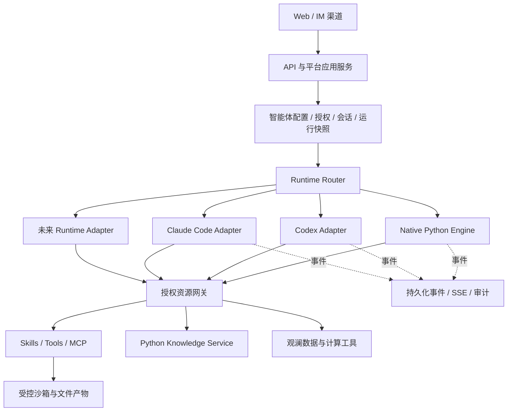

# Hyoga Nexus 总体架构

状态：P0 已完成；P1 平台 API、PostgreSQL schema/迁移、Outbox worker 和单元/API 测试已实现。2026-10-25。PostgreSQL 专用并发/故障集成测试尚未在本环境运行；Runtime、知识库和领域业务仍未实现。

## 产品目标与边界

通用多运行时智能体平台，观澜是第一个股票研究应用。平台使用 Python，Web 使用 Vue 3、TypeScript、Element Plus。初期采用模块化单体：一个 API 服务、一个可独立运行的 worker、一个前端，不按 Python 包数量拆微服务。

智能体有 Native、Codex、Claude Code 及后续类型。创建智能体时选择类型，并绑定多个技能、工具、MCP 工具及知识库；新建会话选择这个已配置的智能体。模型提供商和智能体类型是不同概念：Native 可以使用不同模型 API，Codex/Claude Code 按各自运行时能力配置模型。

WeKnora 提供平台、知识库和权限设计参考；GenericAgent 提供轻量 Python 执行循环、工作记忆和 SOP 参考。知识库由本项目用 Python 实现，不把 WeKnora Go 服务作为必需依赖。不会直接复制两个项目的整个运行环境。

## 分层与执行路径

## 模块职责

| Python 包 | 职责 | 边界 |
|---|---|---|
| core | 标识、协议、执行事件、工具与运行时契约 | 不依赖其他业务包或厂商 SDK |
| platform | 身份、空间、智能体配置、资源绑定、会话、运行、任务、凭据引用、审计 | 编排公共服务，不导入 guanlan |
| runtimes | Native 引擎与外部 SDK/Harness 适配器 | 原生 SDK 类型不外泄，公共工具实现不放在循环中 |
| skills | 技能发现、指令加载、版本与资源依赖解析 | Skill 描述工作流程，不能授予额外权限 |
| tools | 工具定义、注册、授权执行网关和通用内置工具 | 股票工具实现属于 guanlan |
| mcp | 外部 MCP 客户端、连接与工具暴露；平台 MCP 服务接口预留 | 按工具授权，不默认开放整个服务 |
| knowledge | 文档、解析、分块、索引、检索、阅读、引用 | 全 Python；与记忆、股票数值数据库分开 |
| sandbox | 执行环境、工作区隔离、配额和产物收集 | local 仅用于显式开发模式，不能当作多用户隔离 |
| connectors | Web、企业微信、微信、QQ 的消息标准化和投递 | 不复制 Agent 循环和业务规则 |
| guanlan | 股票数据、公告、热点、龙虎榜、研究与回测 | 使用公共协议向平台注册工具和技能 |

apps 是组合入口：API 负责装配 HTTP，worker 装配任务和调度，web 提供交互。入口显式注册领域扩展，让公共包不依赖股票包。跨包使用 core 契约与依赖注入；真实内部依赖在实现对应功能时加入包清单，避免空目录阶段形成循环依赖。

## 自研引擎

Native 使用模型 API，执行“上下文准备 → 模型响应 → 工具请求 → 授权与执行 → 结果反馈”循环。最小版支持流式文本、工具执行、停止、轮次/耗时预算与持久化；后续加入上下文压缩、检查点、暂停恢复和长期记忆。

GenericAgent 的生成器与 StepOutcome 可借鉴；对外必须转成结构化事件。不能靠解析前端 Markdown 推断工具状态，也不能把共享文件记忆、宿主机子进程和全局 cwd 直接作为服务端执行方案。

外部 Runtime 内部仍由其 SDK/Harness 驱动工具循环，平台不再套第二个 Native 循环。各 Runtime 通过适配器连接平台资源；无法受控连接的能力明确不支持。

## 平台资源与授权

智能体绑定多个版本化技能、工具、MCP 工具及知识库。有效资源由智能体配置、调用者/空间权限、会话限定和运行时能力共同决定；会话只能缩小已授权范围。实际执行、检索和读取都重新校验权限，权限撤销在下一次调用生效。

每次运行保存配置、技能版本和资源引用快照，记录来源与时间；凭据只保存引用，不进入提示词或事件。SDK 会话按用户/空间隔离。SDK 内置 shell、文件和网络能力也必须纳入能力与隔离策略，不能绕过网关；做不到时禁止对应配置。

## 知识库与记忆

知识库流程：上传/同步 → 去重与版本 → 异步解析 → 分块 → 向量/关键词索引 → 混合召回 → 可选重排 → 引用。统一提供 search_knowledge、read_document、list_documents 等平台工具，各 Runtime 共享。

多个知识库绑定不等于把全文塞进提示词；查询在授权库范围内检索。先过滤授权再检索，输出保留文档版本、片段定位与引用；删除、撤权和重建索引需同步可见性。

知识库保存资料和证据；平台记忆保存用户偏好、工作事实与可复用经验，按空间/用户/智能体划分。模型生成经验先作为草稿，经过评估后版本发布，不默认自动改写生产技能。

## 会话与事件

新建会话选择智能体，固定智能体版本/运行时；运行保存配置快照并在执行时应用最新权限。切换运行时创建新会话或显式分支，可以传递摘要与授权材料，不宣称可无损迁移 SDK 内部状态。

数据库记录平台会话、运行、消息、事件、引用和产物，并关联外部 runtime_session_id。事件由后端持久化后通过 SSE 发送，带 event_id、run_id、sequence、时间和类型；重连支持从游标继续读取，不等于重复执行任务。

## 数据与部署基线

平台主关系库确定为 PostgreSQL；知识检索的 pgvector 与对象存储按 P3 设计落地。P1 使用 PostgreSQL Outbox 表和 lease polling 作为持久任务队列，决策见 [ADR-0002](adr/0002-p1-run-queue.md)；PostgreSQL 并发/故障恢复验收尚待目标环境执行。未来只有在积压、数据库竞争或路由需求达到复评条件时才引入独立队列。

知识库文档与股票数值数据各自建模。价格、复权、交易日历、财务与龙虎榜通过结构化服务查询；公告与研究文本可以进入知识库。采集任务由 worker 调度，不依赖 Agent 每天“记得执行”。

## 验证分类

软件回归在 tests；智能体、检索和技能评估在 evals；策略历史回测在 guanlan/backtesting。三者分别记录输入版本、结果和失败原因。股票分析必须保留数据时点与来源，策略回测处理复权、交易成本、停牌、退市及未来信息泄漏。

## 当前实际能力

已实现 `/api/v1/health`、PostgreSQL 连通 `/api/v1/ready`、规划能力目录，以及 P1 Workspace/Membership、模型配置版本、Agent 草稿与发布、固定版本 Session、幂等 Run、持久事件/游标、审计和 PostgreSQL Outbox worker。运行 API 需要配置 PostgreSQL 并执行 Alembic 迁移；平台 API 默认没有生产身份提供方，需明确启用本机开发身份或注入外部认证适配器。

worker 会消费 Run 并标记 `runtime_not_configured`，不会调用模型。未实现真实 Runtime、凭据解析器、技能/MCP 执行、知识库、工具执行、文档处理、股票数据和分析。
