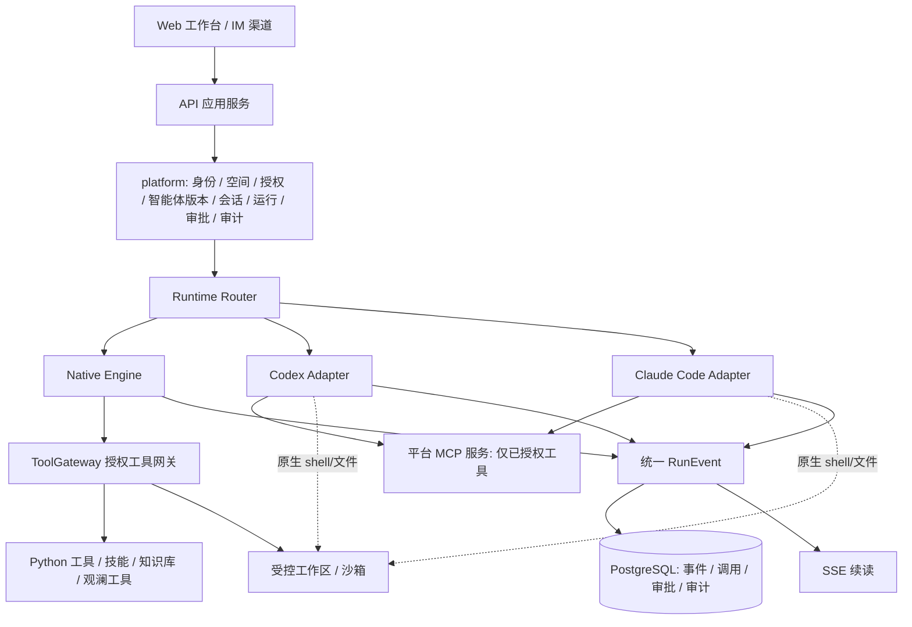

# Hyoga Nexus 总体架构

状态：2026-10-31 重写。本文件是唯一的架构与模块设计文档，合并了原 ADR、目录设计、资源模型、Runtime 契约、参考项目分析、界面约定和智能体框架重构方案。
实施顺序与验收见 [roadmap.md](roadmap.md)。

已实现范围（代码事实）：P0 工程骨架；P1 平台底座（身份/空间、模型配置版本、Agent 版本、Session、幂等 Run、事件与 PostgreSQL Outbox 队列）；P2 Native 基础闭环（流式模型、授权 Python 工具、取消、等待输入、检查点、Memory/SOP 草稿、SSE、对话工作台）；用户模型供应商设置与加密凭据。以上在 SQLite 与模拟模型下验证；PostgreSQL 并发/故障恢复与真实供应商验收尚未执行。尚未实现的能力见第 11 节，不得在界面或文档中宣称已可用。

---

## 1. 产品目标与边界

Hyoga Nexus 是通用多运行时智能体平台，观澜（股票研究）是第一个领域应用。

- **统一智能体**：智能体有类型（Native、Codex、Claude Code 等）。创建时选择类型，并绑定技能、工具、MCP 工具和知识库。新会话选择已发布的智能体版本。
- **三类运行方式**：Native 为自研引擎；Codex 与 Claude Code 通过官方 SDK/协议封装为适配器，与 Native 并列。平台掌握身份、授权、审批、记录、事件和审计，无论运行在哪种 Runtime 上。
- **模块化单体**：一个 API 服务、一个 worker、一个 Web 前端。不按 Python 包拆微服务。
- **不做的事**：不把参考项目整体作为子进程或运行环境嵌入；不让外部 Runtime 的原生工具（shell、文件、网络）绕过平台授权；没有通过验收的隔离后端时，不开放任意代码执行；不宣称外部 Runtime 与 Native 功能对等。

---

## 2. 参考源码分析

本节依据对各项目源码的实际抽样阅读（关键文件与行号级证据见每项末尾的"证据"），并非逐文件审计。每个项目列出可借鉴点、缺点与本项目取舍。所有参考仓库位于 `/project/`，固定版本见证据列。

### 2.1 GenericAgent（lsdefine/GenericAgent，commit `a9a36b4`）

定位：单用户、宿主机运行的极简 Python 智能体，约 3.6k 行 Python。

- **循环**（`agent_loop.py`，132 行）：`agent_runner_loop` 以生成器驱动，每回合调用 `client.chat`，解析工具调用后交给 `BaseHandler.dispatch`，按 `do_<tool_name>` 分发。返回 `StepOutcome(data, next_prompt, should_exit)` 表达结果、下一步提示与退出。坏 JSON 通过 `bad_json` 分支恢复。
- **工具**（`ga.py`，594 行，9 个 `do_*`）：`code_run`、`ask_user`、`web_scan`、`web_execute_js`、`file_patch`、`file_write`、`file_read`、`update_working_checkpoint`、`start_long_term_update`，另有 `no_tool`。
- **执行**：`code_run` 默认 `subprocess` 在宿主机运行；`inline_eval=True` 时对 Python 使用 `eval/exec` 在当前进程执行，并临时 `os.chdir`。
- **记忆**（`memory/` 目录与 `memory_management_sop.md`）：分四层。L1 `global_mem_insight.txt` 为 ≤30 行的导航索引；L2 `global_mem.txt` 为事实库；L3 `memory/` 为任务记录与 SOP 脚本；L4 `L4_raw_sessions/` 为历史会话归档。规则要求：写入 L1/L2/L3 的信息必须来自成功的工具结果；禁止写入密钥；L1 只能少量 patch。
- **多入口**：`agentmain.py` 的 `GenericAgent` 用任务队列、输出队列、后台线程和 `abort` 组织任务；前端有 Streamlit、终端、FastAPI 和桌面桥。
- **模型层**（`llmcore.py`，约 780 行）：手写多协议解析（Claude SSE、OpenAI SSE/JSON、Responses API）、缓存标记、重试与历史压缩。

优点：循环极短、可读性高；分层记忆的写入约束（来源于成功工具结果、禁止写密钥、索引与事实分离）值得保留；SOP 作为可复用经验的思路清晰。

缺点：`code_run` 与 `inline_eval` 没有文件系统或进程隔离，`os.chdir` 改变全局状态；`locals()` 传给钩子，耦合过紧；记忆是共享的文件目录，不能按用户或会话隔离；工具输出没有统一的大小控制；没有权限模型。

本项目取舍：吸收循环形态（StepOutcome、dispatch、坏调用恢复）、生命周期钩子（改为类型化元数据）、工作检查点、分层记忆的写入约束与 SOP 思路。拒绝宿主机执行、全局 cwd、共享记忆目录与 `locals()` 钩子。

证据：`agent_loop.py:1-60`、`ga.py:303-330`（`do_code_run`）、`memory/memory_management_sop.md:1-60`。

### 2.2 WeKnora（Tencent/WeKnora，commit `e1f9a6166`）

定位：Go 实现的企业知识库问答与智能体服务，多租户。

- **引擎**（`internal/agent/engine.go`，1507 行）：`Execute` → `executeLoop` → `runReActIteration` → `runRoundTools`。循环内有 `loopGuards`（空响应重试、重复内容检测、迭代预算、steer 注入上限）。结束时保证一次 `EventAgentComplete` 发出。
- **完成与截断**：`CompletionJudge` 类逻辑分布在 `finalize.go`、`length_truncation_test.go`、`orphan_think_test.go` 等处，覆盖截断、空响应和孤立思考块。
- **压缩与校准**（`compaction/`、`calibration.go`）：`compactor`、`cutpoint`、`overflow`、`fileops`；token 用量校准。
- **挂起与恢复**（`hitl/`、`suspend.go`、`resume.go`）：`broker`、`store`、`reaper` 持久化等待人工输入的状态；恢复时校验会话与授权。
- **审批**（`approval/`）：`gate.go` 对高风险 MCP 工具做策略判断；`grants.go`、`session_grant_test.go` 区分会话级授权；`mcp_risk.go` 评估 MCP 工具风险。
- **工具**（`tools/`，文件数量很多）：知识检索、数据分析（DuckDB）、数据库查询、MCP 调用与目录、FAQ、文件变更队列等。
- **会话**：无状态执行容器，状态存 Redis 与 PostgreSQL；`steer.go` 支持运行中插入用户输入。

优点：平台侧的多租户、资源授权与会话 busy 控制成熟；挂起/恢复和审批门禁的语义清楚；测试覆盖面广（大量 `_test.go` 针对边界条件）。

缺点：Go 单体式引擎文件很大，循环逻辑与事件发送耦合；知识库与智能体绑定较深，不易单独复用；图谱依赖 Neo4j；没有跨会话的记忆演进机制。

本项目取舍：平台组织（Workspace、ResourceGrant 与 AgentGrant 分离、busy gate）、完成判断、压缩/校准、挂起恢复与审批语义参考其源码，用 Python 等价翻译并拆分组件。知识库由本项目用 Python 实现，不依赖 WeKnora 服务，图谱为可选增强。

证据：`internal/agent/engine.go:369-660`（`Execute`/`executeLoop` 与守卫）、`internal/agent/approval/gate.go:1-12`、`internal/agent/compaction/`、`internal/agent/hitl/`。

### 2.3 Hermes Agent（NousResearch/hermes-agent，commit `eb1b4c5b61`）

定位：多渠道个人全能助手，支持本地、容器和远程执行后端，已集成 Codex app-server。

- **主循环**（`agent/conversation_loop.py`，约 1800 行）：`run_conversation` 与 60 余个以 `_` 开头的辅助函数处于同一文件，包括计费失败、压缩、系统提示恢复、回退重启等。
- **Codex 集成**（`agent/transports/codex_app_server.py`）：JSON-RPC over stdio，`initialize` 握手，最低版本 0.125.0；另有 `codex_event_projector.py`、`codex_app_server_session.py`。
- **工具与审批**（`tools/approval.py`）：危险命令检测（`approval_detection`）、人工等待（`approval_human_wait`）、网关等待（`approval_gateway_wait`），按会话保存审批状态。
- **记忆**（`tools/memory_tool.py`）：`MEMORY.md`（代理笔记）与 `USER.md`（用户画像）在会话开始时作为冻结快照进入系统提示；会话中写入落盘但不改变当前前缀，保护提示缓存。
- **技能**（`tools/skills_*.py`、`skills/`）：技能目录扫描、`skill_manager_tool` 增删改、`skills_guard.py` 对外部技能做正则静态扫描并按信任级别决定是否允许安装，`skills_hub_*` 从 GitHub 与 ClawHub 等来源安装。
- **执行后端**（`tools/environments/`）：`local`、`docker`、`ssh`、`modal`、`daytona`、`vercel_sandbox` 等，统一基类 `base.py` 与文件同步 `file_sync.py`。
- **子任务**：`delegate_tool*.py` 系列，含注册表、路由、结果汇总和进度。

优点：多后端执行抽象（同一工具接口切换本地/容器/远程）；冻结记忆快照保护提示缓存的设计务实；技能来源检疫与信任分级值得借鉴；Codex 集成的协议细节已在代码中验证。

缺点：主循环单文件过大，控制流难以测试；插件与工具数量多，依赖面广；记忆是两个 Markdown 文件，不是结构化数据；静态扫描对动态写入目标无能为力（作者在 `skills_guard.py` 文件头已承认此缺口）。

本项目取舍：借鉴执行后端的接缝抽象、冻结提示快照、技能来源检疫与 Codex app-server 协议细节；拒绝单文件循环，主循环拆为可测试组件。

证据：`agent/conversation_loop.py:1785-1800`（入口签名）、`agent/transports/codex_app_server.py:1-30`、`tools/memory_tool.py:1-10`、`tools/skills_guard.py:1-10`、`tools/environments/`。

### 2.4 RAGFlow（infiniflow/ragflow，commit `e5a5060c4`）

定位：深度文档解析与知识库 RAG 引擎，当前主体为 Go，并处于从 Python 迁移的过渡期。

- **Agentic RAG**（`internal/agentic_rag/`）：`agent.go` 的 `Run` 使用 eino ADK 的 `ChatModelAgent` 提供 ReAct 循环、重试/故障切换和 checkpoint；不直接使用 `adk/react.go`。
- **证据登记**（`evidence_registry.go`）：为模型"看到"的每个片段分配稳定的 `[ID:n]` 句柄，按首次出现顺序编号；同一片段重复召回时不再发送正文，并用 SHA-256 识别重复。模型只能引用已登记的句柄。
- **判断与断路**（`decision_judge.go`、`decision_breaker.go`、`decision_filter.go`）：检索是否继续、过滤候选、断路保护。
- **正交检索工具**（`tool_*.go`）：`search_bm25_chunks`、`search_semantic_chunks`、`grep_chunks`、`list_chunks`、`navigate_structure`、`navigate_tree`、`search_metadata`、`graph_explore`、`run_javascript`、`web_search`、`todo_write`、`think`。
- **编译知识**（`compiled_knowledge.go`、`kg_service.go`）：按会话决定哪些编译知识工具可用。
- **引擎层**（`internal/engine/`）：Elasticsearch、Infinity、OceanBase、ClickHouse、NATS 等多种后端。

优点：证据引用机制（句柄登记、去重、只能引用已展示内容）是知识问答领域的最佳实践之一；检索工具细分清楚，每个工具职责单一；断路与判断逻辑可单独测试。

缺点：正在从 Python 迁移到 Go，构建链包含 C/C++/Rust 原生依赖（pdfium 等），维护面大；智能体与知识库耦合，工具集合是 RAG 专用的，不适合通用智能体直接复用。

本项目取舍：采纳证据句柄登记与去重、检索工具正交化、判断/断路思路；知识库完全用 Python 实现，不引入其重型解析依赖。

证据：`internal/agentic_rag/evidence_registry.go:1-30`、`agent.go:326-345`（`Run` 与 eino ADK 注释）、`internal/agentic_rag/tool_*.go`。

### 2.5 DeerFlow（bytedance/deer-flow，commit `a1b89d0`）

定位：基于 LangGraph/LangChain 的超级智能体框架，含子智能体、沙箱与记忆。

- **中间件链**（`backend/packages/harness/deerflow/agents/lead_agent/agent.py`）：主智能体装配约 18 处中间件，包括线程数据、沙箱、澄清、循环检测、记忆、摘要、待办、用量统计、图像查看、标题、子智能体数量限制、工具错误处理、结束原因检测（长度/安全）等，每个都是独立文件。
- **记忆**（`agents/memory/`）：`MemoryManager` 为后端中立的契约；默认 `backends/deermem`，另有 mem0、openviking、honcho 适配器；`tools.py` 提供 `memory_search/get/add/update/delete`；`prescreen` 与 `judging` 在写入前筛选；`memory_middleware.py` 异步去抖排队。
- **技能**（`skills/`）：`catalog`、`parser`、`installer`、`projection`（沙箱只读投射）、`security_scanner` 与 `security_static_scanner`、`permissions`、`review`、`mutations`（技能的增删改经审核）。
- **沙箱**（`sandbox/`）：`lease.py` 租约、`file_operation_lock.py` 文件锁、`identity.py`、`read_file_contract.py`、`middleware.py`；本地文件发布采用原子替换；虚拟路径映射（如 `/mnt/user-data`）隔离宿主路径。
- **子智能体**（`subagents/`）：批处理服务、租约、容量控制、回合预算、验收检查与报告契约。

优点：中间件切面清晰，职责分离良好；沙箱的租约、文件锁、虚拟路径与原子写入细节成熟；技能的扫描、投射与审核组合完整；记忆后端可替换。

缺点：深度依赖 LangChain 中间件 API，框架行为由库决定，调试与升级成本高；约 18 处中间件装配的执行顺序是隐式的，需要靠测试守护；子智能体与批处理体系较重。

本项目取舍：借鉴沙箱租约与虚拟路径、技能投射与审核流程、记忆后端的接口分层；中间件思想转为 Native 引擎的显式组件与有序管线，不引入 LangChain。

证据：`lead_agent/agent.py:34-56`（中间件导入）、`agents/memory/AGENTS.md`、`sandbox/AGENTS.md`。

### 2.6 FastGPT（labring/FastGPT，commit `749809070`）

定位：TypeScript/Next.js 的知识库与可视化工作流平台，产品成熟。

- **工作流引擎**（`packages/service/core/workflow/dispatch/`）：节点调度支持循环（`loop`）、并行（`parallelRun`）、交互节点（`interactive`）、中止（`abandoned`）；图是有向图，允许环。
- **应用与数据集**：应用（App）、知识库（dataset）、插件（plugin）、技能（`core/ai/skill`）分目录管理。
- **沙箱**：`projects/agent-sandbox` 提供独立容器镜像与入口脚本，代码执行通过服务端调用。

优点：可视化工作流成熟，适合业务人员编排；循环与交互节点的语义清晰；产品完整度高。

缺点：技术栈为 Node/TypeScript，与本项目 Python 后端不一致；智能体主要是工作流，不是自由度高的推理循环；沙箱能力与工作流耦合较紧。

本项目取舍：不引入工作流引擎作为 Native 主循环；将其"可交互节点"和"节点输出快照"的思想作为后续工作流能力的参考（当前不在范围内）；资源双轨鉴权（用户侧与应用侧分离）作为权限设计参考。

证据：`packages/service/core/workflow/dispatch/`（目录列表）、`projects/agent-sandbox/`。

### 2.7 TradingAgents（TauricResearch/TradingAgents，commit `e8f5503`）

定位：基于 LangGraph 的多角色股票投研框架。

- **图结构**（`tradingagents/graph/setup.py`）：分析员（市场、基本面、新闻、舆情）→ 多头/空头研究员辩论 → 研究经理 → 交易员 → 激进/中性/保守三方风险讨论 → 组合经理 → 结束；工具节点 `ToolNode` 与 `wrap_up` 收尾。
- **记忆与反思**（`memory/log.py`、`memory/reflection.py`、`memory/settlement.py`）：`TradingMemoryLog` 按决策存储，等待结果落定后做 `update_with_outcome` 回填；`Reflector` 基于结果生成反思；有轮转与标记机制。

优点：投研角色分工和辩论结构清楚；决策记录与事后反思形成闭环，有助于复盘。

缺点：流程为投资领域定制，不是通用智能体循环；辩论依赖提示词，没有规则约束；依赖 LangGraph。

本项目取舍：作为观澜研究流程（第 4.14 节）的候选工作流参考，不作为平台引擎；决策记录与事后回填的思路用于观澜领域记忆。

证据：`tradingagents/graph/setup.py:64-89`、`:145-185`（节点与边）、`tradingagents/memory/log.py:11-35`。

### 2.8 DeepSeek Harness（deepseek-ai，commit `22ddee3792`）

定位：TypeScript 单仓，约 57 个顶层分组目录，目标是通用智能体运行时（事件溯源会话、插件、沙箱、工作流）。

- **循环**（`packages/core/agent-loop/src/agent.ts`）：文件头声明"每个请求都从会话日志派生"，即模型可见上下文是事件流的投影；队列化回合与步骤边界的输入注入。
- **接缝（seam）**：`packages/workflow/workflow/src/types.ts` 等处定义能力接缝；同一能力可替换为本地、容器、SSH 等后端（`sandbox`、`ssh`、`subprocess` 子包）。
- **插件**：`extensions/`、`cordis-client-runner` 等，以 Cordis 框架装配。
- **其他子包**：`spill`（大输出落盘）、`ptc-runtime`（程序化调用工具）、`subagent`、`compaction`、`guard`、`computer-use`、`browser-use`、`session-query`。

优点：事件溯源的会话日志与"模型上下文是派生视图"的原则能解决恢复与审计问题；接缝抽象使执行后端可替换；大输出落盘和守卫（guard）是成熟设计。

缺点：规模大（约 57 个顶层分组目录），本次只读了循环与接缝定义，未能核实全部子系统的成熟度；TypeScript 生态，与本项目 Python 后端不一致；Cordis 等框架依赖较重。

本项目取舍：采纳事件溯源会话日志（上下文从事件派生）、能力接缝三元组（配置化后端）、单调守卫（只能收紧权限）与大输出 Spill；不引入其运行时或框架。

证据：`packages/core/agent-loop/src/agent.ts:1-10`（文件头）、`packages/workflow/workflow/src/types.ts`。

### 2.9 LobeHub（lobehub/lobehub，commit `e1d7bc5655`）

定位：TypeScript 的智能体协作平台，前端与多渠道接入都较完整。

- **智能体运行时**（`packages/agent-runtime/src/`）：`engine`、`loop`、`executors`、`pipeline`、`policies`、`providers`、`groupOrchestration`（群组智能体编排）。
- **上下文引擎**（`packages/context-engine/src/`）：`pipeline.ts` 与 `processors/`，把上下文组装拆成可组合的处理器。
- **内置工具**：约 50 个 `builtin-tool-*` 包，包括记忆、技能、知识库、Claude Code、云沙箱、本地系统、浏览器、画布、任务等。
- **渠道**：`chat-adapter-feishu`、`line`、`qq`、`wechat`、`imessage` 等。

优点：上下文处理器管线、群组编排与渠道适配器的组织方式清楚；内置工具按能力分包，便于裁剪。

缺点：包数量多，前端耦合重；内置工具与产品功能绑定，抽取通用能力需要额外工作；Electron 等桌面端依赖较多。

本项目取舍：上下文处理器的"可组合管线"思想用于 Native 的上下文装配；渠道适配器的边界用于 P8；工具分包的组织方式用于 `packages/tools` 的内置工具划分。

证据：`packages/agent-runtime/src/`（目录）、`packages/context-engine/src/pipeline.ts`、`packages/builtin-tool-*`。

### 2.10 横向对比与结论

| 维度 | GenericAgent | WeKnora | Hermes | RAGFlow | DeerFlow | FastGPT | TradingAgents | DeepSeek Harness | LobeHub |
|---|---|---|---|---|---|---|---|---|---|
| 语言 | Python | Go | Python | Go（迁移中） | Python | TypeScript | Python | TypeScript | TypeScript |
| 引擎形态 | 生成器循环 | ReAct + 守卫 | 单文件循环 | eino ADK ReAct | LangGraph 中间件 | 有环工作流 | LangGraph 图 | 事件溯源循环 | agent-runtime 循环 |
| 隔离/沙箱 | 无 | 受控沙箱 | 多后端 | 无 | 租约 + 虚拟路径 | 容器 | 无 | seam 多后端 | 云沙箱 |
| 记忆 | 四层文件 | 无跨会话 | 冻结 Markdown | 无 | 可替换后端 | 无 | 决策日志+反思 | 事件日志 | 内置工具 |
| 知识库 | 无 | 多租户 RAG | 无 | 深度 RAG | 薄适配器 | 数据集 | 无 | 无 | 内置工具 |
| 权限 | 无 | 细粒度 | 审批 | 作用域 | 授权+审核 | 双轨鉴权 | 无 | 守卫 | 无 |
| Codex 集成 | 无 | 无 | 已有 app-server | 无 | 无 | 无 | 无 | 未核实 | 有 Claude Code 工具包 |

结论：没有一个项目可以直接作为本平台的基础。各项目的可借鉴点如下，本平台按模块分别吸收：

- 引擎循环：GenericAgent（形态）+ WeKnora（完成判断、挂起恢复）+ Hermes（冻结快照、执行后端接缝）。
- 记忆：GenericAgent（分层与写入约束）+ Hermes（冻结快照）+ TradingAgents（决策回填）。
- 知识库：RAGFlow（证据登记、检索工具正交化）+ WeKnora（多租户预过滤、图谱权限）。
- 技能：Hermes（来源检疫）+ DeerFlow（投射与审核）。
- 沙箱：DeerFlow（租约、虚拟路径）+ DeepSeek Harness（接缝）+ Hermes（后端列表）。
- 权限与审批：WeKnora（ResourceGrant/AgentGrant 分离）+ Hermes（危险命令审批）。
- 事件与上下文：DeepSeek Harness（事件溯源）+ LobeHub（上下文处理器管线）。
- Codex/Claude：Hermes（Codex app-server 协议细节）+ 官方 SDK 文档。

---

## 3. 总体架构



### 3.1 依赖规则

| 包 | 职责 | 边界 |
|---|---|---|
| `core` | 标识、端口、DTO、事件、错误码、运行时契约 | 不依赖其他业务包或厂商 SDK |
| `platform` | 身份、空间、智能体版本、资源绑定、会话、运行、队列、凭据引用、审计 | 编排公共服务；不导入 `guanlan` |
| `runtimes` | Native 引擎与外部适配器 | 厂商 SDK 类型不出适配器边界 |
| `tools` | 工具定义、注册、授权网关、通用内置工具 | 领域工具属于领域包 |
| `skills` | 技能发现、解析、版本、依赖 | 技能只描述流程，不授予权限 |
| `mcp` | MCP 客户端、服务端、工具暴露 | 按工具授权，不默认开放整个服务 |
| `knowledge` | 文档、解析、分块、索引、检索、引用 | 全 Python；与记忆、股票数值数据分开 |
| `sandbox` | 执行后端接缝、工作区、配额、产物 | `local` 只用于显式开发模式 |
| `connectors` | Web、企业微信、微信、QQ 的消息标准化与投递 | 不复制智能体循环 |
| `guanlan` | 股票数据、研究、回测、领域工具 | 通过公共协议注册工具和技能 |

`apps/` 是组合根：`api` 装配 HTTP，`worker` 装配后台任务与 Runtime，`web` 提供交互。领域扩展由入口显式注册。

### 3.2 目录结构

```text
hyoga-nexus/
├── apps/
│   ├── api/src/nexus_api/          # FastAPI 入口、http、schemas、dependencies
│   ├── worker/src/nexus_worker/    # 后台入口、jobs、Native 装配
│   └── web/src/                    # Vue 3 + Element Plus 工作台
├── packages/
│   ├── core/src/nexus_core/        # 公共协议、runtime、native、events、tools
│   ├── platform/src/nexus_platform/
│   │   ├── identity/ workspaces/ agents/ sessions/ runs/ resources/
│   │   └── models/ memory/ jobs/ persistence/ observability/
│   ├── runtimes/src/nexus_runtimes/
│   │   ├── native/                 # engine、context、hooks、models、prompts
│   │   ├── adapters/               # codex、claude_code（计划）
│   │   └── capabilities/
│   ├── tools/src/nexus_tools/      # registry、gateway、builtins
│   ├── skills/src/nexus_skills/    # loader、registry、versions、bindings
│   ├── mcp/src/nexus_mcp/          # client、server、gateway
│   ├── knowledge/src/nexus_knowledge/
│   ├── sandbox/src/nexus_sandbox/  # contracts、local、docker（计划）、artifacts
│   ├── connectors/src/nexus_connectors/
│   └── guanlan/src/guanlan/        # 领域数据、分析、回测、工具
├── skills/                         # 技能指令与资源内容（不是实现代码）
├── configs/                        # 非敏感示例；nexus.toml 为本地忽略文件
├── migrations/                     # platform、knowledge、guanlan 的 Alembic
├── tests/                          # 软件测试
├── evals/                          # 智能体、检索、技能、观澜评估样例
└── docs/                           # architecture.md 与 roadmap.md
```

拆分理由：core 是稳定协议；platform 是应用服务；runtimes 是执行器，三者不混入同一个 Agent 类。技能机制（packages/skills）与技能内容（顶层 skills/）职责不同。packages 是可安装包，内部目录是模块，不等于独立服务。

### 3.3 当前实现与目标的差异

- 已存在目录但仅为占位：`adapters/codex`、`adapters/claude_code`、`sandbox/docker`、`knowledge` 的解析与索引、`mcp` 的客户端与服务端、`guanlan` 的数据与分析。
- `packages/runtimes/adapters/deepseek` 为历史占位，本方案不计划接入，待清理。

---

## 4. 模块设计

### 4.1 智能体、Runtime 与契约

**智能体（Agent）与版本（AgentVersion）**：Agent 有名称、类型、说明、系统指令、模型引用、预算与资源绑定。AgentVersion 不可变，发布后固定。Session 创建时固定版本；Run 保存配置快照。

**Runtime 类型**：`native`、`codex`、`claude_code`。类型由智能体版本决定，切换类型等于发布新版本。

**统一契约（`nexus_core.runtime`）**：

```python
class AgentRuntime(Protocol):
    def describe_capabilities(self) -> RuntimeCapabilities: ...
    async def start(self, request: RunRequest, ctx: RunContext) -> RuntimeHandle: ...
    def stream(self, handle: RuntimeHandle) -> AsyncIterator[RunEvent]: ...
    async def respond(self, handle: RuntimeHandle, decision: ApprovalDecision | UserInput) -> None: ...
    async def cancel(self, handle: RuntimeHandle, reason: str) -> None: ...
    async def resume(self, snapshot: RunSnapshot, ctx: RunContext) -> RuntimeHandle: ...
```

- `RunRequest`：run_id、session_id、agent_version_id、用户消息、附件引用、模型配置引用、已解析的资源清单（只读快照）、预算、工作区句柄、凭据句柄（不含明文）。
- `RunContext`：主体、空间，以及**每次工具调用时重新查询授权**的校验函数。不依赖快照判断授权。
- `RuntimeCapabilities`：每项取值 `supported | unsupported | unverified`，项目包括 `text_stream`、`tool_bridge`、`mcp`、`skills`、`approvals`、`cancel`、`conversation_resume`、`execution_resume`、`steer`、`native_shell`、`native_file_write`、`network_control`。能力按安装版本和当前配置验证。

**统一事件（RunEvent）**：`run.started`、`message.delta`、`message.completed`、`reasoning.summary`（可选，默认不展示原文）、`tool.started`、`tool.completed`、`approval.requested`、`approval.resolved`、`input.requested`、`artifact.created`、`usage.updated`、`run.completed`、`run.failed`、`run.cancelled`、`run.interrupted`。

规则：
- 事件先持久化后推送；同一 Run 内 `sequence` 单调递增；`event_id` 全局唯一。
- 只有明确的 `completed` 才是成功。进程退出、连接断开、流结束但没有终态，都归为 `interrupted` 或 `failed`。
- 有副作用的工具若结果未知，状态为 `interrupted`，不自动重放。

**状态映射（已核对的 Codex 值）**：

| 统一状态 | Codex app-server | Claude Agent SDK（待核对） | Native |
|---|---|---|---|
| completed | `turn/completed`，`status=completed` | 结果消息且无错误 | `StepOutcome` 完成 |
| interrupted | `turn/completed`，`status=interrupted` | 取消确认 | 取消已生效 |
| failed | `turn/completed`，`status=failed` | 错误结果 | 异常或预算耗尽 |
| 工具 declined | commandExecution/fileChange 最终 `declined` | 权限拒绝 | 网关拒绝 |

### 4.2 Native 引擎

**组件拆分**（参考 GenericAgent 循环形态，按职责拆分以避免 WeKnora/Hermes 式的超大函数）：

```text
RunOrchestrator     生命周期、取消、预算、事件持久化、租约检查
 └─ TurnExecutor    单回合：组装上下文 → 调模型 → 解析结果
     ├─ ContextAssembler   冻结系统前缀 + 历史视图 + 工作检查点 + 证据句柄
     ├─ ModelPort          流式、厂商无关，SDK 类型只在适配器中
     ├─ CompletionJudge    no_tool / 截断 / 空响应 / 重复内容判断
     └─ ToolDispatcher     schema 校验 → 授权网关 → 执行 → 结果投影与 Spill
```

**回合结果**：`ToolResult(data, next_prompt, disposition)`，disposition ∈ {`continue`、`complete`、`wait_input`、`exit_failed`}。`exit_failed` 必须带失败原因，不能用空提示推断成功。

**完成判断**（参考 WeKnora）：
- 无工具调用且内容非空：完成。
- 模型因长度截断：记录截断并按预算决定是否续写，续写内容去除重叠。
- 空响应：有限次重试（计入预算），仍为空则以明确原因失败。
- 同一内容重复出现：判为停滞，终止并报告。
- 工具调用未闭合或格式不完整：不执行，交给坏调用恢复。

**预算**：逻辑回合、模型尝试、活跃耗时（不含等待用户的时间）、token 四个维度分别计数，持久累计。恢复后继续累计，不因重启重新计数。

**上下文与缓存**：
- 系统提示与工具 schema 在 Run 开始时计算一次，Run 内不变（前缀冻结，参考 Hermes），保护供应商提示缓存。工具变化只在下一个 Run 生效。
- 历史是事件流；模型可见消息由事件派生（参考 DeepSeek Harness）。压缩结果作为新事件写入，源事件保留。
- 压缩策略：优先完整保留最近的消息与工具交换；较早内容压缩为标注过的局部原文摘录（参考 WeKnora compaction）；仍装不下则显式失败 `model_context_exceeded`。
- token 估算：供应商报告 usage 时优先使用；否则按 UTF-8 字节保守估算，调用前预留输入预算并限制输出。
- 证据句柄：知识片段进入上下文时登记为 `[ID:n]`，同一 Run 内重复片段只发句柄（参考 RAGFlow）。模型只能引用已登记句柄，无效引用判为失败。

**工具调用顺序**：同一回合内的工具按模型声明顺序依次执行，每个调用独立记录 invocation。读写屏障：有副作用的工具之间不并发。

**取消与等待**：
- 取消信号在模型流、工具和 Sandbox 调用的每个等待点检查。取消后关闭模型流，有副作用的未知结果标记 `interrupted`。
- `ask_user` 类工具产生 `wait_input`：持久化问题与检查点，释放 worker；回答后继续同一 Run，幂等提交。等待期间不占用 worker 与执行预算。

**恢复**：恢复前校验快照版本、会话/空间/主体、Agent/模型版本、资源授权、审批消费状态与已完成的 invocation，再从挂起点继续。不依赖进程内锁、回调、SDK 句柄或临时资源句柄。

**钩子**：agent/turn/model/tool 的 before/after 类型化钩子，只接收稳定元数据 DTO（不暴露 locals、SDK 对象或凭据）。钩子异常隔离，超时后忽略，Run 结束时注销。

**Run 状态**：queued、running、waiting_input、waiting_approval、completed、failed、cancelled、interrupted。同一 Session 仅允许一个活跃 Run（含等待态），由服务检查与数据库部分唯一索引共同保证。

### 4.3 Codex 适配器

依据：Codex SDK 与 App Server 官方文档（已核对，版本需在实施时锁定并重新核对）。

**集成方式（已确认：方案 A）**：`openai-codex` SDK 负责进程与基础调用（`Codex` / `AsyncCodex`，`thread_start`、`thread.run`、`Sandbox.read_only|workspace_write|full_access`）；流式事件与审批经 app-server 协议获取。

**验证门禁（R3 开始前必须完成）**：确认 SDK 是否暴露底层 JSON-RPC 通道，使事件、审批与 SDK 调用共用同一连接。
- 若可以：事件路径只经该通道。
- 若不可以：回退为直连 app-server 协议，SDK 仅用于 CLI 版本锁定（`CodexConfig(codex_bin=...)`）。回退须记录并告知用户，不静默切换。

**版本**：SDK 与 CLI 版本一并锁定，Hermes 的实践门槛为 0.125.0 或以上。启动时读取版本与 `initialize` 能力，不匹配则能力标记为 unsupported。

**会话映射**：平台 `session_id` ↔ Codex `thread_id`，记录在 `runtime_session_bindings`。`thread/resume` 恢复对话，`thread/fork` 分支，`thread/compact/start` 仅在平台压缩不可用时使用。

**事件映射**：
- `item/agentMessage/delta` → `message.delta`
- `item/started` / `item/completed`（commandExecution、fileChange、dynamic tool call）→ `tool.started` / `tool.completed`
- `item/commandExecution/requestApproval`、`item/fileChange/requestApproval` → `approval.requested`；平台决定后回复 `accept` / `acceptForSession` / `decline` / `cancel`。`acceptForSession` 必须先经平台 `action_grants` 批准。
- `serverRequest/resolved` → `approval.resolved`
- `thread/tokenUsage/updated` → `usage.updated`
- `turn/completed` → 按状态映射表确定终态
- `mcpServer/elicitation/request`、`tool/requestUserInput` → `input.requested`，经平台转给用户

**取消**：`turn/interrupt`；收到 `interrupted` 终态后才结束 Run。`turn/steer` 为可选能力，默认 unsupported。

**原生能力约束**：
- 文件与 shell 由 Codex 执行，通过 `Sandbox` 参数限制为 `workspace_write`，工作目录为平台分配的隔离工作区。禁止多用户场景使用 `full_access`。
- 网络限制通过 app-server 配置（`configOverrides`）与审批策略实现。无法验证时能力标记 unverified，禁止绑定需要网络控制的技能。
- 平台工具经平台 MCP 服务暴露给 Codex，每次调用携带短时运行令牌，平台复核权限，不信任模型传入的 workspace 或 user 标识。

**传输与错误**：只使用 stdio。WebSocket 为实验性且非生产可用，启用前必须配置 `capability-token` 或 `signed-bearer-token`。`-32001` 过载错误使用指数退避与抖动，并计入预算。

### 4.4 Claude Code 适配器

依据：搜索摘要（未直接核对官方文档），**实施前必须读官方文档并锁定版本**。

- **集成方式**：`claude-agent-sdk`（Python）的 `ClaudeSDKClient`，支持自定义工具与 Python 回调钩子。
- **权限**：`can_use_tool` 回调作为审批入口，映射到 `approval.requested`。`allowed_tools` 只做自动批准，不隐藏工具，因此禁用原生工具必须用 `disallowed_tools`。
- **会话**：首次回复获取 session id 并记录；后续用 `resume`；`fork_session` 用于分支。
- **系统提示**：SDK 在首次请求记录系统提示并复用，平台提示变化只在新会话生效，与前缀冻结规则一致。
- **原生工具**：Bash、Edit、Read 等必须通过 `disallowed_tools` 或 `can_use_tool` 限制；无法限制的工具不允许绑定到该 Runtime。
- **依赖**：本机需安装 Claude Code CLI，版本与 SDK 配套；账号与模型权限单独验证。

**切换规则（两种 Runtime 共同适用）**：会话切换 Runtime 时创建新会话，或显式分支。平台将摘要、已授权的消息与引用传给新 Runtime，不承诺迁移 SDK 内部状态。能力不足时界面显示差异；发布智能体时拦截不满足其绑定资源的组合。

### 4.5 工具

**定义（ToolDefinition）**：名称、版本、JSON Schema（参数与结果投影）、风险等级、所需资源、副作用标记（有/无）、幂等性标记、超时、所需 capability。

**注册**：按名称与版本登记。处理器必须是可协作取消的异步函数；阻塞或资源密集的函数需要独立执行器或隔离后端，不能当作普通快速函数注册。

**授权网关（ToolGateway，单调守卫）**：每次调用依次经过 schema 校验、当前授权查询（查数据库，不读快照）、风险分级、审批（如需）、执行、结果投影、审计。守卫只能收紧权限，工具参数不能放宽授权。模型不能通过参数选择主体、空间或 Run。

**结果投影与 Spill**：工具作者提供公开结果投影，投影结果（默认最多 4000 字符）进入模型、消息和事件；超过阈值的原始输出写入 run 级工件存储（Spill），上下文中只保留摘要与引用句柄。截断必须显式标注，不伪装成完整结果。

**内置工具（按确定性优先）**：
- 平台：知识检索（`search_knowledge`、`read_document`、`list_documents`）、记忆读取、检查点更新、待办、询问用户。
- 领域：观澜数据与计算工具，由领域包注册。
- 受控执行：代码执行、文件读写、Web 访问，仅在对应沙箱后端通过验收后开放（见 4.9）。

**外部工具（MCP）**：见 4.7。

### 4.6 技能（Skill）

**定义**：技能是版本化的 `SKILL.md` 加资源文件，描述工作流程、何时调用哪些工具、输出格式。技能**不授予任何权限**，也不改变工具的授权检查。

**存储与版本**：SkillVersion 不可变，保存正文、资源、依赖（需要的工具、MCP 工具、知识库）与内容哈希。草稿可修改，发布后生成新版本。

**渐进披露**：默认只向模型提供技能名称与简介，模型按需请求正文（参考 Claude 规范三级披露）。资源文件按请求读取。

**依赖校验**：发布智能体版本时检查技能依赖是否已由智能体绑定满足；缺失则拒绝发布并说明缺少哪一项。

**来源检疫（参考 Hermes skills_guard 与 DeerFlow security_scanner）**：
- 内置技能可信，不扫描；外部来源按信任级别决定：可信来源允许带提示安装，社区来源有任何发现即阻止，除非管理员明确放行。
- 静态扫描覆盖：可疑的网络请求、凭据读取、文件写入目标、混淆代码。静态扫描无法完全覆盖动态目标，因此扫描只是门禁之一，运行时授权仍然有效。

**自主修改（参考 Hermes skill_manage 与 DeerFlow mutations）**：模型可以提交技能草稿，但发布需要审核（人工或规则），与记忆草稿遵循相同的审核流程。模型不得直接修改已发布版本。

**Skill 与 Runtime**：Native 由平台加载指令与资源；Codex/Claude 将技能转换为指令，或在 SDK 支持时加载技能目录。转换方式在能力表中显式标明。

### 4.7 MCP

- **客户端**：连接外部 MCP 服务，发现工具，按工具启用（不默认开放整个服务）。凭据以引用保存。
- **服务端**：平台对外暴露已授权工具，供 Codex、Claude 等 Runtime 调用。
- **运行令牌**：MCP 调用携带短时令牌，与 Run 生命周期一致，单 Run 有效，撤销即失效。服务端每次调用复核权限，不信任模型传入的身份标识。
- **高风险工具**：参考 WeKnora 的 `approval/mcp_risk.go`，按风险等级要求审批；审批结果记录为 `action_approvals`。

### 4.8 记忆

记忆分为五类，各有不同的生命周期与写入规则。

| 层 | 内容 | 生命周期 | 写入规则 | 参考 |
|---|---|---|---|---|
| 工作检查点 | 当前任务的目标、已完成步骤、待办、关键变量 | Session 内，任务结束后归档 | 只能由工具调用的成功结果更新 | GenericAgent working checkpoint |
| 会话历史 | 消息与工具交换 | Session 生命周期 | 追加；压缩结果以事件形式写入 | DeepSeek Harness 事件流 |
| 用户偏好与事实 | 用户画像、长期偏好（如 `USER.md`） | 跨会话，按用户隔离 | 模型提交草稿，审核后发布；会话开始时冻结快照进入提示 | Hermes memory_tool |
| 可复用经验（SOP） | 验证过的操作流程与脚本 | 版本化，按智能体或空间共享 | 草稿 → 审核 → 发布，不直接修改生产版本 | GenericAgent SOP、TradingAgents 决策回填 |
| 原始会话归档 | 历史会话全文 | 长期保存，按需检索 | 只追加，不参与提示 | GenericAgent L4 |

**统一规则**：
- 所有写入必须携带来源（Run、事件、工具结果）、作用域（用户/空间/智能体/Session）与版本；不能写入密钥与凭据。
- 写入前经过筛选（参考 DeerFlow prescreen）：只保留与任务相关、有依据的内容。
- 草稿在审核前不进入任何系统提示。正式记忆的检索与注入只使用已发布版本。
- 记忆层级之间可以迁移（如从会话归档提炼为经验草稿），但不能丢失来源信息。
- 记忆不是知识库：记忆保存偏好与经验，知识库保存可引用的资料（见 4.10）。

**索引**（参考 GenericAgent L1）：维护一个短小的导航索引（≤30 行），指向事实与经验条目，供模型定位，不直接存放事实正文。

### 4.9 沙箱与执行环境

**接缝（参考 DeepSeek Harness 与 Hermes）**：`CommandExecutorPort`（命令执行）与 `FileStorePort`（文件读写与产物）。实现包括：
- `local`：仅开发模式，不能用于多用户。
- `docker`：候选，计划在 R7 评估。
- `ssh`：候选，同上。

**租约（参考 DeerFlow lease.py 与 FastGPT 租约沙箱）**：执行方持有沙箱租约，租约到期或任务结束后回收；超时与取消会释放租约。

**虚拟路径（参考 DeerFlow）**：模型看到的是虚拟路径（如 `/workspace`、`/outputs`），宿主路径由后端映射，不泄露宿主结构。

**文件写入（参考 DeerFlow sandbox 文档）**：写入使用临时文件加原子替换；父目录写权限与元数据保留要求明确；不对并发写入做仲裁。

**产物**：生成的文件记录为 Artifact，关联 Run 与来源；下载走授权检查。

**门禁**：只有通过隔离验收的后端才能注册任意代码、shell、文件写入工具。验收项：资源限制（CPU、内存、时间、输出大小）、网络隔离、用户隔离、清理、崩溃后的残留检查。未通过时这些工具在工具列表中不出现，而不是返回错误。

**当前状态**：沙箱接缝契约已保留，能力接口明确 unavailable；没有任何可执行后端。

### 4.10 知识库

**职责**：保存可引用的资料（规范、公告、研报、用户文档），与记忆和结构化数据分开。

**存储**：PostgreSQL 保存知识库、文档、不可变文档版本、索引任务、文本块定位与引用关系；原始文件走可替换的对象存储接口；向量索引由独立向量服务承载（具体产品在 R5 验证后确定）。

**生命周期（P3.1）**：
1. 定义知识库、文档、文档版本、解析与索引任务、文本块、来源定位和引用契约。
2. 创建、更新、删除、上传、去重与版本流程。原文件保留在对象存储，数据库保存元数据与状态。
3. 解析与分块作为可恢复后台任务，记录阶段、重试次数、失败原因与幂等标识。首期支持文本、Markdown、PDF，扫描 PDF 的 OCR 范围另行确认。
4. 每个文本块关联文件、文档版本、页码或章节。重建索引使用新索引版本，不混用新旧块。

**检索（P3.2）**：
1. 同一批有版本与来源的文本块同时建立关键词索引与向量索引。
2. **先确定调用者有权访问的知识库与文档范围，再在该范围内检索**（Pre-Filter）。不得先全局召回再在展示层过滤。
3. 合并关键词与向量候选，可选重排。保留召回通道、分数、来源与索引版本，使结果可诊断。
4. 提供 `search_knowledge`、`read_document`、`list_documents`。答案引用回到文档版本与文本块。
5. 无图谱服务时基础检索完整可用。向量服务异常时返回可解释的降级结果，不得绕过权限，不得伪造引用。

**证据登记（参考 RAGFlow）**：检索结果进入上下文时登记为 `[ID:n]`，同一 Run 内去重；模型输出中的引用必须指向已登记句柄。

**图谱增强（P3.3–P3.4，可选，按知识库启用）**：
- 知识库可单独开启图谱，配置实体类型、关系类型、抽取约束、归一规则与模型配置版本。schema 应窄而明确，避免过宽。
- 图元素记录知识库、文档版本、来源块、抽取时间、抽取器与 schema 版本。原文块仍是证据事实源，图节点和边是可追溯的派生数据。
- 实体归一保守：不得仅凭名称相似合并不同公司、证券、人物或事件。无法可靠归一的实体保留为不同实体并保留原始提及名。
- 图谱写入按知识库与索引版本隔离；新版本构建完成后才切换为可见版本，防止半成品被查询。
- 图谱检索只在授权范围内提供给智能体。查询有界（种子实体数、关系数、跳数、证据块数、耗时、模型调用都有上限）；被截断时明确告知，不能把未返回的关系解释为"不存在"。
- 图服务超时或索引缺失时回退到基础检索并记录降级。权限拒绝不得回退为越权搜索。

**管理与验证（P3.5）**：文档页展示解析、索引与图谱状态；检索测试入口分别展示基础检索与图谱增强的来源块、融合结果、截断和降级原因。固定评估集覆盖关键词、语义、跨文档关系、多跳、引用准确性、权限隔离、更新删除、索引重建与图服务故障。

**验收增补**：同一智能体可绑定多个知识库；无权的库与文档不通过向量或图谱路径泄漏；文档更新、删除、撤权与索引重建同步处理向量索引与图谱索引，旧版本不再被召回。

### 4.11 权限、授权与审批

**身份**：`Principal` 由认证适配器提供（`issuer + subject`）。首次访问时映射为本地用户（`UserRecord`）；禁用用户拒绝访问。开发模式使用固定的单一主体，不信任请求头中的用户标识；生产需接入外部身份提供方。

**空间与成员**：Workspace 是资源的所属范围（参考 WeKnora 的 Tenant）。`MembershipRecord` 保存角色；非成员返回 404，角色不足返回 403。

**三类授权严格分离**（参考 WeKnora）：

| 类型 | 含义 | 范围 |
|---|---|---|
| ResourceGrant | 空间之间显式共享资源 | 资源层 |
| ActionGrant | 用户对某类动作的可记忆授权（session 或 automation 作用域，绑定配置哈希、风险等级、过期与撤销） | 动作层 |
| ActionApproval | 单次审批决定 | 单个调用 |

Workspace 角色与资源共享不能替代 ActionGrant 或审批。

**实际执行时复核**：每次工具调用、检索和资源读取都重新查询当前成员、资源状态、绑定与授权（参考 WeKnora 的 `tool_policy.go` 思路）。撤权在下一次调用时生效。

**审批流程**：高风险调用生成 `approval.requested`，进入 `waiting_approval`；决定后经 `approval.resolved` 继续或拒绝。审批决定和依据写入审计。

**危险命令检测（参考 Hermes approval）**：命令模式检测作为审批触发条件，不作为唯一防线；检测结果与授权共同决定。

**审计**：工具调用、授权判断、审批、模型请求与资源访问都写入审计记录，包括主体、空间、Run、结果状态与时间。秘密不进入审计与事件。

### 4.12 会话、事件与持久化

**核心实体**：

以下为代码中已定义的表（取自 `__tablename__`）。

| 表 | 用途 |
|---|---|
| `users`、`workspaces`、`workspace_memberships` | 身份、空间与成员角色 |
| `agents`、`agent_draft_bindings`、`agent_versions`、`agent_resource_bindings` | 智能体、草稿绑定、不可变版本、资源绑定 |
| `platform_resources`、`resource_grants` | 资源登记与空间间显式共享 |
| `sessions`、`messages`、`session_checkpoints` | 会话、消息（assistant/tool 消息带内部 Runtime 元数据）、工作检查点 |
| `runtime_session_bindings` | 平台会话与外部 Runtime 会话 ID 的映射（Codex/Claude 适配器复用） |
| `runs`、`run_events`、`outbox_records` | 运行、事件（sequence 游标）、Outbox 队列 |
| `native_run_states`、`run_directives` | Native 预算累计与运行指令 |
| `run_input_requests`、`action_approvals` | 等待输入的问题与回答；单次审批 |
| `tool_invocations` | 工具调用记录（幂等键、副作用标记、结果状态） |
| `memory_drafts`、`memory_entries`、`memory_versions`、`context_summaries` | 记忆草稿、已发布条目与版本、上下文摘要 |
| `model_profiles`、`model_profile_versions`、`model_providers`、`provider_models`、`model_defaults`、`native_preferences` | 模型配置版本、供应商、默认与偏好 |
| `provider_credentials`、`credential_references` | 加密凭据与凭据引用 |
| `audit_records` | 审计记录 |

计划新增（尚未实现）：`action_grants`（可记忆的动作授权，与 `resource_grants` 分离）；`run_snapshots`（等待审批时的版本化快照）。

**队列（ADR 决策保留）**：PostgreSQL Outbox 表作为持久队列。Run 与 Outbox 记录在同一事务提交；worker 使用 `SELECT ... FOR UPDATE SKIP LOCKED` 领取，写入带过期时间的租约；队列语义为至少一次，由 Run 状态与幂等约束阻止重复执行。租约丢失后，外部执行可能已开始但结果未知的 Run 转为 `interrupted`，不自动重放副作用。

备选方案比较：Redis Streams 的 pending entries 与 `XAUTOCLAIM` 适合横向消费，但 Redis 与数据库不在同一事务，需要持续对账；RabbitMQ 增加服务与运维成本。当前规模不需要。复评条件：队列积压、数据库连接争用、Outbox 维护成本或需要多类型消息路由。

**事件**：持久序号 `sequence` 作为 SSE 的 `id` 与 `Last-Event-ID` 游标；JSON 响应保留独立 `event_id`。先提交事件，再投递。每页最多 500 条。SSE 名称为 `run.event`。等待或终态结束当前连接；浏览器重连不创建新 Run。

**输入回答**：`POST .../runs/{run_id}/input` 携带 `input_request_id`、回答与 `Idempotency-Key`。同一请求重复提交返回相同结果。回答继续同一 Run，预算累计。

**数据库**：PostgreSQL 为事实源，使用 SQLAlchemy 2.x 与 psycopg 3。Alembic 迁移由发布或运维命令显式执行，不在 API 或 worker 启动时自动运行。API 与 worker 使用同步 Session；共享 core 契约不暴露 ORM 类型。不提供 SQLite 应用后端模式，SQLite 仅用于隔离单元测试与迁移方言检查。

**数据库连接配置**：`configs/nexus.toml` 的 `[database].url` 为默认来源，优先级为显式参数 > TOML > `NEXUS_DATABASE_URL`。API、worker 与 Alembic 共用解析逻辑，不自动加载 `.env`。

### 4.13 模型与凭据

**模型配置**：用户在设置页管理供应商与模型。供应商记录归属 Workspace；`owner_user_id` 非空时仅该用户可用，为空时为空间共享。每个供应商有多个 ModelProfile，修改产生不可变版本。

**协议**：`options.protocol` 必须显式设置（如 `openai_chat_completions`），不从 provider 名称猜测协议。首个适配器使用锁定版本的 `openai` SDK 的异步 Chat Completions 流；禁用 SDK 自动重试；工具执行后不重放整个回合。Codex 与 Claude Code 不通过此路径，它们由各自适配器管理。

**凭据**：Key 通过 API 一次性接收，使用 Fernet（cryptography）加密保存在独立凭据表。主密钥通过环境注入 API 与 worker，不写入数据库或仓库。缺少主密钥或密文无效时拒绝解析，不回退为明文。

**环境变量凭据**：`env://` 引用需同时在 `NEXUS_MODEL_CREDENTIAL_ALLOWLIST` 中登记，默认拒绝所有环境变量名。

**网络出口**：HTTPX 调用经过目的地址策略：默认只允许公网 HTTPS，检查 DNS 解析结果并固定 IP，保留域名的 TLS/SNI 校验，禁用重定向，不使用环境代理。API 连接测试与 worker 正式调用共用同一策略。

**默认与固定**：显式模型优先于个人默认，个人默认优先于空间默认。默认只用于新智能体选择，不改已发布版本与已有会话。个人模型在发布、会话创建和执行时都校验归属，不能通过共享智能体扩大权限。

**运维边界**：主密钥丢失则密文无法恢复，需纳入部署秘密管理备份。主密钥轮换需要离线重加密，不提供自动轮换。停用供应商不撤回已发出的请求，之后的回合拒绝执行。

**错误分类**：`model_authentication_failed`、`model_request_rejected`、`model_quota_exhausted`、`model_response_failed`、`timeout`、`rate_limited`、`provider_unavailable`、`context`、`stream`、`model_credential_unavailable`。供应商正文与认证信息不进入错误文本。

**用量**：保留 input、output、cache_read、cache_creation 字段；total 按协议归一；缺失时使用估算。

### 4.14 观澜（股票研究，最后一期 R9）

观澜是领域扩展，代码位于 `packages/guanlan`。公共 Agent、Runtime 与工具协议保持领域无关。

**数据边界**：三类数据分开管理。
- 结构化行情与财务：领域数据，由观澜数据服务提供。
- 研报与公告：知识库证据，可检索、可引用。
- 分析规则：经专家审核、版本化的规则。
三者互不替代。

**数据源**：通过 `guanlan/data` 的适配器接入，Agent 与技能只调用项目工具，不依赖供应商接口。候选数据源（如 AkShare）须逐接口验证覆盖市场、历史范围、更新频率、稳定性、使用条款与商业限制；不把"库中存在接口"当作 SLA 或授权保证。

**时点与来源**：每条数据保留 provider、获取时间、数据对应时间、复权与口径。无法确认的字段或时点明确标记，不推断补齐。备用源结果标注实际来源与降级状态。采集由 worker 定时调度，不依赖智能体记得执行。

**研究流程（候选，步骤是否必选待 R9 设计确认）**：

| 步骤 | 目的 | 能力 | 产物 |
|---|---|---|---|
| 1. 明确任务 | 标的、市场、问题、预测周期、数据截止时点 | 股票分析技能、参数校验 | 任务范围与 as-of 时点 |
| 2. 准备证据 | 获取行情与财务，检索公告与研报 | 观澜数据工具、授权知识库检索 | 带来源、版本与时点的证据集 |
| 3. 分项分析 | 技术、基本面、事件分别整理，区分事实、推断与缺失 | 分析工具、规则、引用 | 分析员报告 |
| 4. 量化参考（可选） | 对明确目标与周期调用已发布模型 | 模型推理工具 | 预测结果、验证摘要、限制 |
| 5. 多空论证（可选） | 多头与空头围绕共同证据互相回应 | 角色、共同证据 | 带引用的辩论记录 |
| 6. 综合结论 | 权衡论据质量、证据强弱、模型适用性与不确定性 | 研究经理角色 | 结构化结论与理由 |
| 7. 风险复核与报告 | 检查风险、情景与结论边界 | 风险检查、报告生成 | 含时点、引用、风险与限制的报告 |
| 8. 评估与回测（适用时） | 评估研究质量或策略表现，防未来泄漏 | `evals/`、`guanlan/backtesting` | 可复现评估记录 |

**参考的模式**：
- TradingAgents：分析员报告 → 多空辩论 → 研究经理综合。辩论依赖提示词，不是规则引擎，也不是投票。本平台只把它作为步骤 5、6 的候选工作流。
- daily_stock_analysis（本地参考仓库，未深入核对）：专业分工后由决策角色综合；分析深度分级（quick/standard/full/specialist）；中间观点结构化（方向、置信度、依据、关键价位、风险标记）；风险清单与程序护栏；输入数据质量可见。
- Qlib（本地参考仓库，未深入核对）：训练与推理分离。模型训练、验证与发布属于离线流程；智能体只调用已发布版本的推理工具，不在对话中训练。信号需同时评估预测质量与策略表现；配置版本化以便重跑。

**模型工具（如 XGBoost）**：作为量化证据来源，结果携带预测目标、周期、数据时点、模型与特征版本、验证摘要和适用限制。技能只描述何时调用，不授予权限。

**规则与研报治理**：研报保留来源、作者、日期、适用市场与行业、版本，检索时结合标的与时间范围，并呈现相互矛盾的观点。反复出现且范围明确的方法可提炼为规则（指标口径、估值步骤、风险检查项、适用与失效条件），经专家审核，并能追溯到原始研报。硬约束由程序校验；需要权衡的部分交给智能体，并要求给出依据与不确定性。

**回测**：历史策略回测不能由智能体文字结论替代，须单独处理复权、交易成本、停复牌、退市与未来信息泄漏，基准、成本与时间段必须记录。

**边界**：本文不表示当前仓库已实现数据采集、XGBoost、辩论流程或回测。进入 R9 前需按仓库规范确认范围。

### 4.15 渠道（connectors）

- 企业微信优先，随后微信、QQ。各渠道只做消息标准化与投递，不复制智能体循环。
- 渠道身份映射到平台用户（`ChannelIdentity`），渠道会话映射到平台会话（`ChannelSessionBinding`）。
- 去重、鉴权、回复长度限制与重试由渠道适配器处理。
- 参考 LobeHub 的 chat-adapter 组织方式。

### 4.16 Web 工作台

**技术**：Vue 3 + TypeScript + Element Plus，Node.js 22.12+。

**界面约定**：浅色、扁平卡片、青绿色主色、系统字体，适配桌面与窄屏。遵循键盘焦点、可读对比度、加载与错误反馈、减少动态效果。规划功能显示"待接入"，不显示虚构的运行数据。

**信息结构**：智能体管理、会话工作台、技能/工具/MCP 资源、知识库、渠道、设置、观澜工作台。类型标签展示能力来源；资源绑定同时显示兼容状态与版本。

**对话工作台（已实现）**：Native 会话选择、已发布智能体与模型、流式消息、工具状态、等待输入回答、停止、游标重连。安全文本渲染，不把模型输出当 HTML 执行。

**API 草案**：`/api/v1/workspaces/{workspace_id}/...` 为当前平台接口。规划中的 `/agents`、`/skills`、`/knowledge-bases`、`/channels`、`/artifacts` 等不是已实现接口。观澜 API 使用 `/api/v1/guanlan/...`。

---

## 5. 关键决策摘要

以下决策取代原 ADR 文件，原文件保留在 Git 历史（提交 `3803f09` 及更早）中。

| 编号 | 决策 | 状态 |
|---|---|---|
| D1 | 平台主库使用 PostgreSQL；SQLAlchemy 2.x + psycopg 3；Alembic 显式迁移，不自动建表 | 已采纳；PostgreSQL 专项待目标环境验收 |
| D2 | 队列使用 PostgreSQL Outbox + `SKIP LOCKED` 租约，至少一次语义 | 已采纳；并发与故障演练待验收 |
| D3 | Native 引擎独占循环；worker 装配模型、工具、持久化与取消 | 已实现 |
| D4 | 首个模型协议为 OpenAI Chat Completions，`protocol` 显式配置；禁用 SDK 自动重试 | 已实现；真实供应商待验收 |
| D5 | 工具必须显式绑定且实际调用时复核授权；模型不能选择主体 | 已实现 |
| D6 | 没有验收隔离后端时不注册任意代码与宿主文件工具 | 已实现 |
| D7 | 用户模型设置：Fernet 加密凭据，主密钥经环境注入；HTTPX 目的地址策略 | 已实现 |
| D8 | Memory/SOP 只产生待审核草稿，不自动注入提示 | 已实现 |
| D9 | Codex 采用 `openai-codex` SDK 管进程，事件与审批经 app-server 协议；R3 前验证 SDK 通道，不通过则回退直连 | 已确认，验证待执行 |
| D10 | Claude Code 采用 `claude-agent-sdk` 封装 | 已确认，官方文档核对待执行 |
| D11 | Native 迁移采用"等价翻译 + 按职责拆分"，不采用单文件保留 | 已确认 |
| D12 | 沙箱后端验收前，Native 不提供任意代码执行 | 已确认 |
| D13 | 观澜股票研究为最后一期（R9），合并原 P6/P7 讨论内容 | 已确认 |
| D14 | 真实账号与数据源在对应实施阶段由用户提供 | 已确认 |

---

## 6. 测试与评估

- **软件回归**：`tests/`，覆盖平台、Native、工具、配置、迁移与前端。
- **契约测试**：同一组用例（文本流、多工具、审批拒绝、取消、超时、崩溃后恢复）在 Native、Codex、Claude 上运行，断言统一终态与事件序列。
- **行为矩阵**：GenericAgent 与 WeKnora 的关键行为逐条映射到测试，记录在 `openspec/changes/p2-native-agent/verification.md`。
- **安全测试**：越权调用、撤权后的下一次调用、运行令牌过期、原生工具禁用、秘密不进入事件与审计。
- **智能体与检索评估**：`evals/`，固定任务、检索引用正确率、技能选择准确率、运行能力契约。
- **策略回测**：观澜 `guanlan/backtesting`，与软件回归分开记录输入版本、结果和失败原因。
- **集成环境**：PostgreSQL 与真实供应商在目标环境执行。未执行的部分在交付说明中列明。

---

## 7. 参考与许可证

- 参考仓库位于 `/project/`，固定版本见第 2 节。
- 已读取并确认许可证的：GenericAgent（MIT）、WeKnora（MIT，含第三方许可说明）。其余项目在迁移任何代码前必须逐一核对许可证。
- 原则：不提交整个第三方仓库；只迁移适用许可证的代码片段，并在模块文件头或包内文档保留来源、版本和许可声明。非 MIT/Apache 项目仅借鉴设计，不复制代码。

---

## 8. 界面与交互之外的运行约束

- 运行提交与输入回答要求 `Idempotency-Key`；同一键重复提交返回原结果。
- 长任务不在 HTTP 请求中执行；提交即返回 Run，状态通过事件与游标读取。
- 启动、迁移与配置错误必须以可读信息失败，不输出凭据。

---

## 9. 当前实际能力

已实现：
- `/api/v1/health`、PostgreSQL 连通检查 `/api/v1/ready`、运行时能力接口 `/api/v1/runtime-capabilities`。
- 身份与空间、成员角色、模型配置版本、Agent 草稿与发布、固定版本 Session、幂等 Run、事件 JSON 与 SSE 续读、Outbox 队列、审计。
- Native 引擎：流式文本、授权 Python 工具、预算、取消、等待输入、检查点、有界历史摘录、Memory/SOP 草稿。
- 用户模型供应商设置、个人与空间范围、加密 Key、默认模型与有界连接测试。
- Web：空间、智能体与会话选择、对话、工具状态、停止与游标重连。
- 配置：`configs/nexus.toml` 数据库配置，API、worker、Alembic 共用。

未实现（不得宣称可用）：
- 真实身份提供方（开发模式之外）、外部凭据保险库。
- Codex 与 Claude Code 适配器。
- 技能、MCP、知识库的执行（当前 Native 遇到这些绑定时明确失败）。
- 隔离沙箱后端、文件产物。
- 观澜数据、分析与回测。
- 渠道接入。
- 运行快照与 ActionGrant（`action_grants`）等计划表。

验证边界：SQLite 与模拟模型验证通过；PostgreSQL 并发、迁移与故障恢复未在目标环境验收；真实供应商未在线验收；浏览器测试使用 API 与 SSE 夹具，不是完整部署环境的端到端验收。
