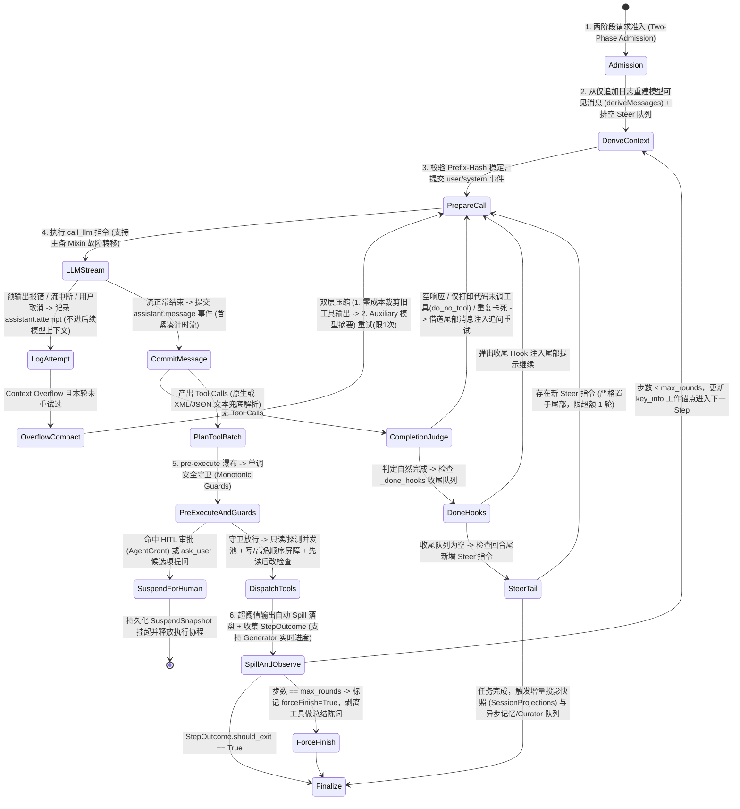
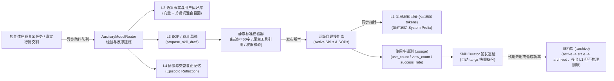
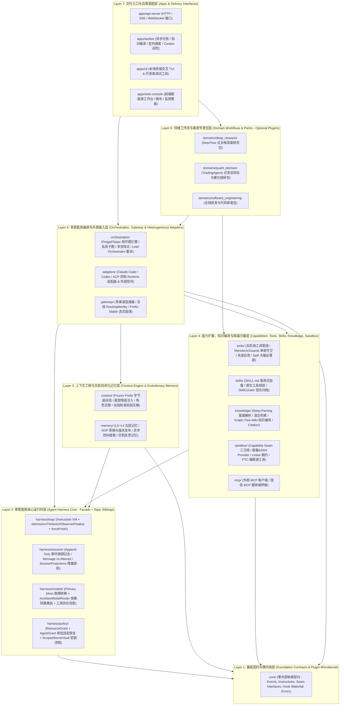

# 九大开源智能体深度源码剖析与全功能智能体架构及代码分层方案

> **文档状态**：深度架构研究与全功能智能体设计方案（2026-10-25）
> **分析对象**：`GenericAgent`、`WeKnora`、`RAGFlow`、`DeerFlow`、`FastGPT`、`LobeHub`、`TradingAgents`（含 `TradingAgents-CN`）、`Hermes Agent`、`DeepSeek Harness`
> **核心目标**：完全从零出发（不预设历史包袱），深度拆解九大代表性开源智能体项目的**实现思想、核心算法机制与代码目录结构**，取长补短，设计一套功能全面、高智能度、低成本（高 KV-Cache 命中）、强安全隔离的**新一代全功能智能体解决方案与代码分层架构**。

---

## 目录

1. [九大开源智能体全景概览与架构流派](#1-九大开源智能体全景概览与架构流派)
2. [九大项目源码级实现思想、核心机制与代码结构剖析](#2-九大项目源码级实现思想核心机制与代码结构剖析)
   - 2.1 [GenericAgent：极简单循环、生成器流与五层文件系统记忆自进化](#21-genericagent极简单循环生成器流与五层文件系统记忆自进化)
   - 2.2 [WeKnora：无状态 ReAct 引擎、在线校准压缩与细粒度权限网关](#22-weknora无状态-react-引擎在线校准压缩与细粒度权限网关)
   - 2.3 [RAGFlow：深度文档解析、知识编译（Knowledge Compilation）与三层 Pregel Harness](#23-ragflow深度文档解析知识编译knowledge-compilation与三层-pregel-harness)
   - 2.4 [DeerFlow（1.x & 2.0）：SuperAgent 主从动态委派、渐进式技能与容器计算机](#24-deerflow1x--20superagent-主从动态委派渐进式技能与容器计算机)
   - 2.5 [FastGPT：基于 Tarjan SCC 的有环图工作流、双轨资源鉴权与租约沙箱](#25-fastgpt基于-tarjan-scc-的有环图工作流双轨资源鉴权与租约沙箱)
   - 2.6 [LobeHub：指令集状态机（Instruction VM）、Context Engine 管线与异构智能体适配](#26-lobehub指令集状态机instruction-vmcontext-engine-管线与异构智能体适配)
   - 2.7 [TradingAgents & TradingAgents-CN：私有上下文子图、多空对抗辩论与交割反思闭环](#27-tradingagents--tradingagents-cn私有上下文子图多空对抗辩论与交割反思闭环)
   - 2.8 [Hermes Agent：Prefix Cache 神圣不变量、`Facade + Siblings` 结构与 `Skill Curator` 馆长自治](#28-hermes-agentprefix-cache-神圣不变量facade--siblings-结构与-skill-curator-馆长自治)
   - 2.9 [DeepSeek Harness（dsh）：Cordis 万物皆插件、Seam 接缝三元组、事件溯源日志与 PTC 运行时](#29-deepseek-harnessdshcordis-万物皆插件seam-接缝三元组事件溯源日志与-ptc-运行时)
3. [九大项目核心维度横向对比与架构取舍矩阵](#3-九大项目核心维度横向对比与架构取舍矩阵)
4. [全功能智能体（Omni-Agent）核心技术实现方案](#4-全功能智能体omni-agent核心技术实现方案)
   - 4.1 [核心方案一：事件溯源与指令解耦的单循环内核（Event-Sourced Instruction Loop）](#41-核心方案一事件溯源与指令解耦的单循环内核event-sourced-instruction-loop)
   - 4.2 [核心方案二：Prefix-Cache 字节级冻结协议与双层校准上下文管线](#42-核心方案二prefix-cache-字节级冻结协议与双层校准上下文管线)
   - 4.3 [核心方案三：主/旁路双轨模型路由（Primary + Auxiliary Router）](#43-核心方案三主旁路双轨模型路由primary--auxiliary-router)
   - 4.4 [核心方案四：五层自进化记忆体系、SOP 版本流与 `Skill Curator` 技能馆长](#44-核心方案四五层自进化记忆体系sop-版本流与-skill-curator-技能馆长)
   - 4.5 [核心方案五：单调守卫工具管线、大输出 Spill、Seam 接缝沙箱与 PTC 编程调工具](#45-核心方案五单调守卫工具管线大输出-spillseam-接缝沙箱与-ptc-编程调工具)
   - 4.6 [核心方案六：深度知识底座（版面感知解析 + 知识编译 Graph/Tree/Wiki + Agentic Search）](#46-核心方案六深度知识底座版面感知解析--知识编译-graphtreewiki--agentic-search)
   - 4.7 [核心方案七：多智能体协同拓扑（Leaf/Orchestrator 委派、进程 Handoff、私有子图与多空对抗辩论）](#47-核心方案七多智能体协同拓扑leaforchestrator-委派进程-handoff私有子图与多空对抗辩论)
5. [最终智能体代码分层架构与详细工程目录规划](#5-最终智能体代码分层架构与详细工程目录规划)
   - 5.1 [七层代码架构设计（Layered Code Architecture）与依赖铁律](#51-七层代码架构设计layered-code-architecture与依赖铁律)
   - 5.2 [代码组织范式：`Facade + Topic Siblings` 与 `Capability Seam Triad`](#52-代码组织范式facade--topic-siblings-与-capability-seam-triad)
   - 5.3 [全量代码目录结构规划（完整目录树与模块级职责说明）](#53-全量代码目录结构规划完整目录树与模块级职责说明)
   - 5.4 [各分层核心接口与关键类代码契约设计](#54-各分层核心接口与关键类代码契约设计)
   - 5.5 [研发演进路线与架构质量门禁（Code Health & Verification Gates）](#55-研发演进路线与架构质量门禁code-health--verification-gates)

---

## 1. 九大开源智能体全景概览与架构流派

通过对九个项目的源码分析，当前开源智能体系统可归纳为**五大技术流派**：

1. **自主演进与长程驻留流派**（`GenericAgent`、`DeerFlow`、`Hermes Agent`）：聚焦长周期多步任务执行、工作检查点锚定、Prefix KV-Cache 极致保护、沙箱环境交互以及记忆/SOP/技能的自主沉淀与馆长式淘汰（`Curator`）。
2. **微内核插件与事件溯源 Harness 流派**（`DeepSeek Harness`）：聚焦“万物皆插件（Everything is a Plugin）”、能力接缝三元组（Definition / Provider / Consumer）、“模型可见 $\iff$ 已记入追加日志”的事件溯源不变量、单调安全守卫（Monotonic Guards）与编程式工具调用（PTC）。
3. **深度知识与企业级 RAG 引擎流派**（`WeKnora`、`RAGFlow`）：聚焦复杂版面文档解析、多形态知识编译（Graph / Tree / Wiki / NavIndex）、抗幻觉原文块引用以及无状态高可靠 ReAct 恢复。
4. **可视化图编排与全栈工作台流派**（`FastGPT`、`LobeHub`）：聚焦有环图工作流调度（Tarjan SCC）、声明式上下文流水线（Context Engine）、指令集虚拟机（Instruction VM）与外部异构智能体适配（Claude Code / Codex / ACP）。
5. **角色子图并发与对抗博弈流派**（`TradingAgents` / `TradingAgents-CN`）：聚焦专业角色私有上下文子图、多空对抗辩论（Bull vs. Bear）、三方风控博弈、程序化断言门禁（Quality Gate）与事后交割反思（Episodic Reflection）。

| 项目名称 | 核心技术栈 | 代码分层与组织特征 | 最具价值的 3 个核心机制 | 架构局限与避坑点 |
| :--- | :--- | :--- | :--- | :--- |
| **GenericAgent** | Python | 扁平极简结构：`agent_loop.py` + `ga.py` + `llmcore.py` + `memory/` | 1. `StepOutcome(data, next_prompt, should_exit)` 极简控制流与生成器流式工具<br>2. `L0~L4` 五层文件系统记忆与 SOP 自进化闭环<br>3. `key_info` 工作锚点 + `no_tool` 伪完成拦截 + `_done_hooks` | 全局共享进程状态、宿主机直接 `subprocess` 与全局 `cwd` 切换、钩子直接暴露 `locals()` |
| **WeKnora** | Go + Vue 3 | DDD 领域分层：`internal/agent/` (engine, act, token, policy, skills, collaboration) | 1. `Think/Act/Observe/Finalize` 四阶段状态机与单次溢出重试<br>2. 在线校准 Token 估算器 + 摘要检查点压缩<br>3. `SteerSink` 运行中纠偏、`AgentGrant` 审批与只读并发/写屏障 | Go 生态与 Python 科学计算/数据分析工具链存在跨语言桥接成本；无原生有环图编排 |
| **RAGFlow** | Go + Python + React | 三层 Harness + 知识编译层：`internal/harness/` (`graphengine` + `agentcore` + `agentloop`) + `ingestion/knowledge_compile/` | 1. `DeepDoc` 视觉解析 + 六态知识编译（Graph/Tree/Wiki/NavIndex/MindMap/Timeline）<br>2. `DecisionHead` / `AgenticSearch` 多步自主探查<br>3. Pregel BSP 图引擎 + 洋葱模型工具中间件 | 底层存储依赖极重（MySQL+Infinity/ES+Kvrocks+NATS+ClickHouse+MinIO），轻量部署困难 |
| **DeerFlow** | Python (LangGraph) + Next.js | 角色图拓扑分层：`Coordinator -> Planner -> Researcher/Coder -> Reporter` 及 2.0 `Lead + Subagents` | 1. 主从动态子智能体委派与独立受限上下文（Scoped Context）<br>2. `SKILL.md` 渐进式按需披露与 `allowed-tools` 工具收敛<br>3. 容器化虚拟计算机沙箱与异步防抖记忆（`DeerMem`） | 强耦合于 LangGraph 内部状态序列化；多租户细粒度授权与 Prefix Cache 优化较弱 |
| **FastGPT** | TypeScript (Next.js) + Mongo/PG | Monorepo 服务分层：`packages/service/core/workflow/dispatch/` + `core/ai/sandbox/application/` | 1. 基于 Tarjan 强连通分量（SCC）的有环图工作流调度器<br>2. `WorkflowResourceContext` 静态版本快照与动态调用人双轨鉴权<br>3. 带租约（Lease）、配额与生命周期的独立沙箱层 | 偏重预定义连线节点，在超长周期自主代码探索上的灵活性弱于原生代码循环 |
| **LobeHub** | TypeScript + PG/Drizzle | 高度解耦的 Monorepo 包：`packages/agent-runtime` + `context-engine` + `heterogeneous-agents` | 1. `Agent.runner` 产出 `AgentInstruction` 与 `InstructionExecutor` 解耦 + `forceFinish` 优雅总结<br>2. `ContextEngine`（`Providers` 注入 + `Processors` 重排 + `TokenAccounting` 分桶）<br>3. 异构智能体统一事件流、`ExternalSignalContext` 与子线程懒创建 | 强绑定 TypeScript 全栈体系，缺少内置的知识编译与多空对抗博弈能力 |
| **TradingAgents (-CN)** | Python (LangGraph/FastAPI) + Vue/React | 角色子图 + 企业协作核：`tradingagents/graph/` + `core/collaboration_runtime.py` + `core/agents/` | 1. 分析师独立子图（`_analyst_graph` 私有历史 + `max_tool_rounds` 强制 `wrap_up`）<br>2. 多空研究员（Bull/Bear）交替辩论 + 激进/保守/中性三方风控博弈<br>3. `CollaborationRuntime` 契约、`AssertionExecutor` 断言门禁与交割反思记忆 | 业务强耦合金融交易，通用文档知识编译、沙箱工程开发与 Prefix Cache 治理不足 |
| **Hermes Agent** | Python + SQLite (FTS5) | `Facade + Topic Siblings` 复杂度棘轮：`run_agent.py` + `agent/turn_*.py` + `tools/` + `skills/` + `gateway/` | 1. **Prefix Cache 神圣不可破坏**：冻结 System Prompt 与工具集，动态提示借道尾部 User/Tool 消息<br>2. **双层压缩 + `AuxiliaryClient` 旁路轻量路由 + `Skill Curator`** 自动统计使用率并归档冷门自建技能<br>3. `Leaf/Orchestrator` 委派、子进程 `handoff` 移交与 `secret_scope` 严格闭锁 | 面向单机多 Profile 驻留守护进程（SQLite + 本地目录），需抽象存储层以同时支持本地与分布式部署 |
| **DeepSeek Harness (`dsh`)** | TypeScript (Bun / Cordis) | 万物皆插件微内核：`packages/core/` (agent-loop, session, tools) + `packages/*` (spill, ptc-runtime, sandbox...) | 1. 基于 **Cordis** 的插件化微内核与 **Seam 三元组**（Definition / Provider / Consumer）<br>2. **“Model-Visible $\iff$ Logged”** 仅追加事件日志、区分 `message` 与 `attempt`、增量投影<br>3. **单调安全守卫（Monotonic Guards）**、先读后改门禁、大输出 `spill` 落盘与 **PTC（编程式调工具）** | 纯单机 CLI/Web 工具链定位，不包含深度知识编译（Graph/Wiki）与多角色辩论编排 |

---

## 2. 九大项目源码级实现思想、核心机制与代码结构剖析

### 2.1 GenericAgent：极简单循环、生成器流与五层文件系统记忆自进化

**本地路径**：[`/project/GenericAgent`](file:///project/GenericAgent)

#### （1）代码目录结构与分层特征
```text
GenericAgent/
├── agent_loop.py          # [核心引擎层] 仅 140 行的单循环调度器：StepOutcome、BaseHandler 与 try_call_generator
├── ga.py                  # [工具与处理器层] GenericAgentHandler：code_run、file_patch、web_scan、ask_user、key_info
├── llmcore.py             # [模型适配层] MixinSession 多模型故障转移、ToolClient 文本工具解析与 bad_json 恢复
├── agentmain.py           # [入口组装层] Prompt 构建、回合回调 turn_end_callback、历史折叠 _fold_earlier
└── memory/                # [五层持久记忆层] L0 宪章、L1 insight 索引、L2 事实、L3 *_sop.md 与脚本、L4 原始会话
```

#### （2）核心实现思想与源码机制
1. **`StepOutcome` 三元组控制流与生成器工具分发（[`agent_loop.py`](file:///project/GenericAgent/agent_loop.py#L7-L30)）**
   - 工具执行统一返回 `StepOutcome(data, next_prompt=None, should_exit=False)`：不仅返回结果数据 `data`，还能通过 `next_prompt` 动态向下一轮注入环境引导提示，或通过 `should_exit=True` 立即结束循环。
   - `BaseHandler.dispatch` 通过 `try_call_generator` 原生支持 Python 生成器（`yield`）工具：耗时工具（如 [`code_run`](file:///project/GenericAgent/ga.py#L16-L99) 子进程读取 stdout）在执行中实时 `yield` 流式进度，最后 `return StepOutcome(...)`。
2. **`no_tool` 伪完成拦截与 `_done_hooks` 收尾队列（[`agent_loop.py`](file:///project/GenericAgent/agent_loop.py#L69-L101)）**
   - 当模型未返回 `tool_calls` 时，并非直接判定完成，而是构造 `{'tool_name': 'no_tool', 'args': {}}` 交由 `do_no_tool` 检查：若为空响应、未解析成功的 `<tool_use>` 残片，或模型只输出了大段代码却忘记调用工具执行，则触发 `_retry_or_exit` 追问重试。
   - 当主任务即将结束时，依次弹出 `handler._done_hooks` 队列中的收尾任务（如经验总结、检查单核对）继续执行。
3. **短期工作锚点（`key_info`）与 L0~L4 五层自进化记忆（[`ga.py`](file:///project/GenericAgent/ga.py)、[`memory/`](file:///project/GenericAgent/memory)）**
   - `update_working_checkpoint` 维护短期工作锚点 `key_info` 并跨会话追踪 `passed_sessions`；在 15/17/41/175 轮按节奏注入长周期提醒与早期历史折叠（`_fold_earlier`）。
   - 记忆分为 **L0（[`memory_management_sop.md`](file:///project/GenericAgent/memory/memory_management_sop.md) 写入准则）** $\rightarrow$ **L1（`global_mem_insight.txt` 常驻 System Prompt 的高浓缩指针目录）** $\rightarrow$ **L2（`global_mem.txt` 事实库）** $\rightarrow$ **L3（`*_sop.md` 与脚本工具，通过 `file_access_stats.json` 统计访问频次）** $\rightarrow$ **L4（`L4_raw_sessions/` 原始轨迹）**。

---

### 2.2 WeKnora：无状态 ReAct 引擎、在线校准压缩与细粒度权限网关

**本地路径**：[`/project/WeKnora`](file:///project/WeKnora)

#### （1）代码目录结构与分层特征
```text
WeKnora/internal/agent/
├── engine.go              # [引擎主干] AgentEngine：Think -> Act -> Observe -> Finalize 状态机与溢出恢复
├── act.go                 # [工具调度层] 只读工具并发池 + 写/未知风险工具顺序屏障 + 截断参数拦截
├── token/                 # [Token 校准层] rawEstimator 与动态在线校准 tokenEstimator (ContextTokenScale)
├── compaction/            # [上下文压缩层] 历史摘要压缩器与 ContextCheckpointSink 持久化
├── policy/                # [权限与审批层] ResourceGrant 资源级授权与 AgentGrant 动作级 HITL 授权
├── skills/                # [渐进式技能层] 技能元数据注入与按需正文展开
└── collaboration/         # [多智能体协作层] 子智能体调用挂起恢复与父任务复核门禁 (holdCollaborationAnswer)
```

#### （2）核心实现思想与源码机制
1. **在线校准 Token 估算与单次溢出自愈（[`internal/agent/engine.go`](file:///project/WeKnora/internal/agent/engine.go#L61-L84)）**
   - 根据连续模型请求返回的真实 `TokenUsage` 动态校准本地估算器的比例系数（`ContextTokenScale`），在下一轮压缩判断前立即生效。
   - 遇到 `context overflow` 时触发 `compactor` 生成摘要检查点，并通过布尔锁 `overflowRecovered` 严格限制每轮只做**一次**溢出压缩重试，通过 `compactionExhaustedAt` 防止无可压缩空间时死循环。
2. **只读并发与写屏障工具调度（`internal/agent/act.go`）**
   - 先拦截因 `max_tokens` 截断导致的参数残缺工具调用；随后将同批工具按副作用分级：**只读/探测工具（Read/Probe）并发执行**（带信号量限流），遇到**写/高风险工具（Write/Destructive）则作为顺序屏障（Sequential Barrier）**串行执行，单工具 `panic` 隔离捕获。
3. **运行中实时纠偏（`SteerSink`）、挂起恢复与模型句柄隔离**
   - 用户在运行期发出的新指令进入 `SteerSink`，在回合边界（Round Boundary）按 FIFO 排空注入；若末轮结束时恰有新指令，允许最多 `maxSteerOverruns = 1` 次额外回合修正回答。
   - 模型在 Prompt 中只看到短句柄与引用编号（Citation ID），真实租户凭证与全量数据保留在请求级 `modelcontext.Registry` 中。

---

### 2.3 RAGFlow：深度文档解析、知识编译（Knowledge Compilation）与三层 Pregel Harness

**本地路径**：[`/project/ragflow`](file:///project/ragflow)

#### （1）代码目录结构与分层特征
```text
ragflow/
├── deepdoc/                                # [视觉文档解析层] 版面分析、OCR、表格结构识别、PDF 坐标定位
└── internal/
    ├── ingestion/knowledge_compile/        # [知识编译层] 异步 backlog/inflight 队列，编译 Graph/Tree/Wiki/NavIndex
    ├── agent/tool/                         # [检索工具层] agentic_search.go, dataset_navigation.go, wiki_query.go
    └── harness/                            # [三层智能体底座]
        ├── graphengine/                    # Layer 1: 与 LLM 无关的 Pregel BSP 图计算引擎 (Channels, Superstep, Checkpoint)
        ├── agentcore/                      # Layer 2: ReActAgent, 5阶段生命周期 Middleware, ToolInvokeMiddleware 洋葱管道
        └── agentloop/                      # Layer 3: 面向流式交互的推模式控制器 (Preempt 抢占、停止与回合管理)
```

#### （2）核心实现思想与源码机制
1. **六态知识编译体系（[`internal/ingestion/knowledge_compile/storage.md`](file:///project/ragflow/internal/ingestion/knowledge_compile/storage.md)）**
   - 突破传统“切块 + 向量”局限，通过异步任务队列将文档编译为六种高阶知识结构（`compile_kwd`）：
     - `graph`（实体/关系知识图谱：`entity`、`relation`、`kg_build_meta`）
     - `tree`（RAPTOR 层次化聚类摘要树：`raptor_kwd`）
     - `page_index` & `nav_doc` / `nav_cluster`（文档目录结构导航树与主题聚类，普通搜索隐藏 `available_int=0`，专供 Agent 导航工具先看目录再精读）
     - `wiki`（自动增量编译的主题百科：`wiki_page`、`wiki_section`、`wiki_entity`，支持脏页标记 `wiki_dirty.go` 与跨文档合并 `wiki_merge.go`）
     - `mind_map` 与 `timeline`（思维导图与时间线）
2. **三层解耦的 Agent Harness（[`internal/harness/README.md`](file:///project/ragflow/internal/harness/README.md#L121-L153)）**
   - 将**图状态机调度（`graphengine`）**、**智能体生命周期与洋葱中间件（`agentcore`）**、**流式会话推模式控制（`agentloop`）**彻底分为三层，每一层都可独立测试与替换。

---

### 2.4 DeerFlow（1.x & 2.0）：SuperAgent 主从动态委派、渐进式技能与容器计算机

**本地路径**：`/project/deer-flow`（结合 ByteDance DeerFlow 1.x/2.0 开源架构解析）

#### （1）核心实现思想与架构机制
1. **`LeadAgent + Scoped Subagents` 主从动态委派**
   - 1.x 采用 `Coordinator -> Planner -> Researcher/Coder -> Reporter` 结构化研究流水线；2.0 演进为 `LeadAgent` 动态派生并行 `Subagent`：每个子智能体拥有**隔离的受限上下文窗口（Scoped Context）**与专属工具集，执行完毕后仅将提炼后的结构化结论与产物路径返回给 `LeadAgent`，防止长任务中海量网页/代码日志撑爆主上下文。
2. **`SKILL.md` 渐进式技能加载与容器沙箱计算机**
   - 技能以 `SKILL.md` 组织并通过 `allowed-tools` 收敛可用工具范围，按需加载；每个任务配备持久化容器工作区（文件系统 + Bash + 浏览器）与后台异步防抖记忆提取队列（`DeerMem`）。

---

### 2.5 FastGPT：基于 Tarjan SCC 的有环图工作流、双轨资源鉴权与租约沙箱

**本地路径**：[`/project/FastGPT`](file:///project/FastGPT)

#### （1）代码目录结构与分层特征
```text
FastGPT/packages/service/core/
├── workflow/dispatch/                      # [图工作流调度层] Tarjan SCC 强连通分量环检测、loop/parallel 分发、lastInteractive 挂起恢复
└── ai/sandbox/application/                 # [企业级沙箱应用层]
    ├── lease.ts                            # 容器租约分配与续期
    ├── lifecycle/                          # 沙箱预热、创建、销毁状态机
    ├── quota.ts                            # CPU/内存/磁盘与并发配额守卫
    ├── ownership.ts                        # 租户与会话所有权校验
    └── sourceGuard.ts                      # 代码执行前置静态安全检查
```

#### （2）核心实现思想与源码机制
1. **基于 Tarjan 强连通分量（SCC）的有环图调度（[`dispatch/index.ts`](file:///project/FastGPT/packages/service/core/workflow/dispatch/index.ts#L57-L58)）**
   - 引入 `classifyEdgesByDFS`、`findSCCs`、`isNodeInCycle` 识别有向图中的强连通分量与回边（Back-edge），在支持并行分支的同时安全支持循环节点而不产生死锁或状态污染。
2. **静态快照与动态调用人双轨鉴权（[`dispatch/index.ts`](file:///project/FastGPT/packages/service/core/workflow/dispatch/index.ts#L112-L116)）**
   - `WorkflowResourceContext` 区分静态绑定资源（校验发布快照）与运行期动态传入资源（校验当前调用人权限与团队文件配额 `maxFileAmount`/`maxBytesPerFile`）。

---

### 2.6 LobeHub：指令集状态机（Instruction VM）、Context Engine 管线与异构智能体适配

**本地路径**：[`/project/lobehub`](file:///project/lobehub)

#### （1）代码目录结构与分层特征
```text
lobehub/packages/
├── agent-runtime/src/core/                 # [指令集虚拟机层]
│   ├── runtime.ts                          # AgentRuntime.step：执行 AgentInstruction 指令集、forceFinish 收尾、批量审批合并
│   └── agent.ts                            # 大脑规划层：根据状态产出 call_llm / call_tool / request_human_* 指令
├── context-engine/src/                     # [声明式上下文管线层]
│   ├── providers/                          # 20+ 上下文注入器 (SystemRole, Memory, Knowledge, Skill, Plan, ForceFinish...)
│   ├── processors/                         # 10+ 消息处理器 (StaleToolResultTrim, ToolMessageReorder, HistoryTruncate...)
│   └── token/                              # Token 分桶记账 (ToolDefinitionTokenBreakdown, attachmentBudget...)
└── heterogeneous-agents/src/               # [外部异构智能体适配层]
    ├── adapters/                           # Claude Code / Codex / OpenCode / ACP 协议转换器
    └── types.ts                            # HeterogeneousAgentEvent, ExternalSignalContext, SubagentSpawnMetadata
```

#### （2）核心实现思想与源码机制
1. **指令集虚拟机（Instruction-Executor VM，[`runtime.ts`](file:///project/lobehub/packages/agent-runtime/src/core/runtime.ts#L29-L210)）**
   - 将“下一步做什么（`agent.runner` 产出 `AgentInstruction[]`）”与“怎么执行指令（`executors` 表）”完全解耦。
   - **`forceFinish` 优雅超限总结（[`runtime.ts`](file:///project/lobehub/packages/agent-runtime/src/core/runtime.ts#L107-L116)）**：当 `stepCount > maxSteps` 时，置 `newState.forceFinish = true`，在最后一轮剥离所有工具定义并注入 `ForceFinishSummaryInjector`，让模型基于已有结果输出完整阶段性总结而非直接报错丢弃。
   - **同批多工具审批合并（[`runtime.ts`](file:///project/lobehub/packages/agent-runtime/src/core/runtime.ts#L153-L165)）**：同一轮多个待批工具合并为单次 `call_tools_batch` 执行，防止逐个唤醒 LLM 造成上下文碎片化。
2. **异构智能体外部信号与子线程映射（[`types.ts`](file:///project/lobehub/packages/heterogeneous-agents/src/types.ts#L90-L150)）**
   - 通过 `ExternalSignalContext` 标识后台监控流或异步任务完成触发的回合；通过 `SubagentSpawnMetadata` 拦截外部 CLI 内部派生的子任务并自动在平台创建独立可回放的子会话线程。

---

### 2.7 TradingAgents & TradingAgents-CN：私有上下文子图、多空对抗辩论与交割反思闭环

**本地路径**：[`/project/TradingAgents`](file:///project/TradingAgents)、[`/project/TradingAgents-CN`](file:///project/TradingAgents-CN)

#### （1）代码目录结构与分层特征
```text
TradingAgents & TradingAgents-CN/
├── tradingagents/
│   ├── graph/setup.py                      # [子图与辩论编排层] _analyst_graph 私有子图并发 + 多空辩论 + 风控三方博弈
│   ├── agents/                             # [角色层] analysts/, researchers/ (bull/bear), risk_mgmt/, managers/
│   └── memory/                             # [反思记忆层] reflection.py 与 settlement.py 真实交割复盘
└── core/
    ├── collaboration_runtime.py            # [统一协作契约层] InvocationRequest / InvocationPolicy / InvocationResult
    └── agents/
        ├── quality_gate.py                 # [质量门禁层] 产出报告结构与时点一致性校验
        └── assertion_executor.py           # [程序化断言层] 确定性规则校验器与降级/重跑控制
```

#### （2）核心实现思想与源码机制
1. **分析师私有子图与 `wrap_up` 强制收尾（[`tradingagents/graph/setup.py`](file:///project/TradingAgents/tradingagents/graph/setup.py#L52-L90)）**
   - 每个分析师编译为独立子图 `_analyst_graph`：拥有**私有 `messages` 历史**，通过 `output_schema` 仅向父图输出最终研报字段，实现多分析师零冲突并发；当工具调用轮数达到 `max_tool_rounds` 时自动路由到 `wrap_up` 节点强制撰写报告并结束，根治死循环。
2. **双层对抗辩论 + 程序化质量门禁 + 交割反思**
   - 多头（`Bull`）与空头（`Bear`）研究员多轮交锋后由 `Research Manager` 裁决，再经激进/保守/中性三方风控博弈；输出前通过 `AssertionExecutor` 做确定性规则校验，并在事后真实结果揭晓时通过 `reflection.py` 沉淀情景反思记忆（Episodic Memory）。

---

### 2.8 Hermes Agent：Prefix Cache 神圣不变量、`Facade + Siblings` 结构与 `Skill Curator` 馆长自治

**本地路径**：[`/project/hermes-agent`](file:///project/hermes-agent)

#### （1）代码目录结构与分层特征
```text
hermes-agent/
├── run_agent.py                            # [主循环薄门面 Facade] AIAgent 核心入口，委派给 agent/turn_*.py 兄弟模块
├── hermes_state.py                         # [状态存储薄门面 Facade] SQLite WAL 会话存储 + FTS5 全文检索门面
├── agent/                                  # [核心回合与上下文层 - Topic Siblings 组织范式]
│   ├── turn_preflight.py                   # 回合前检查与输入准备
│   ├── turn_api_call.py                    # API 请求组装与缓存控制
│   ├── turn_context_compaction.py          # 上下文压缩调度
│   ├── turn_overflow.py                    # 溢出恢复处理
│   ├── turn_recovery_autorecover.py        # 异常流与网络故障自愈
│   ├── context_compressor.py               # 唯一合法上下文改写器：旧工具输出零成本修剪 + 边界摘要
│   ├── auxiliary_client.py                 # 旁路轻量 LLM 路由器（专职压缩/标题/记忆/Curator/视觉，隔离主钩子）
│   ├── curator.py & curator_backup.py      # 技能馆长：使用率评估、active->stale->archived 自动流转与 tar.gz 备份
│   ├── skill_commands.py                   # 技能斜杠指令展开（借道 user 消息，绝不改 System Prompt）
│   ├── subdirectory_hints.py               # 子目录 AGENTS.md 发现（借道 tool 结果追加，绝不改 System Prompt）
│   └── secret_scope.py                     # 多 Profile 密钥作用域闭锁 (未绑定抛 UnscopedSecretError)
├── tools/                                  # [工具与环境层]
│   ├── registry.py                         # 单例工具注册表（核心工具 + check_fn 条件门控工具 + 插件工具）
│   ├── delegate_tool.py                    # Leaf / Orchestrator 子智能体委派（max_spawn_depth=2）与后台完成单元
│   ├── process_registry.py                 # 后台进程管理、父子所有权移交 (handoff) 与先父后子 SIGTERM 销毁
│   ├── skill_usage.py                      # 技能使用遥测 (.usage.json: use_count, view_count, patch_count)
│   └── environments/                       # 终端执行后端抽象：local, docker, ssh, modal, daytona
├── skills/ & optional-skills/              # [双层技能库] 内置激活技能与按需安装技能（严守 <=60 字符描述与原生工具引用规范）
├── plugins/ & hermes_cli/plugin_host.py    # [进程隔离插件层] JSON-RPC 独立宿主进程运行外部插件
└── gateway/                                # [多渠道复用网关层] 单进程多 Profile 复用、冻结 RoutingIdentity、前缀稳定流式投递
```

#### （2）核心实现思想与源码机制
1. **两大神圣不可违背的架构不变量（[`AGENTS.md`](file:///project/hermes-agent/AGENTS.md#L11-L26)、[`agent/AGENTS.md`](file:///project/hermes-agent/agent/AGENTS.md#L50-L60)）**
   - **不变量一：单会话内 Prompt Caching 神圣不可破坏**：会话期内 System Prompt 与 Tool Schemas 保持**字节级稳定**。严禁中途修改早期历史、热插拔工具或重载记忆刷新 System Prompt。任何中途动态注入的内容（技能展开、子目录规则、`/steer` 指令）**一律借道尾部 `user` 消息或 `tool` 结果消息注入**，使多步长任务 Prefix KV-Cache 命中率保持在 90% 以上。
   - **不变量二：严格的角色交替**：绝不允许连续两条同角色消息；运行中 `/steer` 严格置于 `tool` 结果之后（`assistant(tool_calls) -> tool -> user`）。
2. **`Facade + Topic Siblings` 代码健康棘轮（[`AGENTS.md`](file:///project/hermes-agent/AGENTS.md#L27-L61)）**
   - 任何大型模块拆分为**薄门面文件（Facade）+ `<stem>_<topic>.py` 主题兄弟模块（Siblings）**，由 CI 强制执行复杂度棘轮（圈复杂度 `CC <= 20`、函数 `<= 300` 行、文件 `<= 2000` 行）。
3. **双层压缩、`AuxiliaryClient` 旁路路由与 `Skill Curator` 馆长自治**
   - 压缩先做零成本旧工具结果修剪，再走 `auxiliary_client.py` 轻量模型摘要；`curator.py` 根据 `.usage.json` 自动将长期不用的 `agent-created` 技能流转为 `stale -> archived`（移出活跃目录并打包备份，绝不物理删除）。
4. **子智能体进程移交（`Handoff`）与多 Profile 密钥闭锁**
   - 子智能体启动的后台服务可通过 `process_manage(action="handoff")` 移交给父会话；`secret_scope.py` 在未绑定显式 Profile 作用域时读取密钥直接抛 `UnscopedSecretError`。

---

### 2.9 DeepSeek Harness（dsh）：Cordis 万物皆插件、Seam 接缝三元组、事件溯源日志与 PTC 运行时

**本地路径**：[`/project/deepseek-harness`](file:///project/deepseek-harness)

#### （1）代码目录结构与分层特征
```text
deepseek-harness/
├── vendor/                                 # [微内核层] Cordis DI 与插件/Effect 生命周期元框架
└── packages/
    ├── core/                               # [核心协议与循环层]
    │   ├── agent-loop/                     # Turn/Step 瀑布生命周期、两阶段请求准入、重试与中断控制
    │   ├── llm/                            # 供应商无关流式模型契约与 DeepSeek wire 扩展
    │   ├── session/                        # 仅追加 SessionEvent 日志 (vN.jsonl.zstd / SQLite)、相邻版本迁移、deriveMessages
    │   ├── system-prompt/                  # 静态/动态分段提示词组装器
    │   └── tools/                          # 五阶段工具流水线：pre-execute -> MonotonicGuards -> execute -> post-execute -> finalize
    ├── session-projection/                 # [读视图投影层] 增量折叠 SessionEvent 生成 UI/SDK 实时 snapshot()
    ├── compaction-basic/                   # [压缩层] pre-step 主动压缩与 request-error 溢出被动压缩（代数推进校验）
    ├── fs/ & subprocess/ & terminals/ & lsp/ # [能力接缝 Seam 层] Service Definition + Provider + Consumer 三元组分离
    ├── sandbox/ & remote/                  # [隔离执行 Provider 层] 容器沙箱与远程 SSH Provider（无缝接管 fs/subprocess）
    ├── spill/                              # [大输出溢写层] 超大工具输出自动落盘与截断预览句柄
    ├── ptc-runtime/ & workflow/            # [编程式调工具层] 沙箱内 run_code 循环批量调用工具并穿透单调守卫
    ├── approval/ & security/               # [安全与审批层] 一次性/会话级审批流与安全策略守卫
    ├── subagent/ & agent-teams/            # [多智能体层] 独立会话子智能体与带 Roster/Inbox 的持久协作团队
    └── profiles/                           # [声明式装配层] web / headless / sdk / acp 预设与 cordis.patch.yml 覆盖
```

#### （2）核心实现思想与源码机制
1. **基于 Cordis 的“万物皆插件”与能力接缝三元组（Capability Seam Triad，[`docs/architecture.zh.md`](file:///project/deepseek-harness/docs/architecture.zh.md)）**
   - 所有组件均为可逆副作用插件（`ctx.effect()` / `ctx.on()`）。每项能力拆为 **Service Definition（声明接口契约）+ Service Provider（本地/SSH/沙箱实现）+ Consumer（面向模型的工具）**。切换 `ctx.fs` 和 `ctx.subprocess` 的 Provider 即可将文件读写、Bash、终端和 LSP 整体迁移到远程或沙箱环境，工具代码零修改。
2. **“Model-Visible $\iff$ Logged” 事件溯源不变量与增量投影（[`docs/agent-lifecycle.zh.md`](file:///project/deepseek-harness/docs/agent-lifecycle.zh.md)）**
   - 任何进入模型请求的内容必须且只能从仅追加事件日志（`SessionEvent`）中通过 `deriveMessages()` 重建。
   - **区分 `assistant/message` 与 `assistant/attempt`**：成功的响应记为 `assistant/message`；中途报错、重试或取消的流记为 `assistant/attempt`（保留供审计回放，但绝不进入后续模型可见上下文）。
   - **两阶段准入**：在 `prepareCall()` 前取消 Turn，不向日志提交任何孤儿 `system/message` 或 `user/message`。
3. **单调安全守卫（Monotonic Guards）、先读后改门禁、大输出 `Spill` 与 `PTC` 运行时（[`docs/tool-execution-pipeline.zh.md`](file:///project/deepseek-harness/docs/tool-execution-pipeline.zh.md)）**
   - **单调守卫**：位于 `tools/pre-execute` 瀑布之后，是**不可重排、不可绕过的硬性否决门（Deny-or-Abstain）**，内置**先读后改门禁（`fs/write-intent`、`fs/edit-intent`：未读最新版本前拒绝覆写或编辑）**。
   - **`Spill` 大输出落盘**：超限工具输出自动溢写到临时文件，仅向模型返回截断预览与读取指针。
   - **`PTC`（Programmatic Tool Calling）**：允许模型在沙箱内写代码循环调用多个工具并处理中间结果，每次子调用携带父 Token、记录 `tool/ptc-dispatch` 并 **100% 穿过相同的单调守卫与审批管线**。

---

## 3. 九大项目核心维度横向对比与架构取舍矩阵

| 核心架构维度 | 最佳源码借鉴组合 | 吸纳进入最终方案的核心机制 | 明确摒弃或升级改造的设计 |
| :--- | :--- | :--- | :--- |
| **1. 核心代码组织与扩展架构** | `DeepSeek Harness` + `Hermes Agent` + `LobeHub` | - **dsh** 的微内核插件装配与 **Capability Seam 三元组（Definition / Provider / Consumer）**<br>- **Hermes** 的 **`Facade + Topic Siblings`** 模块拆分与代码复杂度棘轮（`CC <= 20`）<br>- **LobeHub** 的 `Instruction VM`（大脑规划产出指令与执行器解耦） | 摒弃上万行的“上帝文件（God File）”与工具直接硬编码调用宿主机 `os`/`subprocess` 的紧耦合写法 |
| **2. 单智能体循环控制流（Agent Loop）** | `GenericAgent` + `WeKnora` + `LobeHub` | - **WeKnora** 的 `Think -> Act -> Observe -> Finalize` 四阶段与只读并发/写屏障<br>- **GA** 的 `StepOutcome(data, next_prompt, should_exit)`、生成器流式工具、`no_tool` 伪完成检测、`_done_hooks`<br>- **LobeHub** 的 `forceFinish` 步数超限优雅总结 | 摒弃 `GenericAgent` 的线程强杀与全局变量；改为结构化取消令牌（Cancellation Token）与挂起快照恢复（Suspend/Resume） |
| **3. 会话存储与事件溯源（Session Log）** | `DeepSeek Harness` + `Hermes Agent` | - **dsh** 的 **“Model-Visible $\iff$ Logged”** 仅追加事件日志、两阶段准入、区分 `assistant/message` 与失败/取消的 `assistant/attempt`<br>- **dsh** 的 `SessionProjections` 增量折叠视图与相邻版本平滑迁移 | 摒弃直接原地 `UPDATE/DELETE` 历史消息表的做法；所有重试、压缩检查点与会话分支（Fork）均基于不可变事件与代数（Generation）演进 |
| **4. Prefix-Cache 保护与上下文工程** | `Hermes Agent` + `LobeHub` + `WeKnora` + `GenericAgent` | - **Hermes** 的 **Prefix Cache 神圣不变量**（冻结 System Prompt 与 Tool Schemas，动态上下文借道尾部 User/Tool 消息注入，严格角色交替）<br>- **LobeHub** 的 `ContextEngine`（`Providers` + `Processors` + `TokenAccounting` 分桶）<br>- **WeKnora** 的在线校准 Token 估算器 + **GA** 的 `key_info` 工作锚点 | 摒弃每轮把动态时间戳、实时状态塞入 System Prompt 或中途增删工具导致 Prefix KV-Cache 100% 失效的高成本反模式 |
| **5. 主/旁路双轨模型路由（Model Routing）** | `Hermes Agent` + `GenericAgent` | - **Hermes** 的 **`AuxiliaryClient` 旁路轻量模型路由器**（将压缩、标题、记忆提炼、Curator、查询改写分流至低成本模型，并隔离事件钩子）<br>- **GA** 的主模型 `Mixin` 故障转移、冷却与主模型回切（Spring-back） | 摒弃所有后台辅助任务与主对话共用昂贵旗舰模型及同一套请求钩子的做法 |
| **6. 自进化记忆、SOP 与技能馆长（Curator）** | `GenericAgent` + `Hermes Agent` + `DeerFlow` + `TradingAgents` | - **GA** 的 `L0~L4` 五层记忆架构（宪章、L1 洞察目录、L2 语义事实、L3 SOP/技能、L4 归档）<br>- **Hermes** 的 **`Skill Curator` 馆长自治**（追踪 `.usage` 使用率，冷门自建技能自动 `active -> stale -> archived` 并备份）<br>- **DeerFlow** 异步防抖记忆提取 + **TradingAgents** 事后交割反思记忆 | 摒弃 Agent 无审核直接覆写生产技能/SOP 文件以及自建技能只增不减导致上下文腐化的做法 |
| **7. 工具执行流水线、Spill 与 PTC** | `DeepSeek Harness` + `RAGFlow` + `WeKnora` | - **dsh** 的五阶段工具流水线、**不可绕过的单调安全守卫（Monotonic Guards）**、**先读后改门禁（Read-before-Edit）**、超大输出自动 **`Spill` 落盘**<br>- **dsh** 的 **PTC（Programmatic Tool Calling）沙箱内代码批量调工具** | 摒弃工具超大输出直接塞入消息历史撑爆窗口，以及高频批处理任务每步都往返一次 LLM 的低效模式 |
| **8. 深度知识底座（Knowledge Compilation）** | `RAGFlow` + `WeKnora` | - **RAGFlow** 的版面感知解析与 **知识编译（`Graph` 实体图谱、`Tree` 层次摘要树、`Wiki` 增量百科、`NavIndex` 目录导航）** + `AgenticSearch`<br>- **WeKnora** 的前置权限过滤、短句柄隔离与原文块级高亮引用（`Citation`） | 摒弃传统“一刀切固定字数 Chunking + 单路向量检索”的浅层 RAG；同时精简底层存储依赖，支持可插拔存储后端 |
| **9. 多智能体编排与博弈协同** | `DeerFlow` + `TradingAgents` + `Hermes Agent` + `FastGPT` | - **DeerFlow / Hermes** 的 `Leaf / Orchestrator` 分级子智能体委派（`max_spawn_depth=2`）与**后台进程/沙箱所有权移交（`Handoff`）**<br>- **TradingAgents** 的私有上下文子图（`_analyst_graph` + `max_tool_rounds` 强制 `wrap_up`）+ **多空对抗辩论与三方风控博弈** + `AssertionExecutor`<br>- **FastGPT / RAGFlow** 的 Tarjan SCC 有环图与 Pregel 状态通道 | 摒弃子智能体共享全局杂乱消息流或子智能体权限失控放大；严格执行子智能体权限交集收敛与父任务复核门禁 |
| **10. 多渠道网关、异构适配与安全隔离** | `LobeHub` + `Hermes Agent` + `FastGPT` | - **LobeHub** 的 `HeterogeneousAgentAdapter`（统一适配 Claude Code / Codex / ACP，`ExternalSignalContext`，子线程映射）<br>- **Hermes** 的冻结 `RoutingIdentity`、`ScopedSecretVault`（未绑定作用域读密钥抛 `UnscopedSecretError`）与前缀稳定流式投递<br>- **FastGPT** 的租约（Lease）与配额沙箱 | 摒弃跨租户共用全局 `.env` 密钥回退机制与无隔离宿主机代码执行 |

---

## 4. 全功能智能体（Omni-Agent）核心技术实现方案

基于九大项目的精髓，我们设计一套不依赖任何历史包袱的**新一代全功能智能体系统（Omni-Agent）**。

### 4.1 核心方案一：事件溯源与指令解耦的单循环内核（Event-Sourced Instruction Loop）

融合 **DeepSeek Harness 的事件溯源**、**LobeHub 的指令集虚拟机**、**WeKnora 的四阶段状态机**与 **GenericAgent 的韧性控制流**：



---

### 4.2 核心方案二：Prefix-Cache 字节级冻结协议与双层校准上下文管线

为彻底解决智能体在 50~200 轮长任务中 Token 费用失控与首字延迟劣化问题，上下文引擎（`context/`）严格执行 **Hermes Agent 的 Prefix Cache 神圣不变量**：

1. **静态前缀冻结区（Frozen Prefix Zone）**
   - 会话首轮组装好 `SystemIdentity`、`L1 Memory Insight Index`、`Active Skill Catalog` 与 `Core Tool Schemas` 后，计算 `prefix_sha256` 并冻结。
   - **铁律**：整个会话期间，绝不向 System Prompt 写入每轮变化的秒级时间戳，绝不在中途热插拔改变工具 Schema 列表，绝不原地修改已提交的历史消息。
2. **动态上下文尾部借道机制（Tail-Message Piggybacking）**
   - 所有运行期动态变化的信息：
     - 用户中途发来的 `/steer` 实时纠偏指令
     - 按需展开的 `SKILL.md` 技能正文与子目录 `AGENTS.md` 规范提示
     - `update_working_checkpoint` 更新的短期工作锚点（`key_info`）与回合预算提醒（15/40/100 轮）
     - `StepOutcome.next_prompt` 工具后置引导提示
   - **全部封装为结构化的 `<runtime_context_update>` 块，附加在最新一轮的 `tool` 结果消息末尾或紧随其后的 `user` 消息中**，同时通过 `RoleAlternationProcessor` 严格保障消息序列满足 `assistant(tool_calls) -> tool -> user` 的角色交替不变量。
3. **在线校准分桶记账与双层渐进压缩**
   - **分桶核算（`TokenAccountingBuckets`）**：实时统计 `frozen_prefix`、`tool_schemas`、`conversation_history`、`working_checkpoint`、`spilled_previews` 五个分桶的 Token 占用及 **KV-Cache 命中率（`cached_tokens / prompt_tokens`）**，并根据 API 真实返回值在线校准 `TokenScaleCalibration` 比例因子。
   - **双层渐进压缩**：
     - **Layer 1（零成本裁剪）**：保留最近 $M$ 轮完整工具交互不动（保护近期 KV-Cache），将早期超过 $K$ 轮的大体积工具原始输出替换为紧凑引用摘要。
     - **Layer 2（检查点摘要）**：达到压缩硬阈值时，由旁路轻量模型生成 `CompactionCheckpoint` 持久化到事件日志（推进上下文代数 `surface_generation`），若流式摘要超时则自动回退至确定性本地摘要算法。

---

### 4.3 核心方案三：主/旁路双轨模型路由（Primary + Auxiliary Router）

吸收 **GenericAgent 的 `MixinSession`** 与 **Hermes Agent 的 `AuxiliaryClient`**：

1. **主推理路由器（`PrimaryModelRouter`）**：
   - 负责核心 `Think` 循环与子智能体推理。支持绑定主模型 + 多个备用模型（Mixin Failover），在预输出阶段遇到 429/5xx 或连接中断时按指数退避与 `Retry-After` 自动故障转移，并在主模型冷却期满后自动回切（Spring-back）。
   - 内置 `ToolProtocolAdapter`：对原生支持 Function Calling 的模型使用标准协议；对不支持或流式工具 JSON 损坏（`bad_json`）的情况，提供 XML/JSON 文本工具解析与带语法错误位置的自愈重试。
2. **旁路辅助路由器（`AuxiliaryModelRouter`）**：
   - 专职处理 **6 类非主线任务**：① 上下文摘要压缩（Compaction）、② 会话标题与标签生成、③ L2/L3 长期记忆草稿提炼、④ `Skill Curator` 技能质量评估、⑤ 检索查询改写与结果初筛、⑥ 多模态图片/表格预描述。
   - **钩子与账单隔离**：触发独立的 `on_auxiliary_call` 遥测事件，不触发主循环生命周期钩子，大幅降低旗舰模型 Token 消耗。

---

### 4.4 核心方案四：五层自进化记忆体系、SOP 版本流与 `Skill Curator` 技能馆长

将 **GenericAgent 的 L0~L4 五层记忆**、**DeerFlow 的异步防抖提取**、**TradingAgents 的交割反思**与 **Hermes Agent 的 `Skill Curator`** 融合成完整的自进化飞轮：



---

### 4.5 核心方案五：单调守卫工具管线、大输出 Spill、Seam 接缝沙箱与 PTC 编程调工具

吸收 **DeepSeek Harness (`dsh`)**、**FastGPT** 与 **Hermes Agent** 的安全与执行机制：

1. **五阶段工具执行流水线（`tools/pipeline.py`）**
   - **Stage 1：`pre_execute` 瀑布中间件**：参数 Schema 校验、动态权限复核、HITL `AgentGrant` 人工审批检查（支持同批次多工具合并批准）。
   - **Stage 2：单调安全守卫（`MonotonicGuards`）**：**不可被任何外层插件重排、短路或绕过的否决门（Deny-or-Abstain）**：
     - `ReadBeforeEditGuard`（先读后改门禁）：模型在当前会话未读取目标文件最新版本前，任何 `write_file` / `patch_file` 意图直接拦截并提示先读取。
     - `WorkspaceBoundaryGuard`：严格校验路径逃逸与符号链接穿越。
     - `ScopedSecretGuard`：校验当前执行上下文是否绑定显式 `RoutingIdentity` 与租户作用域，未绑定时读取凭据直接抛出 `UnscopedSecretError`。
     - `NetworkEgressGuard`：SSRF 私网网段拦截与 DNS/IP 固定。
   - **Stage 3：`execute` 读写并发屏障**：连续 `read/probe` 工具并发执行；遇到 `write/destructive` 工具作为串行屏障单独执行；支持 `AsyncGenerator` 实时推送中间进度。
   - **Stage 4：超大输出自动 `Spill` 落盘（`spill.py`）**：当单次工具输出超过阈值（如 `> 16KB`）时，自动将全量结果写入会话级 Spill 存储，仅向模型返回头部预览、数据结构摘要及 `read_spill_slice(spill_id, offset, limit)` 句柄。
   - **Stage 5：`post_execute` 与 `finalize_content`**：校验输出完整性不变量，生成脱敏前端视图与审计事件。
2. **能力接缝三元组（Capability Seam Triad）与 `PTC` 编程式调工具运行时（`sandbox/`）**
   - **Seam 三元组解耦**：定义 `FilesystemSeam`、`SubprocessSeam`、`TerminalSeam`、`BrowserSeam` 接口（Service Definition）；底层提供 `LocalProvider`、`DockerContainerProvider`、`RemoteSSHProvider`、`CloudSandboxProvider`（Service Provider）；上层工具（Consumer）仅面向 Seam 编程，切换 Provider 即可将整套研发与分析工具链平滑迁移至容器或远程主机。
   - **PTC（Programmatic Tool Calling）批量调工具模式**：模型可通过 `run_ptc_code` 在隔离沙箱中编写 Python 脚本，通过受控 IPC 通道在循环内高速调用已授权工具并聚合计算结果；每次 IPC 子调用携带父 Token、记录 `tool.ptc_dispatch` 事件，并 **100% 穿过上述 Stage 1~5 单调守卫与审批流水线**。

---

### 4.6 核心方案六：深度知识底座（版面感知解析 + 知识编译 Graph/Tree/Wiki + Agentic Search）

融合 **RAGFlow** 与 **WeKnora** 的知识引擎设计：

1. **版面感知解析（Deep Parsing）**：保留文档目录树（AST）、跨页表格表头绑定、图片标题与精确页码/坐标定位（`SourceLocator`）。
2. **异步知识编译管线（Knowledge Compilation）**：
   - 入库文档除构建关键词（BM25/FTS）+ 向量（Dense Vector）混合索引外，按需异步编译四类高阶知识制品：
     - **`NavIndex`（文档结构导航索引）**：供 Agent 先浏览章节大纲再定位精读。
     - **`Tree`（RAPTOR 层次聚类摘要树）**：解决跨章节宏观总结问题。
     - **`Graph`（带原文块证据链的实体关系图谱）**：严格实体消歧，每条边和社区摘要必须绑定支撑它的 `chunk_ids`。
     - **`Wiki`（增量演进的主题百科页）**：支持多篇碎片文档增量合并为专题 Wiki 页，维护脏页标记（Dirty Tracking）与增量重算。
3. **前置权限过滤与 Agentic Search 工具集**：
   - 先注入租户/角色权限过滤条件再执行底层检索；向 Agent 暴露 `navigate_knowledge`、`search_knowledge`、`query_knowledge_graph`（图服务不可用时自动优雅降级为混合检索）、`read_document_section`，所有回答通过短句柄绑定可溯源的原文高亮引用（`Citation`）。

---

### 4.7 核心方案七：多智能体协同拓扑（Leaf/Orchestrator 委派、进程 Handoff、私有子图与多空对抗辩论）

融合 **DeerFlow 2.0**、**Hermes Agent**、**TradingAgents (-CN)** 与 **FastGPT / RAGFlow**：

1. **模式一：`Leaf / Orchestrator` 动态主从委派与进程 `Handoff`**
   - 主智能体通过 `delegate_task` 派生具有独立受限上下文（Scoped Context）的子智能体：
     - **`leaf` 子智能体**：剥离二次委派、向用户提问、修改全局记忆等工具，专注执行原子调研或编码任务。
     - **`orchestrator` 子智能体**：允许受限层级的子任务拆解（硬约束 `max_spawn_depth = 2`）。
   - **资源 `Handoff` 移交**：子智能体启动的后台进程或沙箱环境默认随子任务结束按**先父后子 SIGTERM** 回收；若需保留给父智能体继续使用，支持通过 `handoff_resource` 显式移交所有权。
2. **模式二：私有上下文角色子图 + 多空对抗辩论 + 风控三方博弈**
   - 面向复杂投研、架构评审、商业尽调等高风险决策：
     - **第一阶段（并行私有子图采集）**：多个领域分析师在各自的私有消息子图（`_analyst_graph`）中并行调用工具，达到 `max_tool_rounds` 时自动触发 `wrap_up` 强制收尾，仅向共享证据池输出结构化报告与引用证据。
     - **第二阶段（Bull vs. Bear 多空对抗辩论）**：多头研究员与空头研究员围绕共享证据池进行 $N$ 轮交替质询与反驳，由裁判智能体（`Judge / Manager`）综合双方证据强弱产出初步决策方案。
     - **第三阶段（三方风控博弈与程序化断言门禁）**：激进/保守/中性风控角色评估方案边界，最终通过确定性的 `AssertionExecutor`（校验数据时点、引用真实性、风控指标）后定稿输出。
3. **模式三：基于 Tarjan SCC 的有环图工作流（Graph Workflow）**
   - 底层图执行器支持强连通分量（SCC）环检测、条件路由、并行超步（Superstep）与中断检查点（Checkpoint），既能用代码声明式编排，也能映射至前端可视化画布。

---

## 5. 最终智能体代码分层架构与详细工程目录规划

基于对九大开源项目代码结构的深度归纳，我们为目标全功能智能体设计一套**高内聚、低耦合、单向依赖、模块复杂度受控**的**七层代码架构（7-Layer Code Architecture）**。

### 5.1 七层代码架构设计（Layered Code Architecture）与依赖铁律



#### 架构依赖四大铁律（Architectural Dependency Laws）
1. **严格单向依赖（Strict Acyclic Dependency）**：上层只能依赖下层，`Layer 1 (core)` 零第三方 SDK 依赖；`Layer 2 (harness)` 绝不反向依赖具体渠道（`gateway`）或垂直领域包（`domains`）。
2. **能力接缝三元组（Capability Seam Triad，源自 `DeepSeek Harness`）**：`tools/` 中的所有工具（Consumer）严禁直接调用宿主机文件系统或 `subprocess`，必须通过 `core/seams.py` 声明的接口（Definition）调用由 `sandbox/providers/` 注入的执行后端（Provider）。
3. **薄门面 + 主题兄弟模块（Facade + Topic Siblings，源自 `Hermes Agent`）**：任何核心模块由一个 `<module>/facade.py` 对外暴露稳定接口，内部按职责拆分为 `<stem>_<topic>.py` 兄弟文件，通过 CI 强制限制单函数 $\le 300$ 行、单文件 $\le 2000$ 行、圈复杂度 $\le 20$。
4. **Prefix-Cache 与事件溯源双神圣定律（源自 `Hermes Agent` & `DeepSeek Harness`）**：任何进入模型请求的消息必须源自 `harness/session/` 的仅追加事件日志；任何运行期动态提示必须通过 `context/` 借道尾部消息注入，严禁篡改会话首轮冻结的 System Prefix 与 Tool Schemas。

---

### 5.2 代码组织范式：`Facade + Topic Siblings` 与 `Capability Seam Triad`

在具体编写每一层代码时，统一遵循以下两种经过大规模实战检验的代码组织范式：

```text
# 范式 A：Facade + Topic Siblings（以 harness/loop/ 为例，消除万行上帝文件）
harness/loop/
├── runner.py                   # [Thin Facade] 仅负责编排 Step 状态流转，对外暴露 AgentRunner.run_turn()
├── turn_admission.py           # [Sibling 1] 两阶段请求准入与取消前置拦截
├── turn_think.py               # [Sibling 2] Prefix-Stable 模型调用、流式计时与 message/attempt 事件区分落盘
├── turn_completion.py          # [Sibling 3] 完成判定器：no_tool 代码块追问、空/截断/重复自愈、_done_hooks、forceFinish
├── turn_act.py                 # [Sibling 4] 工具批次规划、只读并发池与写屏障调度、Generator 进度流
└── turn_recovery.py            # [Sibling 5] Context Overflow 单次压缩重试与 bad_json 协议修复

# 范式 B：Capability Seam Triad（以文件与命令执行能力为例，实现本地/容器/SSH 零改动切换）
core/seams/workspace_seam.py    # [1. Service Definition] 定义 FilesystemSeam, SubprocessSeam, TerminalSeam 抽象协议
sandbox/providers/docker.py     # [2. Service Provider] 在隔离容器内实现上述 Seam 接口（含 Lease 租约与配额控制）
tools/builtins/file_ops.py      # [3. Consumer] 面向模型的 read_file / patch_file 工具，仅调用 ctx.seams.fs，不关心底层在哪跑
```

---

### 5.3 全量代码目录结构规划（完整目录树与模块级职责说明）

以下是建议的最终智能体项目完整代码结构（采用 Monorepo 多包分层架构，核心引擎与各能力层边界清晰，既可独立作为 SDK/CLI 使用，也可作为分布式服务端运行）：

```text
omni-agent/
├── pyproject.toml                              # Workspace 根配置、依赖锁定与 Ruff/Mypy/复杂度棘轮规则
├── Makefile                                    # 统一构建、测试、基准评测与代码健康检查命令
│
├── packages/                                   # ==================== 核心分层代码包 ====================
│   │
│   ├── 01-core/                                # [Layer 1: 基础契约与微内核层 - 零业务/零厂商 SDK 依赖]
│   │   └── src/omni_core/
│   │       ├── instructions.py                 # [借鉴 LobeHub] 声明式指令集定义 (CallLLM, CallToolBatch, RequestHuman, Finish...)
│   │       ├── outcome.py                      # [借鉴 GA] StepOutcome(data, next_prompt, should_exit) 与 ToolProgressChunk
│   │       ├── events.py                       # [借鉴 dsh] 仅追加 SessionEvent 模型 (system/user/assistant.message/assistant.attempt/tool.*)
│   │       ├── seams.py                        # [借鉴 dsh] Capability Seam 三元组抽象接口 (FS, Subprocess, Terminal, Browser, LSP)
│   │       ├── identity.py                     # [借鉴 Hermes] 冻结 RoutingIdentity (tenant, workspace, user, profile, channel)
│   │       ├── collaboration.py                # [借鉴 TradingAgents-CN] 跨智能体/子图调用契约 (InvocationRequest/Policy/Result)
│   │       ├── hooks.py                        # [借鉴 dsh + RAGFlow] 可逆 Effect 插件注册表与瀑布流 (Waterfall) 中间件协议
│   │       └── errors.py                       # 分类异常体系 (UnscopedSecretError, ContextOverflowError, GuardDeniedError...)
│   │
│   ├── 02-harness/                             # [Layer 2: 单智能体核心运行时层 - Facade + Topic Siblings]
│   │   └── src/omni_harness/
│   │       ├── loop/                           # [核心循环引擎]
│   │       │   ├── runner.py                   # [Facade] 指令集虚拟机与单循环主控 (AgentRunner)
│   │       │   ├── turn_admission.py           # [Sibling] 两阶段准入 (prepareCall 前取消不写孤儿事件)与 Steer 队列排空
│   │       │   ├── turn_think.py               # [Sibling] 模型流式调用、Prefix-Hash 校验、区分提交 message 与 attempt
│   │       │   ├── turn_completion.py          # [Sibling] 综合完成判定表 (GA no_tool 代码块追问 + WeKnora 空/截断/重复检测 + _done_hooks)
│   │       │   ├── turn_act.py                 # [Sibling] 只读并发池 + 写顺序屏障 + 批量审批合并 + Generator 工具流适配
│   │       │   └── turn_recovery.py            # [Sibling] 单次溢出压缩自愈、bad_json 修复重试、forceFinish 步数超限优雅总结
│   │       ├── session/                        # [事件溯源会话与增量投影 - 借鉴 DeepSeek Harness]
│   │       │   ├── store.py                    # [Facade] 仅追加会话事件日志存储 (支持 PostgreSQL + 本地 SQLite WAL/JSONL.zstd)
│   │       │   ├── derive.py                   # Model-Visible <=> Logged 严格派生器：从事件流重建模型可见消息 (过滤 attempt)
│   │       │   ├── projections.py              # 增量会话投影引擎 (SessionProjections)：实时折叠事件生成前端快照与成本账单
│   │       │   ├── fork.py                     # 零拷贝会话分支 (Session Fork)：按任意历史事件位点派生新会话分支
│   │       │   └── migrations.py               # 会话 Schema 单调版本号与相邻代 (vN -> vN+1) 无损迁移器
│   │       ├── models/                         # [主/旁路双轨模型路由 - 借鉴 Hermes + GA]
│   │       │   ├── primary_router.py           # 主模型路由器：Mixin 多模型故障转移、指数退避、冷却与主模型回切 (Spring-back)
│   │       │   ├── auxiliary_router.py         # 旁路轻量模型路由器：专职压缩/标题/记忆提炼/Curator/查询改写，独立遥测钩子
│   │       │   ├── tool_protocol.py            # 原生 Function Calling 与 XML/JSON 文本工具协议双向适配及去重
│   │       │   └── providers/                  # OpenAI (Chat/Responses)、Anthropic Messages、DeepSeek (Thinking 签名保持) 适配器
│   │       └── policy/                         # [权限、审批挂起与密钥闭锁 - 借鉴 WeKnora + Hermes]
│   │           ├── grants.py                   # ResourceGrant (资源可见性) 与 AgentGrant (按会话/配置Hash/风险等级的动作授权)
│   │           ├── suspend.py                  # HITL 人工审批与 ask_user 候选项挂起快照 (SuspendSnapshot) 序列化与原地恢复
│   │           └── secret_vault.py             # 作用域密钥保险库：未绑定 RoutingIdentity 读取直接抛 UnscopedSecretError
│   │
│   ├── 03-context-memory/                      # [Layer 3: 上下文工程与五层自进化记忆层]
│   │   └── src/omni_context_memory/
│   │       ├── context/                        # [Prefix-Cache 友好的 Context Engine 管线 - 借鉴 Hermes + LobeHub + WeKnora]
│   │       │   ├── pipeline.py                 # [Facade] ContextEngine 组装入口：Frozen Prefix + Tail Piggybacking + Processors
│   │       │   ├── prefix_freeze.py            # 静态前缀冻结器：锁定 SystemIdentity、L1 记忆目录与 Tool Schemas 字节级稳定
│   │       │   ├── tail_injector.py            # 动态上下文尾部借道注入器：封装 Steer、展开的 SKILL.md、子目录规则、key_info
│   │       │   ├── working_checkpoint.py       # [借鉴 GA] 短期工作锚点 (key_info)、跨会话过期提醒 (passed_sessions) 与长周期回合提醒
│   │       │   ├── processors.py               # 严格角色交替校验、孤儿 tool_call 自动补齐、过期大输出折叠处理器
│   │       │   ├── token_calibration.py        # [借鉴 WeKnora + LobeHub] 在线校准 Token 估算器、五维分桶核算与 Cache-Hit 统计
│   │       │   └── compactor.py                # [借鉴 Hermes + dsh] 双层压缩器：1. 旧工具输出零成本修剪 -> 2. Auxiliary 摘要检查点
│   │       └── memory/                         # [L0~L4 五层自进化记忆体系 - 借鉴 GA + DeerFlow + TradingAgents]
│   │           ├── manager.py                  # [Facade] 五层记忆统一读写与检索服务
│   │           ├── l0_governance.py            # L0 记忆准入宪章与敏感信息过滤守卫
│   │           ├── l1_insight_index.py         # L1 常驻洞察指针目录管理 (严格控制 <= 1500 tokens)
│   │           ├── l2_semantic_facts.py        # L2 语义事实与用户偏好库 (异步防抖队列提取 + 向量/关键词混合检索)
│   │           ├── l3_procedural_sops.py       # L3 SOP 经验草稿提炼、静态校验、版本化发布与 L1 索引自动同步
│   │           └── l4_episodic_reflection.py   # L4 原始轨迹归档与事后交割复盘反思记忆 (Episodic Reflection)
│   │
│   ├── 04-capabilities/                        # [Layer 4: 工具管线、渐进式技能、深度知识底座与 Seam 沙箱层]
│   │   └── src/omni_capabilities/
│   │       ├── tools/                          # [五阶段工具执行流水线 - 借鉴 DeepSeek Harness + RAGFlow]
│   │       │   ├── registry.py                 # 工具注册表（核心工具 + check_fn 条件门控工具 + 副作用级别声明）
│   │       │   ├── pipeline.py                 # 五阶段管线：pre_execute -> MonotonicGuards -> execute -> spill -> finalize
│   │       │   ├── guards.py                   # 不可绕过的单调安全守卫：ReadBeforeEditGuard(先读后改)、路径边界、SSRF、密钥作用域
│   │       │   ├── spill.py                    # [借鉴 dsh] 超大工具输出自动 Spill 落盘与 read_spill_slice 切片读取句柄
│   │       │   └── builtins/                   # 内置核心工具：file_ops, bash_ops, web_ops, ask_user(带candidates), checkpoint_ops
│   │       ├── skills/                         # [渐进式技能与馆长自治 - 借鉴 DeerFlow + Hermes]
│   │       │   ├── parser.py                   # SKILL.md 解析与硬性规范校验（描述<=60字、强制引用原生工具、allowed-tools 声明）
│   │       │   ├── loader.py                   # 渐进式披露加载器：首轮仅暴露目录，命中时借道尾部消息注入正文与资源
│   │       │   ├── telemetry.py                # 技能使用率遥测 (.usage：追踪 use_count, view_count, patch_count, success_rate)
│   │       │   └── curator.py                  # [借鉴 Hermes] 技能馆长：自动备份并将冷门/低效自建技能流转为 stale -> archived
│   │       ├── knowledge/                      # [深度解析与知识编译引擎 - 借鉴 RAGFlow + WeKnora]
│   │       │   ├── parsing/                    # 版面感知深度解析器（Markdown AST、PDF 表格结构保持、页码与 BoundingBox 定位）
│   │       │   ├── compilation/                # [核心亮点] 异步知识编译管线：
│   │       │   │   ├── scheduler.py            # 编译 backlog/inflight 租约调度器
│   │       │   │   ├── nav_tree.py             # NavIndex 文档目录导航树与 RAPTOR 层次聚类摘要树编译
│   │       │   │   ├── graph_compiler.py       # 受控 Schema 实体关系图谱抽取、实体消歧与原文 chunk_id 证据绑定
│   │       │   │   └── wiki_compiler.py        # 增量主题百科 (Wiki Page) 编译、脏页标记 (Dirty Tracking) 与跨文档合并
│   │       │   ├── retrieval/                  # 前置权限过滤、BM25+向量混合检索、Rerank、图谱多跳扩展与无图自动降级
│   │       │   ├── citations.py                # 模型短句柄映射与前端原文块级高亮引用回溯
│   │       │   └── agentic_tools.py            # 四大知识工具：navigate_kb, hybrid_search, query_kg, read_doc_section
│   │       ├── sandbox/                        # [Seam 隔离沙箱与 PTC 运行时 - 借鉴 dsh + FastGPT + Hermes]
│   │       │   ├── lease_manager.py            # 沙箱租约分配、续期、CPU/内存配额、子进程 Handoff 移交与先父后子 SIGTERM 回收
│   │       │   ├── ptc_runtime.py              # [借鉴 dsh] Programmatic Tool Calling：沙箱内写代码循环批量调工具（穿透单调守卫）
│   │       │   ├── artifacts.py                # 沙箱文件制品收集、版本快照与下载签名
│   │       │   └── providers/                  # Seam Provider 实现：local.py, docker.py, ssh.py, e2b_modal.py
│   │       └── mcp/                            # [MCP 双向协议桥]
│   │           ├── client.py                   # 外部 MCP Server 发现、连接池与按工具白名单授权
│   │           └── server.py                   # 将内部知识库与工具通过短时签名令牌暴露给外部异构 Agent 的 MCP 服务端
│   │
│   ├── 05-orchestration/                       # [Layer 5: 多智能体协同、图编排、异构适配与多渠道网关层]
│   │   └── src/omni_orchestration/
│   │       ├── graph/                          # [图计算与有环工作流引擎 - 借鉴 RAGFlow graphengine + FastGPT]
│   │       │   ├── builder.py                  # 状态图声明式构建器与状态通道 (LastValue, Topic, BinOpReducer)
│   │       │   ├── scc_scheduler.py            # 基于 Tarjan 强连通分量 (SCC) 的有环图与并行超步 (Superstep) 调度器
│   │       │   └── checkpoint.py               # 图节点级中断快照与恢复
│   │       ├── patterns/                       # [三大核心多智能体协同模式]
│   │       │   ├── delegation.py               # [模式1: DeerFlow+Hermes] Lead + Leaf/Orchestrator 动态委派(depth<=2)与资源 Handoff
│   │       │   ├── private_subgraph.py         # [模式2: TradingAgents] 角色私有历史子图 (_analyst_graph) + max_tool_rounds 强制 wrap_up
│   │       │   ├── adversarial_debate.py       # [模式3: TradingAgents] 多空对抗辩论 (Bull/Bear) + 裁判综合 + 三方风控博弈模板
│   │       │   └── quality_gate.py             # [借鉴 TradingAgents-CN] AssertionExecutor 确定性规则校验门禁与局部重跑
│   │       ├── heterogeneous/                  # [外部异构智能体适配层 - 借鉴 LobeHub]
│   │       │   ├── protocol.py                 # 统一 HeterogeneousAgentEvent、ExternalSignalContext 与 SubagentSpawnMetadata
│   │       │   ├── claude_code_adapter.py      # Claude Code stream-json 适配器与后台监控信号聚合
│   │       │   ├── codex_adapter.py            # OpenAI Codex / App-Server 适配器与子会话线程懒创建
│   │       │   └── acp_adapter.py              # Agent Communication Protocol (ACP) 通用桥接器
│   │       └── gateway/                        # [多渠道复用网关层 - 借鉴 Hermes Gateway]
│   │           ├── router.py                   # 单进程多 Profile/多租户入站路由与 RoutingIdentity 冻结
│   │           ├── stream_delivery.py          # 前缀稳定 (Prefix-Stable) 流式消抖与防重分片投递器
│   │           └── connectors/                 # Web/SSE, 企微, 飞书, 微信, Telegram, Slack, Webhook 渠道适配器
│   │
│   └── 06-domains/                             # [Layer 6: 可插拔垂直领域专家包层 - 按需挂载，不反向污染底座]
│       └── src/omni_domains/
│           ├── deep_research/                  # [通用深度研究包] 规划-多源检索-交叉验证-长文研报生成流水线
│           ├── software_engineering/           # [全栈软件工程包] 仓库地图构建、LSP 诊断、测试驱动修复与 PR 评审工作流
│           └── quant_research/                 # [金融量化与多空投研包] 时点 (As-Of) 数据契约、因子/模型推理、多空辩论与交割回测
│
├── apps/                                       # ==================== Layer 7: 应用交付入口层 ====================
│   ├── api_server/                             # FastAPI HTTP / SSE / WebSocket 服务端组装入口
│   ├── worker/                                 # 后台异步执行器（Run 队列消费、知识编译、记忆提炼、Skill Curator 定时巡检）
│   ├── cli/                                    # 终端交互式 TUI 与开发者本地 Harness CLI（支持 headless / acp 模式）
│   └── web_console/                            # 前端全功能智能体工作台
│       └── src/
│           ├── components/
│           │   ├── chat-stream/                # 增量投影消息流、工具并发/屏障状态卡、Spill 大输出抽屉、HITL 批量审批卡
│           │   ├── prefix-monitor/             # Token 五维分桶条与 Prefix KV-Cache 实时命中率监控仪
│           │   ├── debate-arena/               # 多智能体私有子图并发树与 Bull vs. Bear 多空辩论对抗视图
│           │   └── citation-viewer/            # 知识库原文 PDF/Markdown 块级高亮回溯抽屉
│           └── views/                          # 对话工作台、有环图工作流画布、知识编译监控台、Skill Curator 馆长面板、系统设置
│
├── skills_hub/                                 # 声明式技能内容仓库（builtin/ 激活技能 + optional/ 按需安装技能）
├── scripts/
│   └── code_health/                            # [借鉴 Hermes] 架构依赖方向检查与圈复杂度棘轮脚本 (CC<=20, File<=2000行)
├── tests/                                      # 单元、契约差分探针、单调守卫安全测试与端到端回放测试
└── evals/                                      # 智能体长程闭环率、Prefix-Cache 保持率、知识编译多跳问答、多空辩论质量基准集
```

---

### 5.4 各分层核心接口与关键类代码契约设计

为确保上述分层架构可直接指导编码落地，以下给出跨层协作的 **4 个核心代码契约（Python 3.11+ 类型定义）**：

#### （1）Layer 1 (`01-core`)：能力接缝三元组与指令契约（融合 `DeepSeek Harness` + `LobeHub` + `GenericAgent`）
```python
# packages/01-core/src/omni_core/seams.py
from dataclasses import dataclass
from typing import Any, AsyncIterator, Literal, Protocol

@dataclass(frozen=True)
class StepOutcome:
    """源自 GenericAgent：工具执行结果 + 下一轮引导提示 + 循环退出信号"""
    data: Any
    next_prompt: str | None = None
    should_exit: bool = False
    spilled_artifact_id: str | None = None

class FilesystemSeam(Protocol):
    """源自 DeepSeek Harness：能力接缝定义（Service Definition），解耦本地/容器/SSH"""
    async def read_file(self, path: str, offset: int = 0, limit: int = 2000) -> str: ...
    async def write_file(self, path: str, content: str) -> None: ...
    async def patch_file(self, path: str, diff: str) -> None: ...

class SubprocessSeam(Protocol):
    async def run_command(
        self, command: str, timeout_s: float = 60.0, env: dict[str, str] | None = None
    ) -> AsyncIterator[str | StepOutcome]: ...
```

#### （2）Layer 2 (`02-harness`)：事件溯源会话日志与模型可见派生（源自 `DeepSeek Harness`）
```python
# packages/02-harness/src/omni_harness/session/derive.py
from omni_core.events import SessionEvent

def derive_model_visible_messages(events: list[SessionEvent]) -> list[dict]:
    """
    严格执行 'Model-Visible <=> Logged' 不变量：
    1. 仅从最新 CompactionCheckpoint 之后的已提交事件重建消息；
    2. 纳入 system.frozen_prefix、user.message、assistant.message、tool.result；
    3. 严格排除 assistant.attempt（失败/重试/取消的残缺流），保持模型上下文绝对干净。
    """
    ...
```

#### （3）Layer 3 (`03-context-memory`)：Prefix-Cache 冻结与尾部借道组装（源自 `Hermes Agent`）
```python
# packages/03-context-memory/src/omni_context_memory/context/pipeline.py
from dataclasses import dataclass

@dataclass(frozen=True)
class AssembledModelRequest:
    frozen_system_prompt: str          # 会话期内字节级恒定
    frozen_tool_schemas: list[dict]    # 会话期内字节级恒定
    prefix_sha256: str                 # 用于断言 Prefix Cache 未被意外破坏
    messages: list[dict]               # 动态 Steer、展开的 SKILL.md、key_info 均借道尾部消息并满足严格角色交替
```

#### （4）Layer 4 (`04-capabilities`)：不可绕过的单调安全守卫与 Spill 管线（源自 `DeepSeek Harness`）
```python
# packages/04-capabilities/src/omni_capabilities/tools/guards.py
from typing import Literal, Protocol

GuardDecision = Literal["abstain", "deny"]

class MonotonicToolGuard(Protocol):
    """
    不可被外层插件重排或短路的单调安全守卫：
    任何 Guard 返回 ('deny', reason) 即刻熔断工具执行。
    内置实现：ReadBeforeEditGuard, WorkspaceBoundaryGuard, ScopedSecretGuard, NetworkEgressGuard
    """
    async def evaluate(self, tool_name: str, args: dict, session_state: dict) -> tuple[GuardDecision, str | None]: ...
```

---

### 5.5 研发演进路线与架构质量门禁（Code Health & Verification Gates）

| 阶段 | 交付层级 | 核心里程碑内容 | 自动化架构验收门禁（CI Verification Gate） |
| :--- | :--- | :--- | :--- |
| **Phase 1：微内核与单循环底座** | `01-core` + `02-harness` + `03-context-memory` | 1. 落地事件溯源日志（区分 `message` 与 `attempt`）与 `SessionProjections`<br>2. 实现 `Admission -> Think -> Act -> Observe -> Finalize` 循环、`no_tool` 追问、`forceFinish` 总结<br>3. 实现 **Prefix-Cache 冻结协议**、尾部借道注入、在线校准双层压缩与 `AuxiliaryModelRouter` | 1. **Prefix 稳定性测试**：连续 30 轮含 Steer 与技能展开的对话，`prefix_sha256` 漂移次数必须为 `0`<br>2. **代码复杂度棘轮**：`scripts/code_health` 检查全仓库单函数 $\le 300$ 行、单文件 $\le 2000$ 行、层间零反向依赖 |
| **Phase 2：单调守卫工具链、沙箱与馆长** | `04-capabilities` (`tools`, `skills`, `sandbox`, `mcp`) | 1. 落地五阶段工具管线、`MonotonicGuards`（含先读后改门禁）与超大输出 `Spill`<br>2. 落地 `Capability Seam` 容器/SSH 租约沙箱与 **PTC 编程式批量调工具运行时**<br>3. 落地渐进式 `SKILL.md` 加载器与 **`Skill Curator` 自动归档备份机制** | 1. **安全守卫测试**：未读文件直接调 `write/patch` 100% 被 `ReadBeforeEditGuard` 拦截；` > 16KB` 工具输出 100% 触发 Spill<br>2. **PTC 穿透测试**：沙箱内 PTC 脚本子调用 100% 经过单调守卫与审批流 |
| **Phase 3：深度知识编译底座** | `04-capabilities` (`knowledge`) | 1. 落地版面感知解析（AST / 表格保持 / 页码坐标定位）与前置权限混合检索<br>2. 落地**知识编译异步管线（`NavIndex` 目录树、`Tree` 层次摘要、`Graph` 实体图谱、`Wiki` 增量百科）**<br>3. 落地四大 Agentic Search 工具与块级高亮引用（`Citation`） | 1. **多租户隔离测试**：跨权限知识块召回率为 `0`<br>2. **降级与溯源测试**：图数据库离线时自动降级混合检索；每条图谱关系与回答引用 100% 可回溯至原文 `chunk_id` |
| **Phase 4：多智能体协同、博弈与全端交付** | `05-orchestration` + `06-domains` + `apps/*` | 1. 落地 Tarjan SCC 有环图引擎、`Leaf/Orchestrator` 委派与子进程 `Handoff`<br>2. 落地**私有上下文角色子图（`_analyst_graph` + `wrap_up`）+ 多空对抗辩论（Bull vs. Bear）+ 三方风控博弈 + `AssertionExecutor`**<br>3. 落地 Claude Code/Codex/ACP 异构适配器、多渠道网关与 Web 工作台 | 1. **防死循环测试**：子图工具调用达 `max_tool_rounds` 时 100% 触发 `wrap_up` 产出报告而不抛递归异常<br>2. **密钥闭锁测试**：未绑定 `RoutingIdentity` 读取密钥 100% 抛出 `UnscopedSecretError` |
