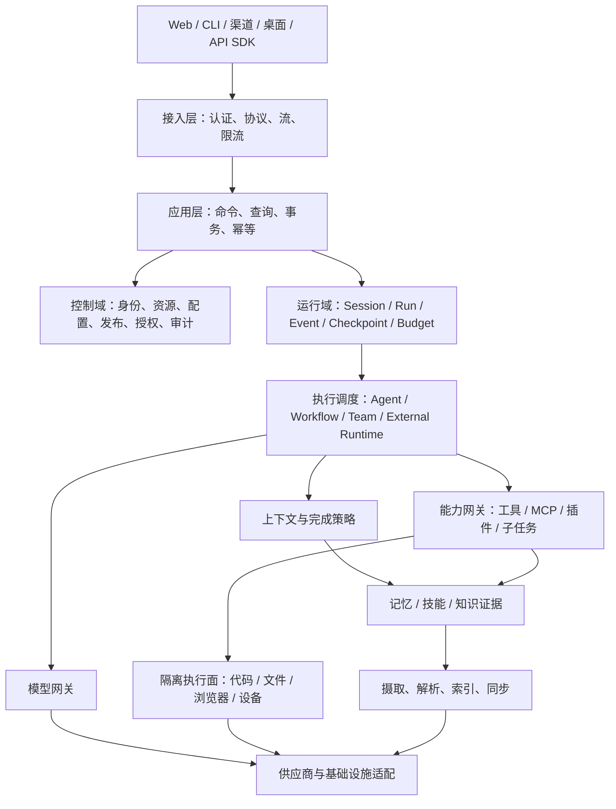
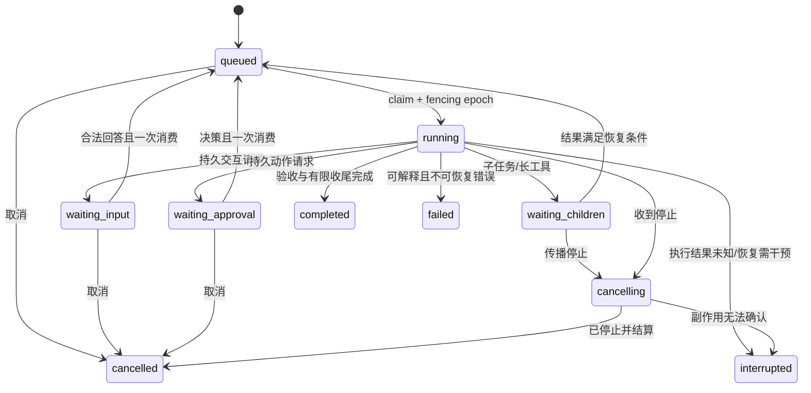

# 全功能智能体：八项目源码分析、详细设计、程序架构与实施计划

> 状态：独立设计建议，供评审；不表示现有功能已经实现，也不自动批准后续编码。  
> 分析日期：2026-10-25。对象为 `/project` 下的八个本地 Git 快照；`weknora`、`tradingagents`、`fastgpt` 分别按实际目录 `WeKnora`、`TradingAgents`、`FastGPT` 分析，`deepseek-harne ss` 按 `deepseek-harness` 分析。  
> 本文不以 hyoga-nexus 当前包结构、数据库或路线图为设计起点。保留 Python 服务端、Vue/TypeScript 用户界面作为组织实施约束，而非从现有代码倒推架构。目录名按本次要求使用 `docs/pedding/`。

## 目录

1. [研究口径与结论](#1-研究口径与结论)
2. [八个项目的实现分析](#2-八个项目的实现分析)
3. [能力取舍与冲突解决](#3-能力取舍与冲突解决)
4. [产品范围与质量目标](#4-产品范围与质量目标)
5. [总体架构与依赖方向](#5-总体架构与依赖方向)
6. [核心领域、数据模型与状态机](#6-核心领域数据模型与状态机)
7. [执行引擎与模型系统](#7-执行引擎与模型系统)
8. [上下文、记忆、技能与自我改进](#8-上下文记忆技能与自我改进)
9. [知识与数据系统](#9-知识与数据系统)
10. [工具、插件、沙箱与安全](#10-工具插件沙箱与安全)
11. [工作流、多智能体与自动化](#11-工作流多智能体与自动化)
12. [交互、API、外部 Runtime 与运维](#12-交互api外部-runtime-与运维)
13. [到功能目录的程序架构](#13-到功能目录的程序架构)
14. [实施步骤、排期与验收](#14-实施步骤排期与验收)
15. [风险、决策与完成标准](#15-风险决策与完成标准)
16. [源码证据索引](#16-源码证据索引)

## 1. 研究口径与结论

### 1.1 快照与证据边界

| 项目 | 本地路径 | 固定提交 | 根许可证文件所示 |
| --- | --- | --- | --- |
| GenericAgent | `/project/GenericAgent` | `a9a36b4b219593369de01c3e5973e56ac02e568b` | MIT |
| Hermes Agent | `/project/hermes-agent` | `eb1b4c5b617dc318edb39683f408666c692d3bdf` | MIT |
| WeKnora | `/project/WeKnora` | `e1f9a6166a593a4804a2f99f1d942919c9cc8ea7` | MIT，并列第三方声明 |
| RAGFlow | `/project/ragflow` | `e5a5060c42f1d4c2251e458b000d40ee309bffc4` | Apache-2.0 |
| DeepSeek Harness | `/project/deepseek-harness` | `22ddee3792402c3e70ec5f86a63c3e3e895a2f60` | MIT |
| LobeHub | `/project/lobehub` | `e1d7bc56550145ed31026d4798d735720579c233` | LobeHub Community License，含衍生作品商业条件 |
| TradingAgents | `/project/TradingAgents` | `e8f5503e9b86d5c2710b0c76b1f686703968c9df` | Apache-2.0 |
| FastGPT | `/project/FastGPT` | `749809070b75278e11a1576a8ef05ca90acb2d08` | 基于 Apache-2.0 的附加条件，含类似多租户 SaaS、标识限制 |

八个工作树在分析起点均无未提交改动。版本固定用于复核，不声称是远端最新版本。TradingAgents-CN 虽在本地存在，本次不列为第九个分析对象。

研究方法是**关键实现与测试定点深读、跨模块追踪及设计归纳**，不是逐行审查所有仓库：

- 核对根目录、依赖、版本、许可证；按职责定位真实入口，避免从 README 推断功能已经完成。
- 深读循环/step、工具执行、持久化边界、挂起恢复、上下文处理、记忆/技能、检索、工作流、领域协作的代表路径。
- 阅读相关测试的用例和断言以核对边界。找到测试不等于测试已执行，更不等于线上能力已验收。
- 文中“源码事实”指所读快照的实际代码；“建议”指综合后的目标设计，不能反向归因给上游。
- 未安装运行八个产品，未进行真实模型、解析服务、沙箱、生产数据库的性能或端到端测量。性能数字均为拟验收目标，排期为估算。
- 本文不作完整源码等价迁移承诺。实施前仍须对拟复用文件、分支、依赖、测试与许可逐项审查；尤其不能把参考设计等同于获准复制 LobeHub/FastGPT 源码。

LobeHub 的 `package.json` 标注与根 `LICENSE` 存在不一致，本文以实际根许可证内容记录风险。FastGPT 的交互设计亦有额外声明。这里仅报告快照文件事实；拟复用范围、授权与发布条件须在实施决策中逐项确定。

### 1.2 设计结论

目标不是把八套 Agent 同时放进一个系统，而是形成一个能够承载其优势的产品：

1. **一个持久运行内核**：命令、事件、预算、工具调用、挂起、恢复、取消、证据、产物一致；运行的事实来源不依赖浏览器或某个进程。
2. **三种独立执行策略**：单智能体自主循环、确定性工作流、团队协作。它们共享执行基础设施，不共享一个巨大且含糊的 while 循环。
3. **四种内容分域**：原始知识与证据、对话与工作记忆、长期事实/偏好/经验、技能与 SOP。领域结构化数据另设数据域，不能全塞进向量库。
4. **一个能力执行入口**：内置工具、MCP、插件、HTTP、代码、浏览器、设备和子智能体都经过同一身份/资源/动作/预算/审计边界。
5. **双视图内容模型**：模型上下文投影与用户交互投影分别生成，都能追溯到规范事件和原始内容；隐藏 UI 不能代替权限控制。
6. **前端完整配置**：供应商、模型、工具、技能、知识、记忆、行为预算、审批、自动化和通知均有用户入口、版本、默认值和授权。
7. **从模块化单体起步**：API、运行 worker、摄取 worker、调度器、沙箱执行面可以独立部署；不在第一阶段把每个目录拆成微服务。

## 2. 八个项目的实现分析

### 2.1 GenericAgent：小内核、可持续工作与经验沉淀

**实际组织与调用链**：`agentmain.GenericAgent` 管理输入/输出队列、后台执行、模型选择与 abort；`agent_loop.agent_runner_loop` 调模型并经 `BaseHandler.dispatch` 分发；`ga.GenericAgentHandler` 实现工具、工作锚点、完成判断及收尾；`llmcore` 保存模型侧历史并处理多协议与文本工具调用；`plugins/hooks.py` 提供模块注册的生命周期扩展。[GA1]、[GA2]、[GA3]、[GA4]

**值得保留的实现细节**：

- `StepOutcome(data, next_prompt, should_exit)` 区分工具数据、下一步引导和退出。不能简化成一个 `success: bool`；无 next_prompt 和显式退出对 done hooks 的处理不同。
- 没有 native tool call 时会走内部 `no_tool` 分支，而不是直接宣布成功：空内容、异常尾标、未解析工具协议、截断、仅大代码块等有不同恢复路径。仅展示代码且有自然语言说明时可以结束。
- 普通函数和生成器通过统一适配执行；生成器的中间输出和 `StopIteration.value` 最终结果各有语义。顺序执行保留原调用位置 `_index`、`_tool_num`。
- `_done_hooks` 在自然结束前补充后处理；`turn_end_callback` 维护历史摘要、提醒、工作状态。收尾仍需回到原任务结果，不应让“整理记忆”吞掉最终交付。
- `history_info`、`key_info`、历史折叠和交替锚点缓解长任务漂移；L1 极短索引→L2 事实→L3 SOP/脚本→L4 原始会话提供按需读取，而非把全部记忆塞进系统提示。
- 记忆指令明确强调行动验证、最小指针、合并重复和不保存易变状态。这是提示层约束，尚不能当作硬性事实验证器。
- `llmcore` 具有 Chat Completions、Responses、Claude、文本工具解析、流重试、usage 和 Mixin 路由等真实实现；模型切换不只是换一个字符串。[GA6]

**不直接照搬的边界**：本地宿主 subprocess、文件/浏览器执行、进程共享状态及运行目录不等于多用户隔离；模块级 hooks 注册与可变上下文不天然有插件权限边界。系统侧要保留行为，把执行、安全、存储和作用域重构为显式服务，不能以“服务化”为由删掉 no_tool、锚点或 SOP。

**综合位置**：作为自主执行策略、工作记忆与经验管理的行为参考；不作为整个企业平台的数据模型。[GA5]

### 2.2 Hermes Agent：长期助手、持久执行与扩展生命周期

**实际组织**：`agent/` 内按 turn preparation、API call、response check、tool round、overflow、final response 等拆分；工具、技能、ContextEngine、MemoryProvider、gateway、cron、状态存储和插件有独立模块。大量拆分说明复杂行为已超出单一 loop 的承载能力，但目录多并不自动意味着职责清楚。

**关键链路与优势**：

- `run_tool_round` 验证/限制/去重调用后，先把 assistant 工具请求写入规范会话存储，再触发副作用；写入失败会终止回合，不继续执行只存在内存里的调用。工具结果持久化失败也阻止继续向模型/界面投影。[HE1]
- ContextEngine 的生命周期区分 session 与 turn：会话开始/结束不是每轮开始/结束；压缩策略能替换，跟踪真实 usage、阈值、保护首尾和压缩计数。[HE2]
- 压缩前的可行性判断、连续摘要降级后的冷却/探测避免反复花模型费用压缩一个不可压缩的窗口。摘要失败不等于无限重试，部分恢复状态保存到 session。[HE3]
- MemoryProvider 明确每个 profile 独立实例，后台线程传播 contextvars，不能把某个用户路径/凭据绑定在模块全局后反复切换。`on_pre_compress` 有带版本的持久检查点契约。[HE4]
- 技能变化通过相对系统提示快照的增删差量通知进入后续轮次，保持缓存前缀稳定，并让会话中途安装/移除的技能可发现。[HE5]
- 子智能体暴露不可变启动请求/handle 和显式生命周期状态，包含取消请求、结果未知，而不是把完整 Agent 对象交给插件。[HE6]
- terminal 工具区分执行规划、审批、环境获取、前台/后台、超时和降级；gateway 处理消息入口与会话生命周期；cron 有任务路由、inflight、取消、失败事件等完整运行问题。[HE7]、[HE8]

**设计提醒**：本地 profile/SQLite/线程上下文的隔离经验值得借鉴，但不能替代服务端租户鉴权。`cron/scheduler.py` 与兼容层较复杂，适合抽出有边界的状态机，不能复制为另一个巨型调度文件。默认本地执行环境也不能视为已隔离沙箱。

**综合位置**：长期助手、规范写入优先、可替换上下文/记忆、技能动态发现、后台与计划任务的主要参考。保留学习能力，同时增加来源、审核、回滚和评测。

### 2.3 WeKnora：知识平台与完整 Agent 引擎并重

**实际组织**：`internal/agent` 不只是资源适配，还包含 ReAct 引擎、think/act、压缩、token 校准、steer、挂起、协作和工具；`internal/application/service` 编排知识/会话/资源/审批/自动化；types、repository、handler、frontend 分层。[WK1]

**关键实现**：

- AgentEngine 跨会话轮次不保有共享聊天历史；调用方从数据库重建输入。运行内有请求级模型上下文、token 校准、压缩失败水位、摘要 checkpoint sink、steer sink、后台提醒和 suspension。
- 工具并发使用显式分类，最多有限并发；遇到非并发工具先排空前面的读取，执行写屏障，再开始后续读取。输出按原顺序收集；挂起不能导致前序工具被无声丢弃。[WK2]
- compaction 的 checkpoint 只覆盖完整已存储回合，不能把活跃 turn 中一半工具链当稳定摘要；上下文溢出有受控 compact-and-retry，而不是无限缩减重试。[WK3]
- AgentGrant 按 tenant、user、session/automation scope、scope_id、grant_key 绑定；还记录配置 hash、风险、来源 prompt、撤销、到期、last_used 与自动化闲置过期。资源共享和动作免重复审批是两种授权。[WK4]
- HybridSearch 先加载并逐 KB 授权，再核对 embedding 模型空间；对多个存储分组 fan-out，查询 embedding 尽量一次计算。不能用不同模型向量直接做距离比较。[WK5]
- 向量/关键词返回列表按原检索列表分开处理，避免把并发完成顺序误当排名；单向量保留相似度、单关键词按本列表归一、混合用加权 RRF。归一分数不等于跨任务的概率置信度。[WK6]
- 前端与服务的作用域、资源选择、知识共享、技能/MCP、产物/后台会话等具备平台化组织；本方案从模块职责吸收，不机械复制其 Go 包及部署依赖。

**综合位置**：资源组织、权限与动作授权、企业知识库、上下文恢复、后台运行的一体化参考。不能只把它当“知识库 UI”。

### 2.4 RAGFlow：文档理解、检索工程和可恢复画布

**快照特别说明**：本地 `go.mod`、`internal/deepdoc`、`internal/ingestion`、`internal/agent/canvas` 和 `internal/harness` 表明当前快照具有 Go 实现。文件中的旧 Python/eino 版本注释是历史说明；依赖版本以当前锁定文件为准，不由注释推断。

**关键实现**：

- PDF layout 处理列/阅读顺序、文字框合并、OCR 去重等；去重需要区分“同页 OCR 伪重复”和真实重复条款/表格行。仅按文本相等去重会损坏证据。[RF1]
- GeneralChunker 有 token 大小、分隔符、子块、重叠、表格/图片上下文；分块不是一个全局 `split(text, n)`，还要保存页面/位置、层级与媒体关系。[RF2]
- RetrievalService 接收 tenant/KB/doc/filter、dense 参数、阈值、rerank 与分页。候选池、rerank 后阈值、统计数量和分页必须有清楚定义，不能混用“引擎总命中数”与“最终可用证据数”。[RF3]
- 图检索用实体/关系/社区报告组织额外召回；知识编译器的 tree 变体构建递归摘要树，并对图投影、claim 产物等做可降级处理。它们是可选增强，不应让基础文档发布依赖所有增强成功。[RF4]、[RF5]
- canvas 编译、节点运行、loop/parallel 子图、状态序列化、checkpoint store、run tracker 和取消分开。等待用户用真实 interrupt/resume 连接 form schema、checkpoint 和恢复输入，不依赖一个没有端到端闭合的 sentinel。[RF6]、[RF7]
- 运行 context 和事件消费者 context 分开：取消任务仍应向在线客户端送终态；断开客户端不能被误认成业务取消。并行子图恢复保留 producer 状态。[RF8]

**不照搬处**：不要把复杂解析、图谱、工作流、沙箱全部变成首发依赖；不要把画布 DSL 作为唯一 Agent 表达。当前快照还有独立 harness 与图执行相关实现，实施时需择定目标与兼容面，不能把多套内部引擎全叠上。

**综合位置**：文档结构保真、知识摄取/编译、证据定位、工作流编译及中断恢复的主要参考。

### 2.5 DeepSeek Harness：事件会话、作用域和可组合执行面

**实际组织**：按 core、LLM、session、compaction、interaction、subagent、fs/sandbox、skill、MCP、schedule、goal、jobs、client 等能力分包；Cordis scope 管理注册与生命周期。不是简单的“工具调用示例”。

**关键实现**：

- ReactLoopAgent 从 session log 派生每个请求，区分 idle/maintenance/running、turn/step、下一步 steer 与下一轮 followup；取消之后唤醒输入不会落入已被 abort 的活动。[DS1]
- Session 事件、请求 header、surface generation、projection 与格式迁移形成可重建执行基础；UI/模型视图不是另一个未经约束的历史真相。
- 尾部修复明确区分 `TOOL_NOT_STARTED` 与 `TOOL_OUTCOME_UNKNOWN`；分叉中缺失结果也不能假定原分支没有执行。历史修复生成可解释的缺失结果，不等于自动再调用工具。[DS2]
- ToolExecutionPipeline 把 lookup/admission、schema、策略、审批、执行、后处理、投影和取消结算集中；只有分类函数明确返回 true 才允许并发，未知/异常默认 exclusive。嵌套程序化工具调用不能绕开这一边界。[DS3]
- scope 用不透明身份与父子关系决定注册可见性、事件路由和清理，防止插件注册全局污染。但此 scope 是程序生命周期机制，不等同于业务租户权限。[DS4]
- compaction checkpoint 带事务关联与来源标记；工具大输出可 spill/prune，附件、子智能体、远程执行和插件市场有独立边界。[DS5]
- auto-review 是实验能力，实际以模型作最终许可决策。本文只吸收其“明确来源角色、保留审批事实、结构化结果”思想，不采用模型覆盖平台硬性拒绝的权限架构。[DS6]

**综合位置**：持久命令/事件、会话投影、工具流水线、插件作用域、日志恢复与跨 Runtime 适配的重要参考。包数量不照搬；按实际职责与复用程度聚合。

### 2.6 LobeHub：交互产品、指令执行与上下文流水线

**实际组织**：model-runtime、agent-runtime、context-engine、conversation-flow、memory-user-memory、tool-runtime、数据库 schema 与前端功能模块相互配合；现快照不仅是聊天前端。

**关键实现**：

- Agent 的“决策”与 Runtime 的“执行指令”分离；`AgentRuntime.step` 接收 state/context，执行 call_llm、call_tool、finish、人工交互等指令，再返回 newState/nextContext。宿主可以配置 executor。[LH1]
- 共享 loop 将 done/error/interrupted、parked、cost_limit、max_steps、no_next_context 统一为停止原因。parked 是非终态暂停，不能混同失败或对同一个 pending 操作再次 step。[LH2]
- ContextEngine 顺序运行 processor，保存 metadata/耗时，支持 abort；provider 覆盖系统角色、工具、技能、项目、用户记忆、知识、页面选择、摘要和动态上下文。应继承可观测的组装流水线，而不是到处拼 prompt 字符串。[LH3]
- memory extraction 先 Gatekeeper，再 identity/preference/context/activity/experience 等层次抽取，区分常用模型与 gate 模型。分类抽取不等于事实已经验证，要在新方案加证据状态。[LH4]
- conversation-flow 将扁平 message 经索引→树结构→语义转换→虚拟列表；区分线程、子智能体和分组。执行记录与交互呈现不能只靠 `role/content` 的数组。[LH5]
- 人工审批 executor 会设置等待状态、持久 pending tool rows 的关联并处理恢复占位与替代批次，说明“批准按钮”背后需要完整的批次身份与恢复语义。[LH6]
- AgentManagerRuntime 聚合 Agent/模型/工具管理，部分实现仍访问前端 store；新系统不能因此让浏览器成为配置授权的唯一执行者。[LH7]

**综合位置**：工作台信息架构、复杂消息呈现、上下文 provider、Agent instruction 模式和用户记忆分型。根许可证条件意味着优先独立实现可观察能力，具体复制需另外审查。

### 2.7 TradingAgents：领域团队、可解释裁决与结果反馈

**实际组织**：GraphSetup、ConditionalLogic、Propagator、checkpointer、analyst execution plan、分层模型、分析员/研究辩论/交易与风险角色、数据 vendor、memory/settlement/reporting。[TA1]

**关键实现**：

- 分析员各有独立图和私有 message history，只返回自己的 report key；共享写入同一个 messages key 会产生并行冲突，也会把一个角色的工具结果泄漏到另一个角色。[TA2]
- 多空研究按轮数及发言方切换，再交研究经理；风险采用进取/保守/中立轮转，再交组合经理。路径映射显式覆盖所有路由返回值，减少标签漂移导致的断图。[TA3]
- 每个分析员有 max_tool_rounds，耗尽时进入 wrap-up 并结束，不让模型持续调用工具撞 recursion limit。角色数与辩论轮数都是费用和延迟乘数。
- quick/deep 模型分层用于分析与裁决；领域上下文、instrument identity、日期和数据源路由独立管理。不能把证券代码当作全球唯一自然键。
- 记忆记录决策、到期后 outcome、benchmark alpha 和 reflection；持有窗口未完整走完不能提前结算。历史运行读取 memory 的 `as_of`，只允许看到在当时已知的结果，旧条目缺少 resolution date 时保守排除。[TA4]、[TA5]

**综合位置**：领域协作的模板，而非所有任务都固定多空辩论。通用内核提供受控 fan-out、私有上下文、结构化 report、裁决和评估；金融域提供市场日历、数据时点、研究方法与回测。结论文本不等于交易指令，更不能把生成报告当作收益验收。

### 2.8 FastGPT：应用编排、知识治理与多执行器接口

**实际组织**：global 契约、workflow-core 的文档/引用/编译/校验、service 下的 workflow dispatch 与 agentLoop，web/next 应用，dataset/search 与权限和计费系统分开组织。

**关键实现**：

- workflow-core 有唯一规范 WorkflowDocument，再编译成 Web/Service 可读状态；引用编码、execution edges 与类型校验集中。不能把画布坐标、端口展示和真正执行图当作同一个不受校验的 JSON。[FG1]
- dispatch 涉及运行变量、节点响应存储、递归深度、交互、usage、停止状态和 tracing，说明可运行画布远不止“节点注册表”。循环要识别图结构，节点结果应独立持久化。[FG2]
- agentLoop 具有 domain/application/provider 边界，provider registry 明确选择 fastAgent/piAgent，未知 provider 报错；业务层不再额外包一层自建模型循环。[FG3]
- application 层收集同一批 usage 并只触发一次账务回调；内部目录读取通过事件公开投影隐藏细节，但内部上下文/恢复状态保留。可见性裁剪应作用于公开副本，而非破坏执行事实。[FG4]
- ask 等待保存原消息链与 tool call，用户回答回到原调用；plan 更新、工具目录、文件上下文、沙箱等分域适配。[FG5]
- dataset 搜索有 query extension、多查询/文本/图片召回、rerank 和加权列表合并；文本 rerank 不能误伤视觉相似召回。embeddingRecall 测试模拟向量库越权命中，并要求按 readable collection 回查裁剪。[FG6]、[FG7]
- `deepRagSearch` 入口委派到全局 handler，不能据此声称当前独立基础实现包含全部 Deep RAG。实施时要核对 handler 的来源、装配和许可证，而非复制一个入口即宣称支持。

**综合位置**：工作流规范文档/编译、应用发布、检索与权限二次校验、usage 归一、提供者隔离。不要同时搬入完整 Mongo/向量数据库/Next.js 技术栈，也不把社区与商业扩展的能力混为一谈。

### 2.9 从源码中识别的具体工程张力

以下为定点源码可见的风险与限制，不表示已经复现线上漏洞，也不作对整个项目质量的泛化结论：

| 源码位置 | 实际可见行为 | 综合方案的处理 |
| --- | --- | --- |
| GA `llmcore._stream_with_retry` | Timeout/ConnectionError 分支按剩余次数重试，没有用已发出内容的 `streamed` 阻止该类传输重试；Mixin 的部分流处理又是另一层策略 | 统一 attempt 的 output-started 状态，预输出重试与流后恢复分开；保留兼容差异，不将新策略伪称原逻辑完全一致 |
| HE `terminal_tool._run_approval_guards` | `force` 直接跳过该层 guard；同时还有环境路由和作用域拒绝机制 | 不把上游 force 透传成平台权限 bypass；本地个人显式策略与多用户硬授权分层 |
| WK `knowledgebase_search_fusion` | 不同召回类型采取不同归一：vector-only 保原分、keyword-only 按列表缩放、hybrid 用 RRF | 保存分数语义和 retrieval mode，禁止将统一数值区间当“置信度概率” |
| RF `knowledge_compiler/tree/raptor.go` | 该快照的 tree 聚类注释/实现采用文档顺序上的 watershed，不应假定是常见 RAPTOR 论文实现的全套聚类算法 | 借鉴递归摘要树、可降级派生产物；具体聚类算法以数据集验证后选择，不按项目名认定等价 |
| LH `AgentManagerRuntime` | 服务注入之外仍有 `@/store/...` 依赖 | 独立实现管理用例和服务接口，不把浏览器 store 导入通用服务端 runtime |
| FG `deepRagSearch` | 入口将工作交给 `global.deepRagHandler` | 审查装配与实际实现；没有 handler 时报告 unavailable，不能仅凭入口存在承诺能力 |
| DS `experimental/auto-review` | 提示词将模型决策作为某待批调用的最终授权结果 | 不采用模型替代硬授权；自动评审只在已有授权范围内给建议并接受确定性策略约束 |

这些差异需要分别进入实施 ADR/行为矩阵。某处实现有可调整空间，不构成删除其他已确认功能的理由。

## 3. 能力取舍与冲突解决

### 3.1 优势组合矩阵

表中“主参考”表示设计来源侧重，不表示其他项目没有同类能力。

| 目标能力 | 主参考 | 采用的机制 | 新方案必须补齐的约束 |
| --- | --- | --- | --- |
| 自主循环与完成判断 | GA、WK、HE | no_tool、完成/截断/空响应分支、循环防护 | 任务证据与结束原因分离；预算耗尽不能标成功 |
| 持久执行与恢复 | HE、DS、WK | 先记录调用、结果未知分类、挂起快照 | 数据库 fencing、外部幂等、版本化恢复 |
| 模型系统 | GA、LH、HE | 多协议、能力映射、缓存、路由/降级 | 每次请求授权；可观测费用与输出后禁重放 |
| 上下文 | LH、WK、HE、GA | processor、摘要 checkpoint、工作锚点 | 来源信任、完整工具配对、分区预算 |
| 长期记忆与学习 | GA、HE、LH、TA | 分层指针、provider、类型抽取、结果反馈 | 审核、冲突、时点、遗忘、撤权、可回滚 |
| 文档知识 | RF、WK、FG | 结构解析、多路检索、图/树增强 | 原文定位、发布代际、模型空间、逐命中授权 |
| 工具和插件 | DS、HE、WK | admission/pipeline、作用域、屏障 | 同步/生成器/PTC/MCP 统一授权与预算 |
| 多智能体 | TA、HE、LH、DS | 私有子图、子任务 handle、协作编排 | 权限取交集、全树预算、共享状态归约 |
| 画布工作流 | RF、FG | DSL→编译→执行、interrupt/checkpoint | 规范 IR、版本、恢复幂等、静态验证 |
| 用户工作台 | LH、WK、FG | 消息树、资源选择、轨迹/引用/产物 | 服务端事实、断线回放、键盘/窄屏 |
| 长期自动化 | HE、WK、DS | schedule/goal/jobs、后台进度 | 时区/错过策略、稳定 execution key、通知重试 |
| 领域研究 | TA、RF | 证据报告、角色裁决、结果评估 | 数据时点、因果隔离、领域指标与人工发布 |

### 3.2 不兼容机制的明确裁决

| 冲突 | 设计选择 | 保留的原能力与理由 |
| --- | --- | --- |
| GA 模型内部历史 vs DS 事件重建/WK DB 历史 | 规范历史由事件与消息存储持有，适配器保留协议会话状态并可重建 | 保留连续对话、模型切换与缓存；消除双重可变真相 |
| 自然结束、done hooks vs 可恢复 step/instruction | CompletionPolicy 产出候选结束；FinalizationCoordinator 执行有限收尾；最终统一结算 | 保留收尾、SOP 和回合回调；不会无限追加模型调用 |
| 单机记忆文件直接 patch vs 多用户治理 | 支持个人自动发布策略与共享审核策略，两者均版本化、可撤销；默认审核 | 保留读取、整理、修改、索引、回滚；不把治理实现退化成只有草稿 |
| 自动记忆抽取 vs 行动验证 | 分开 user_asserted、tool_verified、inferred；推断不能自动升级为事实 | 保留偏好抽取；工具验证要求仅施于可验证事实与执行经验 |
| 多模型透明切换 vs 可复现性 | Agent 配置固定路由策略；请求记录实际模型；用户切换可创建分支 | 保留动态可用性和历史连续性，解释结果模型来源 |
| UI 内部内容隐藏 vs 恢复完整性 | 存储 canonical、model、public 三个投影边界 | 不删除模型依赖状态，也不通过事件泄漏凭据/私有文件 |
| 读工具并发 vs 工具暂停/副作用 | 默认顺序；明确安全的读可有限并发；暂停/写入是屏障 | 保留并发收益及原始顺序；未知类型不得自动并发 |
| 多套 graph/loop/SDK | 统一调度契约，按 execution_kind 选唯一执行器 | 工作流可调用 Agent 节点，但不能嵌套驱动同一 SDK loop |
| 插件灵活性 vs 安全边界 | 可信部署插件与用户安装内容分级；硬授权在插件之外 | 保留 hooks/provider/工具扩展，插件不能覆盖拒绝决策 |
| 模型 auto-review vs 强制权限 | 模型提供风险建议；硬策略与授权记录决定可执行范围 | 自动审批仅在用户预授策略内运行，失败关闭，高风险需人工 |
| 复杂知识增强 vs 基础可用性 | 基础索引为发布必要条件，图/树/多模态增强为独立状态 | 增强可重试/降级，不把部分索引误报完整，也不阻塞全部数据 |
| 八项目目录规模 vs 小团队维护 | 按领域垂直模块聚合；仅在边界稳定或需独立部署时拆包 | 吸收职责，避免复制数百空目录或一次引入全部依赖 |

### 3.3 与既有约束的关系

本文规划包含代码/文件/浏览器工具和隔离执行后端的完整目标设计，但**不解除此前对这些能力的暂缓实施安排**。它们在排期中单独设激活门禁，未确认前不能注册危险工具；其他能力可以独立推进。重新设计也不意味着可以丢弃现有用户数据和已确认行为：迁移仅在目标设计评审后另行建立适配、回填、影子验证和回退方案。

## 4. 产品范围与质量目标

### 4.1 用户与交付场景

- 个人助手：跨会话偏好与项目记忆、文件研究、知识问答、工具操作、后台任务、定时提醒。
- 知识工作者：上传/同步文档、引用原文、深度研究、对比证据、生成报告与可下载产物。
- 开发与运维：代码/终端/浏览器任务、计划与验证、异步执行、审批和回滚；执行必须经过已验收环境。
- 企业团队：组织空间、共享资源、角色权限、Agent/流程发布、审计、用量、评测和版本治理。
- 领域研究：股票等领域的专用数据、分析团队、研究报告、回测与经验反馈；通用系统不内置证券规则。
- 平台集成：API、Web、CLI、渠道机器人、桌面设备、外部 Runtime 复用同一身份与运行记录。

### 4.2 能力分级

| 级别 | 必须可完成的端到端任务 | 不能宣称的能力 |
| --- | --- | --- |
| A 可靠核心 | 配置模型→发布 Agent→连续流式对话→授权工具→停止/等待/恢复→历史回放 | 没有执行环境时宣称支持任意代码 |
| B 知识与记忆 | 文档入库→权限检索→证据回答；记忆审核→复用→更正/删除 | 仅有向量索引就宣称文档理解完整 |
| C 行动与协作 | 隔离执行→产物；子任务→汇合；定时→通知；流程中断→恢复 | 仅并发多个 prompt 就宣称可靠团队 |
| D 持续改进与规模化 | 失败样例→候选技能/策略→评测→发布→回滚；容量与灾备验收 | 自动生成 SOP 就宣称自主进化完成 |

### 4.3 质量目标与测量条件

以下是设计目标，需 M0 建立环境与负载后校准，不是八项目性能结论。

| 指标 | 首个可用版本目标 | 测量方式 |
| --- | --- | --- |
| 权限隔离 | 跨空间/撤权/历史引用泄漏用例 0 失败 | API、召回、产物、缓存、恢复、子任务多层对抗用例 |
| 副作用恢复 | 未知结果工具 0 次未经判定自动重放 | 调用前后/写结果前 kill worker 故障注入 |
| 事件消费 | 重连后已提交事件不丢失、重复事件不重复展示 | 游标续读、重复投递、序列缺口回放 |
| 交互延迟 | 内部控制 API p95 < 300ms；新增文本持久化到在线可见 p95 < 500ms | 约定 50 活跃流、记录硬件/事件大小；不含模型首 token 延迟 |
| 可恢复性 | worker 故障后在 lease 到期加一次扫描内进入可解释状态 | 初始 lease 30s/心跳 10s，按实际负载调优 |
| 知识质量 | 建立不少于 200 条带定位标注的代表集，再约定 recall@k/引用正确率门槛 | 中文、多栏 PDF、表格、FAQ、图片、跨文档和无答案 |
| 可复现性 | 每个报告可追溯配置、工具、模型、数据与证据版本 | 固定夹具差分；真实模型只要求归因完整，不要求逐字确定 |
| 成本 | 主模型、摘要、重试、子任务、嵌入、rerank 全部可归因 | 唯一 usage key；供应商账单对账；未知价格显示未知 |
| 运维 | 初始 RPO ≤15min、RTO ≤2h 的演练目标 | 主库+对象存储+密钥可恢复性演练，不只执行备份命令 |

## 5. 总体架构与依赖方向

### 5.1 分层



- **接入层**只解码、鉴权、限流和流协议，不维护业务状态机。
- **应用层**定义“创建 Run”“批准操作”“发布知识代际”等事务与业务用例，不直接拥有模型/工具循环。
- **领域层**各自拥有不变量、实体和仓储接口；不是一个名叫 platform 的无边界大包。
- **执行层**接收已授权、可重建的执行上下文；仍在真正使用资源时复核授权。
- **能力层**承担工具/知识/记忆等受控服务；通用能力不得向上导入 HTTP 或领域扩展。
- **适配层**实现 SQL、对象存储、向量索引、厂商 API、沙箱后端、外部 SDK；SDK 类型不进入稳定业务契约。
- **应用装配层**选择适配器与插件，持有部署配置和密钥引用；领域对象不自行读取环境变量。

### 5.2 首期部署拓扑

| 进程 | 责任 | 扩展依据 |
| --- | --- | --- |
| api | HTTP/SSE/WS、认证、命令提交、查询和上传签名 | 在线连接与 QPS |
| run-worker | Agent、流程与团队控制步骤，模型流、工具编排 | 活跃 Run、供应商并发与内存 |
| ingestion-worker | 下载、解析、OCR、分块、嵌入、索引/删除 | CPU/GPU/文件体积，独立队列 |
| scheduler | 调度实例生成、lease 修复、过期与通知调度 | 选主/租约；多副本仍只生成一个实例 |
| execution-agent | 沙箱与设备连接、长进程、文件/浏览器操作 | 资源池、地域和隔离等级 |
| evaluation-worker | 离线数据集评测与候选发布门禁 | 独立预算与受控服务凭据 |

首期推荐 PostgreSQL 为事务事实源，S3 兼容对象存储保存原始文件/大结果/产物；按实际摄取需求启用 pgvector 与全文检索。Redis 可做缓存、唤醒、速率协调，不能是审批或运行事实的唯一存储。搜索规模/中文质量触发门槛后引入专用检索引擎；索引接口从首期就可替换。

不同时部署多个消息中间件来满足“架构完整”。首期 PostgreSQL outbox + lease worker 足够时直接使用；未来使用队列只替换投递面，数据库幂等与运行账本继续保留。

### 5.3 核心不变量

1. 持久化成功的调用意图才可执行副作用；持久化成功的公开事件才可送客户端。
2. 一个 Run epoch 同时只有一个调度所有者；子任务各有独立 Run 和预算份额。
3. 至少一次投递是默认现实；外部副作用不承诺端到端 exactly-once。
4. 恢复恢复的是确定边界之后的状态，不是把原任务重新从第一步跑一遍。
5. 工具 schema 可见、Skill 已安装、Agent 已发布，都不等于有权访问资源。
6. 模型输出、检索正文、工具描述和插件内容不能提升指令/授权等级。
7. 原始事件、证据和版本不可被摘要覆盖；删除/保留策略明确处理例外及用户隐私。
8. 所有等待都释放 worker 占用；所有终态都有稳定原因；已终态 Run 不再追加执行。

## 6. 核心领域、数据模型与状态机

### 6.1 领域实体

| 领域 | 核心实体 | 所属规则 |
| --- | --- | --- |
| 身份与空间 | User、Identity、Organization、Workspace、Membership、ServiceAccount | 认证映射、角色、成员停用、服务主体 |
| 资源与配置 | Resource、ResourceVersion、ResourceGrant、Binding、SecretRef、ConfigRevision | 归属、共享、版本、默认、脱敏与撤销 |
| 智能体 | AgentDefinition、AgentVersion、BehaviorProfile、RuntimeProfile | 草稿→校验→发布→停用；发布版本不可原改 |
| 会话与运行 | Conversation、Branch、Message、Run、Step、Attempt、RuntimeLease | 分支、排序、快照、幂等、fencing |
| 交互与审批 | InteractionRequest、ActionApproval、RememberedGrant、Directive | 等待、一次消费、作用域、风险和有效期 |
| 能力调用 | ToolDefinitionVersion、Invocation、ExecutionReceipt、EffectRecord | 输入输出、执行证据、结果未知、补偿 |
| 产物与证据 | Blob、Artifact、ArtifactVersion、EvidenceSpan、Citation、AcceptanceEvidence | 原文定位、内容 hash、访问范围、可验证交付 |
| 记忆与技能 | MemoryItem、MemoryVersion、MemoryEvidence、SkillVersion、LearningCandidate | 可信度、审核、有效期、版本与发布 |
| 知识 | KnowledgeSpace、Source、DocumentVersion、ParseRun、Chunk、IndexGeneration | 数据来源、结构、索引代际、权限与删除 |
| 编排 | WorkflowVersion、CompiledPlan、NodeRun、TeamTemplate、Task、Dependency | 编译、归约、子运行、重试与汇合 |
| 自动化 | Schedule、Trigger、AutomationVersion、ExecutionInstance、Delivery | 时区、稳定实例键、授权快照和投递 |
| 财务与运维 | UsageEntry、BudgetReservation、AuditEvent、TraceLink、EvalRun | 唯一计量、配额、成本、留痕与质量 |

### 6.2 身份和版本贯穿链路

每个 Run 快照至少记录：principal/workspace、AgentVersion、execution_kind、模型路由版本、行为/预算配置版本、工具/技能/知识绑定版本、策略版本、初始输入引用、父 Run、幂等键、创建来源。Secret 只记录引用，不进快照明文。

事件 envelope 建议：

```text
event_id, workspace_id, run_id, branch_id,
sequence, schema_version, event_type, occurred_at,
causation_id, correlation_id, step_id, attempt_id,
public_payload, restricted_payload_ref, trace_id
```

`sequence` 只表示单 Run 提交顺序，不等于全系统时间；事件版本迁移与 payload 读取适配独立。数据库唯一约束 `(run_id, sequence)`、`event_id`；流只消费已提交记录。向用户展示的顺序与并发任务真实执行时间分别保存，避免制造虚假顺序。

### 6.3 Run 状态机



Run 之外另有 Task 的 blocked/ready 状态，避免把所有编排等待都塞进 Run 状态。失败后“重试”通常新建关联 Run/Attempt，原终态保留；从已知 checkpoint 继续必须以显式 resume 命令和匹配版本为条件。

### 6.4 调用状态与崩溃矩阵

工具 Invocation：`prepared → waiting_approval / admitted → dispatched → succeeded / failed / unknown / cancelled_before_dispatch`。返回 timeout 不代表远端没执行；`unknown` 禁止自动重试，除非有幂等键或查询外部 receipt 可确认。

| 崩溃点 | 恢复依据 | 下一动作 |
| --- | --- | --- |
| 意图尚未提交 | 没有 prepared 记录 | 可重新准备，不声称已经执行 |
| 已准备、未派发 | prepared/admitted，无 dispatch receipt | 重新授权；确认无外部派发后可继续 |
| 已派发、未录结果 | dispatched/未知 | 查询执行后端；只读/幂等按策略重试；其他等人工 |
| 结果已提交、尚未发事件 | Invocation + outbox | 只重发事件，不执行工具 |
| 审批已作出、尚未消费 | approval version + token | 原调用一次性恢复，重新鉴权 |
| 审批消费后 worker 丢失 | consumption + invocation epoch | 不重新造审批；按调用 receipt 判定 |
| 索引部分完成 | generation + stage receipts | 继续同代际；未激活代际不可查询 |

### 6.5 数据库与一致性

- Run claim 更新 `lease_owner/lease_until/epoch`；每次状态结算带预期 epoch/version，旧 worker 的迟到写入被拒绝。外部执行面同样携带 execution token；仅数据库 CAS 无法阻止已发到外部的副作用。
- 事务覆盖状态变更、事件与 outbox；投递重试使用稳定 message key。工具副作用发生在事务外，不长期持有行锁等待模型/API。
- 用户交互、审批、指令采用业务幂等键+输入 hash；同键不同内容返回冲突。审批有请求版本，不能拿旧卡片批准后来修改的参数。
- 热数据与大内容分离；消息树 parent/branch 索引、事件 run/sequence 索引、调度 due/status 索引、invocation call_id 唯一。
- tenant/workspace 外键和查询过滤共同保证归属，数据库 RLS 作为可选纵深防御；不能依赖浏览器传来的 workspace_id。
- 删除先停止新访问、失效缓存/索引/共享，再后台清理内容；保留的审计尽量去内容化。删除完成前有明确状态与重试记录。

## 7. 执行引擎与模型系统

### 7.1 执行器契约

```text
Executor.prepare(RunSnapshot, ResumeState) -> PreparedExecution
Executor.advance(ExecutionContext, CommandBatch) -> StepDecision
Executor.cancel(CancellationContext) -> Settlement
Executor.snapshot() -> VersionedCheckpoint

StepDecision = ModelRequest | ToolBatch | SpawnChildren | Wait |
               Continue | Finalize | Fail
```

以上为目标协议草案，不是现有代码。`AgentExecutor`、`WorkflowExecutor`、`TeamExecutor` 和 `ExternalRuntimeAdapter` 各自实现，调度器只知道 claim/advance/wait/settle；不检查各自内部 prompt。

Native Agent 只有一个模型/工具循环。外部 Codex/Claude Code/ACP 等若自身拥有循环，由适配器接管完整执行，不将每次外部 step 再当 Native 模型请求。能力不足必须在 profile/界面显示，不能假装所有 Runtime 都支持同一恢复或工具注入方式。

### 7.2 一轮自主执行的详细顺序

1. claim Run 与 epoch，核对取消、当前成员、已发布配置和预算保留。
2. 加载规范历史/checkpoint；修复缺失工具配对时记录修复原因；先结算已完成结果，禁止重放。
3. 按顺序消费 steer、已解决交互、子任务结果，保留命令来源和消费位点。
4. 解析工具可用集合与版本，执行声明 admission；ContextAssembler 汇总内容，记录来源和 token 账本。
5. 执行可信 before hooks 和硬性 preflight；hooks 修改后的请求再次校验预算、秘密和资源边界。
6. 预留本次模型费用/输出额度，记录 Attempt，请求协议适配器，流式累积并分批持久化公开文本。
7. 校验流终止、tool arguments、usage、拒答/截断；结束时记录真实模型、错误类别和费用。只收到网络 EOF 不能自动当正常完成。
8. 有工具：先提交 assistant tool calls 与 Invocation，再逐调用授权/审批/执行；只读组有限并发，写屏障有序；进度与最终结果分开。
9. 每个调用按 canonical/model/public 投影结算，保持 tool call/result 配对；大结果外置、可按范围读取。未知结果进入 interrupted/人工核对。
10. 无工具：CompletionPolicy 决定正常回答、恢复提示、明确失败、继续原计划或进入有限收尾。
11. after hooks、工作锚点、预算和 checkpoint 原子结算；有晚到 steer 则先记录再判断是否继续，禁止终态后偷偷多调模型。
12. 完成或进入 Wait；释放 lease/外部客户端，记录最终结果、未完成项、产物和证据。

### 7.3 完成判断与收尾

CompletionResult 包含 `decision/reason/evidence_refs/unresolved_items`。策略至少覆盖：空响应、仅推理无公开内容、拒答、流异常、截断文本、截断工具参数、协议文本未解析、重复内容、重复失败调用、计划未完成、工具显式退出、用户取消。

- **正常文本回答**不必强制调用工具；任务要求解释时，展示代码可以完成。
- **需要动作的任务**不能只凭“已完成”三个字结算；报告应引用执行 receipt/产物/测试证据。模型裁决只是输入，关键动作以系统记录为准。
- 进度停滞检测同时看调用签名、错误、证据增量、计划状态；不能因两次相同读取就无限制地中止合法核对。
- FinalizationCoordinator 提供可配置的验证、结果摘要、经验候选、最终回复队列；记录已执行项，恢复时不重复。
- 执行预算与预留收尾预算共同受总硬上限约束；用户 Stop 后不允许额外摘要调用。预算耗尽如实标记未完成，不用收尾掩盖失败。

### 7.4 模型网关

| 子模块 | 详细责任 |
| --- | --- |
| ModelCatalog | 能力矩阵：协议、上下文、输出、工具、JSON、图像/音频、reasoning、缓存、价格版本 |
| ProviderAdapter | Chat Completions、Responses、Anthropic、Gemini 等各自消息/流/工具/签名映射 |
| RequestPlanner | 按模型能力降级/拒绝不支持参数；不静默丢掉关键工具或图片 |
| CredentialResolver | 当前授权、密钥解密/短时句柄、凭据轮换与 provider binding |
| Router | 任务 profile、主备节点、健康、冷却、回归主模型；固定路由版本 |
| RetryController | 网络/429/5xx 的有界预输出重试、Retry-After、jitter、总 deadline、可取消等待 |
| StreamValidator | 消息/内容块/工具参数分片组装、终态、上限、usage、partial error |
| UsageLedger | input/output/reasoning/cache read/write/媒体/embedding/rerank/摘要/重试成本 |
| EgressPolicy | URL/origin/DNS/重定向、私网策略、日志/trace 脱敏和数据外发范围 |

usage 归一要保留供应商原字段含义与计价规则。例如 cached input 可能已包含在 input_tokens，也可能另计；不能统一用 `input + output + cached` 推导 total，否则重复计算。总量缺失时标估算、记录依据，不能与供应商实测混淆。

流已公开文本或返回工具调用后，失败不得切换模型从头拼接；若需继续，新增有来源的 Attempt/消息，向用户显示部分失败。重试不得重放已经执行的工具。

### 7.5 预算体系

预算分 Run/Task/Team/Workspace 多层，包括 tokens、金额、活跃秒、壁钟 deadline、模型请求数、tool rounds、工具时长、并行子任务、递归深度、输入文件与检索量。等待人工不计活跃时长，但继续受到期/保留策略约束。

父预算为子任务 reservation，子任务扣实际用量并归还未用份额；父级不得把各子模型 usage 加总两遍。跨 worker 用数据库原子配额/预留处理竞争，不能各进程独立判断“尚有预算”。费用未知时用显式可配置保守预留，界面显示待对账。

## 8. 上下文、记忆、技能与自我改进

### 8.1 ContextAssembler 流水线

每个 ContextFragment 包含 `source_id/source_version/scope/trust/content_kind/token_estimate/priority/expires_at/evidence_refs`。推荐顺序：

1. 硬系统约束和 Runtime 能力说明。
2. Agent 角色、用户明确指令及项目规则，按来源建立优先级。
3. 已授权工具/技能索引、模型能力和输出约定。
4. 当前目标、plan/todo、工作检查点、待解决问题与失败摘要。
5. 已授权长期记忆指针与本次召回材料。
6. 知识证据、附件、页面选择/设备上下文，以资料而非系统指令封装。
7. 历史摘要、受保护完整最近回合、steer/交互答案。
8. 结构/工具配对验证、token 预算校准、秘密扫描和最终请求映射。

pipeline 输出 composition report：每类 token、纳入/排除原因、来源版本、压缩与降级、处理时长。用户可查看“使用了哪些资料”，但不暴露系统秘密与供应商私有内部推理。

### 8.2 上下文压缩分级

- 先按需加载：工具 schema 和技能/知识用索引→详情，避免一次性全量展开。
- 大工具结果 spill：保留摘要、hash、位置与分页读取入口；公开预览与模型窗口独立。
- 保护 system、当前用户目标、未完成工具对、最近关键回合和工作 checkpoint。
- 旧完整回合可生成来源明确的摘要；摘要与消息范围、model/prompt 版本、quality 标志关联。
- 确定性裁剪是摘要失败的明确降级，不称为“无损总结”；记录被省略的范围。
- 每次压缩比较实际收益；无收益冷却，溢出恢复次数有界；摘要输入本身也要适配摘要模型窗口。
- checkpoint 使用完整已提交边界，跨版本恢复需迁移器；原始材料按保留策略保存，不以摘要替换存档。
- 模型实际 input usage 用于估算校准；一次上下文改写后重置可比基线，避免把不同请求的差量用于校准。

### 8.3 记忆的分型、作用域与检索

| 类型 | 内容 | 写入条件 | 默认读取策略 |
| --- | --- | --- | --- |
| WorkingMemory | 当前目标、进度、key_info、失败路径 | 当前 Run 工具/模型产生，标注来源 | 每轮有限注入，任务结束后不自动变事实 |
| EpisodicMemory | 历史事件、任务与交付 | 原始记录/摘要 | 按相关性读取，可追溯 raw session |
| SemanticMemory | 用户确认的事实、环境约束 | user_asserted 或 tool_verified | 作用域/有效期/冲突筛选 |
| PreferenceMemory | 风格、默认习惯、长期偏好 | 用户声明或候选推断待确认 | 少量高相关，不覆盖当前明确指令 |
| ProceduralMemory | SOP、避坑、验证流程 | 成功/失败证据与适用条件 | 索引定位，执行前核对条件 |
| OutcomeMemory | 方案结果、指标与反思 | 结果已发生且有 known_at | 按 as_of 过滤，防未来信息 |

作用域为 personal/project/agent/workspace，不能把“全局”当无租户公共。共享默认显式发布，读取仍校验 ACL；高敏项目不自动进入个人跨项目记忆。检索先 scope/visibility/known_at 筛选，再相关性排序，去重并处理冲突，不能事后只删掉 UI 引用。

每项记忆保存 claim、evidence refs、assertion_kind、confidence、valid_from/to、known_at、last_verified_at、supersedes、reviewer、版本和删除状态。模型推断必须标 inferred；“用户喜欢简洁”与“数据库端口是 X”不能用同一验证规则。

### 8.4 完整记忆闭环

```text
候选提取 → 来源与敏感信息检查 → 去重/冲突检测 → 可选验证任务
→ 审核/按预授个人策略发布 → 版本与索引事务 → 按需读取
→ 使用反馈/失效检测 → 更正、合并、降权、归档或删除 → 可恢复历史
```

提供用户管理界面：查看原始证据、更正/否认、暂停自动提取、选择作用域、发布共享、恢复版本、导出/删除。删除要传播到索引、缓存和未来摘要；引用已删除内容的摘要需失效重建或移除对应片段，不能仅删原始行。

### 8.5 Skill/SOP/插件的分工

- Skill 是指令和资源包：manifest、说明、适用条件、参数、资源、可选脚本引用、版本与校验和；没有独立授予权限的能力。
- SOP 是经过验证的程序性知识，可成为 Skill 候选，但缺少执行元数据时只是记忆文档。
- Tool 是具有输入输出 schema、效果分类、权限、执行 receipt 的原子能力。
- Plugin 是可信代码扩展：可提供 tools、models、context processors、memory provider、channel、UI projection 和 hooks；需要安装、签名/来源、兼容版本、隔离和卸载清理。
- 渐进披露：索引描述→加载指令→按需资源→执行工具；技能动态增删以差量通知维持缓存前缀，并在执行时复核当前绑定。

### 8.6 持续改进闭环

自我改进不等于自动训练模型权重，也不允许 Agent 直接覆盖生产提示词或策略。

1. 收集任务结果、用户纠正、失败模式、预算和证据；过滤噪声与敏感内容。
2. Learning Curator 提出记忆/SOP/技能/工具 schema/提示词/路由候选，各有类型和风险等级。
3. 候选固定来源、适用条件、预期收益、回归集与失败反例。
4. 在隔离评测环境跑基线/候选差分，覆盖成功率、成本、延迟、权限、秘密、幻觉与退化。
5. 用户/管理员审核，按范围灰度发布；版本 pin，不能修改已运行的配置。
6. 观察线上指标，触发回滚；坏经验可撤销并重建索引。

没有对照集、发布与回滚证据时，功能只能称“经验候选生成”，不能称“自主进化”。

## 9. 知识与数据系统

### 9.1 摄取流水线

```text
SourceConnector → Fetch/IncrementalSync → Blob + checksum
→ FormatDetection/ParserSelection → StructuredDocument
→ Cleaning/ReadingOrder → Chunking/ParentChild/MediaLink
→ Enrichment(标题/关键词/QA/图片说明)
→ Embedding + Fulltext → Validation → ActivateGeneration
→ Optional Graph/Tree/Claim Index → QualityEvaluation
```

每个 stage 有输入 hash、配置/模型/解析器版本、stage receipt、失败分类、可取消 deadline 与重试策略。重跑复用兼容 stage，不因一次 embedding 失败重新下载/OCR 全文件；变更解析器/embedding space 后重建对应派生产物。

### 9.2 文档结构协议

StructuredDocument 包含 section tree、paragraph、list、table/cells、image、caption、code、equation、page、bbox/char offsets、language、source locators、parse confidence。保留原文件和渲染预览。

- PDF 同时支持数字文字、OCR、版面/多栏/跨页表格；按文档检测选择解析配置，不全量强制 OCR。
- 表格保留结构化单元格与文本投影；拆分时重复表头并记录行列范围。
- 图片嵌入、caption 与周边段落分别记录，避免把模型描述当原文事实。
- Chunk ID 使用源版本+结构位置/内容 hash 的稳定策略；修改不相关段落尽量不使全库引用失效。
- 父子块：子块召回、父段落扩展；扩展后再次预算裁剪和授权。

### 9.3 检索执行计划

1. 身份/空间/资源 ACL 确定可检索集合与文档版本；query rewrite 不得扩大授权。
2. 识别检索需求：FAQ、事实定位、跨文档、图片、结构化查询、时点研究。
3. 保留原问题，按需改写/多查询/同义词与关键词扩展；分别记录成本。
4. 按 embedding space 与索引配置分组，执行 dense、fulltext、FAQ、metadata、可选 image/graph/tree 多路召回。
5. 单路名单保留原 rank/score/model；用 RRF 等融合，不直接比较不同空间 cosine 或不同比例 BM25。
6. 去重、邻近合并、可选 rerank/MMR、多样性与来源覆盖；文本 rerank 不直接处理纯视觉分数。
7. 按权威数据源回查文档/段落授权、版本和 active generation，防向量索引/缓存过期越权。
8. 分配 evidence token 预算，打包原文定位、来源、时间、摘要和限制；空证据明确返回，不编造引用。
9. 回答后验证 citation 指向的 span 存在、确有权限且支持对应主张；不支持的结论标假设或移除。

### 9.4 索引代际与同步

DocumentVersion、ParseVersion、EmbeddingSpace、IndexGeneration 分开。新代际后台构建与验证，原子切 active pointer；旧代际按引用/保留策略回收。embedding 模型升级要重嵌入、回归召回质量，不能原地混写。

SourceConnector 保存 external_id、版本/ETag、cursor、增量删除和 sync run；同步失败不能把“本轮未拉到”当“源文件已删除”。权限变更优先撤销检索资格，再异步更新索引；向量过滤不是唯一防线。

### 9.5 Deep Research 与结构化领域数据

ResearchSession 将问题拆成研究计划，执行检索/网络/数据工具，维护证据图、反例和未决问题；多轮依据证据缺口扩展，而不是重复同一 query。报告以 claim→evidence→结论组织，给出覆盖范围、数据时间、争议、引用和可下载产物。

证券/财务/时序数据独立保存 symbol identity、exchange、currency、calendar、event_time、published_at、ingested_at、as_of、vendor 与 revision。文档知识可引用结构化查询结果，但不把 OHLCV 等主数据只存成文本 chunk。回测和经验读取必须满足 known_at≤as_of，未来收益不得流入历史决策上下文。

## 10. 工具、插件、沙箱与安全

### 10.1 Capability Gateway 的统一流水线

```text
声明可见性 → 当前主体与资源授权 → schema/参数归一 → 效果分类
→ 风险/数据外发策略 → 动作授权/审批 → 预算预留 → 持久派发
→ 执行/进度 → receipt/结果结算 → 模型/用户公开投影 → 审计
```

ToolDefinitionVersion 需含 name/version、input/output schema、description、required_resources、effect_class、concurrency_class、idempotency_support、timeout、result projector、approval policy、credential scopes 和 compatibility。允许模型看到的字段与执行凭据分开。

普通 async/sync、sync generator、async generator、长工具 job、MCP、HTTP 和 PTC 都适配到相同契约。程序化工具调用中的嵌套调用继承父 scope/budget/root_call_id，不能直接导入内部执行函数。

### 10.2 资源授权与动作授权分离

- ResourceGrant：谁能读取/使用/管理某资源及版本，含共享来源和撤销。
- ActionApproval：对特定动作、参数 hash、工具版本、Run/调用、风险、有效期的一次性决策。
- RememberedGrant：session/project/automation 范围内对某类动作的预授，绑定用户、资源条件、配置 hash、最高风险、到期和闲置过期。
- 审批 UI 显示实际对象、范围、影响、参数变化、费用与来源，不只一个工具名；支持修改参数后重新校验，旧授权不可沿用。
- 等待审批期间权限/配置已变则重新申请；用户否决回到模型可解释结果，不能换同义工具绕开。
- 模型风险评审是补充信息，无法覆盖硬 deny、越权、秘密外发控制；自动化按显式预授范围运作。

### 10.3 执行环境

| 模式 | 使用范围 | 边界 |
| --- | --- | --- |
| Builtin | 进程内确定性工具 | 仅审查代码、无任意 eval；最小凭据 |
| Remote API | 业务 API/MCP | 目的地、资源 scope、限流与网络策略 |
| Container | 代码/文件/浏览器常规隔离 | 非特权、只读基础镜像、配额、挂载/网络白名单；不能承诺抵御全部容器逃逸 |
| StrongIsolation | 不可信代码/高风险场景 | 可选 microVM/远端专用环境；按后端实际威胁模型验收 |
| Device | 用户桌面/浏览器/远程主机 | 设备身份、短时授权、会话绑定、用户可见停止与审计 |

SandboxJob 支持 prepare/execute/observe/cancel/collect/cleanup，路径映射与 artifact export 明确；禁止宿主凭据/套接字默认挂入。网络出站、CPU/RAM/PID/disk/时长、输出体积和浏览器下载独立控制。长进程使用 job handle 与资源租约，取消和资源回收不能靠断开 SSE。

执行器从未配置到可用要经过独立验收；没有后端时代码/文件/浏览器工具明确 unavailable。此前暂缓项进入独立里程碑，不作为其他功能的隐性前置。

### 10.4 插件生命周期与 hook 能力

插件 manifest 包含 publisher、版本、entrypoints、API compatibility、所需能力、依赖、签名/hash、配置 schema 和卸载迁移。安装→静态审查→预览授权→启用→健康检查→升级/回滚→卸载；服务端记录每一步。

Hook 分 observer、context transform、execution policy 三种。observer 失败可隔离记录；transform 返回 typed patch 并重新验证；policy 失败默认关闭。稳定顺序、总耗时上限、注册 scope、注销/清理和递归防护明确。插件不得取得数据库管理连接或原始全局秘密。

### 10.5 重点威胁与验证

| 威胁 | 控制点 | 验证样例 |
| --- | --- | --- |
| 知识/工具 prompt injection | 来源分级、硬授权、结构化工具参数 | 文档要求外发 Key，调用被拒且不进入 public event |
| 跨租户召回 | 前置过滤+原记录回查+缓存作用域 | 向量库故意返回外国文档仍丢弃 |
| 审批 TOCTOU | 参数/版本/hash、执行点复核、一次消费 | 审批后撤权或修改参数，无法执行 |
| 路径/链接逃逸 | 沙箱真实路径/符号链接/挂载校验 | `..`、symlink、压缩炸弹、浏览器下载越界 |
| SSRF/外发 | DNS/origin/重定向、出站代理、目的域策略 | DNS rebinding、metadata 地址、恶意 MCP URL |
| 子任务权限扩大 | 用户∩父能力∩子配置∩当前授权 | 子 Agent 请求父亲没有的文件/模型被拒 |
| 日志/产物泄漏 | 多投影、秘密引用、扫描/脱敏 | 错误异常、usage metadata、附件名均不回显 Key |
| 重复副作用 | 意图/派发/receipt/unknown 分类 | 远端成功但 worker 崩溃，不再次发送 |

## 11. 工作流、多智能体与自动化

### 11.1 三种编排的边界

| 策略 | 适合场景 | 调度单元 | 不应承担 |
| --- | --- | --- | --- |
| Autonomous Agent | 目标清楚、过程需探索 | 模型/工具回合 | 硬编码全部企业流程 |
| Workflow | 有固定控制、合规/数据处理流程 | 有类型节点和边 | 把每个普通工具读都画成复杂图 |
| Team | 多专长、可独立工作、需裁决 | Task/ChildRun/Report | 通过角色扮演掩盖缺少数据和证据 |

工作流节点可以调用 Agent/Team，Team Task 可选择 workflow，但必须有深度/预算/循环检测；父只监控子执行契约，不进入子内部模型 loop。

### 11.2 Workflow IR 与执行语义

WorkflowDocument 是唯一编辑事实：schema_version、nodes、ports、execution_edges、data_bindings、variables、entrypoints、output_schema、policy、layout_ref。编译器输出不可变 CompiledPlan 与 hash；布局字段不参与执行 hash。

编译前验证：

- 节点/端口存在、类型可兼容、必填输入可达、表达式可解析、资源已绑定。
- 控制流和数据依赖分开；fan-in 的 all/any/quorum 条件显式配置。
- 强连通分量只允许声明 loop，包含 max_iterations、截止时间、break/continue、累计输出界限。
- 子流程/工具调用深度、变量作用域、分支赋值与归约冲突、异常出口和输出 schema。
- 资源授权在编译时作预检，执行时再查；编译成功不保证将来权限永不过期。

首发节点：start/end、LLM、agent、tool、retrieve、condition/switch、transform、parallel/join、loop、subworkflow、human form/approval、delay、emit artifact、error handler。代码 transform 必须走沙箱；表达式采用受限语法，不能以 eval 代替 DSL。

NodeRun 状态：pending/ready/running/waiting/succeeded/failed/skipped/cancelled/unknown。输入冻结、输出按 schema 校验并外置大内容；每个 node attempt 有独立 usage 和 receipt。retry、timeout、fallback、continue_on_error 均配置化，副作用重试仍经能力网关判定。

恢复以执行计划版本、checkpoint、已完成节点与调用结果为依据；并行分支某个等待不会使其他已完成分支重跑。Reducer 必须显式声明 append/merge/replace 与冲突策略，不依赖线程完成顺序覆盖变量。

### 11.3 Team 调度与共享机制

TeamTemplate 包含目标/输入输出 schema、成员角色、AgentVersion、能力边界、拓扑、裁决规则、任务数/深度/成本上限和证据要求。支持：

- supervisor-worker：负责人拆任务、子成员独立执行、汇总验收。
- parallel research：按来源/主题并行，结构化报告汇合去重。
- critic-reviewer：执行者提交证据，审阅者找反例；有限返工次数。
- bounded debate：多空或多方案辩论，固定轮数和独立裁决；适合有争议的问题，不默认用于简单问答。
- workflow team：角色绑定到确定流程节点，兼顾可解释性与自主子步骤。

TaskSpec：task_id、goal、dependencies、input_refs、output_schema、acceptance_criteria、allowed_resources、budget、deadline、cancellation_policy。子上下文默认最小输入包+所需证据；完整父历史只在显式允许且授权后继承。

共享通过 typed report、证据引用、artifact、task mailbox 与受控 blackboard，不共享可变 messages 数组。blackboard 使用版本/CAS 和明确 writer；消息有 message_id、parent/correlation、sequence、ack/TTL、去重。

Coordinator 负责 ready queue、并发限额、join、失败降级、重复/卡死检测、汇总与取消传播；Aggregator 保留分歧、来源和不确定项，不能仅按“赞成数”判断事实。全树预算由父统一预留，避免每个成员都用完整 Run 额度。

### 11.4 Trading Research 领域模板

```text
输入校验/证券身份/数据时点
→ 市场、财务、新闻、情绪四类独立取证
→ 多空研究与反例核查
→ 研究经理裁决（证据/缺口/条件）
→ 交易研究方案（不是直接下单）
→ 进取/保守/中立风险审阅
→ 组合约束检查与人工确认
→ 可追溯报告/回测任务
→ 到期 outcome/benchmark 结算 → 经验候选
```

财务模型、行情供应商、复权、货币/交易日历、可获得时间、交易成本/滑点、组合暴露、回测、paper/live execution 适配均在领域包。经纪交易网关是独立高风险能力，首期研究不默认开放；离线报告评估与真实收益分开。

### 11.5 计划、后台任务与触发器

- Schedule 包含时区、cron/interval/once、DST 行为、misfire 策略、最大重叠、执行 deadline 和暂停原因。
- 自动化固定 AutomationVersion，包含 Agent/流程/资源/动作授权快照；配置更新生成新版本，旧预授可能失效。
- `(automation_id, scheduled_fire_time, version)` 为稳定实例键；Webhook 使用外部 event_id；投递和执行各自幂等。
- `skip/coalesce/catch_up` 三种错过策略由用户选择，并限制补跑数量；不能服务重启后无限补跑。
- 长工具/子 Agent 用后台 job handle 和通知恢复父 Run；用户离线不影响任务，但仍受预算和授权有效期约束。
- Delivery 独立于 Run 结果：消息发送失败重试通知，不重新执行研究/工具；可配置静默、摘要、失败提醒和恢复提醒。
- Goal 是跨多次 Run 的目标和验收/停止条件；每个周期都受配额与权限，不允许无限自治。

## 12. 交互、API、外部 Runtime 与运维

### 12.1 Web 工作台信息架构

| 页面 | 主要内容和操作 | 服务端事实 |
| --- | --- | --- |
| 对话与项目 | 多会话/线程、模型分支、附件、知识/技能选择、计划/任务、停止/steer | branch、messages、Run、交互请求 |
| 执行详情 | 回合/工具树、子任务、进度、错误、重试、预算、证据与产物 | canonical events 的公开投影 |
| 智能体 | 草稿、模型路由、指令、行为、绑定、试运行、版本 diff、发布 | AgentVersion 与发布校验 |
| 知识库 | source sync、文件、解析预览/分块、权限、检索调试、引用定位 | document/index generation |
| 记忆与技能 | 来源、候选、审核、更正/归档、版本、作用域、安装/卸载 | memory/skill versions |
| 流程与团队 | 画布、schema 校验、节点调试、角色、任务拓扑、版本 | WorkflowDocument/TeamTemplate |
| 自动化 | 调度、时区、执行历史、重叠/补跑、通知、授权到期 | Schedule/ExecutionInstance |
| 审批中心 | 当前动作、修改参数、一次/范围授权、失效原因、撤销 | approval/grant 状态 |
| 个人设置 | 模型/凭据、默认预算/行为、偏好、隐私、通知、导出/删除 | personal ConfigRevision |
| 空间管理 | 成员、资源共享、模型/工具策略、配额、审计、评测 | workspace policy 与授权 |
| 设备与执行环境 | 沙箱状态、资源配额、设备配对/权限、会话停止 | execution capabilities |

交互细节：

- Message 是有类型 blocks 的树：text、tool、citation、image/audio/video、artifact、interaction、task、plan、error；不用原始 HTML 直接渲染。
- 用户内容、公开进度、系统诊断、模型私有推理分开。默认展示可验证行动与结论，不能把内部推理/凭据带进聊天。
- waiting_input/approval/children、取消中、已取消、结果未知各有不同提示；“重新连接”只续读，“重试执行”明确新任务或恢复边界。
- 上传在提交前可见状态；大文档摄取不阻塞全部会话，临时附件与已发布知识区别清楚。
- 引用打开原文页/表格/段落，显示来源版本与数据时间；产物可预览/下载/历史比较，但下载也授权。
- 异步页面有 abort/generation，空间/会话切换后旧响应不能覆盖；对话流按 event_id/sequence 去重并处理缺口。
- 桌面/375px、键盘、焦点恢复、关联标签、单一状态播报、文本对比、错误重试和空态作为端到端验收项。

### 12.2 用户配置的继承

配置优先级：平台硬限制 → 空间允许范围 → 项目配置 → AgentVersion 固定配置 → 用户允许的本次覆盖。个人默认仅参与创建或明确使用的默认解析，不能静默改写已发布 AgentVersion。

日常设置必须有 UI+API+持久化+schema+授权：模型与路由、参数、重试/冷却、预算、上下文/压缩、工作记忆、长期记忆策略、知识检索、工具/技能/MCP、团队规模、审批范围、调度和通知。展示“值来自哪里”和“本次实际生效版本”。密钥只一次输入，随后显示掩码/配置状态；不回传原值，不写 localStorage。

部署端仅保留数据库、对象存储基础凭据、加密根密钥、监听地址、执行后端基础连接等运维配置。新增例外需在方案和模块文档解释原因，不因方便开发把日常参数留在环境变量。

### 12.3 API 资源与命令草案

所有路径为目标 `/api/v1`，不是现有 API 承诺；实施时编写 OpenAPI 并评审版本兼容。

| 资源/命令 | 示例 | 关键约束 |
| --- | --- | --- |
| 配置/发布 | `POST /workspaces/{w}/agents/{a}/versions` | expected_version、资源预检、不可变发布 |
| 会话分支 | `POST /workspaces/{w}/conversations/{c}/branches` | fork point、当前历史授权、模型版本 |
| 运行 | `POST /workspaces/{w}/runs` | Idempotency-Key、输入 hash、快照 |
| 事件 | `GET /workspaces/{w}/runs/{r}/events?after={seq}` | SSE/Last-Event-ID、已提交事件、保留期 |
| 控制 | `POST /.../runs/{r}/commands` | cancel/steer/followup、命令版本与消费点 |
| 人工输入 | `POST /.../interactions/{i}/responses` | expected_version、schema、一次消费 |
| 审批 | `POST /.../approvals/{p}/decisions` | 参数 hash、授权范围、有效期与撤权 |
| 工具/能力 | `GET /.../capabilities` | 当前主体可用列表，不回传秘密 |
| 知识查询 | `POST /.../knowledge/search` | scope/filters/as_of、证据 trace |
| 文件摄取 | `POST /.../documents`、`GET /.../ingestion-runs/{id}` | 上传完成校验、大小/格式、异步 stage |
| 记忆与技能 | `POST /.../memory-candidates/{id}/review` | 来源、冲突、发布版本 |
| 工作流 | `POST /.../workflows/{id}/validate`、`.../versions` | IR 校验和版本 hash |
| 团队/自动化 | `POST /.../teams`、`.../automations` | 全树预算、触发幂等与范围授权 |
| 产物 | `GET /.../artifacts/{id}` | 当前 ACL、短时下载、内容安全 |
| 评测 | `POST /.../evaluation-runs` | 固定数据集/策略、独立预算与权限 |

错误 envelope 含 code、message、request_id、可重试信息、公开 details；内部异常不直接透传。API 分页采用稳定游标，长运行内容读取支持范围与快照。公开分享使用独立 share scope/到期 token，不复用成员的 bearer token。

### 12.4 多入口与外部执行

Channel Adapter 只把消息/附件/回复目标转换成稳定 ingress event，映射身份与权限；群聊提及、去重、防 bot 互激、富媒体、编辑/撤回和投递回执单独处理。共享同一 Agent 配置不代表不同渠道用户共享会话或长期记忆。

RuntimeProfile 声明支持 stream/cancel/resume/tool injection/attachments/session fork/artifacts/usage 等能力；Native、外部 SDK、ACP、远程 job 各自映射。外部凭据仅由 adapter 获取。对不支持可靠取消或 resume 的供应商明确标注，不用 UI 假装已经停止远端副作用。

桌面/设备执行走配对、设备身份、短时 scope、origin/nonce、命令序列和回执；浏览器不能直接获远程宿主全权。移动端/桌面只是不同交互入口，业务事实与权限在服务端。

### 12.5 可观测、评测与运维

Trace 链路：ingress→command→run→step→model attempt/tool invocation→child run/ingestion→delivery。结构化日志只保必要诊断，审计单独存；采样不得采掉合规/安全所需事实。

核心指标：排队/lease/恢复耗时、活跃/等待 Run、模型延迟/错误/重试/切换、工具成功/未知、审批等待/拒绝/失效、上下文占用/摘要收益、检索召回/引用/空证据、索引积压、子任务 fan-out、总成本与浪费、用户纠正和评测退化。

评测分五层：纯状态/算法测试、协议/工具契约、数据库/队列/存储集成、浏览器/渠道端到端、真实供应商/文档/沙箱质量和性能。模型 mock 只验证分支，不证明生成质量和供应商兼容。

部署使用版本化迁移、滚动升级、旧事件/配置/checkpoint upcaster；不兼容版本停止接管旧 Run 或使用固定旧 executor。备份覆盖主库、对象存储、配置、密钥可恢复流程；删除/保留与备份恢复后的撤权重放规则必须一致。

## 13. 到功能目录的程序架构

### 13.1 目录使用原则

以下是**目标职责地图**，不是要求一次创建全部目录。先形成一个可运行垂直切片，再按实际职责建立文件；每个独立应用/包维护 README、docs/requirements.md、docs/design.md。下列名称不要求沿用现有仓库；若采用本方案，迁移映射另行评审。

```text
hyoga-nexus/
├── apps/                              # 只装配、协议与进程生命周期
│   ├── api/
│   │   └── src/nexus_api/
│   │       ├── bootstrap/              # 依赖装配、配置加载、startup/shutdown
│   │       ├── middleware/             # 认证、限流、request id、错误映射
│   │       ├── http/v1/
│   │       │   ├── identities/         # 登录主体、成员、空间
│   │       │   ├── agents/             # 草稿、版本、发布、试运行
│   │       │   ├── conversations/      # 分支、消息与附件
│   │       │   ├── runs/               # 命令、状态、事件和恢复
│   │       │   ├── approvals/          # 人工交互与授权管理
│   │       │   ├── resources/          # 模型、工具、MCP、密钥引用
│   │       │   ├── knowledge/          # source/document/search/ingestion
│   │       │   ├── memory/             # 候选、审核、版本、删除
│   │       │   ├── skills/             # 安装、版本、资源访问
│   │       │   ├── workflows/          # DSL、校验、发布和调试
│   │       │   ├── teams/              # 模板、任务与子运行
│   │       │   ├── automations/        # 触发器、调度和投递
│   │       │   ├── artifacts/          # 授权预览和下载
│   │       │   ├── evaluations/        # 数据集、运行与对照
│   │       │   └── settings/           # 个人/项目/空间默认配置
│   │       └── transports/             # SSE、WS、OpenAPI 映射
│   ├── run-worker/src/nexus_run_worker/
│   │   ├── assembly/                   # executor/provider/capability 装配
│   │   ├── consumers/                  # claim、心跳、取消监听、结算
│   │   └── recovery/                   # 过期 lease、未知结果、版本选路
│   ├── ingestion-worker/              # 摄取队列、CPU/GPU 任务装配
│   ├── scheduler/                     # 定时、到期、清理、delivery 调度
│   ├── execution-agent/               # 隔离后端/远程设备受控代理
│   ├── evaluation-worker/             # 固定数据集、差分、灰度门禁
│   ├── cli/                           # 同平台 API，不复制业务循环
│   └── web/
│       └── src/
│           ├── app/                   # 路由、布局、依赖、会话身份
│           ├── api/                   # 类型客户端、runtime validation、流
│           ├── shared/                # 设计 tokens、组件、可访问性与错误
│           └── features/
│               ├── conversations/     # message tree、composer、分支、附件
│               ├── runs/              # timeline、tool/task tree、控制、预算
│               ├── agents/            # editor、versions、binding、preview
│               ├── knowledge/         # sources、parse preview、search debug
│               ├── memory/            # evidence、review、history、privacy
│               ├── skills/            # library、installer、resource viewer
│               ├── workflows/         # canvas、schema、node inspector
│               ├── teams/             # role/task topology、reports
│               ├── automations/       # schedule、history、delivery
│               ├── approvals/         # pending、decisions、remembered grants
│               ├── artifacts/         # document/media/table preview
│               ├── evaluations/       # datasets、comparison、regressions
│               ├── settings/          # model、behavior、tools、privacy
│               └── administration/    # members、policies、audit、usage
├── packages/
│   ├── contracts/src/nexus_contracts/  # 稳定 DTO/ID/协议；不含 SDK/ORM
│   │   ├── identity/                  # subject/scope/resource refs
│   │   ├── events/                    # envelope、schema、事件版本
│   │   ├── execution/                 # commands/decision/checkpoint/result
│   │   ├── models/                    # message blocks、request、stream、usage
│   │   ├── capabilities/              # tool/MCP/effect/receipt
│   │   ├── content/                   # evidence/artifact/locator
│   │   └── ports/                     # clock、ID、storage、policy 等稳定端口
│   ├── identity/src/nexus_identity/
│   │   ├── principals/                # OIDC/API key/service account
│   │   ├── organizations/             # 组织/空间/成员
│   │   ├── authorization/             # resource/action/attribute policy
│   │   └── audit/                     # 权限决策与审计契约
│   ├── catalog/src/nexus_catalog/
│   │   ├── resources/                 # 归属、共享、绑定、版本
│   │   ├── agents/                    # 草稿、发布、校验
│   │   ├── configuration/             # schema、继承、默认、版本
│   │   ├── secrets/                   # 引用、轮换、一次输入
│   │   └── installations/             # plugin/skill/MCP 安装登记
│   ├── execution/src/nexus_execution/
│   │   ├── conversations/             # branch/message、历史授权
│   │   ├── runs/                      # 状态机、命令、epoch、终态
│   │   ├── events/                    # append、outbox、replay、projection
│   │   ├── checkpoints/               # snapshot、serializer、upcaster
│   │   ├── interactions/              # input/approval、once-consumption
│   │   ├── directives/                # steer/followup/inject 的边界
│   │   ├── invocations/               # prepared/dispatch/receipt/unknown
│   │   ├── budgets/                   # reservations、全树配额、结算
│   │   └── recovery/                  # tail repair、resume、external reconcile
│   ├── agent-engine/src/nexus_agent_engine/
│   │   ├── runner/                    # 唯一 Native loop 和回合编排
│   │   ├── turns/                     # model response、tool batch、结束回调
│   │   ├── completion/                # no_tool、空/截断/重复、证据判断
│   │   ├── finalization/              # done queue、验证、有限收尾
│   │   ├── planning/                  # plan/todo、进度与验收条件
│   │   ├── context/                   # assembler、fragments、trust、accounting
│   │   ├── working_memory/            # history_info、key_info、anchor/reminder
│   │   ├── compaction/                # cutpoint、summary、prune、overflow
│   │   ├── hooks/                     # typed registry、scope、transforms
│   │   └── prompts/                   # 版本片段、条件组装、资源模板
│   ├── model-gateway/src/nexus_model_gateway/
│   │   ├── catalog/                   # capability/price/model identity
│   │   ├── protocols/                 # openai_chat/responses/anthropic/gemini
│   │   ├── routing/                   # 主备/冷却/回归/授权
│   │   ├── retry/                     # before-output、deadline、backoff
│   │   ├── streaming/                 # assembly/termination/partial error
│   │   ├── usage/                     # 原字段映射、token/金额、对账
│   │   └── egress/                    # URL/DNS/HTTP/秘密与外发
│   ├── capabilities/src/nexus_capabilities/
│   │   ├── registry/                  # schema/version/admission
│   │   ├── gateway/                   # 授权、审批、预算、dispatch、audit
│   │   ├── execution/                 # sync/async/generator/job/PTC
│   │   ├── scheduling/                # read batches、exclusive barrier
│   │   ├── projection/                # canonical/model/public output
│   │   └── builtins/                  # ask/checkpoint/memory/plan/已审查工具
│   ├── mcp/src/nexus_mcp/
│   │   ├── connections/               # transport、auth、health、lifecycle
│   │   ├── discovery/                 # tools/resources/prompts、版本映射
│   │   ├── execution/                 # 调用/取消/进度、gateway 适配
│   │   └── authorization/             # oauth/token scope、资源回查
│   ├── plugins/src/nexus_plugins/
│   │   ├── manifests/                 # version/API/permissions/dependencies
│   │   ├── lifecycle/                 # install/activate/upgrade/dispose
│   │   ├── scopes/                    # 注册与作用域、清理、事件隔离
│   │   └── compatibility/             # trust tiers、签名、迁移和回滚
│   ├── skills/src/nexus_skills/
│   │   ├── manifests/                 # skill schema/适用条件/版本
│   │   ├── disclosure/                # index/details/resources/delta
│   │   ├── library/                   # 安装、来源、审核、启停
│   │   └── access/                    # 文档/脚本授权与访问审计
│   ├── memory/src/nexus_memory/
│   │   ├── items/                     # type/scope/version/validity
│   │   ├── evidence/                  # claims、来源、known_at、验证
│   │   ├── retrieval/                 # index/recall/conflict/priority
│   │   ├── consolidation/             # candidates/dedup/merge
│   │   ├── governance/                # review/publish/restore/delete
│   │   └── providers/                 # 内置/外部记忆系统适配接口
│   ├── knowledge/src/nexus_knowledge/
│   │   ├── sources/                   # source、ACL、sync cursor
│   │   ├── documents/                 # version/structure/locator/blob refs
│   │   ├── ingestion/                 # stage/job/receipt/retry
│   │   ├── parsing/                   # PDF/OCR/office/html/table/media
│   │   ├── chunking/                  # semantic/token/parent-child/media
│   │   ├── enrichment/                # title/keywords/QA/caption
│   │   ├── indexing/                  # generation/activation/rebuild/delete
│   │   ├── retrieval/                 # planner/recall/fusion/rerank/MMR
│   │   ├── evidence/                  # citation/span/recheck/answer support
│   │   ├── graph/                     # 实体、关系、社区，可选增强
│   │   └── tree/                      # 分层摘要、结构导航，可选增强
│   ├── research/src/nexus_research/
│   │   ├── plans/                     # 问题拆解、证据缺口
│   │   ├── collection/                # web/knowledge/data evidence
│   │   ├── synthesis/                 # claims/conflicts/verification
│   │   └── reporting/                 # 报告、引用、产物与质量
│   ├── workflow/src/nexus_workflow/
│   │   ├── document/                  # 规范 IR、版本、命令变更
│   │   ├── compiler/                  # typing/edges/loop/static validation
│   │   ├── runtime/                   # ready queue/node run/reducers/join
│   │   ├── nodes/                     # 有实际实现的节点类型
│   │   └── persistence/               # checkpoint/resume/兼容迁移端口
│   ├── collaboration/src/nexus_collaboration/
│   │   ├── templates/                 # roles/topology/acceptance
│   │   ├── tasks/                     # DAG/task spec/child handle
│   │   ├── coordinator/               # fanout/join/review/cancel
│   │   ├── communication/             # mailbox/blackboard/report
│   │   └── aggregation/               # evidence merge/disagreement/judgment
│   ├── automation/src/nexus_automation/
│   │   ├── triggers/                  # cron/interval/webhook/event
│   │   ├── schedules/                 # timezone/DST/misfire/overlap
│   │   ├── instances/                 # execution key/lease/history
│   │   ├── goals/                     # 跨 Run 目标、验收与停止
│   │   └── deliveries/                # 通知 outbox/retry/quiet policy
│   ├── artifacts/src/nexus_artifacts/
│   │   ├── blobs/                     # immutable content/hash/storage refs
│   │   ├── versions/                  # artifact lineage/diff
│   │   ├── rendering/                 # 安全预览、格式导出、媒体
│   │   └── access/                    # 下载授权、扫描、保留/清理
│   ├── execution-environments/src/nexus_environments/
│   │   ├── jobs/                      # prepare/run/observe/cancel/collect
│   │   ├── policies/                  # fs/network/CPU/PID/time/credentials
│   │   ├── sandboxes/                 # container/microVM/remote adapters
│   │   ├── browser/                   # browser context、downloads、cleanup
│   │   ├── devices/                   # identity/pairing/session grants
│   │   └── artifacts/                 # 安全输出收集与导出
│   ├── runtime-adapters/src/nexus_runtime_adapters/
│   │   ├── native/                    # 连接自主/工作流/团队执行器
│   │   ├── external-sdk/              # SDK 自带 loop 生命周期
│   │   ├── acp/                       # session/progress/cancel/permission
│   │   └── remote/                    # job/event/receipt 映射
│   ├── connectors/src/nexus_connectors/
│   │   ├── channels/                  # 群聊/私聊/媒体/身份映射
│   │   ├── data-sources/              # 外部文档源、游标与增量
│   │   ├── notifications/             # email/IM/webhook delivery
│   │   └── ingress/                   # 去重、签名、速率、循环防护
│   ├── learning/src/nexus_learning/
│   │   ├── curation/                  # 经验与失败聚合
│   │   ├── candidates/                # skill/prompt/route/tool 建议
│   │   ├── validation/                # 对照集、红队、收益判定
│   │   └── rollout/                   # review/canary/publish/rollback
│   ├── evaluation/src/nexus_evaluation/
│   │   ├── datasets/                  # fixtures/labels/provenance/as_of
│   │   ├── runners/                   # 单任务/回放/供应商/性能
│   │   ├── metrics/                   # success/cost/citation/security
│   │   └── comparison/                # baseline/delta/regression gates
│   ├── observability/src/nexus_observability/
│   │   ├── tracing/                   # spans/correlation/redaction
│   │   ├── metrics/                   # latency/usage/quality/queue
│   │   └── diagnostics/               # 可公开错误与受控内部日志
│   ├── infrastructure/src/nexus_infrastructure/
│   │   ├── postgres/                  # repositories/transactions/outbox
│   │   ├── object-store/              # S3-compatible blobs
│   │   ├── search/                    # pgvector/fulltext/external adapters
│   │   ├── cache/                     # volatile cache/rate coordination
│   │   ├── queue/                     # DB/可选 broker transport
│   │   └── crypto/                    # encryption/KMS/secrets backend
│   └── domains/
│       └── trading-research/
│           ├── instruments/           # identity/exchange/calendar/currency
│           ├── data/                  # vendor/point-in-time/quality
│           ├── analysts/              # market/fundamental/news/sentiment
│           ├── debate/                # bull/bear/research judgment
│           ├── risk/                  # exposure/scenarios/portfolio review
│           ├── reporting/             # claims/evidence/assumptions
│           ├── backtesting/           # chronology/cost/slippage/benchmark
│           ├── outcomes/              # settlement/reflection/as_of
│           └── execution/             # paper/live 单独授权，后续实现
├── skills/                            # 技能内容与资源，不是实现包
├── migrations/                        # 按数据域分版本并约束升级顺序
├── tests/
│   ├── unit/                          # 纯逻辑/状态机/编译器/排序
│   ├── contracts/                     # provider/tool/event/runtime
│   ├── integration/                   # DB/storage/queue/search/sandbox
│   ├── behavior/                      # 来源行为映射和差分用例
│   ├── security/                      # ACL/SSRF/injection/approval/replay
│   ├── recovery/                      # crash/lease/unknown/resume
│   ├── browser/                       # 关键用户旅程、窄屏、键盘
│   └── performance/                   # streams/ingestion/fanout/queues
├── evals/                             # 带来源、版本、许可的质量数据集
├── deploy/                            # local/container/production profiles
├── docs/                              # 全局架构/ADR/契约/研究/阶段验收
└── openspec/                          # 经确认的规格、提案与任务证据
```

### 13.2 防止模块重新耦合

- contracts 只放稳定跨域契约，不变成所有业务对象的集散地；模块私有 schema 留在模块内。
- execution 拥有运行状态/事件；agent-engine 不直接修改 ORM，也不导入 HTTP。
- catalog 拥有资源/配置发布；identity 提供授权；capabilities 只编排执行点，不复制授权规则。
- knowledge 与 memory 可以共享检索端口，但分别拥有实体、索引与生命周期；skill 读取不能绕开 access。
- workflow/collaboration 通过 execution 契约创建子运行，不直接调用另一策略的内部 runner。
- 领域包只由应用入口组合；通用代码无 `if domain == trading` 分支。
- infrastructure 实现模块声明的仓储/端口；按领域聚合适配文件，不搞一个全仓库万能 repository。
- source connector 的平台授权与供应商传输分离；连接器不能绕过 content policy 直写公开消息。
- 每个功能按契约→用例→领域规则→适配→UI→测试→模块文档完整落地，不以目录存在代替实现。

## 14. 实施步骤、排期与验收

### 14.1 计划假设与范围控制

这是目标建设计划，不是本次文档任务中的编码授权。现有实现不按“已经完成某阶段”抵扣工期；批准方案后先做能力盘点与兼容评测，再决定复用、迁移或重建。实施前每个跨包/行为批次进入 OpenSpec，明确确认后编码。

估算基于稳定投入：4 名后端/引擎/数据工程师、2 名前端、1 名测试/质量、0.5 名运维支持；产品/领域专家按评审投入。首个可靠核心约第 10–12 周，知识与记忆约第 18–22 周，完整规划约 36–44 周；部分工作可交叠。总工程量粗估 200–300 人周，含集成、测试、文档和返工，模型/设备/解析许可证与专用环境采购另计。人数变化不能简单线性缩短关键依赖；单人实现完整范围应按人月而非几周估算。

表中的人员安排是未来团队实施建议，不表示本次分析采用了多 Agent 或已分派工程工作。所有工期为未测算代码量之前的规划区间，M0 后依据原型风险、保留范围和样本集重新估算。

### 14.2 里程碑总览

| 里程碑 | 建议窗口 | 依赖 | 交付门槛 |
| --- | --- | --- | --- |
| M0 证据、需求与架构基线 | W1–2 | 无 | 范围、术语、来源/许可矩阵、验收集和 ADR 获确认 |
| M1 身份、资源与配置 | W3–5 | M0 | 登录/空间/资源/秘密/不可变发布闭环 |
| M2 持久运行与恢复骨架 | W4–7 | M1 契约 | claim/epoch/events/outbox/wait/cancel/crash 验证 |
| M3 模型网关与计量 | W5–8 | M1、M2 协议 | 首协议真流、取消、usage、重试与授权 |
| M4 可靠 Native 核心 | W7–11 | M2、M3 | no_tool/tools/budget/hooks/finalization 全分支 |
| M5 对话工作台与配置闭环 | W5–12 | M1→M4 增量接入 | 浏览器完整用户旅程；核心 A 可用 |
| M6 知识摄取与基础检索 | W9–16 | M1、M2、M3、M5 资源 UI | 原文→结构→索引代际→授权引用回答 |
| M7 工作记忆与长期记忆/技能 | W12–19 | M4、M5、M6 证据接口 | 工作锚点、审核/发布/读取/更正/删除闭环 |
| M8 高级检索与研究报告 | W16–22 | M6、M7 | 跨文档/多模态可选增强、报告与质量对照 |
| M9 隔离执行与产物 | 确认后 W13–21 | M1、M2、M4；独立激活 | 代码/文件/浏览器真实隔离及取消/导出验收 |
| M10 团队协作 | W20–25 | M4、M7、预算/报告契约 | 私有子上下文、fanout/join、权限/费用/取消 |
| M11 工作流编译与画布 | W19–28 | M2、M4、M6；M9 代码节点可选 | 编译/节点/循环/并行/人工恢复/版本发布 |
| M12 自动化与多渠道 | W24–30 | M2、M5、M10 或 M11 | 定时/幂等实例/通知重试/渠道身份 |
| M13 领域研究模板 | W26–33 | M6、M8、M10；M11 可选 | 研究报告、数据时点、回测与 outcome 隔离 |
| M14 外部 Runtime 与设备 | W29–35 | M2、M5、M9 能力边界 | 适配器能力矩阵、取消、历史、凭据、产物 |
| M15 持续改进、规模与交付 | W31–40，留 W41–44 缓冲 | 各模块可分批进入 | 差分/灰度/回滚、负载、灾备、升级验收 |

关键路径：M0→M1→M2/M3→M4→M6/M7→M8/M10→M12/M13→M15。M9 未获激活确认时按暂缓推进，不阻塞知识/记忆/只读团队；交付范围必须显式排除危险执行，不能假装完整 C 级已完成。

### 14.3 M0：需求、证据与可验收基线

具体步骤：

1. 与用户确认首发场景、个人/团队/部署模式、保留/暂缓能力及预期数据量；形成 capability backlog，每项有非目标。
2. 建立本次八项目固定版本清单；逐项来源文件/函数/测试→目标模块→保留行为→适配差异→验证方法，包含尚未审查与不采用项。
3. 对拟复用代码核对各文件/子包许可证及第三方依赖；LobeHub/FastGPT 优先采用独立实现，授权问题未解不复制。
4. ADR：规范事件模型、唯一执行器、作用域与授权、知识/记忆/技能边界、模型协议、基础存储、插件信任级别、恢复语义。
5. 建初始 30 个核心行为样例、10 个权限/故障场景、200 条知识标注任务及领域时点样例的采集计划；数据集可先逐批扩充，必须有来源许可。
6. 原型验证三项风险：工具派发/写结果崩溃、模型流取消、复杂 PDF 定位；记录测量与未解问题。
7. 冻结第一批 schema/API/事件与验收门槛，提交首个实施提案。

**交付**：批准范围、ADR、来源矩阵、测试数据清单、风险台账、按周可执行任务。**门禁**：没有明确许可与行为映射的文件不进入复制迁移。

### 14.4 M1：身份、资源与用户配置

1. 设计 User/Identity/Workspace/Membership/ServiceAccount 与认证上下文；API 只接受已校验主体。
2. 实现资源归属/共享/版本/绑定与发布校验，增加归属外键和跨空间负例。
3. 实现 SecretRef、加密/KMS 端口、一次写入/轮换、目的地址 binding；日志/异常/快照不含明文。
4. 配置 schema、个人/空间默认、继承来源、乐观版本、不可变 AgentVersion。
5. Web 建登录/空间、供应商模型、工具/知识资源选择与发布界面；凭据输入后清理。
6. 数据库迁移覆盖空库/有数据升级/重复执行/回退策略；真实 PostgreSQL 从本阶段就纳入集成 CI。

**验收**：两个空间/不同角色创建共享资源，撤权后发布和执行均失败；Key 不回显；同版本不被原地修改。**不完成条件**：只有 API、没有配置 UI，或只跑 SQLite。

### 14.5 M2：持久运行与恢复

1. Run/Step/Attempt/Event/Invocation/Interaction/Lease/Outbox 表与仓储事务。
2. 命令幂等、输入 hash、状态转换、CAS/epoch、心跳与过期接管。
3. SSE 已提交事件回放、游标/保留期、公开投影与 gap 恢复。
4. cancel、steer、followup、wait/resume 命令与消费位点；等待释放 lease。
5. invocation prepared/dispatch/receipt/unknown；外部确认与禁止盲目重放。
6. checkpoint version/upcaster、历史授权、分支 fork 的未闭合工具修复。
7. 故障注入：进程 kill、重复投递、网络断线、旧 worker 延迟结算、双 worker 竞争、审批重复回答。

**验收**：事务事件与状态一致，已完成工具不重复，旧 epoch 写入失败，未知副作用可见。**不完成条件**：只在单 worker 顺序测试中通过。

### 14.6 M3：模型网关与成本

1. 稳定内容块/请求/stream/usage/错误协议及能力矩阵。
2. 首协议 Chat Completions 真流验收，再增 Responses/Anthropic；按供应商支持逐项映射工具/媒体/reasoning。
3. 实现流终止、参数分片、截断、不完整 EOF、断流与关闭；调用前当前授权与密钥解析。
4. 预输出 retry、Retry-After、deadline、取消退避、冷却与主备/回归。
5. 用量原字段、cache 重叠计数、价格版本、预算 reservation 与供应商对账。
6. SSRF/DNS/origin/代理与隐私策略；前端协议/参数/路由设置及“本次实际模型”展示。

**验收**：HTTP 夹具全分支+至少一个真实供应商，partial stream 不拼接重试；摘要/失败/备用请求均计量。**不完成条件**：只把 base_url 改成另家地址即宣称多协议兼容。

### 14.7 M4：Native 可靠核心

1. 单 loop、turn executor、ToolOutcome 三态/等待/显式退出，兼容生成器与中间进度。
2. no_tool 完成决策表：空、异常、未解析文本工具、纯代码澄清、普通回答、截断与拒答。
3. 参数/schema/未知工具/坏 JSON 恢复，坏调用不触发实际副作用。
4. 预算/时间/错误/轮数、取消、模型/工具清理；重复与无进展保护。
5. typed hook 分类、scope 注册/注销、异常/超时、上下文修改后复核。
6. FinalizationCoordinator 保留 done hooks、turn-end、验证/交付/记忆候选；显式取消后不调模型。
7. 与 GA/WK 已批准行为表逐分支差分；不以新接口和 mock 成功路径代替迁移。

**验收**：文本、多个工具、坏参数、等待/恢复、审批、错误预算、未知副作用、终态和清理全部覆盖。**交付**：可靠 Agent 无界面脚本和 API 两种入口使用同一实现。

### 14.8 M5：Web 对话和配置

1. 定义设计 tokens、导航与通用加载/空态/错误/无权限组件；UI 设计按可用技能和现有组件规范评审。
2. typed API + runtime response validation、SSE 游标、dedup、断线续读、旧请求隔离。
3. message blocks/tree、工具/计划/子任务卡、引用与产物基础渲染。
4. 会话创建/切换/分支、模型选择、发送/Stop、waiting answer、审批参数确认、steer/followup。
5. Agent/模型/预算/行为/工具设置、发布预览、当前生效来源与版本。
6. 桌面/375px、键盘/焦点/标签、XSS、重复事件、失权清理和部分失败用例。

**验收**：用户从空账号到完整任务交付无需手写 API/改环境变量；重连不创建新 Run。**不完成条件**：只有截图或静态 fixture，未接真实 API。

### 14.9 M6：知识基础闭环

1. source/document/blob/version 与摄取 stage、进度、取消和失败重试。
2. 先支持文本/Markdown/HTML/数字 PDF，再逐批扩展 Office/OCR/表格/图片，分别验收结构质量。
3. StructuredDocument、稳定定位、parent-child chunk、文本/图表关联。
4. embedding space、全文和向量索引 generation 构建/激活/删除。
5. 多路召回/融合/基础 rerank、逐命中授权回查、证据打包、citation 校验。
6. UI 上传/同步/解析预览/重新处理、权限、检索调试、引用原文。
7. 用真实文件集校对顺序/表格/定位，不以“解析返回非空”验收。

**验收**：原文上传→后台处理→授权回答→准确定位→源更新/撤权/删除；索引失败可恢复且无半代际污染。**不完成条件**：只有 embedding 和 top-k 演示。

### 14.10 M7：记忆与技能完整闭环

1. WorkingMemory 的 key_info、历史折叠、锚点、提醒与持久 checkpoint。
2. MemoryItem 分型/作用域/evidence/known_at，检索索引与冲突处理。
3. 候选提取、去重/合并、验证、审核/个人预授发布、版本恢复和删除传播。
4. Skill manifest/library/disclosure/resources/version，动态差量通知与按需读取审计。
5. 可信插件 ContextEngine/MemoryProvider/hook 生命周期与 profile/空间隔离。
6. UI 查看/更正/否认/归档/恢复/隐私设置；失败经验与 SOP 适用条件展示。

**验收**：同任务第二次可正确复用验证经验，更正后不读旧事实，撤权和删除后摘要/缓存不泄漏。**不完成条件**：只有 propose_memory_draft 或一个长期文本文件。

### 14.11 M8：高级检索与研究

1. 多查询、metadata/time、跨文档、图片+caption 与检索 trace。
2. 图/摘要树按独立 generation/stage 构建，失败保持基础检索可用。
3. ResearchPlan、证据缺口、重复查询控制、claim/evidence/反例与冲突。
4. 报告模板、来源质量、引用校验、表格/图/文档产物。
5. 基础 RAG 与增强策略在同一数据集比较质量/成本/延迟；不默认每次启用最重检索。

**验收**：有答案、无答案、冲突、多跳、时点和多模态样例；给出错误分析而非只报平均分。

### 14.12 M9：隔离执行与产物（须单独激活）

1. 先确认威胁模型、宿主/租户边界、网络与可用后端，再选 container/strong isolation profile。
2. execute job、资源限额、挂载/路径/symlink、网络、凭据注入与清理。
3. terminal/code/file read-write-patch/browser 工具逐项迁移原参数和错误语义，禁止宿主兜底。
4. 长进程 handle、后台观察、停止升级、断线/重启 reconcile 与 unknown 结算。
5. 产物收集、扫描、hash、版本、预览/下载和过期清理。
6. 真实环境权限/逃逸路径/资源耗尽/取消/未知副作用测试。

**验收**：真实隔离运行与攻击/资源案例、失败清理、文件产物完整；确认前维持 unavailable。**不完成条件**：只实现 SandboxPort 或本地 subprocess 包装。

### 14.13 M10：多智能体协作

1. TeamTemplate/TaskSpec/ChildRun/Report schema，父子 lineage。
2. 父预算 reservation、scope 交集、最小上下文包、深度/并发限制。
3. supervisor-worker、parallel research、critic-reviewer 三种基础策略；debate 后增。
4. mailbox/blackboard 的幂等、归约、私有 history 和证据引用。
5. join/all/any、失败降级、超时、取消传播、父故障后子结果重接。
6. UI 任务拓扑、状态、各成员证据/成本、汇总与分歧。

**验收**：并发角色无共享写冲突，子权限不能扩大，重复结果不重复结算，失败子任务可解释。以任务质量提升和成本衡量，不能只展示“多个角色都回复了”。

### 14.14 M11：流程规范、执行与可视编辑

1. WorkflowDocument/IR、变更命令、版本/hash、编译/反编译与 schema。
2. 节点/端口/引用/变量/SCC/loop/子图静态验证。
3. 最小节点集、ready queue、NodeRun attempt、reducers、事件和成本。
4. wait/approval/parallel/loop 的 durable checkpoint 与恢复；已完成节点不重跑。
5. 画布编辑/节点配置/错误定位、单节点调试、完整试运行和版本 diff。
6. 导入/导出、模板、Agent/Team 节点；代码节点等待 M9 激活。

**验收**：循环上限、并行冲突、两次中断恢复、取消和升级兼容用例；先有可运行 IR 再丰富画布，避免 UI 先行而运行语义悬空。

### 14.15 M12：自动化与多入口

1. schedule/timezone/DST/misfire/overlap 与执行实例键。
2. 触发器签名/幂等、事件匹配、审批有效期和无人值守限制。
3. delivery outbox、失败重试/静默/恢复提醒；不得重新执行原任务补通知。
4. 先做一个 IM 渠道+CLI，再扩展；identity mapping、群聊权限、附件和循环防护。
5. Goal/后台任务列表、暂停/恢复/取消、用户离线可查询结果。

**验收**：双 scheduler、重启补跑、DST、Webhook 重放、渠道发送失败、成员撤权；通知与执行有各自状态。

### 14.16 M13：领域研究

1. instrument identity、日历/货币、vendor 与 point-in-time 数据仓储，数据质量可视化。
2. 四分析员私有报告、多空/研究裁决、风险审阅，继承通用 Team。
3. 引入基准回测：无前视、成本/滑点、复权、市场覆盖和回测数据许可。
4. outcome 到期结算、known_at 约束、反思候选与历史样例。
5. 领域 Web 输入、数据来源/时间、报告与回测对照；live execution 独立提案。

**验收**：固定历史决策不会读到未来新闻/记忆/outcome，重跑可归因到同一数据版本；研究质量和真实收益分开报告。

### 14.17 M14：外部 Runtime 与设备

1. Runtime capability contract 与 Native 对照测试，先选一个实际需求最强的外部后端。
2. SDK/ACP 的会话、流、usage、权限请求、取消与产物映射，不套第二循环。
3. 凭据与连接生命周期、进程/网络失败、断线恢复能力显式展示。
4. 设备配对/权限/回执、远程浏览器/终端会话和用户 Stop。
5. 第二个 Runtime 作为契约可扩展性验证，避免协议仅服务第一家。

**验收**：真实后端完整任务、拒绝权限、取消、重连、产物；不支持的能力有明确降级而非模拟返回成功。

### 14.18 M15：改进、容量与交付

1. 质量数据集和失败聚合、LearningCandidate 全生命周期。
2. prompt/skill/tool/route 候选差分，权限/秘密/时点红队门禁。
3. 审核、灰度、按 workspace/version pin 发布与一键回滚。
4. 活跃流/摄取/团队/调度压力，瓶颈测量后再选索引/队列/服务拆分。
5. backup/restore、滚动升级、旧 Run/checkpoint 兼容、断电/网络分区演练。
6. 运营/用户/模块文档、部署 profile、SBOM/许可归属、最终差异清单与已知限制。

**验收**：代表性用户旅程、真实基础设施、至少一个供应商/执行后端实测与回滚演练；所有已承诺项有证据，未完成项显式保留。

### 14.19 每个实施批次的工作顺序

```text
范围/来源/差异核对 → OpenSpec 方案确认 → 契约与迁移设计
→ 纯逻辑/状态转换 → 基础设施适配 → API → UI
→ 差分/权限/恢复/集成/真实环境验证 → 文档和证据
→ 同步规格 → 代码审查 → 提交/推送 → 满足范围后归档
```

每批只安装实际使用的依赖。先完成垂直业务闭环，再扩展抽象；把模拟用例、集成用例、线上验证分别列示。验收失败不得通过降级测试或扩大“暂缓”定义来消除。

### 14.20 现有系统接入目标架构的方法

这不是从现有代码推导方案，而是方案获批后保护用户资产的实施路径：

1. 盘点现有 API、身份、AgentVersion、Run/Event、模型设置与数据，建立现状→目标契约映射。
2. 保留兼容 facade，逐域替换内部实现；禁止一次性更名/搬目录而没有行为收益。
3. 新事件通过 upcaster 读取旧版本；旧 Run 固定旧策略或明确迁移 checkpoint。
4. 以只读 shadow projection 比较历史、预算和授权，不双写或双执行真实副作用。
5. 必须双写的索引用 outbox+可回补状态，不能依赖两套数据库同时提交。
6. 分空间灰度，监控差分与失败；退回兼容入口，保留已产生的规范数据。
7. 只有行为、数据、权限、运维验收均通过才移除旧入口；记录暂缓与不兼容项。

## 15. 风险、决策与完成标准

### 15.1 主要风险台账

| 风险 | 早期信号 | 处理与门禁 |
| --- | --- | --- |
| 范围过大 | 功能目录齐全但没有一条用户旅程 | 按 A→B→C→D 垂直交付，单批有限验收项 |
| 上游源码差异/版本复杂 | 用 README/旧版文章替代当前快照 | 来源文件/函数/测试固定到提交，逐分支对照 |
| 许可不兼容 | package license 与根 LICENSE 不同 | 复制前按实际文件核对；限制项目独立实现/单独授权 |
| 流程和 Agent 双重循环 | 同一任务重复建 plan/重复计费 | executor 唯一所有权和调用图测试 |
| 伪恢复 | crash 后从头重跑所有工具 | 派发/receipt/unknown/epoch 故障门禁 |
| 记忆污染 | 一次错误解释变永久事实 | claim/evidence/type/review/rollback/TTL |
| 检索泄漏/失真 | 跨模型分数混算、缓存越权 | space 分组、原记录回查、generation/ACL cache key |
| 多智能体成本爆炸 | 子任务无限递归/重复研究 | 全树预算、深度/并发/证据增量限制 |
| 沙箱名不副实 | “临时目录”被当隔离 | 独立威胁模型/真实攻击测试，无后端不开放 |
| 配置难以使用 | 关键功能仍需手改 env/内部 ID | UI+schema+权限+版本为完成条件 |
| 评测与真实脱节 | 全部 mock 绿色，真模型失败 | 真实协议/文件/数据库/执行环境独立验收 |
| 过早微服务化 | 业务失败变成跨服务事务问题 | 模块化单体，按测量瓶颈拆部署 |

### 15.2 进入实施前要确认的决策

本文给出可采用的默认建议，不要求本次文档交付后才能阅读；实施审批时逐项确认：

1. 首发面向个人自托管还是团队多租户：建议核心兼容两者，以单 workspace 简化首发交互，隔离模型不放松。
2. 目标实现方式：建议 Python 后端/Vue 前端，抽取上游行为与获准实现，不搬整套八项目依赖。
3. 长期记忆发布：建议个人候选默认审核，可显式开启低风险自动策略；共享记忆必须审核。
4. 首发搜索后端：建议 PostgreSQL 事务+全文/向量最小栈，质量/规模不达标时换专用检索器。
5. 任意执行后端：继续按既有暂缓安排，激活时单独确认隔离等级、网络与设备范围。
6. LobeHub/FastGPT 复用：建议默认独立实现机制；若需直接复制，先明确授权与可发布范围。
7. 外部 Runtime 首家与首个渠道：按实际用户任务选，协议只接有验收资源的后端。
8. 金融域范围：建议研究/报告/回测优先，实盘交易单独授权与独立风险治理。
9. 组织人力与时间：以 M0 原型后再冻结承诺，不将估算表当确定交付日期。

### 15.3 完成定义

一个能力只有同时满足以下条件才能标完成：

- 真实业务流程可由目标用户完成，配置与权限可管理，不只存在接口/目录。
- 关键状态、错误、重试、幂等、取消、未知副作用与恢复都有实现和用例。
- 必要的原行为与兼容扩展有逐项证据，暂缓和未迁移项没有被隐藏。
- 涉及模型/数据库/索引/解析/沙箱等真实依赖的验收完成，或明确只完成了哪一层。
- API/前端/迁移/模块文档/规格/来源归属一致；无敏感数据和完整第三方源码仓库入库。
- 运行指标、回滚和安全边界可操作；故障后用户能理解发生了什么、什么没有完成。

本文件完成的是源码研究与目标设计，不代表 M0–M15 中任何产品能力已经通过上述门禁。

## 16. 源码证据索引

以下索引对应本文实际定点读取的关键源码与测试，供按固定提交复核。路径以 `/project` 为根；符号定位仅供导航，不意味着整个文件/模块全部分支已审查。没有执行上游测试。后续移植需要扩展为逐分支行为/许可/差分矩阵，不能仅引用此表就宣称完整迁移。

| 标识 | 源文件与定位 | SHA-256（前 12 位） |
| --- | --- | --- |
| GA1 | [GenericAgent/agentmain.py](../../../GenericAgent/agentmain.py#L14) · `GenericAgent` | `327d5b270123` |
| GA2 | [GenericAgent/agent_loop.py](../../../GenericAgent/agent_loop.py#L42) · `agent_runner_loop` | `c4f65ace32d1` |
| GA3 | [GenericAgent/ga.py](../../../GenericAgent/ga.py#L469) · `do_no_tool` | `6271e6ad80b9` |
| GA4 | [GenericAgent/plugins/hooks.py](../../../GenericAgent/plugins/hooks.py#L17) · `trigger` | `5dfaaa7abf21` |
| GA5 | [GenericAgent/memory/memory_management_sop.md](../../../GenericAgent/memory/memory_management_sop.md#L17) · `记忆层级` | `91902fd33ac3` |
| GA6 | [GenericAgent/llmcore.py](../../../GenericAgent/llmcore.py#L475) · `_stream_with_retry / MixinSession` | `58b6d79abe9a` |
| HE1 | [hermes-agent/agent/turn_tool_round.py](../../../hermes-agent/agent/turn_tool_round.py#L49) · `run_tool_round` | `1ccd35745285` |
| HE2 | [hermes-agent/agent/context_engine.py](../../../hermes-agent/agent/context_engine.py#L48) · `ContextEngine` | `516a4961c59a` |
| HE3 | [hermes-agent/agent/context_compressor_prellm.py](../../../hermes-agent/agent/context_compressor_prellm.py#L39) · `_fallback_streak_skip` | `05756eff9559` |
| HE4 | [hermes-agent/agent/memory_provider.py](../../../hermes-agent/agent/memory_provider.py#L84) · `MemoryProvider` | `ac81dcf489c6` |
| HE5 | [hermes-agent/agent/skills_index_delta.py](../../../hermes-agent/agent/skills_index_delta.py#L44) · `index_entries` | `2e2ce28eff1d` |
| HE6 | [hermes-agent/agent/subagent_lifecycle.py](../../../hermes-agent/agent/subagent_lifecycle.py#L49) · `SubagentLaunchRequest` | `dcfb4b79a9be` |
| HE7 | [hermes-agent/tools/terminal_tool.py](../../../hermes-agent/tools/terminal_tool.py#L1145) · `_plan_execution` | `58beed9b8a57` |
| HE8 | [hermes-agent/cron/scheduler.py](../../../hermes-agent/cron/scheduler.py#L815) · `try_register_running_job` | `9d132e5c1b85` |
| WK1 | [WeKnora/internal/agent/engine.go](../../../WeKnora/internal/agent/engine.go#L40) · `type AgentEngine` | `c12e81655f4c` |
| WK2 | [WeKnora/internal/agent/act.go](../../../WeKnora/internal/agent/act.go#L257) · `executeToolCallsParallel` | `eabbada5e368` |
| WK3 | [WeKnora/internal/agent/compaction/checkpoint_test.go](../../../WeKnora/internal/agent/compaction/checkpoint_test.go#L80) · `TestCheckpointStopsBeforeASplitStoredTurn` | `9d1fb6b0a372` |
| WK4 | [WeKnora/internal/types/agent_grant.go](../../../WeKnora/internal/types/agent_grant.go#L29) · `type AgentGrant struct` | `5b72e48b63e8` |
| WK5 | [WeKnora/internal/application/service/knowledgebase_search.go](../../../WeKnora/internal/application/service/knowledgebase_search.go#L138) · `hybridSearchCandidates` | `12466ea3dc50` |
| WK6 | [WeKnora/internal/application/service/knowledgebase_search_fusion.go](../../../WeKnora/internal/application/service/knowledgebase_search_fusion.go#L47) · `fuseOrDeduplicate` | `1ea5345c28a0` |
| RF1 | [ragflow/internal/deepdoc/parser/pdf/layout/layout.go](../../../ragflow/internal/deepdoc/parser/pdf/layout/layout.go#L43) · `func DedupIdenticalText` | `3a221743e1d6` |
| RF2 | [ragflow/internal/ingestion/component/chunker/general.go](../../../ragflow/internal/ingestion/component/chunker/general.go#L51) · `type generalChunkerParam` | `f29ed407c583` |
| RF3 | [ragflow/internal/service/nlp/retrieval.go](../../../ragflow/internal/service/nlp/retrieval.go#L51) · `type RetrievalRequest` | `dc7e4fb8ea68` |
| RF4 | [ragflow/internal/service/graph/retrieval.go](../../../ragflow/internal/service/graph/retrieval.go#L16) · `func Retrieval` | `0adde974a7a6` |
| RF5 | [ragflow/internal/ingestion/component/knowledge_compiler/tree/raptor.go](../../../ragflow/internal/ingestion/component/knowledge_compiler/tree/raptor.go#L31) · `func` | `89948866dd79` |
| RF6 | [ragflow/internal/agent/canvas/interrupt_resume.go](../../../ragflow/internal/agent/canvas/interrupt_resume.go#L131) · `func UserFillUpNodeBody` | `739883d0c756` |
| RF7 | [ragflow/internal/agent/canvas/checkpoint_store.go](../../../ragflow/internal/agent/canvas/checkpoint_store.go#L41) · `type KvrocksCheckPointStore` | `533164acd15b` |
| RF8 | [ragflow/internal/agent/canvas/parallel_subgraph_test.go](../../../ragflow/internal/agent/canvas/parallel_subgraph_test.go#L15) · `TestParallelResumePreservesProducerState` | `90fc39a51e12` |
| DS1 | [deepseek-harness/packages/core/agent-loop/src/agent.ts](../../../deepseek-harness/packages/core/agent-loop/src/agent.ts#L104) · `class ReactLoopAgent` | `3729451d2131` |
| DS2 | [deepseek-harness/packages/core/session/src/repair.ts](../../../deepseek-harness/packages/core/session/src/repair.ts#L18) · `TOOL_OUTCOME_UNKNOWN` | `c2835c920aba` |
| DS3 | [deepseek-harness/packages/core/tools/src/pipeline.ts](../../../deepseek-harness/packages/core/tools/src/pipeline.ts#L62) · `class ToolExecutionPipeline` | `07f0a7150b3e` |
| DS4 | [deepseek-harness/packages/core/scope/src/index.ts](../../../deepseek-harness/packages/core/scope/src/index.ts#L72) · `bindScopeParent` | `074b8f0c3fa2` |
| DS5 | [deepseek-harness/packages/compaction/compaction/src/checkpoint.ts](../../../deepseek-harness/packages/compaction/compaction/src/checkpoint.ts#L33) · `compactCheckpointSource` | `194c6f7bf0b0` |
| DS6 | [deepseek-harness/packages/experimental/auto-review/src/index.ts](../../../deepseek-harness/packages/experimental/auto-review/src/index.ts#L48) · `REVIEW_POLICY` | `f3f473cbad02` |
| LH1 | [lobehub/packages/agent-runtime/src/core/runtime.ts](../../../lobehub/packages/agent-runtime/src/core/runtime.ts#L29) · `class AgentRuntime` | `83c63b4f3f40` |
| LH2 | [lobehub/packages/agent-runtime/src/loop/index.ts](../../../lobehub/packages/agent-runtime/src/loop/index.ts#L86) · `resolveTerminalReason` | `9bbd9ce916be` |
| LH3 | [lobehub/packages/context-engine/src/pipeline.ts](../../../lobehub/packages/context-engine/src/pipeline.ts#L19) · `class ContextEngine` | `2898302e9350` |
| LH4 | [lobehub/packages/memory-user-memory/src/services/extractExecutor.ts](../../../lobehub/packages/memory-user-memory/src/services/extractExecutor.ts#L77) · `class MemoryExtractionService` | `1cbac893e668` |
| LH5 | [lobehub/packages/conversation-flow/src/parse.ts](../../../lobehub/packages/conversation-flow/src/parse.ts#L24) · `function parse` | `6cefbcd4017a` |
| LH6 | [lobehub/packages/agent-runtime/src/executors/humanApprove.ts](../../../lobehub/packages/agent-runtime/src/executors/humanApprove.ts#L14) · `requestHumanApprove` | `b896a6103cad` |
| LH7 | [lobehub/packages/agent-manager-runtime/src/AgentManagerRuntime.ts](../../../lobehub/packages/agent-manager-runtime/src/AgentManagerRuntime.ts#L79) · `class AgentManagerRuntime` | `13f8d6af33ac` |
| TA1 | [TradingAgents/tradingagents/graph/trading_graph.py](../../../TradingAgents/tradingagents/graph/trading_graph.py#L51) · `class TradingAgentsGraph` | `7cbd1602cd30` |
| TA2 | [TradingAgents/tradingagents/graph/setup.py](../../../TradingAgents/tradingagents/graph/setup.py#L53) · `def _analyst_graph` | `a2790ebd549f` |
| TA3 | [TradingAgents/tradingagents/graph/conditional_logic.py](../../../TradingAgents/tradingagents/graph/conditional_logic.py#L4) · `class ConditionalLogic` | `3c9f34407155` |
| TA4 | [TradingAgents/tradingagents/memory/settlement.py](../../../TradingAgents/tradingagents/memory/settlement.py#L52) · `def fetch_returns` | `809ad3235274` |
| TA5 | [TradingAgents/tests/test_memory_pointintime.py](../../../TradingAgents/tests/test_memory_pointintime.py#L37) · `test_as_of_excludes_lessons` | `92f4249578ee` |
| FG1 | [FastGPT/packages/workflow-core/src/store/compile.ts](../../../FastGPT/packages/workflow-core/src/store/compile.ts#L7) · `compileStoreWorkflow` | `6529bef10c1a` |
| FG2 | [FastGPT/packages/service/core/workflow/dispatch/index.ts](../../../FastGPT/packages/service/core/workflow/dispatch/index.ts#L134) · `dispatchWorkFlow` | `b9307601ce19` |
| FG3 | [FastGPT/packages/service/core/ai/llm/agentLoop/provider/registry.ts](../../../FastGPT/packages/service/core/ai/llm/agentLoop/provider/registry.ts#L15) · `getAgentLoopProvider` | `f8c6a24cd545` |
| FG4 | [FastGPT/packages/service/core/ai/llm/agentLoop/application/run.ts](../../../FastGPT/packages/service/core/ai/llm/agentLoop/application/run.ts#L32) · `runAgentLoopApplication` | `f068b8599ded` |
| FG5 | [FastGPT/packages/service/core/ai/llm/agentLoop/provider/fastAgent/loop/index.ts](../../../FastGPT/packages/service/core/ai/llm/agentLoop/provider/fastAgent/loop/index.ts#L113) · `buildAskPendingContext` | `3ba0df72d803` |
| FG6 | [FastGPT/packages/service/core/dataset/search/defaultRecall/index.ts](../../../FastGPT/packages/service/core/dataset/search/defaultRecall/index.ts#L35) · `searchDatasetData` | `2d63dc0c8d8a` |
| FG7 | [FastGPT/packages/service/test/core/dataset/search/embeddingRecall.permission.test.ts](../../../FastGPT/packages/service/test/core/dataset/search/embeddingRecall.permission.test.ts#L59) · `drops recalled data` | `d8a4555e4d72` |


### 16.1 已核对的测试边界

- [hermes-agent/tests/agent/test_tool_call_incremental_persistence.py](../../../hermes-agent/tests/agent/test_tool_call_incremental_persistence.py)：工具调用写入先于副作用及失败路径。
- [WeKnora/internal/types/agent_grant_test.go](../../../WeKnora/internal/types/agent_grant_test.go)：授权到期、撤销、绑定与自动化条件。
- [WeKnora/internal/agent/compaction/overflow_test.go](../../../WeKnora/internal/agent/compaction/overflow_test.go)：上下文溢出分类。
- [WeKnora/internal/agent/steer_order_test.go](../../../WeKnora/internal/agent/steer_order_test.go)：追加指令失败后的顺序保持。
- [ragflow/internal/agent/canvas/interrupt_resume_test.go](../../../ragflow/internal/agent/canvas/interrupt_resume_test.go)：用户输入、中断/取消区分、嵌套中断身份。
- [ragflow/internal/agent/canvas/runner_cancel_test.go](../../../ragflow/internal/agent/canvas/runner_cancel_test.go)：运行取消与消费者取消分开。
- [lobehub/packages/agent-runtime/src/loop/index.test.ts](../../../lobehub/packages/agent-runtime/src/loop/index.test.ts)：parked、step 预算、终态不再 step。
- [TradingAgents/tests/test_memory_pointintime.py](../../../TradingAgents/tests/test_memory_pointintime.py)：已知时间过滤与旧记忆保守处理。
- [FastGPT/packages/service/test/core/dataset/search/embeddingRecall.permission.test.ts](../../../FastGPT/packages/service/test/core/dataset/search/embeddingRecall.permission.test.ts)：向量库异常越权命中时的原记录回查。

### 16.2 复核和后续深化

本地源码链接依赖这些仓库继续位于 `/project`；在 GitHub 单仓库页面无法解析到兄弟仓库，应按本节固定提交与相对文件名定位原仓库。源码 SHA 用于识别已读快照，不能证明逻辑已完整审查。后续每个里程碑需补充没有在本次覆盖的 provider、解析格式、协作/渠道/设备、迁移分支和上游测试执行结果。

[GA1]: ../../../GenericAgent/agentmain.py#L14
[GA2]: ../../../GenericAgent/agent_loop.py#L42
[GA3]: ../../../GenericAgent/ga.py#L469
[GA4]: ../../../GenericAgent/plugins/hooks.py#L17
[GA5]: ../../../GenericAgent/memory/memory_management_sop.md#L17
[HE1]: ../../../hermes-agent/agent/turn_tool_round.py#L49
[HE2]: ../../../hermes-agent/agent/context_engine.py#L48
[HE3]: ../../../hermes-agent/agent/context_compressor_prellm.py#L39
[HE4]: ../../../hermes-agent/agent/memory_provider.py#L84
[HE5]: ../../../hermes-agent/agent/skills_index_delta.py#L44
[HE6]: ../../../hermes-agent/agent/subagent_lifecycle.py#L49
[HE7]: ../../../hermes-agent/tools/terminal_tool.py#L1145
[HE8]: ../../../hermes-agent/cron/scheduler.py#L815
[WK1]: ../../../WeKnora/internal/agent/engine.go#L40
[WK2]: ../../../WeKnora/internal/agent/act.go#L257
[WK3]: ../../../WeKnora/internal/agent/compaction/checkpoint_test.go#L80
[WK4]: ../../../WeKnora/internal/types/agent_grant.go#L29
[WK5]: ../../../WeKnora/internal/application/service/knowledgebase_search.go#L138
[WK6]: ../../../WeKnora/internal/application/service/knowledgebase_search_fusion.go#L47
[RF1]: ../../../ragflow/internal/deepdoc/parser/pdf/layout/layout.go#L43
[RF2]: ../../../ragflow/internal/ingestion/component/chunker/general.go#L51
[RF3]: ../../../ragflow/internal/service/nlp/retrieval.go#L51
[RF4]: ../../../ragflow/internal/service/graph/retrieval.go#L16
[RF5]: ../../../ragflow/internal/ingestion/component/knowledge_compiler/tree/raptor.go#L31
[RF6]: ../../../ragflow/internal/agent/canvas/interrupt_resume.go#L131
[RF7]: ../../../ragflow/internal/agent/canvas/checkpoint_store.go#L41
[RF8]: ../../../ragflow/internal/agent/canvas/parallel_subgraph_test.go#L15
[DS1]: ../../../deepseek-harness/packages/core/agent-loop/src/agent.ts#L104
[DS2]: ../../../deepseek-harness/packages/core/session/src/repair.ts#L18
[DS3]: ../../../deepseek-harness/packages/core/tools/src/pipeline.ts#L62
[DS4]: ../../../deepseek-harness/packages/core/scope/src/index.ts#L72
[DS5]: ../../../deepseek-harness/packages/compaction/compaction/src/checkpoint.ts#L33
[DS6]: ../../../deepseek-harness/packages/experimental/auto-review/src/index.ts#L48
[LH1]: ../../../lobehub/packages/agent-runtime/src/core/runtime.ts#L29
[LH2]: ../../../lobehub/packages/agent-runtime/src/loop/index.ts#L86
[LH3]: ../../../lobehub/packages/context-engine/src/pipeline.ts#L19
[LH4]: ../../../lobehub/packages/memory-user-memory/src/services/extractExecutor.ts#L77
[LH5]: ../../../lobehub/packages/conversation-flow/src/parse.ts#L24
[LH6]: ../../../lobehub/packages/agent-runtime/src/executors/humanApprove.ts#L14
[LH7]: ../../../lobehub/packages/agent-manager-runtime/src/AgentManagerRuntime.ts#L79
[TA1]: ../../../TradingAgents/tradingagents/graph/trading_graph.py#L51
[TA2]: ../../../TradingAgents/tradingagents/graph/setup.py#L53
[TA3]: ../../../TradingAgents/tradingagents/graph/conditional_logic.py#L4
[TA4]: ../../../TradingAgents/tradingagents/memory/settlement.py#L52
[TA5]: ../../../TradingAgents/tests/test_memory_pointintime.py#L37
[FG1]: ../../../FastGPT/packages/workflow-core/src/store/compile.ts#L7
[FG2]: ../../../FastGPT/packages/service/core/workflow/dispatch/index.ts#L134
[FG3]: ../../../FastGPT/packages/service/core/ai/llm/agentLoop/provider/registry.ts#L15
[FG4]: ../../../FastGPT/packages/service/core/ai/llm/agentLoop/application/run.ts#L32
[FG5]: ../../../FastGPT/packages/service/core/ai/llm/agentLoop/provider/fastAgent/loop/index.ts#L113
[FG6]: ../../../FastGPT/packages/service/core/dataset/search/defaultRecall/index.ts#L35
[FG7]: ../../../FastGPT/packages/service/test/core/dataset/search/embeddingRecall.permission.test.ts#L59

[GA6]: ../../../GenericAgent/llmcore.py#L475
