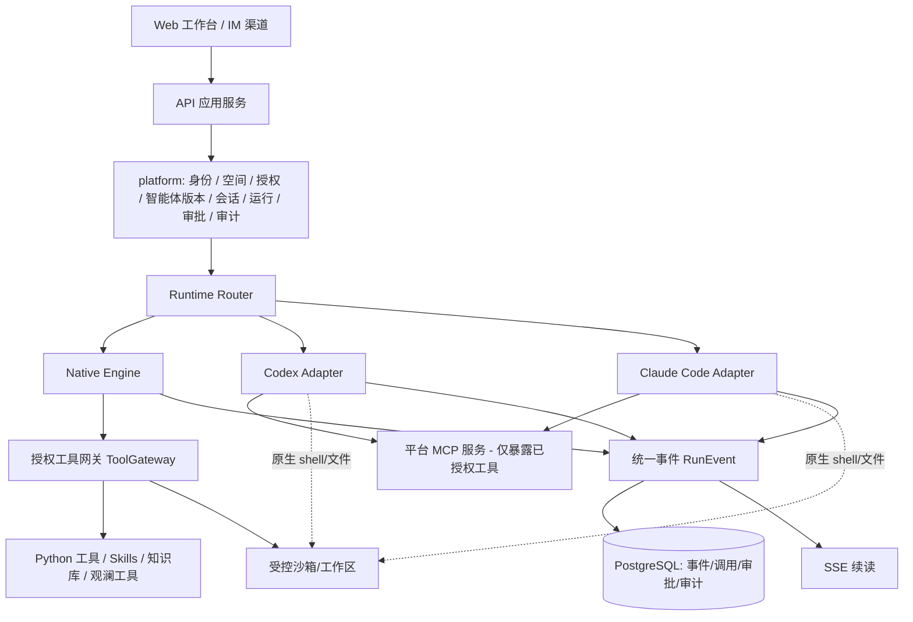

# Hyoga Nexus 智能体框架重构方案

状态：已确认。决策见第 14 节；Codex 采用方案 A（SDK + 协议），Claude Code 采用 `claude-agent-sdk`，Native 采用等价翻译 + 拆分。实施前仍有验证门禁（第 7、10 节）。
日期：2026-10-31
取代范围：`docs/pending/` 中原有的历史分析与计划文档（已合并或删除，见第 12 节），以及 `docs/` 中与旧方案冲突的段落。

---

## 1. 目标与边界

构建一个全新的通用智能体平台，满足三个条件：

1. **自研 Native 智能体**：吸收多个开源项目的已验证优势，而不是复刻某一个项目。
2. **外部 Runtime 封装切换**：Codex 与 Claude Code 通过官方 SDK/协议封装为 Runtime Adapter，与 Native 并列，用户在创建智能体时选择类型。
3. **平台统一治理**：身份、空间、资源授权、审批、记录、事件、审计由平台掌握，无论运行在哪种 Runtime 上。

不做的事（本方案明确排除）：

- 不把整个参考项目作为子进程或运行环境嵌入。
- 不让外部 Runtime 的原生工具（shell、文件、网络）绕过平台授权；做不到约束的能力，配置层禁止绑定。
- 不在没有隔离后端验收前开放任意代码执行。
- 不宣称 Codex/Claude 与 Native 功能对等；能力差异在界面和配置中显式展示。

## 2. 方法与证据等级

本方案的依据分为三类，每条技术结论都标注来源等级：

| 等级 | 含义 | 本次方案中的例子 |
|---|---|---|
| A | 本次直接读取的源码或官方页面 | GenericAgent `agent_loop.py`（StepOutcome、BaseHandler.dispatch、hooks）；WeKnora `internal/agent/engine.go` 结构；Hermes `agent/transports/codex_app_server.py`（协议、最低版本 0.125.0）；Codex SDK 与 App Server 文档 |
| B | 既有分析文档（2026-10-24/25，已删除，历史版本见 Git 提交 `3803f09`） | 对九个项目的分层剖析与选型讨论；其结论已并入本方案第 3 节 |
| C | 搜索摘要或未直接核对 | Claude Agent SDK 的 `can_use_tool`、hooks、`resume` 行为（仅来自搜索摘要，**实施前必须读官方文档并锁定版本**） |

未在本次逐行阅读的部分（如 deer-flow 的 RunManager、FastGPT 的沙箱租约、RAGFlow 的 EvidenceRegistry）沿用等级 B 结论，实施对应模块前需补充逐文件核对。

## 3. 参考项目取舍（采纳什么、不采纳什么）

| 项目 | 采纳 | 不采纳 / 需改造 | 落入模块 |
|---|---|---|---|
| GenericAgent | 紧凑循环；`StepOutcome(data, next_prompt, should_exit)` 三态；`dispatch` 按工具名分发并保留坏 JSON 恢复；agent/turn/llm/tool 生命周期钩子；工作检查点；SOP 作为可复用经验 | `locals()` 传给钩子（耦合过紧）；共享 `memory/` 目录；宿主 subprocess 执行 `code_run`；进程全局 cwd | `runtimes/native/engine`、`hooks`、`context/working` |
| WeKnora | 平台组织：Tenant→Workspace；`ResourceGrant` 与 `AgentGrant` 分离；会话 busy gate；完成判断（no_tool、截断、空响应）；压缩与 token 校准；审批与挂起恢复；事件 Last-Event-ID | Go 服务作为必需依赖；Neo4j 图谱作为默认路径 | `platform` 授权与会话；`native/engine` 完成判断；`knowledge`（Python 重写） |
| Hermes Agent | Codex app-server 客户端的协议细节与版本门槛；Prefix Cache 稳定性（系统提示冻结）；上下文压缩分段；会话分叉（parent_session_id）；多后端执行思路 | 单文件巨型 `run_conversation`（应拆分）；把 Codex 事件投影进自有会话时的耦合 | `runtimes/adapters/codex`、`native/context` |
| RAGFlow | `EvidenceRegistry`：给每个召回片段分配稳定短句柄 `[ID:n]`，重复召回不重复发送正文，确定性引用；检索判断断路器；正交检索工具（grep/list/navigate） | 从 Python 向 Go/C++ 迁移中的构建链；DeepDoc 的重依赖暂不引入 | `knowledge` 检索与引用 |
| DeerFlow | `RunManager` + `StreamBridge` 的断线续读；技能沙箱只读投射；请求级密钥注入与 stdout 脱敏；中间件分层 | LangGraph/LangChain 的状态与消息体系（黑盒较多） | `platform` 运行事件；`skills` 投射；`platform/credentials` |
| FastGPT | 双轨资源鉴权（用户侧与应用侧分离）；租约式沙箱（执行方持有租约，过期回收） | 有环图工作流作为 Native 主循环（本阶段不需要，留给后续工作流能力） | `sandbox` 租约；`platform` 鉴权 |
| TradingAgents | 多角色分析与辩论、交割后的反思写回（用于 P7 股票研究） | 把多智能体辩论作为通用循环（不适合通用场景） | `packages/guanlan`（领域层，P7） |
| DeepSeek Harness | 事件溯源的会话日志，模型可见内容由事件派生；能力接缝三元组（同一能力可替换本地/容器/SSH 后端）；单调安全守卫；超大输出 Spill 落盘 | 全套 TypeScript 运行时（只借鉴设计，不引入） | `runtimes/native` 事件派生；`sandbox` 接缝；`tools` 守卫 |
| LobeHub | 异构智能体适配的状态机思路；上下文引擎管线化 | 前端耦合的状态实现 | 仅作 Web 会话状态参考 |

## 4. 总体架构



分层原则（沿用 AGENTS.md 与 architecture.md，并细化为本方案的依赖规则）：

- `core`：只含契约（端口、DTO、事件、错误码）；不依赖任何厂商 SDK 与其他业务包。
- `platform`：业务规则与持久化；不导入 runtime 实现。
- `runtimes`：Native 与外部适配器；外部 SDK 类型不出适配器边界。
- `tools` / `skills` / `knowledge` / `sandbox` / `mcp`：能力包，只通过 core 端口被调用。
- `apps`：组合根，显式装配 Runtime、工具、领域扩展。

## 5. 统一 Runtime 契约

目标是让三种运行方式对平台表现一致，差异通过能力描述显式暴露。

### 5.1 操作集合（core 端口）

```python
class AgentRuntime(Protocol):
    def describe_capabilities(self) -> RuntimeCapabilities: ...
    async def start(self, request: RunRequest, ctx: RunContext) -> RuntimeHandle: ...
    def stream(self, handle: RuntimeHandle) -> AsyncIterator[RunEvent]: ...
    async def respond(self, handle: RuntimeHandle, decision: ApprovalDecision | UserInput) -> None: ...
    async def cancel(self, handle: RuntimeHandle, reason: str) -> None: ...
    async def resume(self, snapshot: RunSnapshot, ctx: RunContext) -> RuntimeHandle: ...
```

- `RunRequest` 只包含：run_id、session_id、agent_version_id、用户消息、附件引用、模型配置引用、已解析的资源清单（只读快照）、预算、工作区句柄、凭据句柄（不含明文）。
- `RunContext` 包含：主体、空间、当前权限校验函数（每次工具调用都重新调用，不依赖快照）。
- `RuntimeCapabilities` 每项取值 `supported | unsupported | unverified`：`text_stream`、`tool_bridge`、`mcp`、`skills`、`approvals`、`cancel`、`conversation_resume`、`execution_resume`、`steer`、`native_shell`、`native_file_write`、`network_control`。

### 5.2 事件模型（RunEvent）

统一事件类型，所有 Runtime 映射到此集合：

`run.started`、`message.delta`、`message.completed`、`reasoning.summary`（可选，默认不展示原文）、`tool.started`、`tool.completed`、`approval.requested`、`approval.resolved`、`input.requested`、`artifact.created`、`usage.updated`、`run.completed`、`run.failed`、`run.cancelled`、`run.interrupted`。

规则：

- 持久化先于推送；每个 run 内 `sequence` 单调递增；`event_id` 全局唯一。
- 只有明确的 `completed` 才算成功；进程退出、连接断开、流结束但无终态，均为 `interrupted` 或 `failed`。
- 有副作用的工具若结果未知，状态为 `interrupted`，不自动重放。

### 5.3 状态映射（已核对的 Codex 值）

| 统一状态 | Codex App Server | Claude Agent SDK（待核对） | Native |
|---|---|---|---|
| completed | `turn/completed` 且 `status=completed` | 结果消息且无错误 | `StepOutcome.should_exit` 且为完成 |
| interrupted | `turn/completed` 且 `status=interrupted` | 取消确认 | 取消信号已生效 |
| failed | `turn/completed` 且 `status=failed` | 错误结果 | 异常/预算耗尽 |
| 工具 declined | `commandExecution`/`fileChange` 最终 `declined` | 权限拒绝 | 网关拒绝 |

## 6. Native 引擎设计

### 6.1 循环结构

采用 GenericAgent 的循环形态，但拆分为可测试的组件（避免 WeKnora 与 Hermes 式的超大函数）：

```
RunOrchestrator（生命周期、取消、预算、事件持久化）
  └─ TurnExecutor（单回合：组装上下文 → 调模型 → 解析结果）
       ├─ ContextAssembler（冻结系统前缀 + 历史视图 + 工作检查点）
       ├─ ModelPort（流式，厂商无关）
       ├─ CompletionJudge（no_tool / 截断 / 空响应 / 重复调用判断，借鉴 WeKnora）
       └─ ToolDispatcher（参数校验 → 授权网关 → 执行 → 结果截断/Spill）
```

- `StepOutcome` 扩展为 `ToolResult(data, next_prompt, disposition)`，disposition ∈ {`continue`, `complete`, `wait_input`, `exit_failed`}，与现有 P2 实现语义一致。
- 预算三个维度分别计：逻辑回合、模型尝试、活跃耗时。恢复后累计，不因重新计数绕过限制。

### 6.2 上下文与缓存

- **前缀冻结**（Hermes）：系统提示与工具 schema 在 Run 开始时计算一次，Run 内不变，保证供应商 prompt cache 命中。工具列表变化只能在下一个 Run 生效。
- **事件溯源视图**（DeepSeek Harness）：会话历史是事件流；模型可见消息由事件派生。压缩结果作为新事件写入，不删除源事件。
- **压缩**：分段（头部保留、中段摘要、尾部原文），摘要写入 checkpoint；token 估算用上一次 usage 校准（WeKnora calibration）。
- **证据引用**（RAGFlow）：知识片段进入上下文时分配 `[ID:n]`；同一 Run 内重复片段只发送句柄；模型回答的引用只能指向已登记句柄，否则判为无效引用。

### 6.3 工具与安全

- **单调守卫**（DeepSeek Harness）：每次工具调用依次经过：schema 校验 → 当前授权（查询数据库，不读快照）→ 风险分级 → 审批（如需）→ 执行 → 审计。守卫只能收紧，不能被工具参数放宽。
- **大输出 Spill**：超过阈值的工具输出写入 run 级工件存储，上下文中只保留摘要与引用句柄。
- **工具定义**：`ToolDefinition` 含名称、版本、JSON Schema、风险等级、所需资源、副作用标记（有/无）、幂等性标记、超时。

### 6.4 持久化

新增或扩展的表（增量迁移，不清库）：

| 表 | 用途 |
|---|---|
| `runs` / `run_events` | 已有，补充 `runtime_kind`、`runtime_session_id`、`capabilities_snapshot` |
| `run_snapshots` | 等待输入/审批时的版本化快照（已完成调用、上下文指针、预算） |
| `tool_invocations` | 已有，补充幂等键、副作用标记、结果状态 |
| `action_approvals` | 单次审批决定 |
| `action_grants` | 可记忆授权（session 作用域、绑定哈希、风险等级、过期、撤销），与 `resource_grants` 分离 |
| `runtime_session_links` | 平台会话 ↔ 外部 `thread_id` / `session_id` 的映射及其所属主体、空间 |
| `memory_drafts` | 已有草稿表，增加审核状态机 |

## 7. 外部 Runtime 封装

### 7.1 Codex Adapter

依据：Codex SDK 与 App Server 官方文档（等级 A）。

- **集成方式（已确认：方案 A）**：`openai-codex` SDK 管进程与基础调用（`Codex` / `AsyncCodex`，`thread_start`、`thread.run`、`Sandbox.read_only|workspace_write|full_access`）；流式事件与审批经 app-server 协议获取。
  - 验证门禁（R3 开始前必须完成）：确认 SDK 是否暴露底层 JSON-RPC 通道，使事件、审批与 SDK 调用共用同一连接。
    - 若可以：按 SDK 方式集成，事件路径只经该通道。
    - 若不可以：回退为直连协议，SDK 仅保留为 CLI 版本锁定来源（`CodexConfig(codex_bin=...)`）。回退须在 R3 记录并告知用户，不静默切换。
  - SDK 与 CLI 版本一并锁定；升级任一项前重跑契约测试。
  - 方案 A 的已知代价：SDK 版本节奏与审批语义耦合，需要持续跟踪；直连协议的测试可用假 app-server 完成，而经 SDK 的测试需要穿透其内部。
- **版本门槛**：锁定 Codex CLI 版本（Hermes 的经验为不低于 0.125.0）；启动时读取版本与 `initialize` 能力，不匹配则 `describe_capabilities` 返回 unsupported。
- **会话映射**：平台 `session_id` ↔ Codex `thread_id`，存入 `runtime_session_links`。`thread/resume` 用于恢复对话；`thread/fork` 用于分支；`thread/compact/start` 仅在平台压缩不可用时使用。
- **事件映射**：
  - `item/agentMessage/delta` → `message.delta`
  - `item/started` / `item/completed`（commandExecution、fileChange、dynamic tool call）→ `tool.started` / `tool.completed`
  - `item/commandExecution/requestApproval`、`item/fileChange/requestApproval` → `approval.requested`；平台决定后回复 `accept` / `acceptForSession` / `decline` / `cancel`；`acceptForSession` 必须经平台 `action_grants` 批准后才能发送
  - `serverRequest/resolved` → `approval.resolved`
  - `thread/tokenUsage/updated` → `usage.updated`
  - `turn/completed` → 按第 5.3 节映射终态
  - `mcpServer/elicitation/request`、`tool/requestUserInput` → `input.requested`（经平台转发给用户）
- **取消**：`turn/interrupt`；收到 `interrupted` 终态后才结束 run。
- **引导**：`turn/steer` 作为可选能力，默认 unsupported，待验证。
- **原生能力约束**：
  - 文件与 shell 由 Codex 自身执行，通过 `Sandbox` 参数限制为 `workspace_write`，工作目录为平台分配的隔离工作区；`full_access` 禁止用于多用户场景。
  - 网络限制通过 app-server 配置（`configOverrides`）与审批策略实现；无法验证时在能力中标记 unverified 并禁止绑定需要网络控制的技能。
  - 平台工具经平台 MCP 服务暴露给 Codex（`mcpServer` 配置），每次调用携带短时运行令牌，由平台复核权限（不信任模型传入的 workspace/user）。
- **WebSocket 监听**：文档标注实验性且非生产可用，只用 stdio；若将来改用 WebSocket，必须先配置 `capability-token` 或 `signed-bearer-token`。
- **过载重试**：`-32001` 使用指数退避与抖动，并计入预算。

### 7.2 Claude Code Adapter

依据：搜索摘要（等级 C），**实施前必须核对官方文档并锁定版本**。

- **集成方式**：`claude-agent-sdk`（Python）的 `ClaudeSDKClient`（支持自定义工具与 Python 回调钩子）。
- **权限**：`can_use_tool` 回调作为审批入口（映射到 `approval.requested`）；`allowed_tools` 只做自动批准，不隐藏工具，因此禁用原生工具必须用 `disallowed_tools`。
- **会话**：首次回复获取 session id，保存到 `runtime_session_links`；后续用 `resume`。`fork_session` 用于分支。
- **系统提示**：SDK 在首次请求记录系统提示并复用；平台的提示变更只在新会话生效，与前缀冻结规则一致。
- **原生工具**：Bash/Edit/Read 等原生工具必须通过 `disallowed_tools` 或 `can_use_tool` 限制；未能限制的工具不能绑定到该 Runtime。
- **依赖**：需要本机安装 Claude Code CLI，版本与 SDK 配套；账号与模型权限单独验证。

### 7.3 切换规则

- 智能体版本固定 Runtime 类型；切换类型 = 新智能体版本。
- 会话切换 Runtime：创建新会话，或显式分支。平台将摘要、已授权的消息与引用传递给新 Runtime；不承诺迁移 SDK 内部状态。
- 运行时能力不足时，UI 显示差异，并在发布智能体时拦截不满足其绑定资源的组合。

## 8. 工具、技能、知识库、沙箱的统一接入

| 能力 | Native | Codex | Claude Code |
|---|---|---|---|
| 平台 Python 工具 | 直接调用网关 | 平台 MCP 服务 | 平台 MCP 服务或 SDK 自定义工具 |
| 技能 | 平台加载指令与资源（渐进披露） | 转换为指令；仅当 SDK 支持时加载目录 | 同左，以指令与授权工具形式 |
| 知识库 | `search_knowledge` / `read_document` / `list_documents` 工具 | 同一 MCP 工具 | 同一 MCP 工具 |
| 文件/Shell | 不提供宿主执行；sandbox 接缝后端经验收后开放 | 原生，限制在工作区 | 原生，限制在工作区 |
| 产物 | Spill 与 artifact 记录 | 从 `fileChange` 与工作区收集 | 从工作区收集 |

**沙箱接缝**（DeepSeek Harness 的 seam 思路）：定义 `CommandExecutorPort` 与 `FileStorePort`，实现 local（仅开发）、docker（候选）、ssh（候选）。只有通过隔离验收（资源限制、网络隔离、用户隔离、清理）的后端才能注册任意代码工具；未注册时工具列表中不出现。

**MCP 桥**：平台 MCP 服务必须按运行令牌鉴权，令牌短时（与 run 生命周期一致）、单 run 有效、撤销即失效。

## 9. 知识库与记忆（R5）

原 P3 实施步骤已并入本节（原文件已删除）。

### 9.1 边界

- PostgreSQL 保存知识库、文档、不可变文档版本、索引任务状态、文本块定位与引用等关系事实。
- 向量索引与相似度检索由独立向量服务承载，保存可回链到知识库、文档版本、文本块的标识；具体产品在 R5 OpenSpec 中技术验证后确定。
- 原始文件走可替换的对象存储接口。
- 知识图谱增强为可选能力，按知识库单独启用；普通知识库不依赖图谱服务。
- 结构化股票行情、财务数据和平台记忆不进入文档知识库或其图谱。

### 9.2 文档生命周期（P3.1）

1. 定义知识库、文档、文档版本、解析/索引任务、文本块、来源定位和引用契约。
2. 创建、更新、删除、上传、去重与版本流程；原文件保留于对象存储，数据库保存元数据与状态。
3. 解析与分块作为可恢复后台任务，记录阶段、重试、失败原因和幂等标识。首期支持文本、Markdown、PDF；扫描 PDF 的 OCR 范围另行确认。
4. 每个文本块关联来源文件、文档版本、页码或章节。重建索引使用新索引版本，避免新旧块混用。

### 9.3 基础混合检索与引用（P3.2）

1. 同一批有版本与来源的文本块同时构建关键词索引与向量索引。
2. 先确定调用者有权访问的知识库与文档范围，再在该范围内执行关键词与向量检索。不得先全局召回再在展示层过滤（Pre-Filter）。
3. 合并关键词与向量候选，可选重排。保留召回通道、分数、来源与索引版本，使检索结果可诊断。
4. 提供 `search_knowledge`、`read_document`、`list_documents`。答案引用可回到文档版本与文本块定位；删除、撤权和索引替换同步影响可检索性。
5. 无图谱服务时基础 RAG 必须完整可用。向量服务异常时返回可解释的降级结果，不得绕过权限，也不得伪造引用。

### 9.4 图谱增强（P3.3–P3.4，可选）

- 知识库可单独启用图谱，并配置实体类型、关系类型、抽取约束、别名与归一规则、模型配置版本。配置须明确方向、适用条件与禁止推断的内容，避免过宽 schema。
- 图元素记录知识库、文档版本、来源块、抽取时间、抽取器与 schema 版本。原文块仍是证据事实源，图节点与边是可追溯的派生数据，不得脱离来源块成为权威事实。
- 实体归一保守处理：不得仅凭名称相似合并不同公司、证券、人物或事件；不能可靠归一的实体保留为不同实体并保留原始提及名。
- 图谱写入按知识库与索引版本隔离，支持幂等重试、进度与失败原因展示，新版本构建完成后才切换为可见版本，防止半成品图谱被查询。
- 图谱检索仅在授权范围内存在已完成索引的图谱知识库时才提供给智能体。查询解析实体后做有界匹配与关系扩展，并重新按当前用户、空间、知识库和文档授权过滤证据。图查询不得成为知识库范围之外的旁路。
- 对种子实体、关系数、扩展跳数、证据块数、耗时和模型调用设定上限。被截断时明确告知，不能把有限邻域未返回的关系解释为“关系不存在”。
- 图服务超时或索引缺失时回退基础混合检索并记录降级；权限拒绝不得回退为越权搜索。

### 9.5 管理与验证（P3.5）

- 文档页展示解析、索引与图谱构建状态；提供检索测试入口，分别查看基础检索与图谱增强的来源块、融合状态、截断与降级原因。
- 固定评估集覆盖：关键词命中、语义召回、跨文档实体关系、多跳问题、引用准确性、权限隔离、文档更新与删除、索引重建、图服务故障降级。
- 图谱仅在代表性语料有明确增益后按知识库启用，比较检索质量、延迟、模型用量与维护成本。

### 9.6 R5 验收增补

- 同一智能体可绑定多个知识库；无权的库和文档不会通过向量或图谱路径泄漏。
- 基础知识库可通过混合检索生成可追溯答案，不依赖图谱服务。
- 启用图谱的知识库可回答跨文本块的实体关系问题；节点、关系与摘要均能回溯到授权原文块。
- 图谱不可用或索引未完成时，普通检索保持可用并显示降级；截断的图查询不会导致错误的否定结论。
- 文档更新、删除、撤权与索引重建同步处理向量索引与图谱索引，旧版本不再被召回。

### 9.7 记忆

- 分三类：用户偏好、工作事实、可复用经验（SOP）。
- 模型只能提交草稿；草稿经人工或规则审核后发布版本，发布后才进入检索。
- 检索结果与记忆都通过 `[ID:n]` 句柄进入上下文，引用可追溯到文档版本与片段。

## 10. 执行计划

以 `docs/roadmap.md` 的阶段为框架，调整顺序并细化验收。

| 阶段 | 目标 | 主要交付 | 验收标准 | 前置 |
|---|---|---|---|---|
| R0 清理与契约 | 确认本方案，删除历史文档，锁定 core 契约 | 新 `docs/` 结构；`AgentRuntime` 端口与 RunEvent 类型；能力描述 | 契约测试；旧文档引用检查为零 | 用户确认 |
| R1 平台底座收敛 | 完成 PostgreSQL 专项验收，补齐 `runtime_session_links`、`action_grants`、快照表 | 迁移；PostgreSQL 并发/崩溃恢复测试 | 目标环境 PostgreSQL 测试通过 | R0 |
| R2 Native 引擎补齐 | CompletionJudge、压缩与校准、前缀冻结、Spill、Evidence 句柄、快照恢复 | 对照 GenericAgent/WeKnora 的行为矩阵测试 | 行为矩阵全部通过；无隔离后端时执行工具不可见 | R1 |
| R3 Codex Adapter | app-server 客户端、事件映射、审批桥、会话映射 | 集成测试（用 Codex 真实 CLI 版本） | 同一测试集在 Native 与 Codex 上的终态一致；审批可拒绝；取消生效 | R2 的 RunEvent；账号可用 |
| R4 Claude Code Adapter | ClaudeSDKClient 封装、`can_use_tool` 桥、resume | 同 R3 的测试集 | 同上；原生工具被禁用的测试 | R3（复用测试框架） |
| R5 知识库 | 第 9 节流程、Evidence 句柄、授权预过滤 | 检索与引用评估集 | 无权文档不可检索/读取；删除与重建可验证 | R2 |
| R6 技能与 MCP | 版本化技能、渐进披露、依赖校验、MCP 按工具授权 | 两个技能与 MCP 工具协同 | 缺失依赖阻止发布 | R2、R5 |
| R7 沙箱后端 | 候选后端评估与隔离验收 | 通过验收的一个后端 | 资源与网络隔离测试 | R6 |
| R8 渠道与治理 | IM 渠道（企业微信优先）、评估体系、更多 Runtime | 渠道适配器；运行评估集 | 按既有 P8、P9 验收 | R2；视情况 |
| R9 股票研究（最后一期） | 观澜数据平台（P6）与股票研究技能（P7）合并交付，见第 15 节 | 数据适配器与调度、领域工具、研究流程、报告 | 第 15 节验收标准 | R5–R8；数据源与账号实施时提供 |

顺序依据：R3/R4 依赖统一事件与审批，因此放在 Native 行为补齐之后；Codex 先于 Claude，是因为 app-server 协议已由 Hermes 验证并有官方文档，Claude SDK 的权限与 resume 行为需先核对。

## 11. 测试与评估

- **契约测试**：同一组用例（文本流、多工具、审批拒绝、取消、超时、崩溃后恢复）跑在 Native、Codex、Claude 三个 Adapter 上，断言统一终态与事件序列。
- **行为矩阵**：GenericAgent 与 WeKnora 的关键行为逐条映射到测试（与 `openspec/changes/p2-native-agent/verification.md` 的做法一致）。
- **安全测试**：越权工具调用、撤权后的下一次调用、运行令牌过期、原生工具禁用、秘密不进入事件。
- **集成**：PostgreSQL（目标环境）、真实 Codex/Claude（账号可用时）。未执行的部分在交付说明中列明。
- **评估集**：固定智能体任务、检索引用正确率、技能选择准确率（evals/）。

## 12. 文档与历史资料处理（已执行）

- 已删除 `docs/pending/` 中除本文件外的 7 个历史文档。股票与观澜讨论的有效结论合并到第 15 节，P3 知识库步骤合并到第 9 节，其余结论已体现在本方案中，未迁入 `packages/guanlan/docs/`。
- 删除内容保留在 Git 历史中，删除前的提交为 `3803f09`，可按该提交恢复。
- 已改写 `docs/reference-analysis.md`、`docs/roadmap.md`、`docs/runtime-contract.md`、`docs/architecture.md`、`README.md`、`packages/runtimes/` 文档及 `openspec/changes/p2-native-agent/verification.md` 中指向旧文档的链接。
- `docs/roadmap.md` 的阶段表，改为本方案第 10 节。

确认前不删除、不修改上述文件。`openspec/changes/` 下的变更目录按其自身状态处理，不在本次删除范围内。

## 13. 风险

| 风险 | 影响 | 应对 |
|---|---|---|
| Codex app-server 协议为实验性或版本变化快 | 适配器破坏 | 锁定版本；能力探测；契约测试覆盖 |
| Claude SDK 权限/resume 行为与摘要不一致 | 审批或会话错误 | 实施前读官方文档，R4 前不承诺 |
| 外部 Runtime 原生工具越权 | 数据泄露、误操作 | 工作区隔离 + 禁用原生工具；无法约束则不允许绑定 |
| 账号模型不可用 | 无法验收 | 用户提供账号与模型清单；未验收不宣称 |
| 参考项目许可证 | 合规 | 逐文件记录来源与许可证；只迁移 MIT/Apache 项目代码，其余仅借鉴设计 |
| 范围过大 | 交付延迟 | 严格按 R0–R9 验收推进，Native 与 Codex 先行 |

## 14. 需用户确认的决策

1. **Codex 集成**（已确认：方案 A，SDK + 协议）：R3 前完成第 7.1 节的验证门禁；若 SDK 不暴露底层通道，回退直连协议并告知用户。
2. **Claude Code 集成**（已确认）：按第 7.2 节以 `claude-agent-sdk` 封装；实施前核对官方文档并锁定版本，需本机安装 Claude Code CLI。
3. **Native 迁移方式**（已确认：等价翻译 + 拆分组件）：理由见第 14.1 节。
4. **沙箱优先级**（已确认）：R7 之前 Native 不提供任意代码执行。
5. **历史文档与股票内容**（已确认）：股票与观澜讨论合并为第 15 节，作为最后一期 R9；其余历史文档按第 12 节删除，待第 1 项决策后执行。
6. **真实账号与数据源**（已确认，实施时提供）：Codex/Claude 账号、模型清单及观澜数据源账号，在对应阶段实施前由用户提供；本方案不预先依赖。

### 14.1 迁移方式的推荐理由（第 3 项）

推荐"等价翻译 + 按职责拆分"，不采用单文件保留形式，原因：

- 仓库规范（AGENTS.md）要求保留原实现的关键流程、行为语义、边界条件和异常处理；等价翻译满足这一点，但不要求保留单文件结构。
- 同一规范禁止把整套功能集中堆入单个文件，且要求按职责拆分（接口、业务、数据访问、外部适配、工具实现各自清晰）。单文件形式与此直接冲突。
- GenericAgent 的循环本身只有约 130 行，但完整能力（hooks、工具分发、检查点、历史）分散在多个文件；直接保留单文件会把 WeKnora 与 Hermes 的超大函数问题带入新代码。
- 拆分后每个组件可单独做行为矩阵测试，便于证明与参考实现行为一致。
- 代价：需要维护映射表与更多接口，R2 的工作量增加；但这是 R2 的行为验收前提，不是额外范围。

## 15. 股票研究与观澜数据平台（最后一期 R9）

状态：候选设计，合并自原 P6/P7 讨论记录（已删除）。不表示当前仓库已实现数据采集、XGBoost、辩论工作流或回测。进入 R9 前需按仓库规范创建 OpenSpec 提案，并由用户确认。

### 15.1 边界

- 领域代码放在 `packages/guanlan`；公共 Agent/Runtime/工具协议保持领域无关，`guanlan` 通过入口注册扩展。
- 三类数据分开管理：结构化行情与财务（领域数据）、研报与公告（知识库证据）、分析规则（审核后版本化）。三者互不替代。
- 数据源通过 `guanlan/data` 的适配器接入，Agent 与 Skill 只调用项目工具，不直接依赖任何供应商接口。候选数据源（如 AkShare）须逐接口验证覆盖市场、历史范围、更新频率、稳定性、使用条款与商业限制；不把"库中存在接口"当作 SLA 或授权保证。
- 每条数据保留来源（provider）、获取时间、数据对应时间、复权与口径；无法确认的字段或时点明确标记，不推断补齐。备用源结果标注实际来源与降级状态。

### 15.2 研究流程（候选，步骤是否必选待 R9 设计确认）

| 步骤 | 目的 | 可能使用的能力 | 主要产物 |
|---|---|---|---|
| 1. 明确任务 | 确定标的、市场、问题、预测周期、数据截止时点 | 股票分析 Skill、参数校验 | 任务范围与 as-of 时点 |
| 2. 准备证据 | 获取行情/财务数据，检索公告与研报 | 观澜数据工具、授权知识库检索 | 带来源、版本、时点的证据集 |
| 3. 分项分析 | 技术、基本面、事件/舆情分别整理；区分事实、推断与缺失 | 分析工具、规则、知识库引用 | 分析员报告 |
| 4. 量化参考（可选） | 对明确目标与周期调用已发布模型 | 模型推理工具 | 预测结果、验证摘要、限制 |
| 5. 多空论证（可选） | 多头与空头围绕共同证据互相回应 | 多空角色、共同证据 | 带引用的辩论记录 |
| 6. 综合结论 | 权衡论据质量、证据强弱、模型适用性与不确定性 | 研究经理角色 | 结构化研究计划与理由 |
| 7. 风险复核与报告 | 检查风险、情景与结论边界 | 风险检查、报告生成 | 含时点、引用、风险与限制的报告 |
| 8. 评估与回测（适用时） | 评估研究质量或策略表现，防未来泄漏 | `evals/`、`guanlan/backtesting/` | 可复现评估记录 |

历史策略回测不能由智能体文字结论替代，需单独处理复权、交易成本、停复牌、退市与未来信息泄漏。

### 15.3 从参考项目吸收的模式

- **TradingAgents**：分析员报告 → 多空研究员辩论 → 研究经理综合。多空立场主要由提示词引导，不是规则引擎，也不是投票。本方案只把它作为步骤 5、6 的候选工作流，不照搬实现。
- **daily_stock_analysis**：专业分工后由决策角色统一综合；按成本选择分析深度（quick/standard/full/specialist）；中间观点结构化（方向、置信度、依据、关键价位、风险标记）；风险清单与程序护栏；输入数据的来源与缺失状态可见。
- **Qlib**：训练与在线推理分离。模型训练、验证与发布属于离线流程，智能体只调用已发布版本的推理工具，不在对话中临时训练。信号需同时评估预测质量与策略表现；配置（数据集、切分、参数、回测设置）版本化以便重跑。
- **XGBoost 工具**：作为量化证据来源，结果携带预测目标、周期、数据时点、模型与特征版本、验证摘要和适用限制；不等同于买卖建议。Skill 只描述何时调用，不授予工具权限。

### 15.4 规则与研报治理

- 研报进入知识库，保留来源、作者、发布日期、适用市场与行业、文档版本；检索时结合标的、行业与时间范围，呈现引用，并保留相互矛盾的观点。
- 反复出现且适用范围明确的方法，可提炼为结构化规则（指标口径、估值步骤、风险检查项、适用与失效条件）。规则需专家审核与版本管理，并能追溯到原始研报。
- 硬约束尽量由程序校验；需要权衡解释的部分由智能体完成，并要求给出依据与不确定性。

### 15.5 R9 验收标准

- 报告中每个数值与结论可追溯到数据来源、时点与版本；缺失与降级可见。
- 无权数据或知识不可被检索或读取；撤权后下一次调用生效。
- 模型结果以版本化工具输出呈现，不在对话中训练；回测结果与文字结论分开展示，并记录基准、成本与时间段。
- 至少一个数据源通过逐接口验证后接入，并有失败、重试与降级测试。

### 15.6 实施时需用户提供

- 观澜数据源账号或授权信息（如使用需授权的数据接口）。
- 目标市场、标的范围、历史回溯范围与更新频率。
- 专家研报与规则的样例，用于 R5 检索与 R9 规则治理验收。
- 是否需要 XGBoost 或其他模型的既有产物。
