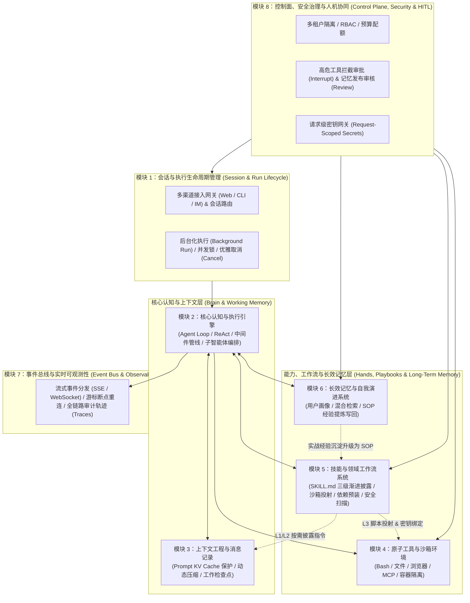

# 通用智能体 8 大核心模块与 Hyoga-Nexus 博采众长选型方案

> 生成日期：2026-10-25
> 对比范围：`/project/deer-flow`、`/project/WeKnora`、`/project/hermes-agent`、`/project/GenericAgent`、`/project/hyoga-nexus`

本文档汇总了对四个外部参考项目（**Deer-Flow**、**WeKnora**、**Hermes-Agent**、**GenericAgent**）与 **Hyoga-Nexus** 的源码级横向对比，提炼出通用智能体（General Agent）的 **8 大核心模块标准架构**，并给出每个模块向 **Hyoga-Nexus** 移植时的具体借鉴选型、源码锚点、落地方案与避坑清单。

---

## 一、 五大项目核心底座横向对比基线

### 1.1 会话管理、事件机制、消息记录与 Skill 对比总表

| 维度 | **Deer-Flow** (全栈多智能体平台) | **WeKnora** (企业级 RAG 问答底座) | **Hermes-Agent** (极客全能个人助手) | **GenericAgent** (极简自进化种子) | **Hyoga-Nexus** (强治理垂直生产力平台) |
| :--- | :--- | :--- | :--- | :--- | :--- |
| **核心定位** | 基于 LangGraph 的异步工作流与沙箱多智能体编排 | 基于 Go 的无状态多租户知识库问答与 Agent 服务 | 多端 IM 网关接入的全天候本地/容器生产力 Agent | 300 行主循环 + SOP 自进化的极简宿主机 Agent | 显式受控状态机 + 强版本/权限/审计治理的垂直平台 |
| **1. 会话与生命周期** | `RunManager` + `ThreadState` 双层解耦；支持 `reject`/`rollback`/`interrupt`/`enqueue` 四种并发策略 | **无状态 Session 容器**：Go 实例不驻留会话，状态存 Redis + PG；Redis Pub/Sub 跨实例 Cancel | SQLite (`state.db`) 持久化 + 多渠道网关动态会话路由；通过 `parent_session_id` 构建会话分叉链 | 进程内全局变量 + 磁盘文件，无多用户/多会话并发隔离；支持 ` fork ` 自重启 | PG 双平面分离：交互会话 (`chat_sessions`) 与后台分析执行 (`analysis_runs`) 解耦 |
| **2. 认知与执行引擎** | LangGraph 状态图 + 14 层洋葱圈 Middleware + `SubagentExecutor` 并发子智能体池 | Go 同步 ReAct 循环 (`AgentEngine`) + Hook 拦截器 | 单文件巨型同步 Loop (`AIAgent.run_conversation`) + 进程池 Subagent (`delegate_tool`) | 300 行 `agent_runner_loop` + `BaseHandler.dispatch` 动态分发 `do_<tool>` | 显式有限状态机 `RunRunner`，拒绝黑盒多智能体自治 |
| **3. 上下文与消息记录** | 链式 `RunJournal`（通过 `parent_id` 支持树状分支）+ `SummarizationMiddleware` + `DurableContextMiddleware` | 滑动窗口加载近期历史 + Redis 瞬态流与 PG 最终消息双写 | **双轨存储** + **严守 System Prompt 静态化保 KV Cache** + 两阶段 `ContextCompressor` | **三层递进工作记忆**：`raw_history` + `history_summary` + `working_checkpoint` (`key_info`) | 平台数据库强 Schema 组装 + 模板化 Prompt 注入 |
| **4. 原子工具与沙箱** | `SandboxProvider`（Local / Docker / K8s）+ `/mnt/user-data` 虚拟路径映射 + MCP | Go 内置 RAG 检索工具集 + 受控沙箱执行 + MCP | 6 大执行后端（Local / Docker / SSH / Modal / Daytona / Singularity）+ 超大输出自动转存文件 | 9 个宿主机原生工具（`code_run` / `file_patch` / `web_scan` 等），无沙箱隔离 | 强权限网关封装的确定性领域工具与受控命令执行 |
| **5. 技能系统 (Skill)** | **L1 延迟发现 (`describe_skill`) + 沙箱只读签名投射 (`projection.py`) + 静态 AST 安全扫描** | **Claude 规范三级渐进披露 + 独创 Installer Agent 安装期预烘焙租户技能镜像** | **5 层目录扫描 + 平台/环境/App 准入过滤 + 防压缩保护 + `skill_manage` 自主热更新** | **SOP 即 Skill**：`global_mem_insight.txt` 指针表 + `memory/*_sop.md` + Python 脚本 | **版本化资源绑定 (`AgentVersion`) + 发布期依赖强校验 + “Skill 绝不授予额外权限”** |
| **6. 记忆与自我演进** | 异步去抖队列 (`MemoryUpdater`) 后台提炼全局 User Profile 与 Fact | 无跨会话自演进机制，聚焦企业静态知识库检索 | SQLite FTS5 全文检索历史会话 + Agent 自主调用工具写回记忆与技能 | 读取 SOP 时触发 `log_memory_access` 统计与 `[SYSTEM TIPS]`；满 10 轮直接 `file_patch` 改写 SOP | 模型仅可调用 `propose` 提交 `memory_drafts` 草稿，必须经人工 `review` 审批后发布版本 |
| **7. 事件总线与观测** | `StreamBridge`（内存 / Redis Streams）+ `Last-Event-ID` 游标断点重连 | Go 泛型内存 `EventBus` + `SessionEventRelay` 桥接 SSE | 回调函数驱动 CLI 渲染与 IM 网关消息定时编辑刷新 | 仅 `ui.py` 进程内 `Queue` 供终端/Streamlit 展示 | 异步队列流式推送 + 完整数据库审计表 (`run_events` / `tool_executions`) |
| **8. 控制面与安全治理** | **3 门禁 `required-secrets` 带外注入与 stdout 自动脱敏** + Sidecar 凭证代理 + Clarify 挂起 | 多租户隔离 (`TenantID`) + RBAC + 租户级环境变量声明 + AgentGrant | 危险命令正则拦截审批 + 项目级 `.agents/skills` 检疫门禁 (Quarantine) | 零权限与多租户治理（完全信任本地单用户环境） | 完整控制面（Workspace / RBAC / ResourceGrant / AgentVersion 发布校验 / 记忆审核） |

---

### 1.2 参考项目核心优缺点速览

1. **Deer-Flow**
   * **优势**：工程化最完备的 Python 异步智能体底座；`RunManager` + `StreamBridge` 解决了长任务断线重连；`skills/projection.py`（沙箱只读投射）与 `secret_context.py`（请求级密钥注入 + stdout 脱敏）是极佳的安全标杆；14 层 Middleware 切面清晰。
   * **劣势**：重度耦合 LangChain / LangGraph 的消息与状态序列化体系，框架黑盒魔法较多，调试栈较深。
2. **WeKnora**
   * **优势**：“无状态 Session 容器”天然适合云原生水平扩缩容；针对禁网沙箱首创 **Installer Agent 安装期依赖预装与租户技能镜像固化**；多租户资源授权（`ResourceGrant` / `AgentGrant`）模型严谨。
   * **劣势**：Go 同步请求级 ReAct 循环对超长程（数十分钟）自主研究任务的上下文压缩、树状分支与动态子智能体支持较弱。
3. **Hermes-Agent**
   * **优势**：**上下文工程（Context Engineering）极致精细**——严格保护 System Prompt 静态前缀以命中 LLM KV Cache，配合两阶段压缩器与活跃 Skill 防裁剪保护；支持平台/环境/App 级别的 Skill 准入过滤与 FTS5 跨会话全文检索。
   * **劣势**：核心循环 `run_agent.py` 超过万行，单文件巨石架构耦合重；基于单机 SQLite，不支持多租户高并发服务化。
4. **GenericAgent**
   * **优势**：**极简主义与高信噪比的工作记忆设计**——300 行主循环清晰可控；`raw_history` + `history_summary` + `working_checkpoint` 三层递进记忆结构极大提升了长任务目标保持能力；读取 SOP 时自动记录访问频次并注入 `[SYSTEM TIPS]` 强制提取步骤到 Checkpoint 的机制以极小代价解决了“长任务遗忘 SOP”的痛点。
   * **劣势**：零多用户隔离、零沙箱防护、允许模型直接覆写生产 SOP 与宿主机脚本，不能直接用于多租户服务端。

---

## 二、 通用智能体的 8 大核心模块全景架构

### 能力层“铁三角”职责边界（模块 4 vs. 模块 5 vs. 模块 6）
* **模块 4（Tool + Sandbox）是“手和隔离车间”**：提供无状态的底层原子动作（读写文件、跑命令、查数据）与容器隔离环境。
* **模块 5（Skill）是“岗位操作手册（SOP）+ 配套脚本夹具包”**：通过 `SKILL.md` 三级渐进披露，教模型如何把原子工具编排成复杂领域工作流（如股票深度分析、DCF 估值计算），但 **Skill 本身绝不授予额外权限**。
* **模块 6（Memory）是“老员工的笔记本”**：记录跨会话的偏好、事实与踩坑教训；当某类经验经人工审核足够成熟时，可升级固化为新的 Skill。

---

## 三、 Hyoga-Nexus 8 大模块“博采众长”移植与落地方案

Hyoga-Nexus（Python 3.12 + FastAPI + SQLAlchemy Monorepo）目前已具备扎实的控制面契约（`packages/platform`），但在执行运行时（`packages/runtime`）、上下文工程（`packages/prompts`）、技能投射（`packages/skills`）和沙箱工具（`packages/tools`）上仍有巨大演进空间。

以下是针对每个模块的 **首选借鉴对象、源码锚点、落地改造方案与避坑清单**：

### 3.1 选型总览矩阵

| 模块 | **首选抄作业对象** | **次选/补充对象** | **移植到 Hyoga-Nexus 的核心机制** | **坚决不抄（避坑）** |
| :--- | :--- | :--- | :--- | :--- |
| **模块 1：会话与生命周期** | **Deer-Flow** (`RunManager`) | **WeKnora** (分布式 Cancel) | 后台 Task 托管 + 并发冲突策略（`reject`/`enqueue`/`interrupt`）+ 跨实例取消广播 | 不抄 Hermes 的 SQLite 单机锁；不抄 GenericAgent 的进程全局变量 |
| **模块 2：认知与执行引擎** | **Deer-Flow** (Middleware 切面) | **Hermes** (受控 Subagent) | 在 `RunRunner` 显式循环外层挂载洋葱圈 Middleware + 强契约化的只读分析子任务（Subagent） | 不引入 LangGraph 黑盒动态图；不抄 Hermes 万行单文件巨石类 |
| **模块 3：上下文与消息记录** | **Hermes-Agent** (KV Cache + 双阶段压缩) | **GenericAgent** (`working_checkpoint`) | **Prompt 静态前缀隔离（保 KV Cache）** + 两阶段工具输出瘦身 + 显式结构化工作检查点 | 不抄 Deer-Flow 繁琐的 LangChain 消息序列化补丁 |
| **模块 4：原子工具与沙箱** | **Deer-Flow** (`SandboxProvider`) | **Hermes** (超大输出自动转存文件) | 统一 `SandboxProvider`（Local/Docker/K8s）+ 虚拟路径映射 + 超长工具输出落盘截断 | 不抄 GenericAgent 的宿主机裸跑 `subprocess` / `inline_eval` |
| **模块 5：技能系统 (Skill)** | **Deer-Flow** (延迟发现 + CoW 投射) | **WeKnora** (安装期镜像预装) | **L1 延迟发现** + **激活态防压缩追踪** + **沙箱只读签名投射** + **离线依赖预烘焙** | 不抄 Hermes 允许模型在生产运行时直接 `skill_manage` 改写技能文件 |
| **模块 6：记忆与自我演进** | **GenericAgent** (读取钩子 + 热度统计) | **Deer-Flow** (异步去抖提取) | 在 Hyoga 现有 `propose -> review` 闭环上，增加**读取 SOP 时自动注入 Checkpoint 提示**与**记忆访问频次统计** | 不抄 GenericAgent/Hermes 的无审核直接覆写 SOP（破坏治理原则） |
| **模块 7：事件总线与观测** | **Deer-Flow** (`StreamBridge`) | **WeKnora** (类型化 EventRelay) | **内存 / Redis Streams 双模 `StreamBridge`**（支持 `after_seq` 游标重连）+ 里程碑事件异步落盘 `run_events` | 不在主推理协程里对每个 `token_delta` 同步阻塞写 PostgreSQL |
| **模块 8：控制面与安全治理** | **Deer-Flow** (`required-secrets` 网关) | **保留 Hyoga 现有设计** | 在 Hyoga 现有 RBAC + 版本发布校验基础上，补齐**请求级密钥带外注入与 stdout/日志自动脱敏** | — |

---

### 3.2 逐模块落地设计细节

#### 模块 1：会话与生命周期管理
* **现状**：[`PlatformRunStore`](file:///project/hyoga-nexus/packages/platform/src/nexus_platform/runs/store.py) 已分离 `chat_sessions` 与 `analysis_runs`，但执行层仍在请求链路内直接驱动 [`RunRunner`](file:///project/hyoga-nexus/packages/runtime/src/nexus_runtime/runs/runner.py)。
* **源码参考**：
  * Deer-Flow：[`deerflow/runtime/runs/manager.py`](file:///project/deer-flow/backend/packages/harness/deerflow/runtime/runs/manager.py#L46-L150)
  * WeKnora：[`internal/application/service/session.go`](file:///project/WeKnora/internal/application/service/session.go#L110-L155)
* **Hyoga-Nexus 改造方案**：
  1. **后台执行池 (`RunWorkerPool`)**：API 收到创建 Run 请求后仅落库 `AnalysisRun(status='pending')` 并立即返回 `run_id`，交由后台 `asyncio.Task` 池（或独立 Worker 进程）异步消费执行。
  2. **同会话并发门禁 (`multitask_strategy`)**：当同一 `session_id` 存在未结束的 Run 时，支持按配置执行 `reject`（返回 409 Busy）、`enqueue`（入队等待前序完成）或 `interrupt`（中止前序 Run 并启动新 Run）。
  3. **分布式优雅中止 (`Cancel`)**：通过 Redis Pub/Sub 广播 `cancel:{run_id}` 信号，触发目标 Worker 调用 `task.cancel()`，在 `finally` 块中完成沙箱回收并写入 `run_cancelled` 事件。

#### 模块 2：核心认知与执行引擎
* **现状**：[`RunRunner`](file:///project/hyoga-nexus/packages/runtime/src/nexus_runtime/runs/runner.py) 是干净的显式 Python 状态机。
* **源码参考**：
  * Deer-Flow：[`deerflow/agents/middlewares/loop_detection_middleware.py`](file:///project/deer-flow/backend/packages/harness/deerflow/agents/middlewares/loop_detection_middleware.py)、[`deerflow/subagents/executor.py`](file:///project/deer-flow/backend/packages/harness/deerflow/subagents/executor.py)
  * Hermes-Agent：[`tools/delegate_tool.py`](file:///project/hermes-agent/tools/delegate_tool.py)
* **Hyoga-Nexus 改造方案**：
  1. **保持纯 Python 显式主循环，引入轻量 Middleware 协议**：定义 `RunMiddleware` 接口（`before_model_call`、`after_model_call`、`wrap_tool_call`、`on_run_finish`），避免引入 LangGraph。
  2. **死循环检测中间件 (`LoopDetectionMiddleware`)**：对每次工具调用的 `(tool_name, canonical_json(args))` 计算签名；同一签名连续出现 3 次时在工具返回中追加系统警告，达到 5 次时临时剥夺该工具调用权，强制模型基于已有信息汇总结论（防止投研 Agent 查不到某项财务指标时无限重试）。
  3. **受控只读子任务 (`spawn_readonly_subrun`)**：针对“同时对比多家公司财报”等高噪音并行场景，允许主 Run 在平台配额内派生只读子 Run（拥有独立上下文窗口、继承当前 Workspace 只读权限、禁止再派生子任务），执行完毕后仅将结构化结论汇入主 Run。

#### 模块 3：上下文工程与消息记录
* **现状**：[`packages/prompts`](file:///project/hyoga-nexus/packages/prompts/) 与 `RunRunner` 尚未实现针对长程多步工具调用的 KV Cache 保护与多阶段压缩。
* **源码参考**：
  * Hermes-Agent：[`agent/context_compressor.py`](file:///project/hermes-agent/agent/context_compressor.py#L1050-L1200)
  * Deer-Flow：[`deerflow/agents/middlewares/durable_context_middleware.py`](file:///project/deer-flow/backend/packages/harness/deerflow/agents/middlewares/durable_context_middleware.py)
  * GenericAgent：[`ga.py`](file:///project/GenericAgent/ga.py#L525-L580)（`raw_history` / `history_summary` / `working_checkpoint`）
* **Hyoga-Nexus 改造方案**：
  1. **System Prompt 静态前缀铁律（保 KV Cache）**：将 `AgentVersion` 的固定角色指令、Tool Schema、Skill L1 索引固定在 System Prompt 最前端且**跨轮次字节级不变**；动态变化的当前时间、已激活 Skill 状态、`working_checkpoint` 统一注入到独立的 `<durable_runtime_context>` 消息块中，使长程分析任务的 LLM Prompt Cache 命中率保持在 85% 以上。
  2. **两阶段上下文压缩 (`ContextCompactor`)**：
     * **Phase 1（工具输出脱水）**：距离当前轮次超过 N 步的超长工具返回（如几百行原始财报表格），自动替换为 `[已归档至 tool_execution:{id}，摘要：...]`，但豁免近期加载的 `SKILL.md` 正文（借鉴 Hermes `_collect_protected_skill_names`）。
     * **Phase 2（历史区间折叠）**：当总 Token 超过模型窗口阈值（如 75%）时，保留首尾消息，将中间轮次压缩为结构化 `<history_summary>`。
  3. **结构化工作检查点 (`working_checkpoint`)**：借鉴 GenericAgent，在 Run 状态中维护显式的检查点槽位（包含 `objective`、`verified_facts`、`active_sop_steps`、`pending_questions`），确保即使经历多次上下文压缩，核心研究脉络也绝不丢失。

#### 模块 4：原子工具与沙箱执行环境
* **现状**：[`packages/tools`](file:///project/hyoga-nexus/packages/tools/) 需补齐安全隔离的代码/脚本执行后端与大输出保护。
* **源码参考**：
  * Deer-Flow：[`deerflow/sandbox/`](file:///project/deer-flow/backend/packages/harness/deerflow/sandbox/)
  * Hermes-Agent：[`tools/`](file:///project/hermes-agent/tools/)
* **Hyoga-Nexus 改造方案**：
  1. **统一 `SandboxProvider` 抽象**：定义 `SandboxSession` 协议，支持 `LocalRestrictedSandbox`（开发调试）与 `DockerPoolSandbox`（生产环境无外网容器池，预装 Pandas/Numpy/Matplotlib 等投研计算库）。
  2. **虚拟路径映射与 Artifact 自动采集**：模型在沙箱内仅能访问 `/workspace/inputs`（只读）、`/workspace/skills`（只读投射）和 `/workspace/outputs`（读写）；`/workspace/outputs` 下生成的图表或报告文件自动由平台采集并登记为 `RunArtifact`。
  3. **超大输出自动落盘截断**：单次工具输出超过阈值（如 16KB）时，自动将完整内容写入沙箱临时文件，仅向模型返回头部预览、行数统计与文件路径，防止单次工具调用撑爆上下文。

#### 模块 5：技能与领域工作流系统 (Skill System)
* **现状**：已有 [`skills/guanlan/stock-analysis/SKILL.md`](file:///project/hyoga-nexus/skills/guanlan/stock-analysis/SKILL.md) 及“Skill 不越权”原则，需补齐渐进式披露、沙箱脚本投射与离线依赖治理。
* **源码参考**：
  * Deer-Flow：[`deerflow/skills/describe.py`](file:///project/deer-flow/backend/packages/harness/deerflow/skills/describe.py)、[`deerflow/skills/projection.py`](file:///project/deer-flow/backend/packages/harness/deerflow/skills/projection.py)、[`deerflow/skills/security_scanner.py`](file:///project/deer-flow/backend/packages/harness/deerflow/skills/security_scanner.py)
  * WeKnora：[`internal/agent/skills/skill.go`](file:///project/WeKnora/internal/agent/skills/skill.go#L36-L79)、[`internal/application/service/tenant_skill_install.go`](file:///project/WeKnora/internal/application/service/tenant_skill_install.go)
  * Hermes-Agent：[`agent/skill_utils.py`](file:///project/hermes-agent/agent/skill_utils.py#L90-L193)、[`tools/skills_tool.py`](file:///project/hermes-agent/tools/skills_tool.py#L121-L136)
* **Hyoga-Nexus 改造方案**：
  1. **三级渐进式披露 + 防重复加载**：
     * **L1**：仅将当前 `AgentVersion` 已绑定且有权限的 Skill `name` + `description`（Skill 数量多时可开启延迟发现，仅放名称列表）注入 Prompt。
     * **L2**：模型调用 `load_skill` 时返回 `SKILL.md` 正文，同时启用会话内去重（借鉴 Hermes `dedup_skill_view`）并将技能名记入 `RunState.active_skills`（受防压缩保护，且写入 `run_events` 审计）。
     * **L3**：Skill 目录下的 `scripts/`、`references/`、`templates/` 仅在沙箱内按需读取或执行。
  2. **沙箱只读签名投射 (`SkillProjection`)**：借鉴 Deer-Flow `projection.py`，仅将当前 `AgentVersion` 显式绑定的 Skill 目录生成带 SHA256 清单的只读视图挂载进沙箱 `/workspace/skills/{skill_slug}`，拦截一切越界软链接。
  3. **发布期安全扫描与依赖预烘焙**：借鉴 Deer-Flow 的 `security_scanner.py`（静态 AST / Shell / 硬编码密钥扫描）与 WeKnora 的预装理念，严禁 Skill 在对话运行期联网执行 `pip install`，所有依赖必须在技能入库/版本发布阶段完成扫描与镜像预烘焙。

#### 模块 6：长效记忆与自我演进系统
* **现状**：Hyoga-Nexus 已具备领先的 [`propose`](file:///project/hyoga-nexus/packages/platform/src/nexus_platform/runs/store.py#L222-L235) $\rightarrow$ 人工 [`review`](file:///project/hyoga-nexus/apps/api/src/nexus_api/http/native.py#L74-L86) 受控演进工作流。
* **源码参考**：
  * GenericAgent：[`ga.py`](file:///project/GenericAgent/ga.py#L444-L446)（`do_file_read` 中的 `log_memory_access` 与 `[SYSTEM TIPS]`）
* **Hyoga-Nexus 改造方案**：
  1. **读取 SOP / Memory 时的自动提醒钩子（Read-Time Hook）**：当模型调用 `read_memory` 或 `load_skill` 时，在返回文本末尾自动追加：
     `"[SYSTEM TIP] 请将该 SOP/记忆中的关键执行步骤与约束条件立即提取并更新至 working_checkpoint 中。"`
     这一极简机制能显著降低长任务后半段模型偏离 SOP 的概率。
  2. **记忆与技能热度遥测 (`Access Telemetry`)**：在 `memory_entries` 与 `skill_usages` 上记录 `access_count` 与 `last_accessed_at`，帮助平台管理员识别高频核心 SOP 与长期未被调用的僵尸记忆。

#### 模块 7：事件总线与实时可观测性
* **现状**：[`store.py`](file:///project/hyoga-nexus/packages/platform/src/nexus_platform/runs/store.py) 使用进程内 `asyncio.Queue` 配合 `run_events` 表。
* **源码参考**：
  * Deer-Flow：[`deerflow/runtime/stream_bridge.py`](file:///project/deer-flow/backend/packages/harness/deerflow/runtime/stream_bridge.py)
* **Hyoga-Nexus 改造方案**：
  1. **抽象 `StreamBridge`（支持游标断点续传）**：提供 `MemoryStreamBridge`（单机）与 `RedisStreamBridge`（多实例生产环境），每个流式事件分配单调递增序号 `seq`，前端 SSE 断线重连时携带 `Last-Event-ID` / `after_seq` 即可无损补齐漏掉的增量输出。
  2. **高频流式帧与落库审计事件分离**：高频 `token_delta` 仅经 `StreamBridge` 推送前端并设置短 TTL 缓存；只在 `step_started`、`tool_call_started`、`tool_call_completed`、`skill_activated`、`message_completed`、`run_finished` 等关键节点写入 PostgreSQL `run_events` 与 `tool_executions` 表。

#### 模块 8：控制面、安全治理与人机协同
* **现状**：Workspace、RBAC、ResourceGrant、AgentVersion 发布校验与记忆 Review 已就绪。
* **源码参考**：
  * Deer-Flow：[`deerflow/runtime/secret_context.py`](file:///project/deer-flow/backend/packages/harness/deerflow/runtime/secret_context.py)、[`deerflow/sandbox/env_policy.py`](file:///project/deer-flow/backend/packages/harness/deerflow/sandbox/)
* **Hyoga-Nexus 改造方案**：
  1. **请求级密钥网关 (`Request-Scoped Secret Broker`)**：
     * Skill 或 Tool 在元数据中声明 `required_secrets: ["TUSHARE_TOKEN", "WIND_API_KEY"]`。
     * 执行沙箱脚本时，必须同时满足三重门禁：**① Workspace 已配置该凭证 $\times$ ② 当前 `AgentVersion` 已授权绑定该 Skill/Tool $\times$ ③ 该 Skill 在当前 Run 中已激活**，平台才将凭证通过内存通道注入子进程环境变量。
  2. **输出与日志强制脱敏 (`Secret Scrubbing`)**：在沙箱 stdout/stderr 返回给模型或写入 `tool_executions` / `run_events` 表之前，自动将所有已注入密钥的明文替换为 `[REDACTED]`，确保**沙箱进程可用、大模型与日志不可见**。

---

## 四、 推荐分阶段落地路线图（Roadmap）

1. **Phase A（低成本高收益：上下文工程与 SOP 遵循率质变）**
   * 落地 **模块 3**：System Prompt 静态前缀隔离（保 KV Cache）+ 两阶段工具输出压缩 + `working_checkpoint`。
   * 落地 **模块 6**：读取 Memory / Skill 时自动注入 `[SYSTEM TIP]` 钩子与访问频次统计。
   * 落地 **模块 2**：`LoopDetectionMiddleware` 死循环检测切面。
2. **Phase B（打通深度领域工作流：Skill 体系与沙箱投射）**
   * 落地 **模块 5**：Skill 三级渐进披露、`RunState.active_skills` 防压缩保护、沙箱只读签名投射 (`SkillProjection`)。
   * 落地 **模块 4**：统一 `SandboxProvider` 抽象、虚拟路径映射与超大工具输出自动落盘截断。
3. **Phase C（生产级高可用与企业安全闭环）**
   * 落地 **模块 1 & 7**：`RunManager` 后台 Worker 化、同会话并发冲突策略、分布式 Cancel、`StreamBridge` 游标断点续传。
   * 落地 **模块 8**：三重门禁 `required_secrets` 带外注入与输出自动脱敏网关、受控只读子任务 (`spawn_readonly_subrun`)。
