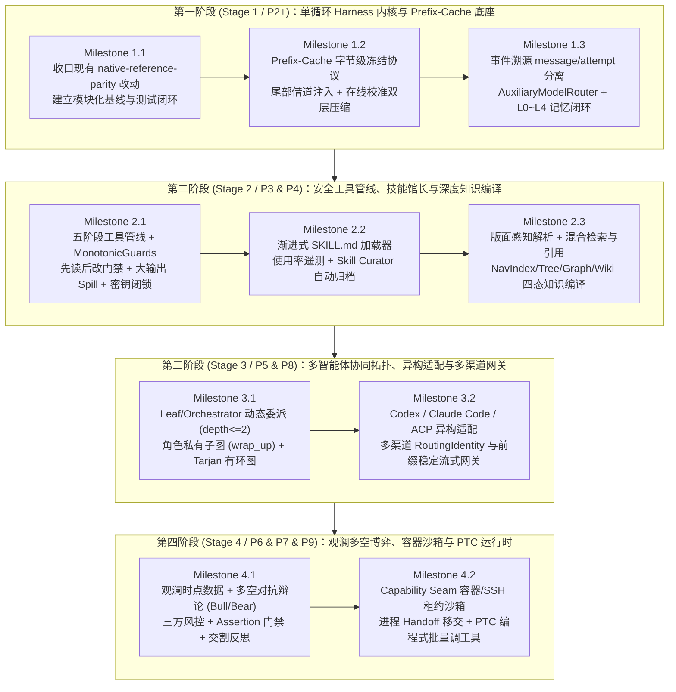

# 全功能智能体（Omni-Agent）分阶段落地实施方案（待确认分析）

> **文档状态**：分阶段架构演进与工程实施分析方案（2026-10-25，**待用户确认**）
> **前置文档**：[九大开源智能体深度源码剖析与全功能智能体架构及代码分层方案](open-source-agents-analysis-and-solution.md)、[分阶段路线图](../roadmap.md)、[目录设计](../directory-layout.md)、[参考项目分析](../reference-analysis.md)
> **适用原则**：本方案将九大开源智能体（`GenericAgent`、`WeKnora`、`RAGFlow`、`DeerFlow`、`FastGPT`、`LobeHub`、`TradingAgents/-CN`、`Hermes Agent`、`DeepSeek Harness`）的核心机制映射到 `hyoga-nexus` 现有仓库结构中。所有功能变更严格遵循 `AGENTS.md` 约定：**按阶段创建/更新 OpenSpec 提案并经用户确认后编码**；完整保留 `GenericAgent` 与 `WeKnora` 核心能力及兼容边界；日常配置一律遵循「**用户前端优先**」。

---

## 目录

1. [总体落地策略与架构映射原则](#1-总体落地策略与架构映射原则)
2. [七层目标架构与 `hyoga-nexus` 现有包结构精确映射表](#2-七层目标架构与-hyoga-nexus-现有包结构精确映射表)
3. [四阶段十里程碑（4 Stages / 10 Milestones）实施全景图](#3-四阶段十里程碑4-stages--10-milestones实施全景图)
4. [第一阶段（Stage 1 / P2+）：单循环 Harness 内核收口、Prefix-Cache 冻结与双轨模型/五层记忆](#4-第一阶段stage-1--p2单循环-harness-内核收口prefix-cache-冻结与双轨模型五层记忆)
   - 4.1 [Milestone 1.1：当前工作区 `native-reference-parity` 改动审计、收口与基线闭环](#41-milestone-11当前工作区-native-reference-parity-改动审计收口与基线闭环)
   - 4.2 [Milestone 1.2：Prefix-Cache 字节级冻结协议、动态尾部借道注入与在线校准双层压缩](#42-milestone-12prefix-cache-字节级冻结协议动态尾部借道注入与在线校准双层压缩)
   - 4.3 [Milestone 1.3：事件溯源 `message vs. attempt` 分离、`AuxiliaryModelRouter` 旁路路由与五层记忆闭环](#43-milestone-13事件溯源-message-vs-attempt-分离auxiliarymodelrouter-旁路路由与五层记忆闭环)
5. [第二阶段（Stage 2 / P3 & P4）：单调守卫工具管线、`Skill Curator` 馆长与四态知识编译](#5-第二阶段stage-2--p3--p4单调守卫工具管线skill-curator-馆长与四态知识编译)
   - 5.1 [Milestone 2.1：五阶段工具管线、`MonotonicGuards`（先读后改门禁）、大输出 `Spill` 与密钥闭锁](#51-milestone-21五阶段工具管线monotonicguards先读后改门禁大输出-spill-与密钥闭锁)
   - 5.2 [Milestone 2.2：渐进式 `SKILL.md` 加载器、使用率遥测与 `Skill Curator` 自动归档备份](#52-milestone-22渐进式-skillmd-加载器使用率遥测与-skill-curator-自动归档备份)
   - 5.3 [Milestone 2.3：版面感知解析、混合检索与异步四态知识编译（`NavIndex`/`Tree`/`Graph`/`Wiki`）](#53-milestone-23版面感知解析混合检索与异步四态知识编译navindextreegraphwiki)
6. [第三阶段（Stage 3 / P5 & P8）：多智能体协同拓扑、异构智能体适配与多渠道网关](#6-第三阶段stage-3--p5--p8多智能体协同拓扑异构智能体适配与多渠道网关)
   - 6.1 [Milestone 3.1：`Leaf / Orchestrator` 主从委派、私有上下文角色子图与 Tarjan SCC 有环图](#61-milestone-31leaf--orchestrator-主从委派私有上下文角色子图与-tarjan-scc-有环图)
   - 6.2 [Milestone 3.2：异构智能体适配（Codex / Claude Code / ACP）与多渠道前缀稳定流式网关](#62-milestone-32异构智能体适配codex--claude-code--acp与多渠道前缀稳定流式网关)
7. [第四阶段（Stage 4 / P6 & P7 & P9）：观澜多空博弈、容器租约沙箱与 `PTC` 编程调工具](#7-第四阶段stage-4--p6--p7--p9观澜多空博弈容器租约沙箱与-ptc-编程调工具)
   - 7.1 [Milestone 4.1：观澜数据底座、`Bull vs. Bear` 多空对抗辩论、三方风控博弈与交割反思闭环](#71-milestone-41观澜数据底座bull-vs-bear-多空对抗辩论三方风控博弈与交割反思闭环)
   - 7.2 [Milestone 4.2：`Capability Seam` 容器/SSH 租约沙箱、进程 `Handoff` 与 `PTC` 编程式调工具](#72-milestone-42capability-seam-容器ssh-租约沙箱进程-handoff-与-ptc-编程式调工具)
8. [代码健康棘轮与自动化验收门禁（Code Health & Verification Gates）](#8-代码健康棘轮与自动化验收门禁code-health--verification-gates)
9. [待用户确认决策清单（Open Decisions Checklist）](#9-待用户确认决策清单open-decisions-checklist)

---

## 1. 总体落地策略与架构映射原则

在将 [open-source-agents-analysis-and-solution.md](open-source-agents-analysis-and-solution.md) 中的全功能智能体设计落入 `hyoga-nexus` 时，遵循以下五条工程准则：

1. **复用现有 Monorepo 顶层包边界，不推倒重来**：
   - 保持 `packages/{core, platform, runtimes, tools, skills, knowledge, sandbox, mcp, connectors, guanlan}` 与 `apps/{api, worker, web}` 的包名和单向依赖关系不变。
   - 在每个包内部采用 **Hermes Agent 的 `Facade + Topic Siblings`（薄门面 + 主题兄弟模块）** 和 **DeepSeek Harness 的 `Capability Seam Triad`（能力接缝定义 / Provider 实现 / 工具消费端）** 进行模块化组织。
2. **与现有 `P0 ~ P9` 路线图无缝对齐，由内向外逐层演进**：
   - 先把 **单智能体核心循环、Prefix-Cache 冻结、事件溯源、双轨模型路由与五层记忆（P2+）** 打磨到极致；
   - 再向上扩展 **五阶段工具安全管线、渐进式技能与 `Skill Curator`、深度知识编译（P3 & P4）**；
   - 随后推进 **多智能体协同拓扑、异构 Runtime 适配与多渠道网关（P5 & P8）**；
   - 最后完成 **观澜多空辩论投研闭环与隔离容器沙箱/PTC 运行时（P6 & P7 & P9）**。
3. **坚持「用户前端优先」配置原则**：
   - 每个阶段新增的模型路由（含 `AuxiliaryModelRouter` 旁路模型）、上下文压缩阈值、记忆/SOP 审核开关、`Skill Curator` 归档策略、工具审批（`AgentGrant`）与知识编译开关，全部同步在 `apps/web` 提供可视化设置界面，并配套后端持久化、版本化与权限校验。
4. **严格保护暂缓边界**：
   - 在第四阶段用户明确解除沙箱暂缓前，继续遵守当前约定：`packages/sandbox` 仅保留契约与接口，宿主机任意代码执行、本地文件改写、浏览器操控等高危工具不开放，在工具注册表中保持 `unavailable` 状态。
5. **每个 Milestone 对应一个独立可验收的 OpenSpec 变更包**：
   - 拒绝跨阶段大爆炸式修改；每个 Milestone 必须通过单元测试、契约测试、前端构建（及涉及聊天交互时的 Playwright 浏览器测试）与 `scripts/code_health.py` 复杂度棘轮检查后，再归档进入下一 Milestone。

---

## 2. 七层目标架构与 `hyoga-nexus` 现有包结构精确映射表

| 目标架构分层 ([分析方案第 5 章](open-source-agents-analysis-and-solution.md#5-最终智能体代码分层架构与详细工程目录规划)) | `hyoga-nexus` 对应包路径 | 内部子模块规划（`Facade + Topic Siblings`） | 核心借鉴来源 |
| :--- | :--- | :--- | :--- |
| **Layer 1：基础契约与微内核层** | `packages/core/src/nexus_core/` | - `runtime.py` / `native.py`：`StepOutcome`、`AgentInstruction`、生命周期事件 - `seams.py`（新增）：`FilesystemSeam`、`SubprocessSeam`、`TerminalSeam`、`BrowserSeam` 抽象协议 - `identity.py`（新增）：冻结 `RoutingIdentity` 与 `ScopedSecretError` - `collaboration.py`（新增）：子智能体/子图 `InvocationRequest/Policy/Result` | `DeepSeek Harness`、`LobeHub`、`GenericAgent`、`Hermes` |
| **Layer 2：单智能体核心 Harness** | `packages/runtimes/src/nexus_runtimes/native/` + `packages/platform/src/nexus_platform/runs/` | - `engine/`：`runner.py` (Facade) + `turn.py`、`completion.py`、`recovery.py`、`tools.py`、`cancellation.py` - `models/`：`factory.py`、`routing.py`（主模型 Mixin + **`auxiliary.py` 旁路轻量路由**）、`retry.py`、`tool_protocol.py`、`protocols/*` - `platform/runs/`：`execution.py`（区分 `assistant.message` 与 `assistant.attempt`）、`projections.py`、`approvals.py`、`directives.py`、`settings.py` - `platform/sessions/fork.py`：零拷贝会话分支 | `GenericAgent`、`WeKnora`、`DeepSeek Harness`、`Hermes`、`LobeHub` |
| **Layer 3：上下文工程与五层记忆** | `packages/runtimes/src/nexus_runtimes/native/context/` + `packages/platform/src/nexus_platform/memory/` | - `native/context/`：`assembly.py`（**`prefix_freeze` 字节级冻结 + `tail_injector` 尾部借道注入**）、`compaction.py`（在线校准 Token 分桶 + 双层压缩）、`history.py`（严格角色交替）、`working.py`（`key_info` 工作锚点） - `platform/memory/`：`service.py`、`repository.py`（`L0` 宪章、`L1` 洞察目录、`L2` 事实、`L3` SOP 版本流、`L4` 交割反思） | `Hermes`、`LobeHub`、`WeKnora`、`GenericAgent`、`DeerFlow` |
| **Layer 4：工具管线、技能馆长、知识编译与沙箱** | `packages/tools/` `packages/skills/` `packages/knowledge/` `packages/sandbox/` `packages/mcp/` | - `nexus_tools/`：`pipeline.py`（五阶段管线）、`guards.py`（**`MonotonicGuards` + 先读后改门禁**）、`spill.py`（超大输出落盘）、`builtins/*` - `nexus_skills/`：`parser.py`（`<=60`字校验）、`loader.py`（渐进披露）、`telemetry.py`、`curator.py`（**`Skill Curator` 自动归档备份**） - `nexus_knowledge/`：`parsing/`、`compilation/`（**`NavIndex` / `Tree` / `Graph` / `Wiki` 异步编译**）、`retrieval/`、`citations/` - `nexus_sandbox/`：`contracts/`、`lease.py`、`ptc_runtime.py`（**编程式批量调工具**）、`providers/` | `DeepSeek Harness`、`Hermes`、`DeerFlow`、`RAGFlow`、`WeKnora`、`FastGPT` |
| **Layer 5：多智能体协同、异构适配与网关** | `packages/runtimes/src/nexus_runtimes/` + `packages/connectors/` | - `runtimes/collaboration/`（新增）：`scc_graph.py`（Tarjan 有环图）、`delegation.py`（`Leaf/Orchestrator` 委派与 `Handoff`）、`private_subgraph.py`（`_analyst_graph` + `wrap_up`）、`debate.py`（多空对抗辩论）、`assertion_gate.py` - `runtimes/adapters/`：`codex/`、`claude_code/`、`acp/`（统一事件流、`ExternalSignalContext`、子线程映射） - `nexus_connectors/`：冻结 `RoutingIdentity`、前缀稳定流式消抖投递 | `DeerFlow 2.0`、`TradingAgents`、`FastGPT`、`LobeHub`、`Hermes` |
| **Layer 6 & 7：领域专家包与应用入口** | `packages/guanlan/` `apps/api/`、`apps/worker/`、`apps/web/` | - `guanlan/`：时点数据（As-Of）、分析师私有子图并发、多空研究员辩论、三方风控博弈、交割复盘反思 - `apps/web/`：对话工作台、Prefix-Cache 命中率监控条、Spill 预览抽屉、多空辩论竞技场视图、用户前端设置中心 | `TradingAgents-CN`、`LobeHub`、`WeKnora` |

---

## 3. 四阶段十里程碑（4 Stages / 10 Milestones）实施全景图

---

## 4. 第一阶段（Stage 1 / P2+）：单循环 Harness 内核收口、Prefix-Cache 冻结与双轨模型/五层记忆

### 4.1 Milestone 1.1：当前工作区 `native-reference-parity` 改动审计、收口与基线闭环

- **现状与目标**：
  - 仓库已有 Native 迁移批次的实施代码（含 `runtimes/native/engine/{runner,turn,completion,recovery,tools,cancellation}.py`、`context/{assembly,compaction,history,working}.py`、`models/{factory,routing,retry,tool_protocol,protocols}`、`platform/{memory,runs,sessions/fork}` 及前端 `NativeSettingsView.vue`、`RuntimeControls.vue`、`ModelBranchControls.vue`）。
  - 第一步不是再叠新代码，而是**先对工作区现有改动做完整质量审计、清理临时参考源码目录、跑通全量测试与前端构建并提交入库**，确立干净的 Stage 1 基线。
- **具体实施任务**：
  1. 清理工作区未跟踪的第三方参考源码副本，确保符合 `AGENTS.md`“不提交第三方源码仓库”的红线。
  2. 核查当前已实现的模块边界、版权归属头与类型注解。
  3. 运行 `uv run --locked pytest`（含 `tests/test_native_parity.py`）与 `apps/web` 的 `npm run build`，修复任何潜在边界缺陷后完成分批提交。
- **验收门禁**：
  - 全量 `pytest` 100% 通过，`apps/web` 生产构建零错误，`git status` 工作区干净。

---

### 4.2 Milestone 1.2：Prefix-Cache 字节级冻结协议、动态尾部借道注入与在线校准双层压缩

- **核心借鉴**：`Hermes Agent`（`agent/turn_api_call.py`、`context_compressor.py`、`skill_commands.py`）、`WeKnora`（`internal/agent/token/`）、`LobeHub`（`packages/context-engine`）。
- **OpenSpec 变更名建议**：`native-prefix-cache-and-calibrated-context`
- **具体模块与代码设计**：
  1. **静态前缀冻结器（`packages/runtimes/src/nexus_runtimes/native/context/assembly.py`）**：
     - 会话第 1 轮组装 `SystemIdentity + L1 洞察目录 + Active Skill Catalog + Tool Schemas` 后，计算 `prefix_sha256` 并写入会话运行状态。
     - 会话存续期间，严禁向 System Prompt 注入每轮变化的动态时间戳或实时状态，严禁中途增删工具定义列表。
  2. **动态上下文尾部借道注入器（`native/context/tail_injector.py`）**：
     - 将运行期 `/steer` 纠偏指令、按需展开的技能/项目提示、`key_info` 工作锚点更新、回合预算提醒（15/17/41/175 轮）以及 `StepOutcome.next_prompt` 统一封装为 `<runtime_context_update>` 结构化块，**借道最新一轮 `tool` 结果末尾或紧随其后的 `user` 消息注入**。
     - 在 `native/context/history.py` 强制执行**角色交替校验（Role Alternation Invariant）**：确保 `assistant(tool_calls) -> tool -> user` 严格交替，绝不产生连续同角色消息。
  3. **在线校准五维 Token 分桶与双层渐进压缩（`native/context/compaction.py`）**：
     - 统计 `frozen_prefix`、`tool_schemas`、`conversation_history`、`working_checkpoint`、`spilled_previews` 五个分桶及 `cached_tokens / prompt_tokens` 命中率。
     - 根据模型 API 返回的真实 `usage` 动态校准本地估算系数 `token_scale_factor`。
     - **Layer 1（零成本裁剪）**：保护最近 $M$ 轮不动，优先裁剪早期超过 $K$ 轮的大体积工具原始输出；**Layer 2（检查点摘要）**：达到压缩阈值或触发 `context_overflow` 时生成持久化 `CompactionCheckpoint`（每轮限单次溢出压缩重试），同时引入 **LobeHub 的 `forceFinish` 优雅总结机制**（达到 `max_rounds` 时剥离工具做总结陈词而非直接报错）。
  4. **前端可视化与配置（`apps/web`）**：
     - 在对话顶栏/调试抽屉展示实时 **Prefix KV-Cache 命中率** 与五维 Token 分桶条；在 `NativeSettingsView.vue` 支持配置压缩阈值、保留近期轮数 $M$ 与 `forceFinish` 总结开关。
- **验收门禁**：
  - 编写契约测试 `test_prefix_cache_invariants.py`：模拟连续 25 轮含工具调用、`/steer` 纠偏与 `key_info` 更新的长任务，断言 `prefix_sha256` 变化次数为 `0`，且消息序列 100% 满足角色交替。

---

### 4.3 Milestone 1.3：事件溯源 `message vs. attempt` 分离、`AuxiliaryModelRouter` 旁路路由与五层记忆闭环

- **核心借鉴**：`DeepSeek Harness`（`packages/core/session`、`packages/session-projection`）、`Hermes Agent`（`agent/auxiliary_client.py`）、`GenericAgent`（`memory/`）。
- **OpenSpec 变更名建议**：`event-sourced-session-and-auxiliary-router`
- **具体模块与代码设计**：
  1. **“Model-Visible $\iff$ Logged” 事件溯源与 `message / attempt` 分离（`packages/platform/src/nexus_platform/runs/execution.py`）**：
     - 两阶段请求准入：在 `prepare_call` 前若 Run 已取消，不写入任何孤儿 `user` 或 `system` 事件。
     - 成功的模型响应记为 `assistant.message`；预输出报错、流中断、网络重试或用户取消的半截响应记为 `assistant.attempt`（保留供审计 UI 查看，但在 `derive_model_visible_messages` 重建模型上下文时 **100% 过滤排除**）。
     - 新增 `SessionProjections` 增量折叠视图：前端聊天界面与 Run 账单直接读取折叠快照。
  2. **主/旁路双轨模型路由（`packages/runtimes/src/nexus_runtimes/native/models/routing.py` & `auxiliary.py`）**：
     - `PrimaryModelRouter`：负责主对话与子智能体推理，支持 Mixin 故障转移、指数退避与冷却回切（Spring-back）。
     - `AuxiliaryModelRouter`：专职处理 **上下文摘要压缩、会话自动命名、`L2/L3` 记忆草稿提炼、技能质量评估、查询改写**，使用独立轻量模型配置与独立遥测事件（`auxiliary.llm_call`），不污染主循环钩子。
  3. **五层自进化记忆服务完备化（`packages/platform/src/nexus_platform/memory/`）**：
     - 明确划分 `L0`（准入宪章与敏感过滤）、`L1`（`<=1500 tokens` 常驻洞察指针目录）、`L2`（语义事实库）、`L3`（SOP/技能草稿 $\rightarrow$ 静态校验 $\rightarrow$ 审核发布 $\rightarrow$ 自动同步 `L1` 指针）、`L4`（原始轨迹与事后复盘记忆），引入 **DeerFlow 异步防抖记忆提取队列**。
  4. **前端配置入口（`apps/web/src/views/settings/ModelSettingsView.vue` & `NativeSettingsView.vue`）**：
     - 在模型设置页新增「**旁路辅助模型（Auxiliary Model）**」默认绑定选项；在记忆管理页支持查看/审核/回滚 `L1~L3` 记忆与 SOP 版本。
- **验收门禁**：
  - 注入模拟流中断与 429 重试，验证 `assistant.attempt` 被记录到审计日志但绝不出现在下一轮发送给 LLM 的 `messages` 中；验证压缩与记忆提炼请求 100% 走 `AuxiliaryModelRouter`。

---

## 5. 第二阶段（Stage 2 / P3 & P4）：单调守卫工具管线、`Skill Curator` 馆长与四态知识编译

### 5.1 Milestone 2.1：五阶段工具管线、`MonotonicGuards`（先读后改门禁）、大输出 `Spill` 与密钥闭锁

- **核心借鉴**：`DeepSeek Harness`（`packages/core/tools`、`packages/spill`）、`WeKnora`（`internal/agent/act.go`、`policy/`）、`Hermes Agent`（`agent/secret_scope.py`）。
- **OpenSpec 变更名建议**：`monotonic-tool-pipeline-and-spill`
- **具体模块与代码设计**：
  1. **五阶段工具执行流水线（`packages/tools/src/nexus_tools/gateway/`）**：
     - `Stage 1 (pre_execute)`：Schema 校验、截断残缺参数拦截、资源授权复核、`AgentGrant` 人工审批检查（支持 **LobeHub 同批多工具合并审批**）。
     - `Stage 2 (MonotonicGuards)`：**不可被任何插件重排或绕过的单调否决守卫**，内置：
       - `ReadBeforeEditGuard`（先读后改门禁：会话内未读取目标文件/资源最新版本前，拒绝覆写或 Patch 操作）；
       - `ScopedSecretGuard`（未绑定冻结 `RoutingIdentity` 读取凭据时直接抛 `UnscopedSecretError`）；
       - `NetworkEgressGuard`（SSRF 私网拦截与 DNS/IP 固定）。
     - `Stage 3 (execute)`：**只读/探测工具（Read/Probe）并发池执行 + 写/高风险工具（Write/Destructive）顺序屏障串行执行**，原生支持 Python 生成器（`yield`）实时流式进度。
     - `Stage 4 (spill)`：当单次工具返回结果超过阈值（默认 `16KB`，前端可配）时，自动将全量内容溢写至会话级 Spill 存储，仅向模型返回头部预览、结构摘要与 `read_spill_slice(spill_id, offset, limit)` 切片读取工具句柄。
     - `Stage 5 (finalize)`：校验结果完整性并生成审计事件。
- **验收门禁**：
  - 未调用读取工具直接调用修改类工具 100% 被 `ReadBeforeEditGuard` 拦截；`100KB` 工具输出自动触发 Spill，进入模型上下文的预览体积严格 `< 4KB` 且可通过 `read_spill_slice` 分页读取。

---

### 5.2 Milestone 2.2：渐进式 `SKILL.md` 加载器、使用率遥测与 `Skill Curator` 自动归档备份

- **核心借鉴**：`DeerFlow`（渐进式 `SKILL.md` 与 `allowed-tools`）、`Hermes Agent`（`agent/curator.py`、`tools/skill_usage.py`）。
- **OpenSpec 变更名建议**：`p4-progressive-skills-and-curator`
- **具体模块与代码设计**：
  1. **`SKILL.md` 硬性规范校验与渐进加载（`packages/skills/src/nexus_skills/`）**：
     - 发布或导入技能时强制校验：描述 $\le 60$ 字符、正文引用真实注册工具名、声明 `allowed-tools` 白名单。
     - 首轮仅在冻结前缀的 `Active Skill Catalog` 中暴露简短名称与描述；当模型或用户触发某技能时，通过 **尾部借道注入器** 按需加载技能正文与关联脚本/模板资源，绝不破坏 System Prompt Prefix Cache。
  2. **使用率遥测与 `Skill Curator` 馆长自治（`nexus_skills/telemetry.py` & `curator.py`）**：
     - 自动记录每个技能的 `use_count`、`view_count`、`patch_count`、`last_used_at` 与关联 Run 成功率。
     - `apps/worker` 定期运行 `SkillCuratorJob`：对智能体自建（`agent-created`）且长期未使用或低成功率的技能，先自动创建版本快照备份，再将状态流转为 `active -> stale -> archived`（移出 `L1` 常驻目录以释放上下文预算，但绝不物理删除，用户可在前端技能页一键恢复）。

---

### 5.3 Milestone 2.3：版面感知解析、混合检索与异步四态知识编译（`NavIndex`/`Tree`/`Graph`/`Wiki`）

- **核心借鉴**：`RAGFlow`（`deepdoc/`、`internal/ingestion/knowledge_compile/`、`agent/tool/`）、`WeKnora`（前置权限过滤、短句柄隔离与原文块级 `Citation`）。
- **OpenSpec 变更名建议**：`p3-knowledge-compilation-and-agentic-search`（对 [P3 知识库实施步骤](knowledge-base-implementation.md) 的增强扩展）
- **具体模块与代码设计**：
  1. **P3.1 & P3.2 基础层（版面感知解析 + 前置权限混合检索 + 块级高亮引用）**：
     - 解析 Markdown AST 章节层级、PDF 跨页表格表头与页码坐标（`SourceLocator`）。
     - 检索前先注入 Workspace/User 授权知识库范围过滤，执行关键词（BM25/FTS）+ 向量混合召回与 Rerank，模型侧仅见短句柄，前端可回溯原文块级高亮引用（`Citation`）。
  2. **P3.3 & P3.4 知识编译增强层（`packages/knowledge/src/nexus_knowledge/compilation/`）**：
     - 在知识库设置中提供按库按需开启的 **四态异步知识编译管线**（由 `apps/worker` 通过 backlog/inflight 租约队列消费）：
       - **`NavIndex`（文档目录结构导航索引）**：默认对普通向量检索隐藏，专供 `navigate_knowledge` 工具先看目录大纲再定位章节。
       - **`Tree`（RAPTOR 层次聚类摘要树）**：支撑跨章节宏观归纳问答。
       - **`Graph`（受控 Schema 实体关系图谱）**：严格实体消歧，每条节点/边必须绑定支撑它的原文 `chunk_ids`；图服务不可用时自动优雅降级为基础混合检索。
       - **`Wiki`（增量演进主题百科）**：支持多篇文档按主题编译为结构化 Wiki 页，具备脏页标记（`dirty_tracking`）与增量重编译能力。
     - 向 Agent 暴露四大知识工具：`navigate_knowledge`、`search_knowledge`、`query_knowledge_graph`、`read_document_section`。

---

## 6. 第三阶段（Stage 3 / P5 & P8）：多智能体协同拓扑、异构智能体适配与多渠道网关

### 6.1 Milestone 3.1：`Leaf / Orchestrator` 主从委派、私有上下文角色子图与 Tarjan SCC 有环图

- **核心借鉴**：`DeerFlow 2.0`、`Hermes Agent`（`tools/delegate_tool.py`）、`TradingAgents`（`tradingagents/graph/setup.py`）、`FastGPT`（Tarjan SCC 环检测）。
- **OpenSpec 变更名建议**：`multi-agent-orchestration-and-subgraphs`
- **具体模块与代码设计**：
  1. **`Leaf / Orchestrator` 分级子智能体委派（`packages/runtimes/src/nexus_runtimes/collaboration/delegation.py`）**：
     - 主智能体通过 `delegate_task` 派生具有**独立受限上下文（Scoped Context）**与权限交集的子智能体。
     - `leaf` 模式剥离二次委派、向用户提问、改写全局记忆等工具；`orchestrator` 模式允许受限拆解（硬约束 `max_spawn_depth = 2`）；支持父任务复核门禁（`hold_collaboration_answer`）。
  2. **角色私有上下文子图与强制 `wrap_up` 收尾（`collaboration/private_subgraph.py`）**：
     - 每个专业角色在独立子图（`_analyst_graph`）内维护私有消息流，并行执行工具调用；当工具轮数达到 `max_tool_rounds` 时自动路由至 `wrap_up` 节点强制产出结构化报告并退出，彻底根治多智能体工具死循环，最终仅将结构化字段写回父图共享状态。
  3. **基于 Tarjan 强连通分量（SCC）的有环图调度器（`collaboration/scc_graph.py`）**：
     - 支持有向图中的受控循环节点、条件分支、并行超步（Superstep）与节点级中断检查点恢复。

---

### 6.2 Milestone 3.2：异构智能体适配（Codex / Claude Code / ACP）与多渠道前缀稳定流式网关

- **核心借鉴**：`LobeHub`（`packages/heterogeneous-agents`）、`Hermes Agent`（`gateway/`）。
- **OpenSpec 变更名建议**：`p5-p8-heterogeneous-adapters-and-gateway`
- **具体模块与代码设计**：
  1. **外部异构 Runtime 适配器（`packages/runtimes/src/nexus_runtimes/adapters/`）**：
     - 优先落地 `codex` 与 `claude_code` 适配器：将其原生事件流统一转换为平台 `RuntimeEvent`。
     - 引入 `ExternalSignalContext`（标识外部后台监控触发的唤醒回合）与 `SubagentSpawnMetadata`（当外部 CLI 内部派生子任务时，自动在平台映射创建可独立回放的子会话线程）。
     - 通过 `packages/mcp/server` 授予短时签名令牌，使外部 Runtime 也能在相同权限边界下调用平台知识库与工具。
  2. **多渠道复用网关（`packages/connectors/src/nexus_connectors/`）**：
     - 入站消息进入时立即解析并冻结 `RoutingIdentity(workspace_id, user_id, channel, external_thread_id)`。
     - 实现 **前缀稳定（Prefix-Stable）流式消抖投递器**：适配企业微信、微信、QQ 等渠道的消息长度与编辑频率限制，支持幂等去重与断线重投。

---

## 7. 第四阶段（Stage 4 / P6 & P7 & P9）：观澜多空博弈、容器租约沙箱与 `PTC` 编程调工具

### 7.1 Milestone 4.1：观澜数据底座、`Bull vs. Bear` 多空对抗辩论、三方风控博弈与交割反思闭环

- **核心借鉴**：`TradingAgents` & `TradingAgents-CN`（`graph/setup.py`、`core/agents/quality_gate.py`、`assertion_executor.py`、`memory/reflection.py`）。
- **OpenSpec 变更名建议**：`p6-p7-guanlan-adversarial-research-and-reflection`
- **具体模块与代码设计**：
  1. **P6 观澜结构化时点数据底座（`packages/guanlan/src/guanlan/data/`）**：
     - 落地股票主数据、交易日历、行情、基本面、公告、热点与龙虎榜采集调度；所有查询工具强制携带 `as_of`（数据时点）契约，严防未来函数泄漏。
  2. **P7 四阶段对抗式投研工作流（`packages/guanlan/src/guanlan/analysis/`）**：
     - **阶段一（多维分析师私有子图并发）**：基本面、技术面、公告事件、资金/龙虎榜分析师在各自私有子图中并行取数并产出带证据引用的初稿。
     - **阶段二（`Bull vs. Bear` 多空研究员交替辩论）**：多头与空头研究员围绕共享证据池进行 $N$ 轮质询与反驳，由 `ResearchManager` 裁判综合双边证据。
     - **阶段三（激进/保守/中性三方风控博弈 + `AssertionExecutor` 确定性断言门禁）**：程序化校验报告中的数据时点一致性、涨跌停/仓位约束与引用真实性；断言未通过时自动触发局部重跑或降级警告。
     - **阶段四（真实行情交割复盘与 `L4` 情景反思记忆）**：当后续真实交易日行情揭晓后，后台任务自动对比预测与实际交割结果，通过 `AuxiliaryModelRouter` 提炼经验教训写入 `L4 Episodic Reflection`，在未来相似标的分析时自动召回。

---

### 7.2 Milestone 4.2：`Capability Seam` 容器/SSH 租约沙箱、进程 `Handoff` 与 `PTC` 编程式调工具

> **前置条件**：需经用户明确确认解除沙箱执行后端暂缓后再启动本里程碑。

- **核心借鉴**：`DeepSeek Harness`（`packages/sandbox`、`packages/ptc-runtime`）、`FastGPT`（`core/ai/sandbox/application/lease.ts`）、`Hermes Agent`（`tools/process_registry.py`）。
- **OpenSpec 变更名建议**：`p9-seam-sandbox-and-ptc-runtime`
- **具体模块与代码设计**：
  1. **`Capability Seam` 容器与远程 Provider（`packages/sandbox/src/nexus_sandbox/`）**：
     - 实现 `DockerContainerProvider` 与 `RemoteSSHProvider`，无缝接管 `FilesystemSeam`、`SubprocessSeam`、`TerminalSeam`；配套租约（Lease）续期、CPU/内存/磁盘配额守卫与静态源码预检（`SourceGuard`）。
  2. **子进程生命周期与所有权 `Handoff` 移交**：
     - 子智能体启动的后台进程默认随子任务结束按 **先父后子 `SIGTERM -> SIGKILL`** 顺序优雅回收；支持通过 `handoff_process` 显式将后台服务所有权移交给父会话。
  3. **`PTC`（Programmatic Tool Calling）沙箱内编程式批量调工具（`nexus_sandbox/ptc_runtime.py`）**：
     - 允许模型在隔离沙箱内编写 Python 脚本，通过受控 IPC 通道在循环中高速批量调用已授权工具并聚合处理中间数据（避免上百次工具调用反复往返 LLM）。
     - **安全铁律**：沙箱内发起的每一次 IPC 工具子调用必须携带父级调用令牌，记录 `tool.ptc_dispatch` 事件，并 **100% 穿透 Milestone 2.1 的单调安全守卫（`MonotonicGuards`）与审批流水线**。

---

## 8. 代码健康棘轮与自动化验收门禁（Code Health & Verification Gates）

借鉴 `Hermes Agent` 与 `DeepSeek Harness` 的工程治理经验，在 `scripts/code_health.py` 与 GitHub Actions CI 中建立四大硬性门禁：

| 门禁维度 | 自动化检查规则 | 目的 |
| :--- | :--- | :--- |
| **1. 模块复杂度棘轮（Complexity Ratchet）** | 单函数圈复杂度 `CC <= 20`、单函数行数 `<= 300` 行、单文件行数 `<= 2000` 行；超限必须按 `Facade + Topic Siblings` 拆分 | 根治上万行“上帝文件（God File）”，保证长期可维护性 |
| **2. 架构依赖方向检查（Layer Boundary Check）** | 静态扫描 import 图：`core` 零外部 SDK 依赖；通用包绝不导入 `guanlan`；工具（Consumer）只面向 `Seam` 接口编程 | 防止层间反向依赖与业务耦合污染底座 |
| **3. Prefix-Cache 稳定性门禁（Prefix Stability Gate）** | 每次修改 `runtimes/native/context` 时自动运行 20 轮多步回归夹具，断言会话期内 `prefix_sha256` 零漂移、角色严格交替 | 防止无意改动破坏 KV-Cache 导致推理成本暴涨 5~10 倍 |
| **4. 单调守卫与越权隔离门禁（Security & Isolation Gate）** | 验证 `assistant.attempt` 不进入模型上下文、未读文件改写被 `ReadBeforeEditGuard` 拦截、未绑定 `RoutingIdentity` 读密钥抛 `UnscopedSecretError`、跨权限知识块零召回 | 保障多租户、长周期自主执行的安全性与可审计性 |

---

## 9. 待用户确认决策清单（Open Decisions Checklist）

在正式按上述阶段启动 OpenSpec 提案与编码前，请确认以下 4 个关键推进决策：

1. **当前工作区 `native-reference-parity` 的处理方式（Milestone 1.1）**：
   - 是否同意先清理工作区未跟踪的第三方临时参考副本，对工作区已编写的 `native-reference-parity` 模块跑通完整测试与前端构建后先行提交，作为第一阶段的干净基线？
2. **第一阶段升级范围（Milestone 1.2 & 1.3）**：
   - 在完成 Milestone 1.1 基线收口后，是否立即创建/更新 OpenSpec 提案，优先落地 **Prefix-Cache 字节级冻结 + 动态尾部借道注入 + 事件溯源 `message/attempt` 分离 + `AuxiliaryModelRouter` 旁路轻量路由**？
3. **第二阶段（P3 知识编译 vs. P4 技能馆长 & 单调守卫工具管线）的先后顺序**：
   - 建议先落地 **Milestone 2.1（五阶段工具管线 + 单调守卫 + 大输出 Spill）& Milestone 2.2（渐进式技能 + `Skill Curator`）**，紧接着落地 **Milestone 2.3（P3 知识库与 `NavIndex/Tree/Graph/Wiki` 四态知识编译）**，因为知识库 Agentic Search 工具本身也将受益于大输出 Spill 和尾部借道机制。是否认可该顺序？
4. **代码复杂度棘轮（`scripts/code_health.py`）的启用时机**：
   - 是否同意从第一阶段起就在仓库中引入 `Facade + Topic Siblings` 复杂度检查脚本（单函数 $\le 300$ 行、单文件 $\le 2000$ 行），作为后续所有阶段提交的固定校验项？
