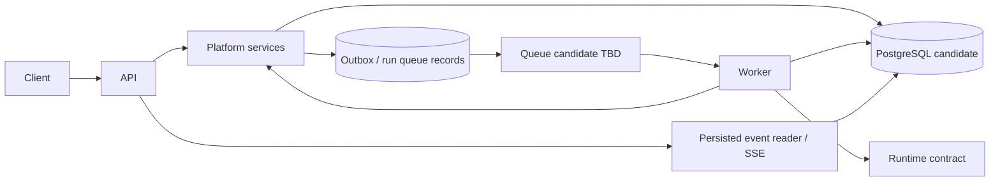

# Technical Design: P1 平台底座

## 1. 架构与概览

P1 继续采用模块化单体：API 负责认证、参数校验与平台应用服务调用；平台服务负责身份、配置、授权、会话和运行记录；worker 领取持久化任务并调用 Runtime 契约；core 提供稳定 ID、状态/事件枚举和数据传输契约。数据库是业务状态与事件日志的事实源，队列只是唤醒 worker 的投递机制。

用户身份来源（本地账号还是外部身份提供者）仍是待定部署决策；领域接口以稳定 `user_id` 为主体，不依赖某个身份 SDK。平台包不依赖 `guanlan`、Runtime SDK 或队列厂商 SDK；厂商消息和队列消息由应用入口/适配器转换为 core 契约。

## 2. 逻辑数据模型

所有 ID 使用不可猜测的稳定 ID（建议 UUIDv7 或等价方案，具体生成库在实现时选定）。时间统一存 UTC。租户对象携带 `workspace_id`；数据库和服务层均执行空间边界检查。以下是逻辑模型，不是 SQL 表定义。

| 实体 | 关键字段与约束 |
|---|---|
| User | `id`、身份源标识、状态、创建时间；不在 P1 假定具体登录提供商。 |
| Workspace | `id`、名称、状态、创建者、时间。 |
| Membership | `workspace_id`、`user_id`、角色、状态、加入/撤销时间；`(workspace_id,user_id)` 唯一。 |
| ModelProfile / ModelProfileVersion | 空间归属、提供商/模型名、非秘密连接选项、CredentialRef、版本和状态；发布版本不可变。运行时类型与模型供应商分离。 |
| CredentialRef | 凭据后端标识、秘密项句柄、范围、轮换元数据；不保存秘密值。 |
| Agent / AgentVersion | Agent 为稳定身份和当前草稿/发布指针；版本含 runtime_type、说明、指令、ModelProfileVersion、预算、创建者、内容哈希和发布时间。发布内容不可变。 |
| ResourceBinding | AgentVersion 对技能版本、工具版本、MCP 单工具绑定或知识库 ID/版本的显式引用；复合唯一键防止重复绑定。资源可来自同空间或明确授权共享源。 |
| Session | `workspace_id`、`owner_user_id`、`agent_version_id`、固定 `runtime_type`、渠道/分支引用、状态、创建/更新时间。 |
| Message | `session_id`、可选 `run_id`、角色/类型、正文引用或内容、附件引用、序号及时间；平台消息类型不泄漏到 Runtime SDK。 |
| Run | `workspace_id`、`session_id`、发起人、状态、幂等键、请求摘要、配置快照、attempt/lease 字段、开始/终止时间、错误分类。幂等键在规定作用域内唯一。 |
| RunEvent | `event_id`、`run_id`、`sequence`、类型、schema_version、时间、结构化 payload；`(run_id,sequence)` 唯一。 |
| ToolInvocation | `invocation_id`、`run_id`、资源版本/工具 ID、状态、幂等/操作 ID、开始/结束时间、输入输出摘要及错误分类。 |
| RuntimeSessionBinding | `session_id`、runtime_type、runtime_instance_scope、外部 session ID、能力/恢复元数据和更新时间；外部 ID 加密或限制可见性，避免跨空间关联泄露。 |
| AuditRecord | 空间、操作者、动作、目标、时间、结果及最小元数据；追加写入，不含秘密。 |
| OutboxRecord | 事件/Run 消息 ID、类型、payload 引用、可投递时间、投递次数和确认时间；与 Run 状态变更处于同一数据库事务。 |

关系约束：Workspace 拥有 Membership、Agent、Session、Run 和私有资源；Agent 有多个不可变版本；版本拥有多个 ResourceBinding；Session 固定一个 AgentVersion；Run 属于 Session 并拥有事件、工具调用；RuntimeSessionBinding 属于 Session。关键外键应包含或验证 Workspace 一致性，防止跨空间拼接对象。

运行快照建议保存规范化 JSON 文档并计算内容哈希，同时保存可查询的版本外键。快照记录“启动时配置”和授权来源，不作为永久授权凭证；执行边界仍需要当前权限证明。

## 3. 身份、角色与授权

P1 角色动作矩阵：

| 动作 | Owner | Admin | Member |
|---|---:|---:|---:|
| 查看/使用已授权 Agent、创建自己的 Session/Run | 是 | 是 | 是 |
| 管理 Agent、模型配置与资源绑定 | 是 | 是 | 否，除非资源策略另行授予 |
| 邀请成员、调整 admin/member | 是 | 是 | 否 |
| 移除/降级 Owner、删除空间 | 是（最后一个 Owner 受保护） | 否 | 否 |
| 查看空间审计记录 | 是 | 是 | 仅自身相关的运行记录（P1 默认） |

授权上下文包含 `principal_id`、`workspace_id`、Membership 状态/角色、请求来源和 trace ID。服务层通过统一授权端口执行检查，避免 HTTP 路由自行拼装权限。共享资源必须有显式 grant；Agent 的配置绑定只是候选资源清单，不会覆盖用户无权访问或 Runtime 不支持的能力。

创建 Run 时校验 Session 所有权/共享策略、AgentVersion 可用性、每个绑定资源访问、Runtime capability、模型配置可用性和预算。形成资源快照后，工具/知识操作携带 `run_id` 和短时授权上下文再次检查：Membership 被撤销、grant 被移除或资源被禁用时，后续操作拒绝；已经完成的操作不回滚。撤权导致 Run 无法继续时由适配器返回明确权限失败并终止或等待，不静默跳过。

## 4. 配置版本和会话/运行流程

1. 管理员创建/编辑 Agent 草稿。草稿引用明确版本的模型配置和资源；依赖缺失、跨空间或能力不匹配时阻止发布。
2. 发布生成不可变 AgentVersion 和内容哈希，并将 Agent 的发布指针原子更新。并发发布使用版本号/乐观锁；冲突返回可重试的版本冲突。
3. 用户在 Workspace 内选择已发布版本创建 Session；Session 固定该版本与 RuntimeType。
4. 提交 Run 时验证当前权限，按 `(workspace_id, principal_id, idempotency_key)` 去重；在单个数据库事务中写 Run、初始状态/事件及 OutboxRecord。相同键和相同请求返回原 Run；相同键但请求摘要不同返回冲突。
5. Outbox relay 向选定队列投递 Run ID。投递可能至少一次，worker 通过原子领取/租约将 Run 从 `queued` 改为 `running`，写事件，再开始 Runtime。不得依赖 broker 的恰好一次语义。
6. Runtime 输出转成版本化 core 事件；事件分配 sequence 并持久化后才发布。完成、失败、取消及中断更新 Run 状态与终态事件需事务一致。
7. SSE/API 按权限查询持久化事件，从 `after_sequence` 游标开始推送；断线后客户端续读，事件重放不会重新调用 Runtime。

取消是持久化控制请求：先记录取消意图并投递控制消息，worker/runtime 确认后进入 `cancelled`。若执行结果未知或进程无法确认，不可伪报取消成功；可进入 `interrupted` 并保留诊断状态。审批/等待输入是非终态，继续执行通过新的明确命令恢复。

## 5. 事件与队列语义

事件至少包含 `event_id`、`run_id`、`sequence`、`occurred_at`、`type`、`schema_version`、`payload`。Payload 定义按类型校验；正文增量可包含内容，但秘密、凭据句柄解析值、内部推理及完整工具秘密输入不得进入事件。错误事件提供稳定错误码、可公开说明和内部诊断引用。

RunEvent 的 sequence 在数据库事务或专用 Run 计数器下分配，确保并发写不会重复/乱序。事件存储保留期/归档策略为部署决策，但 P1 至少承诺在产品保留期内可按游标重放。读 SSE 不获得队列消费权。

Outbox 可避免“Run 已提交但消息未发”窗口；relay 可重复投递。候选队列需要比较：Redis Streams、PostgreSQL 持久任务表/队列库、独立 broker（如 RabbitMQ）。验证指标包括恢复语义、可见延迟、取消控制、部署维护成本、监控、水平 worker、测试替身和本地开发。此处不作最终选择。

## 6. API 契约草案

API 路径仅作为契约设计，不代表当前存在路由：

- `POST /api/v1/workspaces/{workspace_id}/agents`：创建草稿；返回 Agent 标识和版本状态。
- `POST /api/v1/workspaces/{workspace_id}/agents/{agent_id}/versions`：基于草稿保存新版本或发布；具体拆分端点在实现设计时确定。
- `POST /api/v1/workspaces/{workspace_id}/sessions`：输入 `agent_version_id`、可选标题/渠道；服务端校验调用者有权使用。
- `POST /api/v1/workspaces/{workspace_id}/sessions/{session_id}/runs`：输入用户消息/附件引用、幂等键；返回 `run_id` 与 `queued` 状态。
- `GET /api/v1/workspaces/{workspace_id}/runs/{run_id}`：读取当前状态及摘要。
- `GET /api/v1/workspaces/{workspace_id}/runs/{run_id}/events?after_sequence=N`：SSE 或分页读取持久事件，校验 Run 所属空间和主体权限。
- `POST /api/v1/workspaces/{workspace_id}/runs/{run_id}/cancel`：记录取消意图；返回请求状态，不提前承诺 Runtime 已停止。

错误响应使用稳定 `code`、用户可读 `message`、`request_id` 和可选字段级详情。跨空间或不存在对象应采取一致的不可枚举策略；版本冲突、权限拒绝、幂等键冲突、资源已撤销、能力不支持、Run 状态冲突分别使用明确错误码。

## 7. 迁移与包边界

拟由 `platform/persistence` 提供 Repository/Unit of Work 端口与事务边界，平台服务不依赖 ORM 具体模型。数据库实现和迁移版本由平台持久化适配器管理；应用入口注入数据库会话和队列适配器。`core` 只定义与厂商无关的 ID、枚举、DTO、事件和 Runtime/存储端口，不导入 SQLAlchemy、Redis、SDK。

迁移需支持空库初始化、连续升级、备份恢复演练和失败后的可诊断状态。破坏性字段调整采用扩展/迁移/收缩步骤；迁移运行由明确的发布命令执行，不由每个 API/worker 实例并发自动执行。

## 8. 失败情况与边界

- 发布时绑定资源已删除、已撤权或版本不存在：拒绝发布并返回具体资源问题。
- 建立 Run 后 API 断线：客户端用幂等键查询/重试，拿到同一 Run。
- Outbox 重复发送：worker 只领取一次有效 lease；已运行或终态 Run 不再启动。
- Worker 在 Runtime 调用期间死亡：lease 到期后先基于 Runtime 可恢复能力和 operation 状态判断；未知副作用不自动重放。
- 事件持久化成功、SSE 发送失败：客户端重连后按游标获取事件。
- 事件写入失败：不得继续向客户端宣称该事件已发生；worker 重试持久化或将 Run 标记为可诊断失败。
- 事件序号冲突：事务失败重试分配；不允许跳过冲突直接发布。
- 成员撤权与工具调用并发：定义授权检查为工具执行开始时的线性化点；检查之后已经启动的调用不回滚，下一次调用拒绝。
- 数据库不可用：API 不返回“已排队”成功，worker 不确认任务消息。
- 凭据引用失效/轮换：执行前解析失败，产生安全错误码和审计记录，不回退到日志或快照中的秘密。
- Workspace 最后一个 Owner 被移除：拒绝操作，需先转移 Owner。

## 9. 决策与待验证项

- PostgreSQL 作为平台主关系库：基于架构文档候选，实施前验证并记录 ADR；是否与观澜关系数据共用集群不属于本变更定论。
- 队列与 Outbox relay：通过 `tasks.md` 的 P1 技术验证比较后决定。
- 身份认证提供方、凭据存储后端、事件保留时长、附件对象存储、加密密钥管理：先定义适配边界，产品/部署条件明确后在 ADR 决定。
- UUIDv7 为 ID 候选，需核对 Python 版本/库策略后定案。
- P1 首个可验收闭环限定 Native 配置类型、Agent/Session/Run 持久化及事件重放；不表示 Native 执行循环已纳入 P1。
