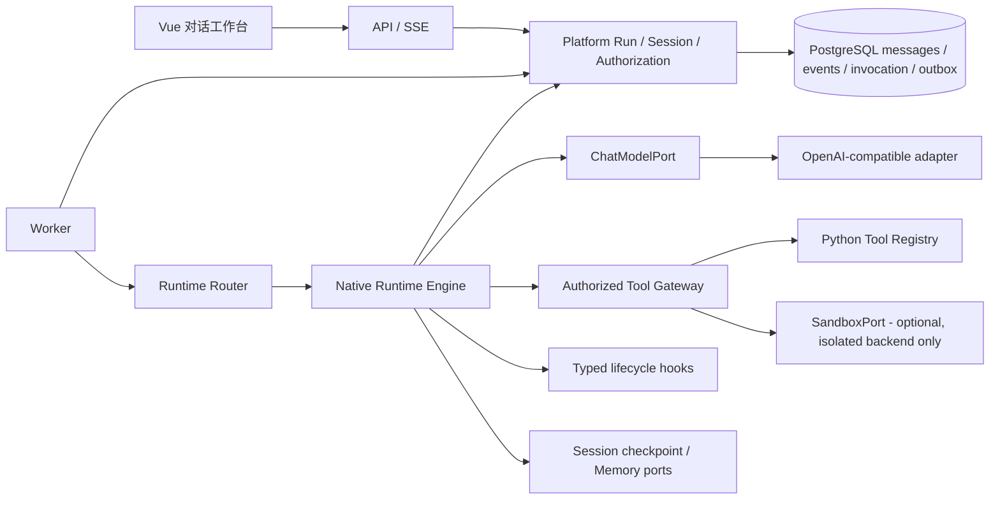

# Technical Design: P2 自研 Native 智能体闭环

## 1. 目标架构

平台服务和 worker 不持有模型流，也不构造第二层 Native 控制循环。`packages/runtimes/native` 中的 Engine 拥有 Native 专属 model/tool 循环；Worker 为单 Run 创建 Runtime 调用上下文，将已持久化事件和工具结果写回平台。外部 SDK 后续适配器由其自身控制内部 loop。

## 2. GenericAgent 固定版本行为映射

只读核对 `/project/GenericAgent` 固定版本 `a9a36b4`，不复制源文件。逐项映射如下：

| GenericAgent 行为/扩展点 | Nexus P2 表达 | 兼容边界 |
|---|---|---|
| `agent_runner_loop`：模型多轮响应、每轮进度、工具结果后继续 | Native Engine async iterator；`model.delta`、`turn.started/finished`、最终 assistant message | Run 状态、事件游标与队列仍由平台持久化；Engine 只负责当前 Run 的执行控制。
| `StepOutcome(data,next_prompt,should_exit)` | `ToolResult(data, continuation, disposition)` | 错误反馈模型继续、显式退出、任务完成三种语义分开；不把 Python 对象直接放进公共事件。
| `BaseHandler.dispatch`、JSON 工具参数、多项调用顺序 | `ToolRegistry` schema 校验、`AuthorizedToolGateway`、按序 invocation | 没有权限/注册/能力的工具报结构化错误，不静默绕过；并行仅作为后续 opt-in 扩展。
| `agent/turn/llm/tool_before/after` hooks | 类型化 `RuntimeLifecycleHook` 事件注册 | 保留所有生命周期阶段；禁止暴露 `locals()`、模型 SDK 对象或任意 Session；钩子只能通过声明接口扩展。
| `task_queue`、逐任务 output queue、`abort()` | P1 持久 Outbox/Run/Event、平台取消命令、每 Run cancellation token | 不在 worker 或 Engine 中另造任务 queue；取消有排队、模型流、工具和未知副作用状态。
| `history` / `history_info` / handler working checkpoint | Session Message、可分页上下文、Session 工作检查点 | 按 Workspace/Session 主键隔离并持久化；不共享单例模型客户端历史。
| `ask_user` | Run `waiting_input` + 持久请求 + 授权回复命令 | 不依赖同一浏览器连接或进程内回调；继续操作产生可追踪状态转移。
| `start_long_term_update`、global memory/SOP | Memory/SOP provider 和候审核草稿 API/事件 | 不允许模型直接修改共享正式记忆；审批治理是安全增强，保留建议、来源和审核后发布行为。
| `code_run`、文件、web 工具 | 授权工具注册表 + SandboxPort/Artifact API | 仅映射可隔离、可审计能力；宿主机 `subprocess`/`eval`、全局 cwd 与任意网络不迁移。无法安全约束时能力标为 unsupported。
| 多前端共享任务输出和停止能力 | 同一平台 Run/Event 契约被 Web 与未来 connector 消费 | 前端重连只补历史事件；不创建第二个 Agent 实例、不重复执行。

此映射保留 Native 核心行为与扩展点，数据隔离、持久化、授权和过程审计属于新增能力。未进入 P2 的高级工具必须在 capability manifest 中保留可见状态及原因，不能以悄然删除方式处理。

## 3. 公共契约和模块职责

- `core`：增加纯数据契约，如 `ModelRequest/ModelChunk/ModelToolCall/ModelTurnResult`、`ToolCall/ToolResult/ToolDisposition`、`RuntimeEvent` 扩展字段、`CancellationTokenPort`、`SandboxPort`、生命周期 Hook DTO。不得依赖 Pydantic/FastAPI/SQLAlchemy/厂商 SDK；若现有核心契约需修改需保持向后兼容。
- `runtimes/native`：Engine、context composer、loop budget、model/tool orchestration、错误映射和 Native capability descriptor。
- `runtimes/native/models`：ChatModelPort 的 provider adapter；首次实现 OpenAI-compatible streaming Chat Completions。模型 SDK 原生消息、异常、流事件只存在本模块。模型内容增量和 tool-call argument 分片先缓冲校验，完整且合法后才允许 dispatch。
- `tools`：稳定 ToolDefinition/schema、Python 实现注册和平台授权网关。工具实现不得直接读取当前 Workspace 的数据库来推断授权；网关在每次调用时复核 P1 授权端口。
- `sandbox`：SandboxPort 与能力描述；危险代码、shell、文件系统写入仅通过隔离 backend。未安装/未验收的 sandbox backend 不可注册任意代码工具。
- `platform`：取得 Workspace/主体/AgentVersion/资源 binding/凭据引用和预算；保存 assistant/tool message、ToolInvocation、RunEvent、检查点；处理 input response、cancel、timeout 与状态机。
- `apps/worker`：claim Run，创建运行级依赖 scope，选择 Runtime，事件持久化后通知订阅者。worker 的重复投递先检查 Run/lease/idempotency，完成/未知结果按持久状态恢复。
- `apps/api`：类型化 Run 创建、SSE/游标、取消、等待输入回复；HTTP 只做 schema/身份/协议转换。
- `apps/web`：新建/选择 Session，显示逐字流、工具卡片/错误、等待输入、取消和断线重连；组件通过 API 模块获取事件和数据。

## 4. Agent 运行上下文

Run context 来自已发布 AgentVersion、固定 ModelProfileVersion、Session 消息、Workspace 授权和当前 Active resource grants。密码由凭据 Resolver 在 Runtime 启动边界解析到短时 Provider client；只保留 `credential_reference_id` 和非敏感元数据。禁止将解密值放入 context dump、异常、事件、Prompt 或 Hook。

上下文顺序以 provider 能力适配：稳定 system instructions、已审核的 Workspace/Agent 记忆注入（如果 provider 已装配）、Session 历史摘要、最近消息、当前用户消息、经权限过滤的工具 schema。超限时先应用可审计的历史摘要策略，不删除原始 Session 消息；原文仍以平台消息记录为准。模型上下文不能包含无权限的旧资源内容；撤权后构造新 Run 上下文必须重新筛选。

每个 Session 的对话历史写入平台 Message 表；每个 Run 创建消息一次，Assistant 增量通过 RunEvent 持久化，完成后补写完整 Assistant Message；工具调用写 ToolInvocation 与 tool Message/事件。并发 Run 对同一 Session 使用序号/锁，定义顺序而不交错污染历史。Run 幂等重试返回既有 Run，不再写用户消息。

`working_checkpoint` 是按 Session 隔离的可恢复结构，保存明确字段（关键事实、正在做的工作、已尝试方案、更新时间/来源）。修改经 ToolGateway 校验并写审计。Long-term memory/SOP 只能生成待审核 Draft，必须展示差异、来源 Run 和目标作用域；审核发布创建不可变版本，旧版本可追溯。

## 5. 模型和工具循环

1. Worker 重新读取 Run/Session/AgentVersion，校验 Run 可执行、权限和预算，创建单 Run Engine。
2. Engine 加载上下文，写入并发/模型请求事件，然后向 ChatModelPort 发起带 timeout、token 限额、工具 schema 和 cancellation token 的流式请求。
3. 将模型文本增量转换为公共 `message.delta` 并先写 RunEvent，再转发订阅者。工具调用名、id 和 arguments 分片只在内存累积；完成后以 JSON Schema 校验并写 `tool.started`。
4. 一次响应可返回多个工具调用；P2 顺序调用 registry。授权失败、工具未知、坏 JSON/参数错误、可恢复业务错误转为对应 `ToolResult` 并反馈给模型，消耗回合/错误预算，避免无界重复。工具结果只存受控摘要；敏感输出或超过长度限制的详细内容存授权 Artifact 并向模型返回引用/短摘要。
5. 每个工具调用先写 pending invocation，按 `invocation_id` 进入工具。纯 Python 快速函数受限于执行 deadline；阻塞/资源密集或有副作用操作通过对应 worker/sandbox executor，传入 run-scoped identity/cancel token。权限校验即该调用授权线性化点。执行前明确幂等性和副作用策略。
6. 若 `ToolResult.disposition=continue`，把该轮 assistant tool call 与 tool result 加入本次模型上下文，再请求下一轮；`wait_input` 转 `waiting_input` 并结束当前 worker 执行；`exit` 只在携带明确完成/失败原因时结束；无工具的正常响应保存为完整 assistant message 和 `completed`。
7. 任何 Provider/Engine/Tool 异常按稳定错误码落 Run 终态和诊断事件；token/耗时/轮数上限明确结束。Worker 重启不得盲目重跑已有有副作用 invocation。

初始 provider 以 OpenAI-compatible Chat Completions streaming API 做一条窄适配路径。先验证当前 OpenAI Python SDK 的异步流式/函数调用覆盖面并固定版本；具体 Provider SDK 类型被限制在 Native adapter。模型 Profile `provider`/`options` 需明确声明协议和 base URL；不能仅凭厂商名推断兼容。官方 SDK 文档目前说明 async streaming iterator 与 Chat Completions tool-argument 完成事件，实施时仍要对锁定版本做适配测试：[openai-python streaming docs](https://github.com/openai/openai-python/blob/main/helpers.md#streaming-helpers)。

## 6. 取消、等待与运行恢复

- 排队状态取消：平台事务将 Run 设为 `cancelled`，worker claim 时跳过。
- 模型流中取消：API 写 cancel request/event；Runtime cancellation token 关闭当前流并阻止下一轮，写取消确认；若 Provider 无法确认底层请求已停止，记录受控诊断并按实际状态结束。
- 工具执行取消：每次调用接收 cancel token。支持中断且结果已知则 `cancelled`；外部副作用已发出但结果未知则 `interrupted` 并保留 operation/invocation ID，不自动重放。
- 等待用户输入：`waiting_input` 持久保存输入请求和工具调用引用；authorized response 命令记录消息、事件和状态，再由 Outbox 继续同一 Session/Run 或创建明确关联的 continuation Run。不得保留一个 worker 线程长时间阻塞等待。
- Resume 只续接 Nexus 记录的消息/检查点；不承诺恢复进程内 generator 或 Provider 内部私有会话。

## 7. API 与 SSE

- `POST /api/v1/workspaces/{workspace_id}/sessions/{session_id}/runs` 复用 P1 幂等 Run。
- `GET /api/v1/workspaces/{workspace_id}/runs/{run_id}/events` 支持分页和序号游标；新增 `Accept: text/event-stream` 时按 `Last-Event-ID`/`after_sequence` 持久游标续读。
- `POST /api/v1/workspaces/{workspace_id}/runs/{run_id}/cancel` 复用 P1 取消 API，返回 cancel requested/terminal state。
- 新增 waiting input 响应 endpoint（路径在实现前与当前 API 路由统一），提交 `run_id`、`input_request_id`、用户回答及幂等键；服务端校验 Run 为 waiting_input、Session 所有权、Membership 与输入 request 未消费。

Event schema 需向后兼容，新增事件包括 `turn.started/turn.completed`、`model.started/model.completed`、`message.delta`、`tool.started/tool.completed/tool.failed`、`input.requested/input.received`、`budget.exhausted` 和终态。敏感 tool arguments、内部推理、完整错误栈和 provider 响应体永不发送给 SSE。

## 8. Web 工作台交互

- 对照 WeKnora 固定版本 Vue 前端的聊天流、工具结果与引用呈现，对照 GenericAgent `stapp.py`/`conductor.py` 的任务进度、会话连续性、选择模型、后台运行和 Stop 可观察行为；用 Nexus `Session/Run/Event` 做服务端事实源。
- P2 页面在当前 Workspace 选择一个已发布 Native AgentVersion 创建或打开 Session；Agent/ModelProfile 版本由服务端配置固定。切换模型对应选择已配置版本并创建新 Session/显式新分支，不改变活跃 Session 的不可变版本。
- 消息按 sequence 消费事件，工具卡片展示名称、排队/执行/完成/失败/等待状态和公开摘要；不暴露原始 secret、全量未过滤参数或 hidden reasoning。
- 用户停止后显示取消中，等服务端终态后显示已取消/仍有未知操作；连接断开时显示恢复入口，使用游标补历史，不重发 Run。
- `waiting_input` 内嵌明确输入/确认区，保留原问题和提交中/失败状态。仅适合 UI 的状态消息使用单一 `aria-live="polite"`/`role="status"`，不让每个 token 都抢读屏焦点。
- 采用现有 Element Plus 和项目 tokens；桌面双栏可见会话列表、聊天区与运行状态，窄屏收拢为单栏/抽屉；Markdown、代码与文件名安全渲染，所有停止/发送/重试控件可键盘操作并提供可读标签。

## 9. 失败、安全与可观测性

失败类型至少区分 `model_credential_unavailable`、`model_provider_unavailable`、`model_rate_limited`、`model_context_exceeded`、`model_stream_invalid`、`tool_not_registered`、`tool_arguments_invalid`、`tool_authorization_denied`、`tool_timeout`、`sandbox_unavailable`、`budget_exhausted`、`cancelled`、`interrupted`。Retry-After 仅用于无副作用、可证明未执行的模型请求；不得对含已完成副作用的整轮执行重试。

每条日志/审计最少携带 request_id/run_id/session_id/invocation_id/provider id 和错误类别；不得写 prompt 全文、解密凭据、模型内部推理或未审查的工具数据。Hook 默认只看元数据/稳定 DTO；普通 hook 不能接管授权或状态机。

测试需使用 FakeChatModel 确定地输出文本、多工具/分片调用、坏 JSON、超时、中断和限额；FakeTool 注入授权撤销、异常、耗时、副作用结果未知；API/SSE 验证事件续读、重复事件去重、Session 隔离和 waiting_input。危险执行只在真实隔离 sandbox 验收后才测试启用，不能用 mock 结果冒充隔离验收。

## 10. 实施决策与部署待验收项

- 已采用 `openai==2.29.0`，通过模拟 HTTP 流验证 SDK 适配；未使用真实模型账号在线验收。
- 未提供隔离 Sandbox backend；以注册式 Python 工具闭环验收，代码、shell、宿主文件/任意网络与文件产物保持 unavailable。
- waiting_input 继续同一 Run，通过输入请求和 execute Outbox 幂等恢复，预算累计；不保留阻塞 worker。
- 流事件与消息分别保留，不自动清理原件；模型上下文使用有界历史摘录并记录 compaction 事件，超限显式失败。retention/归档策略仍由 P1/P9 治理待办追踪。
- 工具原始结果不自动落盘，只有显式公开投影（最多 4000 字符）进入事件、模型和历史；详细 Artifact 存储尚未接入。
- 具体决策见 [ADR-0003](../../../docs/adr/0003-native-model-and-execution.md)，行为证据见 [验收记录](verification.md)。
